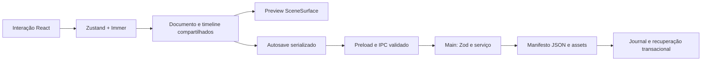
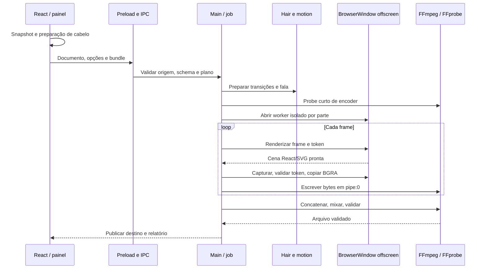
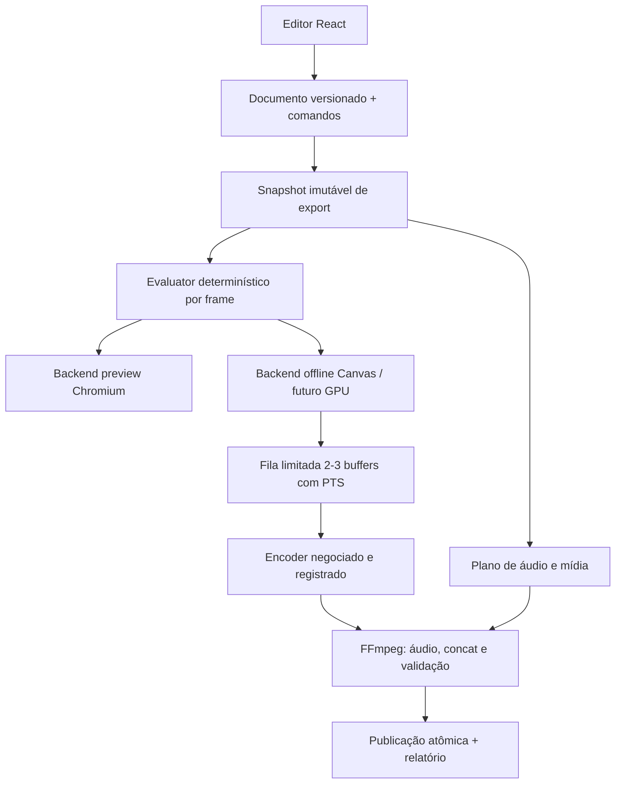

# Pesquisa técnica profunda — Auditoria do Editor V6

**Data:** 13/11/2026 
**Repositório:** Native-gacha, raiz C:\TRABALHO 2\OUTROS\GACHA EM C++ 
**Branch:** Dev-V2 
**HEAD do código auditado:** 54d8793e59dabc47833392df2c01a30fa23709d9 
**HEAD ao fechar a pesquisa:** aa917af53044be3f5adf5a299c4e9f457c99c3e4 (atualização somente documental posterior) 
**Escopo:** edição, timeline, preview, persistência, exportação, alternativas tecnológicas, testes e medições sintéticas. Nenhum arquivo de código foi alterado pela auditoria; o build do teste Electron gerou somente artefatos ignorados em `out/`.

> **Evolução durante a auditoria:** a análise começou no commit `227633295d90fd8f275b7776d110620302c42782`. O código avançou até `54d8793e`, incorporando pruning de assets por trecho, telemetria de memória dos processos Electron, ajuste do intervalo padrão e melhorias recentes na seleção/remoção da timeline. O HEAD ao fechar (`aa917af5`) só atualiza `docs/editor-v6/REESTRUTURACAO.md`, sem alteração funcional após o baseline auditado. Essa documentação não foi modificada pela auditoria. Arquivos locais não rastreados em `public/` e HTMLs diagnósticos foram preservados e excluídos do commit do relatório. O teste de pruning de payload está rastreado e passa.

## 1. Resumo executivo

**Resposta à pergunta central:** a implementação é coerente para preservar aparência, segurança e integridade do MP4, mas não é a arquitetura de maior desempenho possível para projetos complexos. O limite não é simplesmente Electron ou FFmpeg; é a combinação de preparação de cabelo/movimentos, composição React/SVG, captura de janela por frame e cópia de pixels para o encoder. Além disso, o FFmpeg distribuído não corresponde às suposições de x264 feitas por parte do código e dos resultados históricos.

**Recomendação:** Cenário B, evoluindo em etapas com paridade visual e rollback. Manter documento, timeline, preview React, IPC seguro, FFmpeg como finalizador e publicação validada. Compilar um snapshot imutável de exportação, reduzir preparação repetida, salvar assets por hash e provar um renderizador que entrega buffer diretamente sem depender de capturePage. Não há evidência para justificar hoje uma reescrita total ou a troca de FFmpeg por GStreamer/WebCodecs.

Principais conclusões:

1. O caminho padrão é React → SVG/Chromium → BrowserWindow offscreen → `capturePage` → `NativeImage.toBitmap` → cópia BGRA → stdin do FFmpeg. Há um modo `paint-event` por variável de ambiente, usando `beginFrameSubscription`, mas ele também faz readback para CPU. Em 1080p/30, o buffer bruto equivale a aproximadamente **237 MiB/s por lane**; vídeo em camadas duplica aproximadamente o tráfego. É uma conta teórica das dimensões, não throughput medido.
2. Preparação pode custar mais que render/encode. Uma execução histórica de 05/11/2026 mediu 54,72 s em um projeto de 309 frames: 10,50 s de cabelo, 23,70 s para 21 transições e 17,79 s de renderização/codificação. É um resultado único e não representa o build atual. Um registro de 06/11 cita ~91 s com cabelo em outro contexto, sem comparação OFF equivalente.
3. O perfil CPU tenta libx264 e depois libopenh264, mas o FFmpeg atual é n8.1.3, sem libx264. O probe local escolheu OpenH264. O comentário e as medições de x264 não descrevem esta distribuição.
4. A saída tem engenharia sólida: backpressure, cancelamento, reutilização de frame, concatenação com cópia do stream de vídeo, alinhamento de áudio, validação de quadros/duração/emendas e publicação segura do candidato.
5. O autosave redecodifica e republica todos os assets incorporados a cada gravação. A transação e seu journal são bons para recuperação; a unidade de gravação ampla é o ponto a otimizar.
6. O snapshot por trecho já filtra imagens de cena e de cabelo antes de enviar os dados a cada worker; a timeline e os metadados permanecem completos para suportar replay de movimento. O ganho em bytes e tempo ainda não foi medido.
7. A telemetria de produção agora agrega memória dos processos Electron por tipo, mas não mede CPU, processos FFmpeg ou VRAM. Um harness de stress Windows faz atribuição por PID e CPU/RSS em condições específicas, ainda sem métricas de engine GPU/VRAM.

**Prioridades:** P0 fixar binário/encoder e baseline frio; P1 medir preparação e completar observabilidade além da telemetria Electron agregada; P1 salvar assets por hash e medir o pruning por trecho já implementado; P2 validar render buffer direto contra golden frames; P3 considerar cache quente, WebCodecs ou backend nativo só depois dos gates.

## 2. Mapeamento da arquitetura atual

### 2.1 Stack e domínios

O aplicativo usa Electron, Chromium, React 19 e TypeScript; package.json declara Zustand 5, Immer 11, Zod 4, Sharp 0.35 e Electron-Vite 6. A instalação nesta sessão executou Electron 45.3.1 e Vitest 5.1.0. Renderer não grava no filesystem: ações cruzam preload/IPC, Main valida origem e dados, serviços de domínio cuidam de persistência e subprocessos.

O Editor V6 tem documento, store e contratos compartilhados próprios. EditorV6Page.tsx compõe a tela e hooks; timeline, preview, áudio, persistência e exportação têm módulos separados. É uma base razoável, embora a página ainda coordene muitos casos de uso. Referências: [EditorV6Page.tsx](src/renderer/src/features/editorV6/EditorV6Page.tsx#L74), [editorV6Store.ts](src/renderer/src/features/editorV6/editorV6Store.ts#L19), [editorV6Schema.ts](src/shared/editorV6Schema.ts#L194).

### 2.2 Documento e timeline

O formato persistido é schemaVersion 1, com timeline fixa em 30 fps. O schema permite 200 tracks, 1.000 blocos por track, 1.000 elementos, 500 mídias, 5.000 assets e um milhão de frames. Um milhão de frames representa cerca de 9 h 15 min a 30 fps. Exportação aceita 16:9, dimensões pares de 320×180 até 1920×1080; não há 4K nem frame rate variável no contrato atual. São limites de produto, não limitações inerentes ao FFmpeg.

O intervalo final inicial agora usa o último bloco ativo, visível e não silenciado, além do áudio exportável; faixas ocultas/silenciadas, lacunas e estados invisíveis não o estendem. Fundos persistentes ficam fora desse cálculo. Se não houver conteúdo delimitador, usa a duração do documento. Essa escolha evita exportar cauda vazia sem cortar a persistência de personagens. Referência: [editorV6Export.ts](src/shared/editorV6Export.ts#L32).

A timeline mantém estados de personagem até o próximo estado, normaliza frames inteiros, indexa clips por elemento com WeakMap e usa busca binária para achar o clip no frame. Playback deriva o frame de relógio monotônico e requestAnimationFrame; as linhas da timeline não re-renderizam a cada tick. São escolhas boas de previsibilidade e devem permanecer. Referências: [editorV6TimelineCore.ts](src/shared/editorV6TimelineCore.ts#L36), [useEditorV6Playback.ts](src/renderer/src/features/editorV6/useEditorV6Playback.ts#L7), [EditorV6TimelineRows.tsx](src/renderer/src/features/editorV6/EditorV6TimelineRows.tsx#L28).

Na interação atual, o primeiro clique seleciona o bloco; clique repetido move o playhead dentro dos limites do bloco. Arrastar altera a timeline ao soltar. Remover um bloco exclui filhos vinculados e fecha o espaço em faixas editáveis; se for o último estado de personagem, fica um `emptyGap` invisível para impedir que o estado anterior reapareça. O intervalo padrão da exportação ignora esse gap. Esses comportamentos têm testes específicos e preservam a semântica de estados persistentes.

### 2.3 Preview, cena e mídia

SceneSurface compõe fundo, imagens, personagens, texto e balões em SVG de viewBox 1920×1080; é compartilhada pelo preview e worker de exportação. Isso reduz divergência para cena estática. Cabelo pode aparecer como canvas raster em foreignObject; o mesh usa WebGL, mas o frame final segue pelo compositor Chromium e pela captura. Referências: [SceneSurface.tsx](src/renderer/src/features/editorV6/SceneSurface.tsx#L42), [SceneImageContent.tsx](src/renderer/src/features/editorV6/SceneImageContent.tsx#L16), [exportHairMeshRenderer.ts](src/renderer/src/features/editorV6/exportHairMeshRenderer.ts#L30).

Vídeo tem dois caminhos: preview usa HTMLVideoElement em foreignObject e corrige drift por seeks; export usa filtros FFmpeg para seek, escala, rotação e overlay. O frame inteiro é comum, mas decoder, composição e conversão de cor diferem. Isso justifica golden tests; não prova que haja bug visível. Referências: [SceneVideoLayer.tsx](src/renderer/src/features/editorV6/SceneVideoLayer.tsx#L17), [exportVideoComposition.ts](electron/domains/editorV6/exportVideoComposition.ts#L21).

Assets do Fabricador/Customizador e mídias são vinculados por IDs/protocolos, não duplicados para simular propriedade. Imagens locais do projeto ficam em PNG separado do manifesto JSON. A direção de propriedade entre documento, catálogo e mídia é adequada.

### 2.4 Fluxo completo

O painel cria um snapshot destacado do estado Immer com `structuredClone`, prepara o bundle de cabelo e invoca o comando. Main valida sender, schema e opções, cria o job e prepara personagens/movimentos. Em seguida cria diretório temporário, testa encoder, rende partes, mixa áudio, valida MP4 e publica somente depois da validação. Referências: [editorV6ExportCommands.ts](src/renderer/src/features/editorV6/editorV6ExportCommands.ts#L8), [exportIpc.ts](electron/domains/editorV6/exportIpc.ts#L108), [exportRunner.ts](electron/domains/editorV6/exportRunner.ts#L49), [exportFinalization.ts](electron/domains/editorV6/exportFinalization.ts#L44).

## 3. Análise detalhada da exportação

### 3.1 Pipeline observado

1. **Perfil:** painel fixa 1080p/30, CPU H.264 e Turbo 2× obrigatório. Perfil compartilhado define 1920×1080, encoder cpu e forceTurbo1080 true. UI não tem seletor de resolução/encoder. Há dois botões separados para exportar com e sem animação de cabelo.
2. **Validação:** IPC valida origem, documento, intervalo e dimensões. O caminho atual monta ffmpeg.exe/ffprobe.exe e é Windows-only.
3. **Preparação:** cria pasta temporária, relatório, candidato e cacheScope aleatório. Cabelo é preparado antes do job; motion e boca antes dos frames. Cache aleatório mantém exportações frias e não mistura artefatos entre jobs; isso parece uma política deliberada.
4. **Codec:** probe de um quadro sintético verifica se o encoder inicia. Não mede qualidade, velocidade sustentada, uso de GPU ou estabilidade de MP4 longo.
5. **Particionamento:** Turbo divide em duas partes paralelas. Com fala, trechos viram lotes de até 300 frames/10 s. Cada parte pode abrir worker e processo FFmpeg; existe custo de inicialização e preparo por parte.
6. **Worker:** BrowserWindow escondida e offscreen, partition aleatória, contextIsolation, sandbox, nodeIntegration false, throttling desabilitado, navegação/permissões limitadas e preload dedicado. Bom isolamento e bom controle de lifecycle.
7. **Render:** resolve cena por frame inteiro, aplica boca/cabelo, prepara imagens, faz commit React síncrono, espera imagens SVG, grava token fora da cena e aguarda requestAnimationFrame.
8. **Captura:** padrão é webContents.capturePage. Um token de 24 bits verifica que o bitmap pertence ao frame pedido; leitura antiga provoca invalidate e retry. NativeImage.toBitmap ocorre uma vez; linhas úteis são copiadas para buffer BGRA reutilizável. beginFrameSubscription existe para diagnóstico, não é padrão. [Electron webContents API](https://www.electronjs.org/docs/latest/api/web-contents)
9. **Vídeo em camadas:** com mídia sob personagens, captura fundo e foreground em sequência no mesmo frame e monta buffer vertical com altura 2×. FFmpeg separa as bandas e compõe vídeo entre elas. Preserva z-order, mas dobra aproximadamente readback/cópias.
10. **Pipe:** rawvideo BGRA 30 fps vai a pipe:0. O código espera callback da escrita antes do próximo frame: backpressure limita fila JS. FFmpeg pode consumir/encodar em paralelo; não há fila explícita de render ahead com 2–3 frames.
11. **Encode:** H.264, yuv420p, metadata BT.709/TV, GOP 60, sem B-frames, timescale 30.000, alvo 12 Mbps. Cada encoder tem rate control próprio; mesmo bitrate não significa mesma qualidade.
12. **Vídeo e áudio:** overlay é trimado em frames, escalado/rotacionado e composto por filter_complex. Áudio é recortado e alinhado em 48 kHz estéreo; cada frame de atraso equivale a 1.600 samples; amix e AAC 192 kbps. Frames inteiros ajudam a reduzir drift.
13. **Finalização:** concat demuxer com cópia do stream de vídeo, sem recodificação H.264 adicional; áudio é mixado na finalização. Recuperação só para erros de decode reconhecidos. Boa aplicação de stream copy. [FFmpeg formats](https://ffmpeg.org/ffmpeg-formats.html), [FFmpeg CLI](https://ffmpeg.org/ffmpeg.html)
14. **Publicação:** confere assinatura de codec das partes, quadros/pacotes, 30/1, dimensões, duração, áudio e decodifica ao redor das emendas. Destino não é alterado até validar candidato; cancelamento/erro limpam temporários.

### 3.2 Custo bruto, memória e concorrência

Para BGRA:

- 1920 × 1080 × 4 = 8.294.400 bytes/frame, ~7,91 MiB.
- 30 fps = 248.832.000 bytes/s, ~237,3 MiB/s por lane.
- 300 frames = ~2,32 GiB de bytes acumulados por lane.
- Camadas com altura 2× dobram esses valores.

Isso não significa que 2,32 GiB estejam simultaneamente na RAM. O buffer de destino é reutilizado e a escrita tem backpressure; ainda há NativeImage, cópia por linhas, pipe e custos internos de Chromium/GPU. Peso real de parede precisa de ETW/Chromium profiling. Aceleração do encoder não elimina o retorno de pixels à CPU.

Duas lanes mantêm até duas janelas e dois FFmpeg ativos, além de preparação por parte. Threads são limitadas por disponibilidade de CPU e máximo de oito por processo; não há decisão adaptativa baseada em VRAM ou taxa medida no dispositivo.

### 3.3 Codec e executável

O FFmpeg presente reporta n8.1.3, tem libopenh264, h264_amf, h264_mf, h264_nvenc e h264_qsv, e foi compilado com disable-libx264. CPU tenta libx264 e depois libopenh264. Logo, x264Preset e comentários/benchmarks de x264 não descrevem o binário atual.

| Encoder | Probe local | Interpretação |
|---|---|---|
| h264_nvenc | falhou | Não iniciou no ambiente/probe |
| h264_qsv | falhou | Não iniciou no ambiente/probe |
| h264_amf | passou | Iniciou um frame |
| h264_mf | passou | Código passa hw_encoding 0, portanto não pede hardware |
| libx264 | falhou | Ausente do build |
| libopenh264 | passou | Fallback real do perfil CPU |

Probe de um frame é teste mínimo de capacidade, não ranking. Auto só escolhe o primeiro candidato capaz, não mede performance/qualidade. Build com x264 exigiria revisar licença/configuração; [FFmpeg codecs](https://www.ffmpeg.org/ffmpeg-codecs.html) e [FFmpeg legal](https://ffmpeg.org/legal.html).

### 3.4 Decisões bem implementadas

- Um único toBitmap por readback, conforme comentário em [exportCaptureBitmap.ts](electron/domains/editorV6/exportCaptureBitmap.ts#L9).
- Reuso de bitmap para frames visuais idênticos, mas ainda emite o frame necessário ao vídeo.
- Backpressure, timeout, abort e encerramento de processos.
- Concat com cópia do vídeo, sem geração H.264 adicional.
- Timebase fixo e validação de frames/emendas.
- Cache frio por job: evita contaminação e não dá falsos ganhos de warm cache. Cache persistente deve ser opcional e invalidado por conteúdo.

## 4. Problemas e limitações identificados

### P1 — Captura da janela é interface obrigatória de pixels

**Evidência:** [exportFrameCapture.ts](electron/domains/editorV6/exportFrameCapture.ts#L97), [exportCaptureBitmap.ts](electron/domains/editorV6/exportCaptureBitmap.ts#L33), [exportWorkerFrameRenderer.ts](electron/domains/editorV6/exportWorkerFrameRenderer.ts#L43), [exportPartRenderer.ts](electron/domains/editorV6/exportPartRenderer.ts#L105) e [#L119](electron/domains/editorV6/exportPartRenderer.ts#L119).

**Causa provável:** composição compartilhada está numa janela Chromium; encoder só recebe CPU pixels depois da captura.

**Consequência:** compor, sincronizar, capturar e copiar a cada frame; custo cresce com resolução e camadas. Problema estrutural certo; tamanho do gargalo em wall time não isolado.

**Solução:** criar interface de renderer que devolva buffer/surface. Primeiro Canvas/OffscreenCanvas; comparar contra a captura atual em BGRA. Manter legado como oracle. Só usar readback assíncrono/zero-copy ou surface D3D se profiling mostrar que leitura domina.

**Alternativas:** otimizar capturePage; testar beginFrameSubscription; migrar para Skia/Direct2D/WebGPU. A primeira não remove o limite; evento paint ainda requer imagem e sincronização; nativo tem risco alto.

**Impacto:** potencial médio-alto se capture/cópia dominarem; não reduz preparação de hair/motion. **Complexidade:** média para Canvas, alta para surface compartilhada. **Risco:** alto de divergência visual. **Confiança:** alta no caminho, média no ganho real.

### P1 — Preparação de hair/motion é cara e pode se repetir

**Evidência:** [exportReadiness.ts](electron/domains/editorV6/exportReadiness.ts#L34), [prepareMotions.ts](electron/domains/editorV6/prepareMotions.ts#L47), [prepareMouthLoops.ts](electron/domains/editorV6/prepareMouthLoops.ts#L100), [relatório 05/11](docs/editor-v6/ARQUITETURA_SALTO_REAL_EXPORTADOR_2026-11-05.md#L7). Esse relatório mediu 141 rigs sem reuso no job.

**Causa provável:** atlas para transições, preparação separada de hair e mouth loops por parte. Cresce com número de transições/poses/complexidade.

**Consequência:** custo antes do encode, duplicação de estados normal/sem hair e possível preparo por lane. Histórico: cabelo + motion deram 34,21 s de 54,72 s, ~62,5%, numa única execução. Não generalizar ao build/projetos atuais.

**Solução:** snapshot compilado por exportação, recursos visuais imutáveis e composição de pose por frame quando produzir paridade. Completar R37/R38 com tint, bridges, roupas, face, boca, hair, recorte e oclusão. Cache por conteúdo opcional, com invalidadores e limite.

**Alternativas:** manter atlas onde necessário; compartilhar preparação entre lanes; compositor nativo. Atlas é confiável mas mantém custo; reescrita é arriscada.

**Impacto:** maior potencial em projetos complexos. **Complexidade:** alta. **Risco:** muito alto de fidelidade. **Confiança:** alta no custo existente, média no tamanho do ganho.

### P1 — Perfil CPU e binário discordam

**Evidência:** default em [editorV6Export.ts](src/shared/editorV6Export.ts#L15), selector em [exportEncoderSelection.ts](electron/domains/editorV6/exportEncoderSelection.ts#L33), flags em [exportEncoding.ts](electron/domains/editorV6/exportEncoding.ts#L10), build atual sem x264.

**Causa provável:** presets/benchmarks de outra build; painel fixa CPU; probe verifica um frame; auto é ordenação, não comparação. h264_mf recebe hw_encoding 0.

**Consequência:** benchmarks antigos de x264 não descrevem o usuário atual; label CPU/H.264 não indica OpenH264; auto pode escolher software e variar qualidade entre máquinas.

**Solução:** registrar SHA/configure, encoder efetivo, GPU/driver e flags em todo relatório. Matriz por build: OpenH264, AMF/NVENC/QSV/MF com arquivo completo, gate de qualidade e fallback. Manter default previsível até provar auto.

**Alternativas:** distribuir x264; sempre usar hardware; WebCodecs. Cada uma muda licença, compatibilidade ou container/mixer.

**Impacto:** corrige expectativa e torna escolha mensurável; velocidade depende do dispositivo. **Complexidade:** baixa para telemetria, média para matriz. **Risco:** baixo-médio. **Confiança:** alta.

### P2 — Autosave decodifica e republica assets não modificados

**Evidência:** [documentPersistence.ts](electron/domains/editorV6/documentPersistence.ts#L149) percorre assets, decodifica data URL, normaliza e constrói writes. [assetManifestTransaction.ts](electron/domains/storage/assetManifestTransaction.ts#L105) lê e guarda backups; [#L133](electron/domains/storage/assetManifestTransaction.ts#L133) escreve os destinos.

**Causa:** unidade de publicação é o manifesto e lista inteira de assets, não diff por conteúdo.

**Consequência:** a cada gravação serializada, repete conversão, leitura/backup, escrita de PNG e manifesto; afeta autosave, memória temporária e I/O em projetos grandes.

**Solução:** hashes SHA-256 de bytes canônicos, ignorar assets idênticos, assets imutáveis/versionados por conteúdo e commit atômico do manifesto. Preservar journal/rollback e testar crash em cada estágio.

**Alternativas:** mais debounce ou guardar assets em banco. Debounce não reduz custo de um save; banco aumenta migração.

**Impacto:** alto em projetos grandes, pequeno em pequenos. **Complexidade:** média. **Risco:** médio-alto para recuperação/referências. **Confiança:** alta sobre trabalho duplicado, média-alta sobre latência percebida.

### P2 — Snapshot por trecho reduz imagens, mas preserva metadados amplos

**Evidência:** [createEditorV6ExportWorkerData](electron/domains/editorV6/exportWorkerPayload.ts#L55) é chamado antes de criar cada worker em [exportIpc.ts](electron/domains/editorV6/exportIpc.ts#L131). O helper seleciona assets de cena para o trecho, conserva o último estado anterior de personagem e fundos persistentes, e filtra superfícies/texturas de cabelo. A estrutura completa de timeline, elementos e metadados de mídia ainda é copiada para cada worker. [exportWorkerPayload.test.ts](tests/editor-v6/exportWorkerPayload.test.ts) cobre assets ativos e históricos.

**Causa:** preservar o replay de rig/motion desde o frame zero e reduzir o risco de perder estados anteriores exige manter metadados históricos; o pruning atual se concentra no peso de imagem.

**Consequência:** o commit recente reduz payload de PNG/base64 e cabelo por trecho, mas não reduz proporções da timeline nem metadados repetidos. O ganho em bytes, clone e RSS ainda não foi medido. Remover estados antigos sem uma compilação de dependências poderia quebrar transições, mouth-loop ou rig.

**Solução:** medir tamanho e tempo antes/depois do helper em projetos sintéticos escalonados. Depois, compilar um `ExportSnapshot` com IDs alcançáveis no intervalo, referências de mídia por caminho/hash e metadados históricos somente quando motion precisa deles. Manter cobertura de backgrounds persistentes, fala, face e hair rig.

**Alternativas:** worker longo recebendo snapshot uma vez; payload por lane; comandos de cena compilados. Workers longos ocupam memória; compilação aumenta complexidade.

**Impacto:** moderado em projetos grandes. **Complexidade:** média. **Risco:** médio. **Confiança:** alta sobre o comportamento do helper atual, média sobre o ganho.

### P2 — Turbo obrigatório aborta quando há caminho sequencial

**Evidência:** default forceTurbo1080 true em [editorV6Export.ts](src/shared/editorV6Export.ts#L15), aviso UI em [EditorV6ExportPanel.tsx](src/renderer/src/features/editorV6/EditorV6ExportPanel.tsx#L42), abort do fallback em [exportFallbackStrategy.ts](electron/domains/editorV6/exportFallbackStrategy.ts#L39).

**Causa:** prioridade explícita a Turbo 2× em lugar de disponibilidade.

**Consequência:** falha de uma lane/worker/encoder cancela o perfil padrão apesar de possível caminho sequencial equivalente. Pode exigir repetir preparação.

**Solução:** separar modo benchmark estrito do modo usuário, permitindo fallback sequencial com mesmo tamanho/qualidade e aviso no relatório.

**Alternativas:** manter estrito; retry com 1 worker; retry e trocar encoder. Retirar o strict melhora disponibilidade; gates de saída devem permanecer iguais.

**Impacto:** alto em confiabilidade, sem ganho quando Turbo funciona. **Complexidade:** baixa-média. **Risco:** baixo se fallback auditado. **Confiança:** alta.

### P2 — Preview e export de vídeo usam motores diferentes

**Evidência:** [SceneVideoLayer.tsx](src/renderer/src/features/editorV6/SceneVideoLayer.tsx#L17) usa HTMLVideoElement e seeks; [exportVideoComposition.ts](electron/domains/editorV6/exportVideoComposition.ts#L21) usa FFmpeg filters.

**Causa:** Chromium é conveniente para playback, FFmpeg para processamento frame accurate.

**Consequência:** seek, VFR, rotação, escala, alpha e cor podem divergir. Não há prova de bug visível, mas também não há paridade suficiente.

**Solução:** golden frames no início/meio/fim, seeks e VFR com tolerância documentada.

**Alternativas:** Chromium também no export; FFmpeg também no preview; manter dois decoders com contrato de timebase comum. Unificar pode degradar experiência/desempenho.

**Impacto:** previsibilidade e confiança. **Complexidade:** baixa para testes, alta para unificar. **Risco:** médio. **Confiança:** alta que os caminhos diferem, média de impacto visual.

### P2 — Telemetria de export ainda não mede CPU, FFmpeg ou VRAM

**Evidência:** [exportProcessMemory.ts](electron/domains/editorV6/exportProcessMemory.ts#L28) agrega `workingSetSize` e `privateBytes` de `app.getAppMetrics()` a cada ~1 s por tipo Electron; o Main mantém seu RSS a cada 500 ms em [exportRunner.ts](electron/domains/editorV6/exportRunner.ts#L108). O teste confirma que falha na coleta é registrada sem interromper a exportação em [export.electron.ts](tests/editor-v6/export.electron.ts#L235). Um harness separado, somente no modo stress e Windows, usa [windowsProcessSampler.cjs](scripts/editor-v6/windowsProcessSampler.cjs) para associar Main, renderers e FFmpeg a PIDs e coletar CPU/RSS. O relatório normal de export não usa esse sampler.

**Causa:** a telemetria de produção lê apenas `type` e `memory`; não retém PID/nome, não coleta `percentCPUUsage`, e o processo FFmpeg filho não faz parte da amostra do Electron. O sampler específico de stress usa `Get-Process` e não coleta engine GPU nem VRAM. Somar working set de processos Electron pode contar páginas compartilhadas mais de uma vez; bytes privados e amostras incompletas são reportados separadamente.

**Consequência:** o relatório normal ajuda a detectar crescimento de memória do conjunto Electron, mas ainda não distingue CPU/tempo de FFmpeg, uso por PID ou pressão de GPU. As fases e p50/p95 por frame não isolam todos os custos nem substituem wall time. O benchmark existente pode responder parte disso, mas exige harness isolado e Windows.

**Solução:** preservar o sampler leve por tipo e falhas não fatais. Para profiling controlado, integrar o sampler por PID/CPU já existente ou exportar spans estruturados que o harness correlacione; medir GPU engine/VRAM via ETW somente nos benchmarks. Relatar claramente métricas ausentes e evitar somar working sets como memória física única.

**Alternativas:** ampliar `app.getAppMetrics()` para CPU por tipo; usar sampler externo/ETW. A API Electron é simples e multiplataforma, mas não identifica FFmpeg de forma confiável; ETW é mais completo, com custo operacional.

**Impacto:** alto na qualidade das decisões de otimização, nenhum no runtime. **Complexidade:** baixa-média no sampler já existente, média para ETW. **Risco:** baixo. **Confiança:** alta.

### P3 — Documentação de export diverge dos controles reais

**Evidência:** [EXPORTACAO.md](docs/editor-v6/EXPORTACAO.md#L5) manda escolher 720p/1080p e encoder automático/CPU, e [#L14](docs/editor-v6/EXPORTACAO.md#L14) descreve uma opção experimental de cabelo. O painel atual mostra resolução 1080p fixa, CPU H.264 e Turbo obrigatório ([EditorV6ExportPanel.tsx](src/renderer/src/features/editorV6/EditorV6ExportPanel.tsx#L42)); oferece botões separados com/sem cabelo em [#L67](src/renderer/src/features/editorV6/EditorV6ExportPanel.tsx#L67). O perfil vem de [editorV6Export.ts](src/shared/editorV6Export.ts#L12).

**Causa:** o texto operacional não foi atualizado junto às mudanças do perfil e do painel.

**Consequência:** as opções descritas não podem ser encontradas; o modelo de ativação de cabelo parece diferente do produto. Benchmarks e recomendações baseados no perfil documentado podem testar uma combinação que a UI não oferece.

**Solução:** alinhar a documentação ao perfil real e manter um teste simples de contrato para valores e comandos visíveis. Se selectors forem desejados, primeiro definir compatibilidade e fluxo de fallback como decisão de produto.

**Alternativas:** adicionar os selectors documentados; manter a UI fixa e corrigir apenas o texto. Não há evidência de que os selectors sejam requisito de usuário.

**Impacto:** baixo em performance, médio em suporte e previsibilidade. **Complexidade:** baixa. **Risco:** baixo. **Confiança:** alta.

### P3 — Limites individuais não formam orçamento agregado

**Evidência:** 5.000 assets e 70.000.000 caracteres por data URL em [editorV6Schema.ts](src/shared/editorV6Schema.ts#L11) e [#L32](src/shared/editorV6Schema.ts#L32); até 500 mídias e 5 GiB por arquivo; timeline até 1.000.000 frames. Não há orçamento agregado de bytes de assets no schema mostrado.

**Causa:** validação limita itens individuais, não memória total de parse, clone, persistência e workers.

**Consequência:** documento extremo pode pressionar memória antes de falhar. Os máximos teóricos não indicam frequência prática.

**Solução:** orçamentos agregados por fase, verificados antes de clone/encode; referências por caminho/hash; mensagem de limite clara.

**Alternativas:** reduzir máximos, lazy load, import streaming. Reduzir máximos pode quebrar projetos válidos; orçamento total é mais compatível.

**Impacto:** baixo no uso comum, alto em casos extremos. **Complexidade:** média. **Risco:** médio para compatibilidade. **Confiança:** alta sobre limites, baixa-média sobre frequência.

## 5. Alternativas tecnológicas

### 5.1 Canvas 2D / OffscreenCanvas

Compositor Canvas desenha asset, texto, transformação e máscara em superfície explícita e pode rodar em worker, removendo commit React/SVG e screenshot. O rasterizador de peças existente tem cache LRU, mas R37 registra tint, bridges, roupas, face e hair ausentes e caminho não integrado: [editorV6PartRasterRenderer.ts](src/shared/editorV6PartRasterRenderer.ts#L86), [R37 status](docs/editor-v6/ZONA_GUERRA_R37_STATUS_E_GATES.md#L26).

**Ganho:** menos custo DOM/React e buffer mais explícito. **Limite:** Canvas 2D não garante GPU; getImageData ainda copia para CPU; fontes/SVG/máscaras/antialias podem divergir. **Adequação:** melhor primeiro POC B, com comparação pixel a pixel.

### 5.2 WebGL/WebGPU

Shaders/texturas podem compor hair/mesh e efeitos em GPU; V6 já usa WebGL no hair. WebGPU adiciona compute moderno, mas depende do Electron/Chromium/driver. Se o encoder ainda recebe bytes por pipe, readback continua necessário; readPixels pode deslocar gargalo em vez de eliminá-lo.

**Ganho:** efeitos GPU-bound, maior se encoder compartilhar surface sem cópia. **Custo:** device/context loss, textura, alpha, formato e sync. **Adequação:** usar apenas em efeito comprovadamente GPU-bound.

### 5.3 FFmpeg CLI versus libav*

FFmpeg CLI atual cobre decoders, filtros, mixagem, AAC/H.264, probe, concat e stream copy. Processo separado dá isolamento, timeout e logs. Libavcodec embutido reduziria algum overhead de processo, mas aumenta ABI, binding, build multiplataforma e ownership de buffers.

**Limite:** não remove captura React/SVG. **Recomendação:** manter CLI; o finalizador e stream copy estão bem aproveitados.

### 5.4 WebCodecs

WebCodecs configura VideoEncoder e recebe VideoFrame com timestamp, mas suportes variam; spec consultada é W3C Working Draft. [W3C WebCodecs](https://www.w3.org/TR/webcodecs/), [guia Chromium](https://developer.chrome.com/docs/web-platform/best-practices/webcodecs).

**Ganho:** Canvas → VideoFrame → encoder dentro de Chromium, potencialmente hardware. **Limite:** exige compositor Canvas e backpressure; spec não define por si só mux MP4, então seria necessário muxer extra ou manter FFmpeg para áudio/container/validação (inferência pelo escopo da especificação). Bitstreams de partes precisam ser compatíveis para concat. **Recomendação:** experimento posterior, não caminho inicial.

### 5.5 GStreamer

appsrc injeta dados e tem sinais need-data/enough-data para controlar fila; documentação recomenda parar de enviar quando suficiente. [GStreamer appsrc](https://gstreamer.freedesktop.org/documentation/app/appsrc.html). Queue e elementos compõem pipeline com threads.

**Ganho:** pipeline/queues explícitos, múltiplos sinks. **Limite:** recebe os mesmos bytes de capturePage se a origem não mudar; não é automaticamente mais rápido. Distribuir plugins/codecs aumenta pacote e manutenção. **Recomendação:** só se houver requisitos de pipeline contínuo que FFmpeg CLI não atenda.

### 5.6 Media Foundation / Direct3D

Pipeline nativo pode compor em texture D3D11 e entregar surface ao encoder sem roundtrip CPU se todos os elos aceitarem o mesmo device/formato. MFT de encoder e processador de vídeo são componentes separados e assíncronos. [Microsoft Hardware MFTs](https://learn.microsoft.com/en-us/windows/win32/medfound/hardware-mfts), [Direct3D-aware MFTs](https://learn.microsoft.com/en-us/windows/win32/medfound/direct3d-aware-mfts).

**Ganho:** maior teto em throughput/CPU no Windows. **Custos:** específico de plataforma, suporte a GPUs/drivers, device lost, NV12/BGRA e qualidade. **Recomendação:** backend de longo prazo se B provar gargalo e houver orçamento de matriz de hardware.

### 5.7 Codificadores e resultado sintético

AMF/NVENC/QSV/MF podem acelerar encode, não preparação, Chromium ou cópia BGRA. Probe local AMF iniciou; OpenH264 foi fallback CPU. Benchmark sintético: 150 frames 1080p testsrc2, argumentos do código, saída null, três execuções alternadas.

| Encoder | Tempos | Mediana | Throughput aproximado |
|---|---:|---:|---:|
| OpenH264 | 1.557 / 1.582 / 1.643 s | 1.582 s | 94,8 fps |
| AMF | 0.920 / 0.914 / 1.080 s | 0.920 s | 163,1 fps |

AMF foi 1,72× mais rápido nesta etapa sintética. Não criou MP4 nem comparou qualidade, áudio, renderização, hair, overlay ou estabilidade sustentada. Não prevê export completo. Justifica matriz controlada, não mudança automática de default.

## 6. Comparação de arquiteturas

| Critério | A — Otimizar atual | B — Reformar partes importantes | C — Redesenhar do zero |
|---|---|---|---|
| Preview/export | Ganho baixo-médio por save/payload/encoder; captura e preparação ficam | Potencial médio-alto removendo screenshot/preparação repetida; precisa gates | Maior teto se renderer e encoder compartilharem GPU surface |
| Qualidade | Render atual, menor risco visual | Preview mantido, backend substituído por equivalência | Reimplementar paridade é risco inicial grande |
| Recursos | Menos I/O/cópias de assets, pixels continuam caros | Menos React/readback se comprovado; buffers com limite | Chance de zero-copy, mas VRAM/driver mais complexos |
| Estabilidade | Alta, mudanças pequenas | Média durante transição, legado permite rollback | Baixa durante migração de pilha |
| Escalabilidade | Limitada por BrowserWindow/base64 e 1080p/30 atuais | Cresce mantendo documento | Maior teto e maior superfície de falhas |
| Manutenção | Baixa complexidade, dívida permanece | Média-alta, exige renderer interface e parity tests | Muito alta: renderer/codecs/drivers/editor/formato |
| Compatibilidade | Alta | Alta se schema, IDs e IPC forem preservados | Baixa-média durante migração |
| Custo/risco | Baixo, risco de otimizar ruído | Médio | Muito alto |
| Curto prazo | Alto para encoder, métricas e persistência | Moderado, depois dos gates | Baixo |
| Longo prazo | Médio | Alto se permitir múltiplos backends | Alto teto técnico se produto justificar |

**Decisão:** usar A como preparação, B como direção. C não tem justificativa empírica hoje; nada mostra que timeline/UI/persistência inteira precisa ser descartada.

## 7. Arquitetura ideal recomendada

**Princípio:** um modelo de tempo/cena, múltiplos backends de render e um contrato único de frame. React continua na interação; export compila snapshot determinístico, sem depender de uma janela como interface permanente de pixels.

Componentes:

1. **Documento/timeline:** manter entidades e IDs atuais; frames inteiros; migrações explícitas de schema.
2. **Snapshot:** congelar documento/revisions de personagem, limitar assets ao alcance do intervalo, registrar hashes. Não ler dado mutável durante render.
3. **Evaluator puro:** snapshot + frame/timebase → draw list ordenada de transforms, alpha, masks, texto, mídia e dependências; reusar resolução de timeline existente.
4. **Camadas de personagem:** recursos imutáveis de corpo/roupa/face/boca/hair. Atlas permanecem quando únicos para preservar efeitos; cache por conteúdo e versão, não só ID.
5. **IRenderBackend:** preview Chromium e backend offline que devolve RGBA/BGRA; iniciar Canvas, sem presumir GPU. Compartilhar evaluator/timebase e golden tests.
6. **Fila limitada:** pool 2–3 buffers, timestamps explícitos, N+1 enquanto encoder consome N; não reutilizar antes do consumo; backpressure bloqueia sem crescer RAM.
7. **Encoder capability profile:** detectar build/hardware/formato, probe sustentado, fallback explícito; registrar flags e qualidade. Mesmo bitrate não promete imagem igual.
8. **Finalizador:** manter FFmpeg/FFprobe para overlays, mixagem, concat sem reencode, validação e arquivo final.
9. **Observabilidade/publicação:** spans de parede, lanes, PIDs, RSS/CPU/GPU, payload e qualidade; candidato isolado e publicação atômica.

D3D/Media Foundation fica como backend futuro, não requisito do primeiro corte.

## 8. Oportunidades de otimização

### Ganhos rápidos

1. Fixar FFmpeg por hash/configure; testar encoders no build/CI e salvar encoder real no relatório.
2. Benchmark frio alternado de OpenH264 e AMF com arquivo completo e qualidade, não só probe de 1 frame.
3. Diff por hash antes de decodificar/publicar asset; manter journal/recovery e testar crash.
4. Medir o snapshot por trecho já implementado com boca preparada, fundos persistentes e rigs históricos; só reduzir mais metadados/estados depois de provar que assets não alcançáveis foram excluídos sem perda visual.
5. Medir cabelo, rigs, atlas e mouth loops; achar trabalho repetido por lane.
6. Permitir fallback sequencial no perfil usuário e reservar forceTurbo1080 para medição estrita; manter qualidade e validação.
7. Medir PIDs e GPU em 3 exportações; wall time separado da soma de fases concorrentes.
8. Golden tests de preview/export para imagem e vídeo, timestamp, cor, alpha, transform e seam.

### Estruturais

1. Prototipar buffer direto para cena simples com rasterizador atual; comparar 30 frames BGRA contra capture atual.
2. Expandir fundo/texto, objeto, personagem sem motion, roupa/face, boca, hair estático/animação, vídeo.
3. Só então testar buffering 2–3, tempo de parede, p95, cancelamento e lifetime.
4. Se preparação dominar, trocar atlas por grafo reutilizável somente onde houver paridade.
5. Se readback dominar, spike D3D11/MF ou WebCodecs em uma cena, com runtime suportado.
6. Cache persistente como modo warm separado; nunca comparar warm com cold como ganho de primeira exportação.

## 9. Plano de evolução ou migração

| Fase | Trabalho | Gate | Risco/dependência |
|---|---|---|---|
| 0. Baseline | HEAD, SHA/configure do FFmpeg, GPU/driver, fixture sanitizada, 3–5 exports frios alternados | Total, fases e qualidade reproduzíveis | Ambiente precisa estar controlado |
| 1. Medição | PID/CPU/RSS, GPU/VRAM, payload e wall spans | Identificar parcela dominante | ETW/contadores podem variar |
| 2. Persistência/snapshot | Diff/hash, assets alcançáveis, menos cópia base64 | Recovery e projeto legado passam, heap/save melhoram | IDs, links e journal |
| 3. Gate visual | Golden RGBA para cenas/transições/vídeo/alpha | Diferença dentro da tolerância | H.264 não serve como oracle RGBA |
| 4. POC Canvas | 30 frames estáticos/texto/objeto | Paridade e ganho após 3–5 runs | Canvas pode não usar GPU |
| 5. Personagens | Face, boca, roupas, hair e motion | Gates R37/R38, cancelamento e memória | Risco alto de regressão visual |
| 6. Pipeline limitado | Pool 2–3, render/encode sobrepostos | Sem frame stale, seam ou crescimento de RAM | Lifetime/backpressure/PTS |
| 7. Encoder alternativo | AMF/NVENC/QSV/MF/WebCodecs com fixture real | Qualidade, decode e estabilidade aprovados | Driver/build variam |
| 8. Promoção | Flag interna, caminho legado e rollback | 3 exports frios e paridade no hardware alvo | Microbenchmark isolado não basta |

Usar Amdahl para decidir ordem: se hair/motion dominarem, otimizar screenshot terá teto; se captura/cópia dominar, não reescrever timeline.

## 10. Benchmarks e validação

### Executados

- npm run typecheck: **passou**.
- npm run test:editor-v6: **passou**: 20 testes do perfil de stress e 175 arquivos/755 testes Vitest aprovados, 1 teste ignorado.
- npm run test:editor-v6:export: **passou duas vezes após build** no HEAD auditado com projetos sintéticos em `%TEMP%`, uma no modo padrão `capturePage` e uma com `GACHA_EDITOR_V6_CAPTURE_MODE=paint-event`. Ambos validaram duas lanes, 81 frames, 78 reutilizados, áudio contínuo na seam, mídia sobreposta, cancelamento preservando destino anterior, caso 1080p, motion na seam e limpeza. O HEAD atual também testa falha do coletor de métricas: a exportação conclui e registra amostra perdida.
- Stress sintético de fala: 301 frames em 320×180. Uma execução `capturePage` levou 1,895 s (RSS Main amostrado: 120,2 → 163,6 MB); `paint-event` levou 1,839 s (120,3 → 165,3 MB). É um par de runs, não comparação controlada; essa diferença não demonstra superioridade de nenhum modo. Um personagem, sem hair comparativo ou mídia real. **Smoke test, não benchmark de produto.**
- Probe do FFmpeg local: AMF/MF/OpenH264 passaram; NVENC/QSV falharam; x264 ausente. Não garante suporte em outros PCs.
- Benchmark isolado 150 frames 1080p, três execuções alternadas, saída null: AMF mediana 0,920 s, OpenH264 1,582 s, 1,72×. Sem arquivo, qualidade, áudio, rendering ou overlay.
- Sem export de mídia real nem perfil de GPU/VRAM. O sampler de stress mede CPU/RSS por PID, mas a validação aqui não executou esse perfil com projeto real. Histórico 05/11 é um projeto/uma execução; 06/11 é outro contexto sem par hair OFF. Não usar como baseline atual.

### Protocolo necessário

1. Mesma máquina Windows, energia/GPU/driver, commit e hash do FFmpeg; medir ambiente ocioso.
2. Fixture sintética de 300 frames e projeto representativo anonimizado em 1080p/30, hair ON/OFF, fala, vídeo+áudio, fundo estático/animado.
3. 3–5 runs frios alternados por perfil; conjunto warm separado se houver cache.
4. Medir wall time até arquivo validado, preparo, cada lane e finalização, p50/p95, CPU por PID, working set, I/O, GPU engine/VRAM, bytes de pipe/captura e encoder.
5. Comparar compositor em RGBA/BGRA, depois MP4 em alvo de qualidade (SSIM/PSNR/VMAF se disponível), bitrate, BT.709, áudio/sync, frame count e frames junto a seams.
6. Cancelar em cada fase e testar encoder indisponível, renderer crash, áudio danificado, disco cheio e interrupção de publicação; destino anterior deve permanecer íntegro.

## 11. Conclusão

O Editor V6 **não usa a abordagem de maior desempenho possível**, mas há razão técnica para várias decisões: React/SVG reutiliza regras visuais, BrowserWindow offscreen isola renderer, FFmpeg resolve mídia e codecs maduros, concat com stream copy e validação protegem o resultado. Esses componentes não precisam ser descartados.

A prioridade é remover trabalho que não contribui ao MP4. Os principais alvos são caminho de pixels via captura/cópia, preparação de hair/motion, divergência entre build FFmpeg e perfil/benchmarks, e regravação de assets. Não adotar tecnologia nova apenas pela popularidade.

**Decisão recomendada:** Cenário B. Corrigir identidade do encoder e observabilidade; otimizar persistência/snapshot sem quebrar compatibilidade; provar backend de buffer direto contra o renderer atual; então escolher mudanças com base em 3–5 exports frios e testes de pixels. Manter timeline 30 fps, IDs, schema legado, IPC seguro, FFmpeg finalizador e publicação validada até o novo caminho passar os gates.

**Não há fundamento para reescrita total hoje.** Há fundamento forte para deixar de tratar screenshot de janela como interface permanente de pixels e para compilar export de forma explícita. Compositor nativo/GPU só deve avançar se o POC provar ganho no tempo total e paridade de personagens complexos.

### Fontes técnicas externas consultadas

- [Electron — webContents capturePage e frame subscription](https://www.electronjs.org/docs/latest/api/web-contents)
- [FFmpeg — codecs e opções de hardware](https://www.ffmpeg.org/ffmpeg-codecs.html)
- [FFmpeg — concat demuxer](https://ffmpeg.org/ffmpeg-formats.html)
- [FFmpeg — stream copy e linha de comando](https://ffmpeg.org/ffmpeg.html)
- [W3C — WebCodecs Working Draft](https://www.w3.org/TR/webcodecs/)
- [Chromium — boas práticas WebCodecs](https://developer.chrome.com/docs/web-platform/best-practices/webcodecs)
- [GStreamer — appsrc e backpressure](https://gstreamer.freedesktop.org/documentation/app/appsrc.html)
- [Microsoft — Hardware MFTs](https://learn.microsoft.com/en-us/windows/win32/medfound/hardware-mfts)
- [Microsoft — Direct3D-aware MFTs](https://learn.microsoft.com/en-us/windows/win32/medfound/direct3d-aware-mfts)
- [FFmpeg — considerações legais](https://ffmpeg.org/legal.html)
