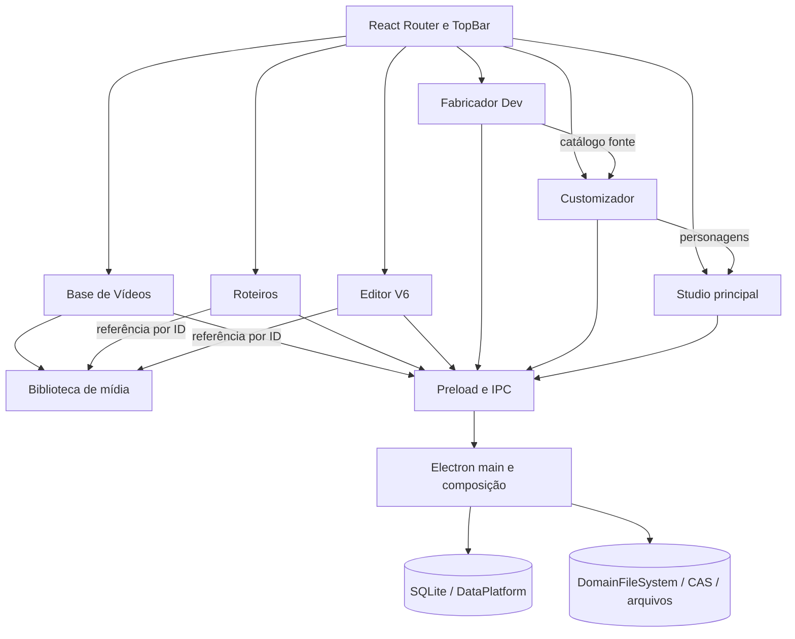

# Mapa do aplicativo e plano de refatoração progressiva

## Reauditoria geral — 2026-10-29

### Rodada ampliada — limite de memória nas prévias de cor do Fabricador

- O cache das prévias de pele mantinha até 80 entradas, mas não limitava o tamanho das imagens. Ao alternar entre slots, ele podia conservar referências às imagens-fonte e às PNGs geradas sem um teto de memória estimado.
- `modelBodyPreviewCache.ts` mantém a reutilização LRU existente e aplica um orçamento de 64 MiB estimados, além do teto de 80 entradas. A estimativa considera dois bytes por unidade da string da fonte, guias, cores e resultado; é uma estimativa conservadora de retenção, não uma medição do heap do Chromium.
- Se uma geração termina depois de sua entrada ter sido substituída ou expulsa, ela não atualiza o orçamento nem remove a entrada atual. Falhas continuam removendo somente a entrada correspondente. A promessa entregue à renderização permanece utilizável mesmo após a expulsão do cache.
- Não houve mudança no recolorimento, nas chaves dos dados salvos, nos canais IPC ou na persistência. `npm run typecheck`, `npm run audit:architecture` (394 arquivos) e `npm run build` passaram. Testes automatizados não foram executados nesta etapa.

### Rodada ampliada — operações manuais do Fabricador no flush

- A auditoria do inventário de encerramento encontrou quatro caminhos fora do flush: importação da folha do Model Source, exportação do PNG do Model Source, exportação WebM do Animador Facial e autosave do Design Dev.
- `fabricator:import-model` agora permanece na fila do slot desde a abertura do seletor até gravar a fonte; isso serializa a gravação com outras alterações daquele modelo e permite que o flush principal a aguarde. O download de PNG, a exportação WebM (incluindo seletor e escrita) e as gravações IPC do Design Dev agora expõem operações ativas ao inventário `collectPendingPersistenceWrites()`.
- O rascunho de Design Dev também registra `flushDesignSettings` no flush do renderer. A fila preserva a rejeição para que navegação/encerramento detecte uma falha, enquanto uma edição posterior pode iniciar uma nova tentativa.
- Canais IPC, conteúdo JSON, caminhos de persistência e arquivos exportados não mudaram. As regressões usam arquivos temporários, saídas sintéticas e Promises controladas; nenhum modelo, download ou configuração local foi aberto ou alterado.
- `npm run test:fabricator:manual-lifecycle` passou com 5 testes; `npm run test:refactor` com 330; `npm test` com 27; `test:data-backup-ipc` com 4; `test:roteiros` com 6; `test:media-library-pending` com 2. Também passaram `npm run typecheck`, `npm run audit:architecture` (361 arquivos) e `npm run build`.
- Esta etapa fecha as lacunas encontradas nesses caminhos manuais; permanece necessária a auditoria completa das operações restantes e de recuperação após interrupção forçada do processo.

### Rodada ampliada — superfície e painel de exportação

- O smoke integrado `test:editor-v6:surface` falhava ao importar áudio porque seu mock ainda expunha métodos no objeto `desktop` plano; a interface atual usa `desktop.editorV6`. A fixture agora implementa o contrato namespaced tipado, sem adicionar compatibilidade obsoleta ao aplicativo.
- Validação Electron/Chromium com projeto e áudio sintéticos: preview e quadros sequenciais da exportação tiveram 0 canais de pixel diferentes; as proporções foram preservadas nos dois tamanhos avaliados. O painel importou uma faixa e iniciou uma exportação.
- Comparar a captura nativa da preview com a renderização SVG mostrou diferenças limitadas à rasterização de texto (7.524 canais, nenhum pixel fora da área de texto; erro médio por canal 0,1223). Portanto, a evidência confirma geometria e conteúdo visual fora do texto, não igualdade pixel a pixel das fontes entre renderizadores.
- `npm run test:editor-v6:surface` passou em duas execuções no estado atual. Usa perfil temporário e fixtures; não acessa projetos pessoais.

### Rodada ampliada — geometria 1080p e busca de assets

- A captura 1920×1032 veio de bounds iniciais limitados à área útil do monitor Windows. Definir setContentSize explicitamente após criar a janela estabelece o viewport solicitado, sem depender apenas do tamanho inicial do construtor. Acrescentada verificação da área do personagem no MP4 1080p decodificado.
- Contraprova real: retirar apenas setContentSize faz o teste detectar 158.112 pixels amarelos, contra 165.888 esperados. Restaurar a configuração entrega exatamente 165.888 pixels. O teste anterior só validava resolução final e não detectava a distorção anterior ao encode.
- No renderer de exportação, índice assetsById é construído uma vez. Preparação por quadro consulta apenas os IDs visíveis em vez de percorrer todo project.assets. Custo dessa seleção muda de O(total de assets) para O(IDs visíveis), após indexação inicial O(total); não foi atribuída porcentagem de ganho de FPS a essa mudança.
- Três exportações reais completas consecutivas no estado final passaram com área 1080p exata, após as cinco rodadas do ciclo de bitmap. Diagnóstico adicional permaneceu desligado. Aprovados também 108 testes Editor V6 (um ignorado existente), 330 de refatoração, 27 gerais, typecheck, auditoria e build.
- Benchmark sintético de armazenamento desta rodada: 2.600 assets, inserção 310,8 ms e busca p95 8,63 ms, executado junto a outras verificações. Não comparar diretamente com runs anteriores para alegar aceleração; hardware/carga e esse benchmark não medem a alteração da captura.

### Rodada ampliada — captura nativa e cancelamento

- Instrumentação opt-in `GACHA_EXPORT_CAPTURE_DIAGNOSTICS=1` grava a primeira captura por worker em fixture temporária: viewport, bounds SVG, fonte e posição das imagens, contagem de pixels. A reprodução mostrou DOM correto com superfície praticamente branca (um pixel de fundo correto). Aguardar SVG ou trocar por paint/invalidate não corrigiu; essas tentativas foram removidas.
- `exportBitmap` materializa o bitmap nativo antes de transformar e evita resize quando tamanho e quantidade de bytes já correspondem à saída. A política anterior redimensionava toda captura mesmo no mesmo tamanho. O fallback continua validando o tamanho BGRA antes de enviar ao FFmpeg. Não há afirmação de uma causa interna específica do Chromium; a correção do caminho é sustentada por regressão reproduzida antes e cinco execuções completas consecutivas aprovadas depois, com diagnóstico desligado.
- `ready` tardio de um worker já encerrado passa a ser ignorado somente para IDs conhecidos e mainFrame correspondente, em inventário limitado a 128 IDs. Remetentes desconhecidos continuam rejeitados; payload de worker fechado continua sem autorização.
- Novas regressões cobrem pixels nativos sem resampling, ordem de materialização no fallback, tamanho inválido e distinção entre ready tardio e remetente desconhecido. Passaram 108 testes Editor V6 (um ignorado existente), 330 de refatoração, typecheck, auditoria e build.
- Cinco rodadas reais completas: 81 quadros/78 reaproveitados na fixture estática, pico de dois workers, áudio contínuo, destino preservado ao cancelar, recuperação induzida, quadro único, 1080p e transição na emenda. Sem perfis pessoais. Naquele estágio, a precisão geométrica ainda estava pendente; a medição e contraprova do viewport 1080p estão na seção posterior desta reauditoria.

### Validação Electron integrada e investigação da captura

- Executados em perfis temporários: check-motion passou (7 amostras, 90.000 pixels de atlas); motion-service passou com reutilização de janela/cache, recuperação de cancelamento e agendamento em background. Raster SHA256: 79db53ee3662e72a5bb737ed9fb0eb72e391ce74945c9681bb2fcb56b5aacdd2. Avisos de GPU apareceram ao finalizar check-motion; o processo encerrou com código zero.
- O teste de exportação ainda verificava o antigo método desktop.bakeEditorV6Motion. Atualizado para o contrato atual desktop.editorV6.bakeEditorV6Motion, sem restaurar API obsoleta no produto.
- A exportação integrada teve duas execuções completas aprovadas e uma falha intermitente na emenda Turbo. As aprovadas verificaram 81 quadros, 78 reaproveitados, pico de dois workers, áudio contínuo, fallback induzido, destino preservado ao cancelar, quadro único, 1080p e transição de pose na emenda.
- Na investigação inicial, a fixture `editor-v6-export-check-3VMdcG/turbo.mp4`, quadros 39/40/41, mostrou pixels amarelos 4608/0/0 e perda da segunda parte. Essa falha foi posteriormente investigada com diagnóstico opt-in de DOM/SVG/captura e corrigida no caminho de materialização do bitmap nativo; os resultados e a contraprova estão nas seções mais recentes desta reauditoria.
- `check-export` mantém `out/editor-v6-export-check/result.json` com estado running/failed ou resultado aprovado, evitando um relatório verde antigo após falha. As fixtures e capturas são sintéticas e ficam fora do controle de versão.

### Protocolo de mídia do Editor V6 no domínio dono

- `editorV6/mediaProtocol.ts` concentra validação de URL, vínculo no manifesto, MIME permitido e autorização de mídia local/biblioteca. `main.ts` registra o protocolo e injeta leitura nativa do manifesto, caminho de projeto e resolução física/CAS. O domínio não importa Electron nem consulta tabelas de outros domínios.
- A leitura do manifesto continua nativa, sem cache que possa manter vínculos removidos. Resolução da biblioteca só ocorre após comprovar a referência por projeto. Manifestos inválidos são recusados; nomes, IDs, extensões e conteúdo autorizado mantêm o contrato anterior. A entrega de bytes usa o helper compartilhado da etapa anterior.
- Oito testes novos verificam mídia local e da biblioteca com ranges reais em arquivos sintéticos, manifestos inválidos, projeto divergente, item sem referência, host/nome inválido, MIME não permitido e arquivo ausente. Confirmação por spies de que entradas inválidas não alcançam os resolvedores.
- Validação: 105 testes Editor V6 aprovados (um ignorado existente), 330 de refatoração, typecheck, auditoria de arquitetura e build. Nenhum dado pessoal acessado. Os protocolos restantes de biblioteca/imagens ainda estão no composition root e seguem na revisão geral.

### Resposta de mídia compartilhada

- Três implementações de headers/HEAD/Range/stream eram duplicadas: biblioteca de vídeos, mídia do Editor V6 na janela principal e mídia no worker de exportação. `mediaLibrary/mediaFileResponse.ts` centraliza somente a entrega de arquivo já autorizado; IDs, validações de manifesto, resolução CAS e escopo por projeto permanecem nos protocolos donos.
- Intervalos decimais são interpretados com BigInt antes de limitar ao tamanho do arquivo, evitando perda de precisão com valores maiores que Number.MAX_SAFE_INTEGER. GET parcial mantém 206 e Content-Range; pedidos não suportados/insatisfatíveis mantêm 416; HEAD entrega metadados sem abrir body. Leituras recebem o AbortSignal da requisição. Os chamadores aguardam a resposta dentro do try para preservar 404 em falhas de acesso.
- Referência normativa: RFC 9110, seção 14.1.2: https://www.rfc-editor.org/rfc/rfc9110.html#section-14.1.2. Continua suportado um intervalo único, sem multipart. Arquivos vazios continuam retornando 416 se solicitado range, preservando o comportamento existente.
- 13 regressões novas com arquivos temporários verificam bytes exatos, sufixo, intervalo aberto, limites, números muito grandes, sintaxe inválida, HEAD e resposta completa. Aprovados 97 testes Editor V6 (um ignorado existente), 330 de refatoração, typecheck, auditoria e build. Não houve benchmark de throughput nem playback real de mídia neste ciclo.

### Navegação das janelas e dependências

- `npm audit --json` retornou zero vulnerabilidades conhecidas nas dependências instaladas nesta rodada. Isso não certifica ausência de vulnerabilidades no app nem justifica atualizar versões indiscriminadamente.
- Mapeamento não encontrou uso funcional de window.open ou navegação de documento no renderer. A navegação das áreas usa HashRouter; documentos são carregados pelo processo principal. `windowNavigation.ts` aplica deny a popups e preventDefault a will-navigate nas três criações de BrowserWindow de produção: janela principal, preparador e exportador.
- Base oficial: https://www.electronjs.org/docs/latest/tutorial/security/ e https://www.electronjs.org/docs/latest/api/web-contents — will-navigate não bloqueia HashRouter nem loadURL/loadFile iniciados pelo processo principal.
- O smoke de bootstrap em Electron real agora também comprova popup bloqueado, navegação externa impedida, hash alterável e loadFile funcionando em perfil temporário. Relatório em out/editor-v6-bootstrap/result.json. Não certifica todos os cenários de navegação interativa ou permissões.
- Aprovados: 84 testes Editor V6 (um ignorado existente), 330 de refatoração, auditoria de arquitetura, typecheck, build e smoke Electron real. Política de permissões por sessão, CSP e demais superfícies permanecem itens de auditoria; não há declaração de segurança completa.

### Bootstrap separado para workers e interface

- `main.tsx` importava estaticamente ReactDOM, roteador, App e CSS mesmo no hash do preparador de animações. `ui/mountApp.tsx` agora é importado somente na janela interativa; mantém StrictMode, HashRouter, boundaries e CSS. O registro público de flush continua síncrono no bootstrap.
- Build: entrada bootstrap 5,20 kB; montagem da interface 96,20 kB e stylesheet de 374,13 kB ficam no caminho interativo. São tamanhos de artefatos sem compressão; não são medida de RSS nem de latência.
- Novo comando reproduzível `npm run test:editor-v6:bootstrap` compila e abre Electron real com perfil temporário e bridge sintética que retorna fila vazia. Verificou que o worker chama payload, não monta DOM da interface, não carrega stylesheets nem mountApp, e mantém a função pública de flush. Relatório gerado em `out/editor-v6-bootstrap/result.json`, não versionado. Nenhum perfil real foi aberto pelo teste.
- Passaram 330 testes de refatoração, typecheck, auditoria e build, além do smoke Electron real com os artefatos de produção. Esse smoke cobre inicialização do baker, não renderização de uma animação completa nem navegação interativa; essas verificações continuam no escopo pendente.

### Carregamento dos workspaces do Fabricador

- A página importava estaticamente nove workspaces especializados embora a seção inicial seja Modelos. Os componentes agora são React.lazy no escopo do módulo, com Suspense local dentro do provider de aparência. A seção é montada somente quando selecionada; permanece o flush de gravações antes da troca e o tratamento de erros da rota.
- Os três CSSs de workspaces permanecem carregados pela página: existem seletores compartilhados e carregar CSS só após visitar uma seção poderia mudar a aparência conforme a ordem de navegação. Os estilos não foram reescritos.
- Build de produção: módulo FabricatorPage de 1.018,25 kB para 292,87 kB (aproximadamente 71,2% menor, sem compressão). Workspaces especializados agora têm chunks próprios entre 9,61 kB e 172,04 kB, além de dependências compartilhadas. Isso mede divisão do bundle, não redução total do instalador nem tempo/FPS/memória real; o grafo compartilhado também muda.
- Aprovados 330 testes de refatoração, typecheck, auditoria de arquitetura e build. A versão final conserva os CSSs eager e compilou novamente. Navegação real com fixtures e medição de carregamento continuam pendentes; não houve acesso a rascunhos pessoais.

### Fechamento dos renderizadores de exportação

- `exportWorkers` agora centraliza fechamento explícito, abort e evento externo closed no mesmo cleanup idempotente: remove entrada autorizada e listener de abort, solta a referência ao bitmap de camadas e rejeita preparação ainda pendente.
- A fábrica acompanha seus workers ativos; seu dispose fecha todos e remove os handlers. Após dispose, recusa novos workers. O runner existente continua dono do fechamento por finally e cancelamento por AbortSignal; não foi adicionada nova dependência no fluxo de encerramento global.
- Chamadas de frame após fechamento retornam erro de domínio imediato. Os formatos de payload/IPC, política de mídia e bitmap entregue ao FFmpeg foram preservados.
- Testes com BrowserWindow simulado verificam fechamento externo, revogação de autorização por ID, remoção do listener, descarte da fábrica e fechamento antes de ready. Aprovados 84 testes do Editor V6 (um ignorado existente), typecheck, auditoria de arquitetura e build. Simulação não substitui teste de crash/captura real do Chromium.
- Auditoria de segurança: a navegação e abertura de janelas já são bloqueadas no renderer principal e nos dois renderizadores auxiliares. A etapa 36 adicionou handlers de verificação e solicitação de permissões para a sessão principal e a sessão isolada de exportação. A nota anterior sobre o preparador de movimento compartilhar a sessão principal estava desatualizada: `motionIpc.ts` cria uma partição sem persistência por worker e aplica restrições de permissões e recursos; `motionRendererSecurity.test.ts` verifica essa configuração. Isso cobre a sessão do worker, não toda a revisão de segurança do aplicativo.

### Recoloração e política única de retenção

- `characterImagePromiseCache` concentra LRU, orçamento estimado, atualização após conclusão e limpeza por identidade. O loader de origem e os três caches de recoloração usam a mesma política; os algoritmos de pixels e suas chaves foram preservados.
- Pele: antes sem limite; agora 80 entradas/64 MiB estimados. Corpo: 80 entradas/64 MiB; cabelo: 40 entradas/64 MiB. Hits promovem a entrada na ordem LRU. Cada instância dos renderizadores continua independente.
- A estimativa inclui chave, fonte PNG gerada quando diferente da chave e RGBA. Canvases dos workers usam width/height quando naturalWidth/naturalHeight não existem. Nenhuma imagem ou canvas evicto é limpo ou destruído enquanto consumidores podem segurá-lo.
- Testes novos verificam canvas de worker, string PNG gerada, limite/reutilização da pele e evicção de resultados grandes nas três funções públicas de recoloração. Os testes anteriores de corrida/LRU do loader continuam passando. Esses testes de integração usam fallback de canvas sem contexto para isolar retenção; não certificam aparência visual ou algoritmos de pixels.
- Validação: 81 testes Editor V6 aprovados (um ignorado existente), 330 de refatoração, typecheck, auditoria de arquitetura e build. Sem benchmark de RSS/GPU neste ciclo; a melhora comprovada é a retenção limitada por política, não uma porcentagem de redução do processo.

### Cache de imagens decodificadas

- Os consumidores foram mapeados: Customizador/Studio/Roteiros/Fabricador usam uma instância; Editor V6 usa outra. Ambas mantêm o contrato Promise<HTMLImageElement> e sua independência.
- `characterImageCache` conserva LRU/512 entradas e acrescenta orçamento estimado de 128 MiB por instância: fonte UTF-16 e pixels RGBA (largura natural × altura natural × 4). A contabilidade é atualizada após carregar. Imagens maiores que o orçamento são entregues ao chamador, mas não retidas. A evicção não modifica src nem invalida referências de renderizações em curso.
- Corrigida corrida: rejeição de uma carga já removida só limpa a entrada se ainda for a mesma requisição; não remove uma substituta mais recente.
- Testes sintéticos cobrem compartilhamento de cargas pendentes, ordem LRU, orçamento por pixels, imagem grande, validade da referência externa e rejeição antiga. Aprovados: 77 testes do Editor V6 (um ignorado existente), 330 de refatoração, typecheck, auditoria de arquitetura e build.
- Limitação: o orçamento estima imagens retidas por cada renderizador, não a memória global do Chromium/GPU nem cargas simultâneas. Outros consumidores ainda podem manter imagens vivas. Não foi medido ganho de RSS/FPS neste ciclo; próxima revisão deve comparar a política estimada com uso real em fixtures.

### Ciclo de vida de esperas dos workers

- `waitForExport` é usado no carregamento dos workers, desenho/captura de quadros, preparação das transições e envio/finalização do FFmpeg. A limpeza do timer/listener dependia da conclusão da operação original, mesmo quando a espera já havia sido cancelada ou expirado.
- A finalização agora é única e remove timer/listener imediatamente em sucesso, falha, cancelamento ou timeout. Respostas tardias continuam consumidas, sem modificar o resultado já entregue. O helper cancela a espera; encerrar o processo/janela continua responsabilidade dos donos existentes.
- Regressões sintéticas usam operações que nunca concluem, timers controlados, cancelamento prévio e rejeição tardia. Verificados: 73 testes do Editor V6 aprovados, um ignorado existente, typecheck, auditoria de arquitetura e build. Nenhum perfil real foi usado.
- A política de bytes do cache de imagens e da recoloração foi concluída nas etapas registradas acima e na etapa 35. A validação continua limitada a estimativas e fixtures; RSS/FPS de um processo Chromium com uma cena real ainda precisa de medição dedicada.

Objetivo ativo: refatoração geral de todos os domínios, incluindo organização, redundâncias, segurança, inicialização, renderização, memória, processamento e persistência. As etapas abaixo registram progresso; não certificam conclusão do aplicativo inteiro.

- Base desta rodada: `Dev-V2`, `68e83f4`, árvore limpa. Reutilizar este mapa e os contratos existentes; preservar formatos e dados pessoais.
- Baseline executado: auditoria de arquitetura sem violações, typecheck, 27 testes gerais, 330 testes de refatoração e build de produção aprovados. Editor V6: 70 testes aprovados após duas regressões novas; um teste permanece ignorado pela configuração existente.
- Correção aplicada: indexação compartilhada de fala consolida intervalos sobrepostos/contidos/adjacentes por personagem antes da busca binária. Antes, um balão curto contido em outro podia desligar a fala cedo. A consulta permanece O(log n), e o índice continua vinculado à timeline via WeakMap. Os testes comparam todos os frames com a união direta dos balões e verificam limites, personagens distintos, tracks ocultas/mutadas e imutabilidade.
- Evidência sintética de armazenamento nesta máquina: 2.600 assets, inserção em lote 305,2 ms e busca p95 9,75 ms no baseline. Estes números não representam FPS, inicialização ou consumo real do Chromium.
- Pendências de escopo geral: medir inicialização/FPS/memória com fixtures; revisar transporte e vida útil de imagens; auditar filas e cancelamento por domínio; reduzir responsabilidades das páginas e do composition root; investigar dependências/código sem consumidores; revisar segurança e recuperação dos workers; executar aceitação visual e exportação com fixtures após mudanças de renderização. Priorizar conforme evidências, sem ampliar thresholds para passar verificações.

**Data:** 2026-10-27

**Última atualização:** 2026-10-29

**Base histórica da reauditoria:** branch local `Dev-V2`, criada sobre `Main-desenvolvimento` no commit `6c2997223430ded043043222469b1fc20a63084f`.

**Ponto de partida desta etapa:** branch local `Dev-V2`, commit `06c5b25` (`fix(fabricator): protect referenced poses across workspaces`).

**Base histórica do primeiro ciclo:** commit `805798f` (`refactor(media): remove obsolete video studios field`), branch local `Dev-V2`.

**Objetivo:** mapear a arquitetura e os fluxos de dados do Native-gacha; priorizar e executar uma refatoração incremental em etapas pequenas, simplificando módulos e conexões entre áreas. Remover código legado somente quando seu desuso estiver confirmado, preservar dados e comportamento existente, verificar cada etapa e registrar cada mudança em um commit local revisável.

**Escopo:** diagnóstico arquitetural e melhorias incrementais de código e contratos. Mudanças de schema, migrações de dados, exclusões de assets ou alterações visuais compartilhadas exigem mapeamento e verificação próprios antes de serem incluídas.

## Resumo

O aplicativo tem sete áreas em uma shell Electron/React. A separação de Base de Vídeos e Roteiros já avançou: têm rotas e telas distintas, contratos próprios, APIs com namespace e a Base está em sua própria pasta. A proteção de exclusão também consulta referências nos domínios donos, sem deixar o repositório da Base acessar tabelas de Roteiros.

A **Biblioteca de Mídia** é dona dos arquivos de vídeo e seus IDs. Base de Vídeos guarda estado editorial e numeração; Roteiros e Editor V6 guardam referências por ID. Uma coordenação curta agora serializa alterações nesses vínculos nas três áreas, evitando que um autosave atrasado recoloque a referência depois de excluir o vídeo.

O restante já tem módulos por domínio e armazenamento local com SQLite, arquivos e CAS. `electron/main.ts` é o composition root: instancia serviços, injeta recursos nativos e registra as IPCs pelos registradores donos de cada domínio; mantém diretamente o flush transversal e a coordenação de referências entre domínios. A validação de documentos de Studio e Editor V6 fica em schemas compartilhados. A maior concentração de responsabilidades permanece nas páginas React e workspaces extensos; cada extração deve seguir o dono do estado e da persistência.

**Próximos passos:** referências, filas e persistência dos catálogos faciais agora têm escopo explícito por `modelSlot` ou perfil. As gravações do catálogo facial mantêm a ordem fila do slot → lock de personagens → fila de expressões; os guias faciais são serializados por perfil e entram no inventário de flush, backup e encerramento. O próximo ciclo continua a auditoria das operações IPC manuais iniciadas por ações do usuário e completa a matriz de falhas e recuperação de cada domínio. O flush transversal permanece no composition root. A orquestração e os modos de render de Studio e Editor V6 continuam separados até existir comparação visual das saídas reais.

## 1. Estado observado

- Aplicação desktop local em Electron 44, React 19 e TypeScript; não encontrei backend HTTP separado. O processo principal Electron faz o papel de backend local via IPC.
- O `App` usa React Router, carrega cada área sob demanda e separa Studio, Editor V6, Roteiros, Base de Vídeos, Customizador, Opções e Fabricador Dev.
- O código do processo principal está parcialmente separado por domínio. Há módulos próprios para Base de Vídeos, Customizador, catálogos do Fabricador, Studio principal e Editor V6.
- A persistência mistura SQLite para catálogos/documentos e armazenamento de arquivos por domínio/CAS. O esquema SQLite continua centralizado em `electron/dataPlatform.cjs`.
- Não encontrei solicitação para executar migração de dados; este diagnóstico não migra nem modifica dados pessoais.

### Inventário da reauditoria

Contagens revalidadas na branch local `Dev-V2`, base desta etapa `3785da5`. As contagens de páginas abaixo usam linhas com conteúdo; a quantidade de linhas físicas de `main.ts` também é registrada.

- O shell tem sete rotas de produto: Customizador, Studio principal, Editor V6, Roteiros, Base de Vídeos, Opções e Fabricador DEV.
- `electron/domains/` contém módulos para Base de Vídeos, Customizador, Editor V6, Fabricador, imagens compartilhadas, Roteiros, armazenamento compartilhado e Studio. `src/shared/` guarda contratos e regras usadas por mais de um processo.
- `electron/main.ts` tem 1.419 linhas físicas (1.336 com conteúdo) após as extrações já registradas. É o composition root e ainda mantém a montagem de serviços, guardas transversais de poses/vídeos, caminhos e protocolos; a validação de Studio desta etapa saiu para `src/shared/studioValidation.ts`. A normalização de imagens fica no domínio compartilhado `electron/domains/images`.
- As páginas com maior volume de conteúdo são Studio (1.349), Editor V6 (1.324), Customizador (1.189) e Fabricador Dev (1.035); Roteiros tem 545 e Base de Vídeos 346. Dentro do Fabricador, os workspaces maiores são Expressões (1.245), peças faciais (1.193), Animador (1.082), Model Source (955) e Roupas (888). Esses números localizam concentração de responsabilidades, mas não são por si só motivo para dividir arquivos.
- A auditoria estática de dependências mantém em zero os imports de runtime entre os pares de features listados em `scripts/architecture/boundaries-baseline.json`.

### Mapa resumido



### Caminho de uma operação

```text
App.tsx / TopBar
  → página da feature em src/renderer/src/features/<domínio>
  → contrato window.desktop em src/shared + desktop.d.ts
  → método correspondente em electron/preload.ts
  → canal IPC registrado por electron/main.ts ou electron/domains/<domínio>
  → validação e caso de uso do domínio
  → DataPlatform/SQLite, DomainFileSystem/CAS ou arquivos do domínio
  → resposta pelo mesmo contrato até a página
```

O renderer não abre SQLite nem acessa o disco diretamente. `electron/main.ts` compõe os serviços e ainda conserva handlers inline; quando a área tem módulo extraído, o preload e o handler mantêm o nome de canal existente. `desktop.d.ts` descreve o objeto exposto em `contextBridge`.

## 2. Base de Vídeos e Roteiros

### O que já está separado

- `TopBar.tsx` tem entradas distintas para `/roteiros` e `/base-videos`.
- `App.tsx` tem rotas e carregamento lazy distintos.
- `electron/domains/baseVideos/` contém `service.ts`, `repository.ts`, `validation.ts` e `ipc.ts`.
- Os metadados de Base ficam em tabelas próprias (`base_video_details`, categorias, atribuições e sequência); os documentos ficam em `roteiros`, `roteiro_tiktoks`, `roteiro_sections` e logs.
- O vínculo de vídeo no roteiro é por ID; os bytes não são copiados para cada roteiro.
- `RoteiroVideoReference` também persiste nome, formato, tamanho e duração junto ao ID. Isso funciona como snapshot de exibição, mas pode ficar desatualizado depois de renomear o item na biblioteca; leitura e exportação devem resolver o arquivo pelo ID.

### Situação atual e acoplamentos restantes

| Área | Evidência no código | Efeito |
|---|---|---|
| Local da feature | `BaseVideosPage.tsx` está em `features/baseVideos/`; `App.tsx` mantém rota própria. | Separação visual e de diretório concluída. |
| Contratos | `BaseVideoDetails` e `BaseVideoCategory` estão em `src/shared/baseVideos.ts`; biblioteca e referências estão em `src/shared/mediaLibrary.ts`. | APIs têm donos claros; `RoteirosDesktopApi` continua cuidando apenas dos documentos e exportações de Roteiros. |
| API do preload | `desktop.baseVideos`, `desktop.mediaLibrary` e `desktop.videoBackgrounds` têm namespaces próprios. | Os canais IPC antigos foram preservados; o restante do preload ainda é uma união ampla de APIs. |
| Referências | Roteiros consulta sua tabela em `domains/roteiros/videoReferences.ts`; Editor V6 lê os vínculos nos próprios manifestos. `mediaLibrary/videoReferences.ts` compõe os leitores. | A Base e a Biblioteca chamam a mesma proteção sem conhecer schemas consumidores. |
| Fila | A Base e exclusão da mídia ainda usam `roteirosSaveQueue`; Editor V6 tem fila própria; gravações que alteram referências passam por um coordenador comum. | O coordenador serializa apenas salvamentos que adicionam vínculos e exclusões; as filas próprias preservam a ordem do restante das gravações. |
| Ownership de mídia | `electron/domains/mediaLibrary/videoLibraryStore.ts` mantém originais em `media-library`; Roteiros, Base e Editor V6 usam o mesmo ID/arquivo. O caminho legado é composto por `studioLibraryPath('video')`, sob `studios/Editor Gacha`. | O catálogo de arquivos é compartilhado e não pertence exclusivamente à tela de Base de Vídeos. O nome/caminho legado não deve ser renomeado durante uma extração de código. |
| Estado “Rascunho/Base” | A tela calcula isso pela presença de `video_number` em `base_video_details`; não há tabela de rascunhos separada. | “Rascunho” é um estado de publicação dentro do mesmo catálogo, não uma biblioteca física independente. |
| Consumidores | Roteiros e Editor V6 escolhem e consultam itens via `desktop.mediaLibrary`; metadados editoriais via `desktop.baseVideos`. | A relação por ID fica clara e não duplica o arquivo. |
| Exclusão | Os canais da Base e da Biblioteca compartilham a mesma proteção de referências. | A regra é comum; novos consumidores precisam registrar seu leitor no serviço da biblioteca. |
| Campo removido | O antigo campo `studios` foi retirado de `VideoLibraryItem` e das respostas da biblioteca de vídeos. | A busca incluiu Base de Vídeos, Roteiros, Editor V6, preload, IPC e persistência; nenhuma área consumia o campo. O Studio mantém seu campo `studios` próprio para fundos de imagem, com vínculos reais. Propriedades desconhecidas em catálogos legados não são removidas do disco. |

### Propriedade recomendada

```text
Biblioteca de mídia (Media Library)
  ├─ é dona do arquivo binário, ID, nome, formato, tamanho, duração e disponibilidade
  ├─ fornece importação, leitura/stream e exclusão física protegida
  └─ mantém/verifica referências recebidas de outros domínios

Base de Vídeos
  ├─ é dona do estado de publicação, número sequencial, categoria e descrição editorial
  └─ associa seus metadados ao ID da biblioteca de mídia

Roteiros
  ├─ é dono dos documentos, seções, falas/pensamentos e logs de exportação
  └─ guarda referências por ID a vídeos; não é dono dos arquivos

Editor V6
  └─ pode referenciar um item da biblioteca, sem passar a depender dos metadados editoriais da Base
```

“Separação real” não significa criar cópia do mesmo MP4 nem proibir vínculo. Significa cada domínio possuir seus dados e casos de uso, consumir contratos explícitos e não fazer SQL direto nas tabelas internas de outro domínio.

### Sequência segura para essa separação

1. **Extrair contratos sem mudar o disco — concluído:** tipos de Base e mídia têm arquivos próprios; os dados de roteiro continuam no contrato de Roteiros.
2. **Separar APIs do preload por namespace — concluído:** consumidores usam `desktop.mediaLibrary` e `desktop.baseVideos`, mantendo os canais IPC atuais.
3. **Mover a UI — concluído:** BaseVideosPage tem pasta própria e preserva sua rota/layout.
4. **Desacoplar referências — concluído nesta etapa:** leitores ficam nos domínios donos e uma proteção comum verifica Roteiros e Editor V6 antes da exclusão.
5. **Concluído — separar concorrência por responsabilidade:** salvamentos de referências e exclusão passam por um coordenador curto, mantendo `roteirosSaveQueue` e a fila do Editor V6 para o restante das operações.
6. **Concluído nesta etapa — consolidar o contrato da biblioteca de vídeos:** `VideoLibraryItem` não carrega mais `studios`, antes sintetizado como lista vazia; o DTO filtra essa propriedade se ela estiver em um catálogo antigo, sem regravar ou descartar os dados persistidos. O campo homônimo da biblioteca de fundos do Studio é separado e permanece em uso.
7. **Somente depois avaliar o schema:** manter `base_video_details`, tabelas de Roteiros e IDs atuais. Não é necessário separar SQLite por arquivo para obter isolamento de domínio. Qualquer normalização de `video_asset_json` para uma tabela relacional exige inventário de documentos legados, migração testável e rollback.

### Critérios de aceitação

- Salvar/excluir metadados da Base não reescreve documentos Roteiros.
- Roteiros pode selecionar vídeo por ID e continua exibindo o arquivo correto após reiniciar.
- Excluir um roteiro nunca apaga um vídeo publicado.
- Excluir mídia usada por Roteiros ou Editor V6 é bloqueado; remover uma referência libera a exclusão somente quando não houver outras referências.
- Publicar, desfazer publicação (se suportado), categorizar, renomear e mover o item entre as vistas mantém IDs e numeração existentes.
- Nenhum MP4 é duplicado por causa de vínculo a um roteiro.
- Corrida de autosave de Roteiros contra exclusão de vídeo não pode deixar referência quebrada.
- Contratos JSON/SQLite e rotas visuais existentes permanecem compatíveis.

## 3. Mapa do restante do aplicativo

| Área | Entrada visual e dono | Integrações e persistência | Observação estrutural |
|---|---|---|---|
| Fabricador Dev | `features/fabricator/FabricatorPage.tsx`; catálogo autoral de modelos, poses, roupas, cabelo, rosto, presets e animações. | `domains/fabricator/` concentra catálogos, IPC, persistência versionada, transações e recuperação; configurações de banners têm serviço e IPC próprios. É fonte do Customizador e de outros renderizadores. | Vários domínios já foram extraídos; a página ainda coordena workspaces e comandos. |
| Customizador | `features/customizer/CustomizerPage.tsx`; instâncias de personagens e escolhas/overrides individuais. | `domains/customizer/` tem validação, serviço, repositório e IPC; lê catálogos do Fabricador e alimenta Studio, Roteiros e Editor V6. | Renderização e coordenação de estado ainda estão concentradas na página. |
| Studio principal | `features/studio/StudioPage.tsx`; documento de cena e composição. | `domains/studio/` tem IPC primário e de arquivos, índice e persistência; usa personagens do Customizador e armazenamento visual comum. | Autosave e importação de imagem compartilham a mesma fila do renderer antes do IPC; prints do CAS são materializados temporariamente para abrir no sistema. |
| Editor V6 | `features/editorV6/EditorV6Page.tsx`; projetos, timeline, preview e exportação. | `domains/editorV6/` cobre IPC primário e de arquivos, manifesto/índice, journal de assets, motions e workers/processo de exportação; usa biblioteca por ID. | Autosave e importação de imagem/áudio/vídeo compartilham a mesma fila do renderer antes do IPC. |
| Roteiros | `features/roteiros/RoteirosPage.tsx`; documentos, seções, elenco, falas/pensamentos e exportações. | `domains/roteiros/` tem serviços, repositórios SQLite, validação e IPC de documentos, logs, bibliotecas e exportações; usa Biblioteca/Base por ID, fundos compartilhados e personagens do Customizador/Fabricador. | A renderização dos personagens é feita no renderer; o processo principal valida e recebe os arquivos PNG antes de publicar o projeto exportado. |
| Base de Vídeos | `features/baseVideos/BaseVideosPage.tsx`; publicação, numeração, descrição, categorias e vistas de rascunho. | `domains/baseVideos/` tem serviço, repositório, validação e IPC; metadados relacionam ao ID da Biblioteca em SQLite. | Feature e namespace próprios; exclusão coordenada com consumidores dos vídeos. |
| Opções/Dados | `features/options/OptionsPage.tsx`; backups, inventário, migração e configurações. | `DataPlatform`, `DataMigrationService`, `domains/storage/dataMigrationIpc.ts`, `DataBackupService`, `domains/storage/dataBackupIpc.ts` e `DomainFileSystem` coordenam SQLite, CAS e arquivos. | Infraestrutura crítica; migrações reais continuam explícitas e verificáveis. |

### Trilha de modelo, pose e roupa

- **Modelo-fonte:** Fabricador guarda as peças desmontadas com IDs estáveis e `sourceTransform`, que registra a posição original de cada recorte. Poses partem do modelo montado, mas preservam esses IDs e a origem do modelo (`slot` e `updatedAt`) no snapshot.
- **Pose:** `PoseWorkspace` grava cada pose no catálogo do slot de modelo que a originou. Customizador, Studio, Editor V6 e o Animador consultam esse catálogo por `sourceModelSlot` e `slot`; Customizador, Studio e Editor V6 validam a identidade da pose antes de projetá-la.
- **Referências e exclusão de poses:** o personagem persiste `modelSlot`/`poseSlot`; cenas do Studio referenciam poses por elementos de personagem; o Editor V6 também guarda vínculos em elementos e no estado da timeline. `src/shared/fabricatorPoseReferences.ts` reúne os coletores, e `electron/domains/fabricator/poseReferences.ts` coordena gravações e exclusões. A exclusão de uma pose em uso é bloqueada; referências legadas já quebradas continuam editáveis, e referências cujo modelo não pode ser identificado falham fechadas para a mesma pose.
- **Roupa:** um conjunto pertence a `modelSlot`; cada peça aponta para `attachedPartId` e guarda o encaixe no referencial local do osso original em `binding`. `mapWardrobeComponentToPose` converte esse encaixe para o osso homônimo da pose. Os PNGs e os metadados do conjunto continuam na biblioteca do Fabricador.
- **Instância do personagem:** Customizador guarda apenas referências (`modelSlot`, `setId`, `componentId`) e ajustes próprios do personagem em `wardrobeGroups`; não altera o modelo, a pose ou o conjunto de roupa-fonte.
- **Renderização:** `characterWardrobeRenderer` resolve modelo-fonte, pose, conjunto e grupo equipado por IDs e desenha as peças sobre os ossos correspondentes. As fachadas de Customizador/Studio e Editor V6, além da prévia do Animador, reutilizam esse mapeamento. `validateWardrobeFlow` aponta vínculo ausente, incompatibilidade de slot/revisão e transformações inválidas, sem regravar catálogos durante a leitura.
- **Compatibilidade:** `WardrobePosePart.wardrobeAttachment` ainda tem um leitor em Poses, mas não encontrei escritores no projeto; fica preservado por poder existir em documentos salvos antigos. A roupa atual é ligada pelo conjunto independente, não copiada para dentro da pose.

- No Customizador, os seletores “Outros” e “Perfil” estão na navegação, mas a página não tem ramificações de conteúdo para essas áreas. As subcategorias de “Outros” só mudam o estilo da aba ativa. Mantive esses destinos visíveis como lacuna funcional a esclarecer; não removi a navegação como se fosse código morto.

### Camadas transversais

- **Shell visual:** `src/renderer/src/ui/App.tsx` define sete rotas e lazy-load; `TopBar` escolhe a área; `AppErrorBoundary` e o fallback Suspense tratam falha/carregamento por rota.
- **Contrato desktop:** `electron/preload.ts` constrói o objeto protegido `window.desktop`; contratos de domínio ficam em `src/shared/` e a declaração global em `desktop.d.ts`. Base, Biblioteca de Mídia, fundos, gerenciamento de dados, importação de imagens, Fabricador, Customizador, Studio, Editor V6 e Roteiros expõem namespaces tipados. A auditoria de chamadas migrou os consumidores internos e removeu os aliases planos; `flushPendingWrites` permanece na raiz para a coordenação transversal de encerramento.
- **Composição:** `electron/main.ts` inicializa Electron, filesystem, migrações e bibliotecas, conecta serviços e injeta dependências nos registradores IPC. `electron/application/appDataBootstrap.ts` configura os diretórios locais e valida raízes DEV AI, cópias privadas, perfil Chromium e caminhos temporários antes do restante do boot. `electron/application/registerRoteirosIpc.ts` compõe os serviços de mídia e Roteiros no limite da aplicação, recebendo filesystem, banco, diálogos e bibliotecas por callbacks. `electron/domains/storage/pendingPersistenceIpc.ts` registra o canal global de flush: valida a origem, drena os timers do renderer e só então aguarda o inventário de gravações do processo principal. `electron/domains/roteiros/writeQueue.ts` mantém em ordem as gravações do domínio Roteiros e deixa falhas visíveis ao backup e ao encerramento. `dataMigrationIpc` registra as quatro operações de migração e expõe a tarefa ativa para o encerramento aguardar, `dataBackupIpc` registra o inventário e as cinco operações de backup, `fabricator/hairIpc` registra seis canais e mantém a fila de cabelo consultável pelo backup e pelo encerramento, `fabricator/projectIpc` registra operações de projetos e `fabricator/wardrobeIpc` coordena os três canais de roupa. `faceAnimationExportIpc` continua no domínio Fabricador; `images/imageNormalizationIpc` registra a normalização compartilhada sem renomear o canal existente. As persistências de projeto, histórico e roupa ficam em módulos do domínio. Os módulos de arquivo do Studio/Editor V6 coordenam seleção de imagens e abertura de prints; `designSettingsService` cuida da ativação segura do domínio legado, leitura, validação e gravação. `main.ts` injeta caminhos, acesso ao storage, normalização e callbacks de ciclo de vida; continua responsável por criar serviços, coordenar filas antes do backup e finalizar migrações após a abertura saudável.
- **Dados:** `electron/dataPlatform.cjs` possui schema e catálogo SQLite centralizados; `DomainFileSystem` permite caminhos lógicos sobre armazenamento físico/CAS; cada domínio mantém manifestos e arquivos próprios. Os nomes antigos dos diretórios são parte da compatibilidade.
- **Ordem de operações locais:** `electron/domains/storage/keyedOperationQueue.ts` agora centraliza FIFO por chave para as persistências de catálogos do Fabricador, Studio e Editor V6. Uma falha é devolvida à operação chamadora, sem impedir a seguinte; chaves distintas avançam em paralelo. As tabelas `pending` dos journals de assets têm outro contrato — recuperação aguarda uma publicação em andamento — e permanecem separadas.
- **Renderização compartilhada:** `characters/` já compartilha cache de imagem, materiais preparados, tintura, presets de expressão e composição de camadas, roupas e rosto de catálogo. Os renderizadores mantêm suas próprias fachadas, políticas e ciclo de vida. Ainda falta comparar saídas reais de Studio e Editor V6 antes de unificar a orquestração completa.

### Dívida estrutural geral

1. **Composition root inchado:** `electron/main.ts` tem 1.060 linhas e ainda inicializa serviços globais e mantém o inventário transversal de gravações pendentes. A configuração dos perfis foi extraída para `application/appDataBootstrap.ts`, o registro de Roteiros/mídia para a composição da aplicação, o canal de flush para `domains/storage/pendingPersistenceIpc.ts` e a fila de Roteiros para o próprio domínio. Ainda falta decompor a inicialização de serviços e o inventário sem deslocar propriedade entre domínios.
2. **Preload amplo:** `electron/preload.ts` preserva os métodos raiz para compatibilidade e agora também oferece agrupamentos por domínio. Os consumidores ainda precisam migrar gradualmente para os namespaces; os nomes e a validação dos canais IPC permanecem os mesmos.
3. **Páginas longas:** Customizador, Editor V6, Studio e Fabricador Dev ainda concentram estado e operações. A refatoração deve extrair casos de uso, seletores, hooks e componentes por responsabilidade, sem dividir apenas para reduzir contagem de linhas.
4. **Núcleo de renderização de personagem:** Fabricador, Customizador, Studio e Editor V6 consomem modelos e composições em contextos diferentes. Um núcleo compartilhado exige contratos claros e fixtures visuais douradas antes de trocar os caminhos atuais.
5. **Persistência heterogênea:** algumas áreas já usam serviços/repositórios/filas, outras gravam diretamente no `main.ts`. Cada domínio precisa declarar quem é dono do formato, fila, backup, recuperação e validade de referências.
6. **Storage distribuído:** bibliotecas e projetos usam caminhos legados em `app-data/runtime/profile/...` sobre a infraestrutura DataPlatform/CAS. Não renomear diretórios por estética; caminhos fazem parte da compatibilidade e dos dados do usuário.
7. **Documentação em camadas:** há ADRs úteis e relatórios de ciclos anteriores. Manter este arquivo como investigação atual e atualizar o índice da arquitetura quando a primeira fase for implementada; relatórios históricos não substituem o código presente.

## 4. Ordem de refatoração recomendada para o app

### Ciclo 1 — Base de Vídeos, Biblioteca de Mídia e Roteiros

- **Concluído:** isolar contratos e APIs por namespace, mover a UI e centralizar a verificação das referências.
- **Concluído:** coordenar gravações de Roteiros e Editor V6 com exclusão de mídia; preservar as filas e a ordem existentes por domínio.
- **Concluído nesta etapa:** retirar `studios` do contrato da biblioteca de vídeos após mapear seus consumidores e confirmar que a persistência não depende dele.
- Preservar caminho, IDs, JSON, schema SQLite e vínculos atuais.

### Ciclo 2 — Composição Electron e domínio de Roteiros

- **Concluído:** extrair `roteiros:list/save` em validação de lote, serviço, repositório e handlers IPC pequenos.
- **Concluído:** extrair logs de exportação com validação, serviço, repositório e handlers IPC pequenos.
- **Concluído nesta etapa:** extrair os canais de GIFs e fundos para serviços e IPC por domínio, preservando nomes, validação de origem e vínculos por ID.
- **Concluído nesta etapa:** extrair validação, armazenamento, handlers de exportação e propriedade dos jobs por janela para `domains/roteiros/`.
- Manter funções puras de validação fora do Electron.
- Adotar contratos explícitos de comandos/consultas e autorização IPC uniforme.
- Eliminar SQL de um domínio dentro do repositório de outro.
- Concluído nesta etapa: os quatro handlers de migração estão em `electron/domains/storage/dataMigrationIpc.ts`; o inventário e os cinco handlers de backup estão em `electron/domains/storage/dataBackupIpc.ts`. `main.ts` conserva a inicialização dos serviços, o dreno das filas antes do backup, o envio de progresso e a espera da migração durante o encerramento. O preload, a autorização de origem, os canais IPC e os formatos não mudaram.
- Concluído nesta etapa: `electron/domains/fabricator/hairIpc.ts` registra os seis canais de cabelo e passa a ser dona da fila de gravação por modelo. A mesma fila continua sendo drenada pelo backup e pelo encerramento através de `getPendingWrites()`.
- Concluído nesta etapa: `electron/domains/studio/fileIpc.ts` e `electron/domains/editorV6/fileIpc.ts` registram os oito canais de pasta, importação de imagem e prints. O Studio preserva a materialização temporária de diretórios ativos do CAS; canais, limites, caminhos e formatos continuam iguais.
- Concluído nesta etapa: `electron/domains/fabricator/designSettingsService.ts` assumiu a ativação controlada do domínio legado e a leitura/gravação das configurações. `designSettingsIpc.ts` registra os dois canais, preservando validação, caminho e formato JSON.
- Concluído nesta etapa: `fabricator/projectIpc.ts` registra importação, salvamento, publicação do Model Source, leitura/gravação do histórico e exclusão de slot. A fila por slot passou para o módulo e continua consultável por backup e encerramento. `historyPersistence.ts` assumiu o manifesto v1 e os assets por hash, inclusive a limpeza de arquivos sem referência; caminhos, canais, validações, limites e formatos foram mantidos. `main.ts` injeta os adaptadores e agora tem 1.777 linhas e seis handlers inline.
- Concluído nesta etapa: `fabricator/wardrobePersistence.ts` assumiu validação, leitura, gravação, cache e fila global dos conjuntos; `wardrobeIpc.ts` registra carga, salvamento e exclusão. O Customizador continua protegendo as alterações com sua fila de personagens antes de verificar referências, e backup/encerramento ainda aguardam a fila de roupas por `getPendingWrites()`. Catálogo, caminhos, nomes dos arquivos, compatibilidade de categorias e proteção de referências foram preservados. `main.ts` agora tem 1.703 linhas e três handlers inline.
- Concluído nesta etapa: `faceAnimationExportIpc.ts` registra exportação facial e `images/imageNormalizationIpc.ts` registra o canal compartilhado de normalização. Permanecem os limites de 250 MB e assinatura EBML do WebM, o seletor e sufixo `.webm`, o limite de 50 MB da imagem e todos os campos retornados ao renderer. `main.ts` agora mantém um handler direto: o flush transversal das filas.
- Concluído nesta etapa: `useFabricatorHistory.ts` passou a controlar snapshots, limites de 50 estados, gestos de edição, desfazer/refazer e persistência dos assets alterados. A página continua decidindo quando cada operação começa ou encerra um gesto e usa a API do hook para trocar/limpar o histórico ao carregar outro slot. A montagem, os canais e os arquivos salvos permanecem iguais; `FabricatorPage.tsx` caiu de 1.021 para 946 linhas.
- Concluído nesta etapa: `models/seamMixer.ts` agora concentra a geometria do pincel, leitura de pixels, teste de sobreposição com camadas inferiores e atenuação de alfa. `FabricatorPage.tsx` continua coordenando camadas visíveis, fila, sessão, histórico e salvamento dos assets; a ordem das peças, o raio e o efeito do pincel foram preservados. A página caiu de 946 para 840 linhas.
- Concluído nesta etapa: `models/projectHydration.ts` prepara o projeto ao abrir um slot: normaliza âncoras e camadas, limpa contornos legados e recupera bases do chroma usando o histórico compatível. O módulo devolve também os assets que precisam ser gravados e eventuais avisos; `FabricatorPage` mantém IPC, token de troca de slot e atualização de estado. IDs, schema e arquivos salvos não mudaram; a página caiu de 840 para 809 linhas.

### Ciclo 3 — Renderização de personagens compartilhada

- **Aplicado em parte:** cache de imagens, materiais preparados, tintura, presets de expressão e desenho de camadas, roupas e rosto de catálogo foram movidos para módulos reutilizáveis sob `characters/`.
- As fachadas continuam mantendo as políticas de Studio/Editor V6, inclusive piscar, boca falada e descarte de canvas.
- **Pendente antes de unificar a orquestração:** comparar as saídas reais dos dois renderizadores com fixtures visuais douradas; o teste sintético existente não executa essas fachadas.

### Ciclo 4 — Modularização das páginas grandes

- Customizador: roster, comandos, navegador de modelo e biblioteca de assets já têm hooks próprios. `CustomizerAssetPreviews.tsx` agora é dona da prévia recortada de cabelo e da prévia de candidatos de roupa; a cache local continua junto ao componente que a consome.
- `customizerFaceCatalogModel.ts` concentra seleção/pareamento de assets faciais, slots, partes e presets de pele/cor que antes estavam junto à página. A regra pura de identificação do lado direito agora pertence a `src/shared/faceLibrarySelection.ts`, preservando os reexports que os renderizadores já expunham.
- `createCustomizerFaceCatalogModel()` agora deriva em um único lugar as opções pareadas, escolhas por parte facial e seleção por ID/variante, compartilhadas pelo catálogo e pela biblioteca facial. A página continua dona das ações que alteram e salvam a personagem.
- `CustomizerAppearanceControls.tsx` agora contém os controles de transparência/blush/paleta usados por cabelo e rosto, além dos presets de cores. As callbacks e o estado do personagem continuam sob coordenação da página.
- `customizerFacePreview.ts` recebe os dados faciais por opções nomeadas e monta a saída PNG do catálogo; seleção de tamanho e estado da prévia permanecem na página.
- A fachada sem consumidores `features/customizer/skinTint.ts` foi removida após busca em todo o repositório. A implementação canônica permanece em `characters/skinTint.ts`.
- `customizerPreviewImages.ts` reúne a espera pela decodificação de imagens e a amostragem do tom original da pele, usadas em vários pontos de preview.
- `customizerNavigation.tsx` concentra módulos, abas e mapeamentos de ajuste de cabelo/rosto/roupa. O ícone de categoria e as regras foram copiados sem alteração; a página continua escolhendo a aba ativa.
- `customizerHairAppearanceModel.ts` concentra o vínculo entre partes editáveis do cabelo e estilos do catálogo, além da seleção de highlights de cabelo; isso deixa a compatibilidade da peça `rearHair` perto da regra que a interpreta.
- `useCustomizerBodyAppearance.ts` concentra o rascunho temporário, limites, comparação com valores salvos e gravação das proporções/dimensões corporais. A página mantém o uso desses valores na renderização e nos controles; a persistência continua passando pelo comando e pela fila existentes.
- `useCustomizerCharacterSourceSelection.ts` concentra as ações de selecionar modelo/pose, salvar seus slots na instância, validar o snapshot e renderizar o preview. Mantém o token de solicitação para ignorar previews antigos e continua lendo os projetos do Fabricador via IPC.
- `customizerArtworkSource.ts` concentra a carga e validação do par modelo/pose vindo do Fabricador. Preview inicial, seleção manual e recuperação das âncoras de roupa usam o mesmo caminho; loaders injetados preservam o cache de modelo na troca de pose, e cada fluxo mantém sua própria mensagem e guarda de respostas atrasadas.
- `useCustomizerCatalogThumbnails.ts` mantém a geração assíncrona e o cache das miniaturas de modelos e poses junto aos dados do navegador do catálogo. Cancelamento, mensagens, tamanhos renderizados e chaves de cache foram mantidos; a página caiu de 1.785 para 1.744 linhas.
- `customizerCharacterPreview.ts` é a regra comum do preview base: aplica cabeça/proporções/dimensões, calcula a resolução e decodifica a imagem antes da troca. Carga inicial e seleção manual usam o mesmo caminho.
- `useCustomizerFacePreview.ts` coordena o preview facial e mantém os dois formatos de origem: catálogo atual e conjunto legado; a página continua dona dos dados e da seleção.
- Seleções manuais de modelo e pose agora usam `selectCharacterArtwork`, a mesma regra da carga inicial, para validar que o snapshot da pose pertence aos IDs de modelo/pose antes de renderizá-lo. Uma pose ausente/incompatível deixa de cair silenciosamente na imagem do modelo.
- `CustomizerModelPicker.tsx` devolve a seleção de modelo à aba visível “Modelos”; proporções e dimensões ficam na aba “Corpo”. O catálogo e menu duplicados sob `hidden` foram removidos após confirmar que seus únicos consumidores estavam no próprio bloco oculto; erros do catálogo agora aparecem na lateral ativa. `customizerModuleByTab` mantém a associação entre abas e áreas em um único ponto, compartilhado pelos dois menus.
- `useCustomizerHairPreview.ts` monta e atualiza as camadas de cabelo traseira e frontal, incorporando também `partOverrides` nas dependências para evitar uma prévia desatualizada após ajustes de partes.
- `useCustomizerWardrobePreview.ts` aplica o rascunho de arraste somente à composição visual e produz as camadas abaixo e acima do cabelo; os grupos salvos continuam vindo da instância do personagem.
- O arraste do overlay de roupa estava inativo desde a importação do projeto (`wardrobePreviewDraggable = false`), então os handlers, estado de arraste e estilos exclusivos foram removidos; os controles do painel continuam aplicando e salvando transformações pela fila existente.
- `useCustomizerWardrobeAdjustment.ts` concentra o rascunho da peça selecionada e as alterações de transformação/visibilidade; usa a âncora da página e persiste pela fila de comandos existente.
- `useCustomizerWardrobePanelActions.ts` concentra a aplicação/remoção de peças e suas paletas, incluindo a compatibilidade entre óculos antigos e acessórios do catálogo; grava apenas a instância do personagem.
- `wardrobePanelCandidates()` monta as opções do painel a partir de resumo/detalhe do Fabricador e dos assets faciais; óculos de `head-extra` ganham um adaptador temporário para continuar usando a seleção e as cores da roupa.
- `customizerClothesAdjustmentModel.ts` centraliza o filtro, a deduplicação e a ordenação das peças aplicadas para o painel, incluindo agrupamento de pares esquerda/direita.
- `customizerHeadAdjustmentModel.ts` mantém os seletores que determinam se um ajuste de cabeça está aplicado e qual asset deve aparecer como miniatura, incluindo compatibilidade entre rosto, cabelo e acessórios.
- `useCustomizerHeadAdjustment.ts` concentra seleção e gravação dos ajustes de cabeça em `partOverrides` ou nos acessórios vestidos; o cálculo de âncora continua usando o mapeamento atual da página.
- Depois que cabeça e roupas receberam painéis próprios, a antiga grade genérica de ajustes e sua ação de restaurar todos os ajustes ficaram sem chamadas. A ramificação, a ação sem consumidor e os estilos exclusivos foram removidos; os controles ativos de exclusão/restauração por item continuam nos painéis atuais.
- `CustomizerHeadAdjustmentPanel.tsx` agora apresenta e deriva a lista de ajustes de cabeça, miniaturas, estado aplicado e controles de transformação; a página continua coordenando a seleção e `useCustomizerHeadAdjustment.ts` mantém a gravação. As consultas ao seletor de itens aplicados agora passam o personagem junto ao ID, fazendo a lista e os controles refletirem os dados da instância.
- `useCustomizerAdjustmentPreview.ts` coordena o alvo selecionado, limpa destaques ao trocar personagem/módulo/categoria e direciona o preview para rosto, cabelo ou roupas. Os hooks de ajuste continuam usando o mesmo setter para limpar o destaque durante a gravação.
- `useCustomizerHeadNavigation.ts` concentra a aba de cabeça, a categoria de ajuste e a regra de voltar de “Ajustar” à categoria anterior; seleções feitas pelo catálogo facial usam o mesmo caminho.
- `useCustomizerWardrobeNavigation.ts` concentra categoria, seção e página das roupas; mantém a alternância de “Ajustar” e limpa a biblioteca ao alternar entre as duas páginas de uma categoria.
- `useCustomizerPreviewViewport.ts` concentra medição, zoom e arraste da viewport compartilhada pelos dois canvases de prévia. A página mantém a decisão contextual sobre quando arrastar (há arte carregada) e reinicia o pan ao trocar de personagem; dimensões, densidade, limites de zoom e captura do ponteiro permanecem iguais.
- Próxima revisão do Customizador: decidir com o produto o destino de “Outros” e “Perfil”, que hoje não têm conteúdo associado.
- `features/fabricator/models/geometry.ts` concentra a rotação de ponto em torno de uma origem, usada por Modelos, Poses e Animador. As telas continuam controlando quais peças, âncoras e pivôs entram em cada operação.
- `features/fabricator/models/imageData.ts` centraliza decodificação de imagens e conversão de bytes PNG para data URL. Os chamadores preservam a mensagem de erro específica de cada fluxo.
- `features/fabricator/models/chromaCleanup.ts` concentra o processamento de bordas verdes usado ao atualizar modelos salvos da versão anterior do chroma; o carregamento continua responsável por escolher quando executar essa atualização e registrar a nova versão.
- `MAX_CHROMA_TOLERANCE`, declarado em `models/modelSource.ts`, agora fornece o limite da validação e das faixas de chroma tanto na página de Modelos quanto no editor da fonte.
- `features/fabricator/models/projectSerialization.ts` aplica o contrato `FabricatorProjectSave` nos três caminhos que persistem metadados de modelo: autosave, histórico e publicação da fonte editada.
- `features/fabricator/projectPersistence.ts` coordena os assets alterados e a recuperação sinalizada por `FABRICATOR_MISSING_ASSETS`; a gravação agora filtra os assets pelo snapshot do projeto para impedir que assets sujos de outro slot entrem na operação. `modelWriter.ts` valida também a imagem de base quando `chromaBaseSaved` está ativo; a recuperação restaura principal e base sob o mesmo ID.
- `features/fabricator/models/rigEditing.ts` agora reúne conectar peças, mover ramos fixados, alternar fixação e girar ramos. `FabricatorPage` mantém os gestos e a seleção; a transformação do rig recebe o projeto atual e devolve o próximo snapshot, com geração de ID injetada na conexão manual.
- `features/fabricator/wardrobe/wardrobeAutoDetection.ts` reúne também a inferência de categoria e nome da roupa pelo osso escolhido. A tela mantém o fluxo de edição e passa a consumir as mesmas regras do módulo que já detecta categorias pela posição dos recortes importados; nomes de peças com largura original legada ausente usam a largura montada do osso.
- A troca de slot em `FabricatorPage` carrega projeto, histórico e eventual limpeza de chroma em etapas assíncronas. Um contador de seleção invalida respostas antigas; durante a troca, a página mostra carregamento e bloqueia edição/importação. A troca e a exclusão também invalidam mensagens atrasadas de workers, e um projeto carregado atualiza o ref antes do estado React. Uma reimportação que termina depois de o usuário trocar de slot persiste o slot solicitado sem reativar a tela antiga. A persistência filtra os assets sujos pelos IDs de peça do snapshot.
- `WardrobeWorkspace` invalida respostas atrasadas ao carregar a lista/pose de teste, fechar o seletor, trocar o modelo/conjunto ou desmontar a tela. A pose carregada também precisa declarar o mesmo `sourceModelSlot` e `slot` solicitados antes de entrar na prévia.
- `wardrobeGridImage.ts` mantém as operações de imagem de baixo nível: remoção do fundo uniforme, escolha das divisões horizontais e limites dos recortes visíveis. `wardrobeGridImport.ts` converte a grade 3×3 ou 4×3 em componentes, centraliza cada peça no tronco de referência e aplica o vínculo inicial. `WardrobeWorkspace` mantém o seletor de arquivo e a atualização do conjunto; o formato salvo e o posicionamento permanecem iguais.
- `wardrobeProcessorProtocol.ts` define o contrato tipado entre o worker de separação e `WardrobeWorkspace`. `wardrobeSheetImport.ts` converte os recortes PNG, classifica as peças e sugere seus ossos usando o modelo de referência; a tela continua dona do ciclo de vida do worker, dos avisos e da gravação do rascunho.
- `wardrobeReferenceRecovery.ts` reconstrói em memória as referências da folha original para modelos legados, usando o primeiro snapshot do histórico e preservando os pivôs atuais. O carregamento da biblioteca consome o resultado sem publicar a recuperação no catálogo do modelo.
- Fabricador: separar workspaces e comandos de catálogo; preservar transações, histórico e snapshots.
- Studio e Editor V6: separar estado/documento, timeline/cena, exportação e painel; não compartilhar engines por semelhança visual sem contrato explícito.

### Ciclo 5 — Persistência e confiabilidade transversal

- Mapear filas e operações atômicas por domínio.
- Formalizar como entidades registram referências de assets e projetos.
- Testar crash/reabertura/backup/restauração com perfis sintéticos isolados.
- Medir desempenho antes de otimizar store, renderização ou CAS.

## 5. Regras para preservar dados durante a refatoração

- Não trocar `id` de vídeo, roteiro, personagem, pose ou asset.
- Não mover fisicamente arquivos do perfil durante a separação de código.
- Não modificar esquema SQLite, formato JSON ou canais IPC na mesma etapa que mover UI.
- Não excluir nem reescrever `entity_references` como se já cobrisse vídeos: o código atual tem a tabela genérica, mas não encontrei indexação de referências de Roteiros/Editor V6 à biblioteca de vídeo através dela.
- Manter o perfil pessoal fora dos testes; usar fixtures sintéticas para falhas, ordenação e recuperação.
- Alterações localizadas devem ficar em commits pequenos e descritivos; manter `ABRIR_DESENVOLVIMENTO.bat` fora dos commits se continuar modificado.

## 6. Primeira etapa de implementação

Em 27/10/2026 foi aplicado um primeiro corte de separação no código:

- Contratos de Base de Vídeos movidos para `src/shared/baseVideos.ts`.
- Biblioteca reutilizável de vídeos e snapshots por ID movidos para `src/shared/mediaLibrary.ts`.
- API do renderer agora expõe `desktop.baseVideos` e `desktop.mediaLibrary`; os nomes IPC existentes continuam iguais.
- Tipos e métodos de Base de Vídeos foram removidos do contrato `RoteirosDesktopApi`.
- `BaseVideosPage` foi movida para `features/baseVideos/`.
- Roteiros e Editor V6 usam as APIs com namespace explícito; Editor V6 e Roteiros ainda podem selecionar a mesma mídia por ID.
- Contrato de biblioteca de fundos foi separado como `desktop.videoBackgrounds`.
- Schema SQLite, formatos de persistência, IDs, arquivos no perfil e regras de exclusão não foram alterados.

Este corte separa propriedade dos contratos e chamadas entre domínios, mas não migra a biblioteca física. A Base de Vídeos ainda classifica/publica itens da biblioteca de mídia; Roteiros guarda snapshots com IDs para preservar vínculos existentes.

### Etapa aplicada — proteção de referências por domínio

- `electron/domains/roteiros/videoReferences.ts` consulta referências de vídeos no formato que Roteiros já persiste.
- `electron/domains/editorV6/videoReferences.ts` localiza vínculos por ID nos projetos do Editor V6.
- `electron/domains/mediaLibrary/videoReferences.ts` reúne essas consultas em uma única proteção usada pela exclusão iniciada tanto na Base de Vídeos quanto na Biblioteca de Mídia.
- `BaseVideoRepository` deixou de consultar tabelas de Roteiros. Os canais IPC, IDs, formatos armazenados, banco e fila compartilhada de gravações foram preservados.
- O teste de domínio `npm run test:base-videos` passou com 7 verificações. Nenhum perfil ou mídia real foi usado.

### Etapa aplicada — coordenação de vínculos entre domínios

- `mediaLibrary/videoReferences.ts` agora fornece um coordenador assíncrono que serializa apenas operações capazes de criar ou remover referências a vídeos.
- Salvamentos de Roteiros, gravações do Editor V6 e exclusões iniciadas pela Biblioteca ou pela Base passam pelo mesmo coordenador; `roteirosSaveQueue` e a fila do Editor V6 continuam atendendo suas responsabilidades originais.
- Ao salvar, Roteiros compara os IDs recebidos aos já armazenados em `roteiro_sections`; Editor V6 recupera o journal de assets e compara o documento ao manifesto confirmado. Só vínculos novos são conferidos no catálogo e no arquivo físico da biblioteca.
- Vínculos existentes são preservados mesmo se o arquivo já estiver ausente. Isso mantém projetos legados editáveis; uma gravação atrasada que tente adicionar um ID removido é rejeitada.
- IDs, canais IPC, snapshots, caminhos, schema SQLite e formatos JSON permaneceram iguais. A alteração não acessou nem migrou o perfil pessoal.

### Etapa aplicada — documentos de Roteiros

- `roteiros:list` e `roteiros:save` agora passam por `domains/roteiros/documentIpc.ts`, `service.ts` e `repository.ts`; `validation.ts` valida o lote e os IDs duplicados antes de enfileirar.
- A montagem do documento e a transação SQL foram movidas sem alterar tabelas, ordenação, nomes de canal ou payload. O serviço continua usando a fila compartilhada e o coordenador de vínculos introduzido no ciclo anterior.
- `electron/main.ts` passou de 2.402 para 2.307 linhas e de 74 para 72 handlers inline; os canais extraídos ficam registrados no módulo dono de Roteiros.

### Etapa aplicada — logs de exportação de Roteiros

- Os canais `roteiros:export-logs:*` agora são registrados por `exportLogsIpc.ts`; validação e ordenação ficam em `exportLogsService.ts`, e as consultas/retention de 50 registros ficam em `exportLogsRepository.ts`.
- Os três canais, o limite dos 50 logs mais recentes, as mensagens de validação e a fila de gravações foram preservados. `main.ts` compartilha a mesma fila entre documentos, logs e a Base.
- `electron/main.ts` passou de 2.307 para 2.276 linhas e de 72 para 69 handlers inline.

### Etapa aplicada — bibliotecas de fundos e GIFs de Roteiros

- Os canais `background-library:*` e `roteiros:ui-gifs:*` agora ficam em `domains/mediaLibrary/` e `domains/roteiros/`, com seus casos de uso separados dos detalhes do Electron.
- A checagem de origem confiável continua em cada handler. O seletor de arquivos, caminhos do GIF padrão, mensagens e contratos de retorno continuam iguais.
- Excluir fundo ou GIF e salvar Roteiros agora compartilham a fila de escrita. O serviço impede excluir um item referenciado, e novos vínculos são conferidos na biblioteca antes de gravar; referências antigas continuam editáveis mesmo se o arquivo estiver ausente.
- IDs, canais IPC, schema SQLite, catálogo e caminhos físicos foram preservados. `electron/main.ts` tem 2.294 linhas e 63 handlers inline; a extração reduz responsabilidades da raiz, ainda que a coordenação necessária tenha aumentado algumas linhas de composição.

### Etapa aplicada — exportações de Roteiros

- Os armazenadores de exportação foram organizados em `domains/roteiros/characterExportStore.ts` e `projectExportStore.ts`; validação e coordenação ficam em `exportService.ts`, e os canais são registrados por `exportIpc.ts`.
- Os seis canais continuam iguais. A validação dos personagens para o TXT foi movida para o serviço; a propriedade de cada job continua limitada à janela que o iniciou, e jobs abandonados são cancelados quando essa janela fecha.
- Formatos do projeto, manifesto, limite de arquivos, localização temporária, proteção dos arquivos existentes e rollback continuam no mesmo código de armazenamento, sem alteração dos caminhos ou do projeto exportado.
- `electron/main.ts` tem 2.221 linhas e 57 handlers inline, contra 63 após a extração das bibliotecas. Ele ainda compõe os resolvers da Biblioteca de Mídia, GIFs e fundos para os exports.

### Reauditoria de referências do Video Studio removido

- O commit `a17094a` removeu a rota e a interface do Video Studio. O `App.tsx` atual mantém sete áreas de produto: Customizador, Studio, Editor V6, Roteiros, Base de Vídeos, Opções e Fabricador Dev.
- Sobraram testes estáticos, limites de arquitetura e auditorias que tentavam abrir `/video-studio` ou importar arquivos já apagados. Atualizei os checks mantidos para as telas atuais de Studio/Editor V6, retirei os limites e os registros órfãos e excluí os scripts de auditoria sem alvo ativo.
- As verificações matemáticas de roupa e pose foram preservadas. As funções de renderização continuam pertencendo a `characters/characterRenderer.ts`; removi os reexports de compatibilidade da página Customizador porque a busca não encontrou consumidor ativo fora da auditoria antiga.
- Os diretórios físicos legados `video-studio.media` e `video-studio.backgrounds` permanecem em `DomainFileSystem`, `DataPlatform` e `dataMigration`. São caminhos de dados existentes e não foram renomeados, apagados nem migrados.
- A antiga auditoria de isolamento de Studio/Video Studio foi retirada, sem substituição por um teste visual Studio/Editor V6 nesta etapa. O catálogo mantém as auditorias rápidas com código atual; uma nova auditoria visual das telas atuais pode ser criada quando a interface e seus seletores estiverem mapeados.
- O catálogo agora contém seis auditorias registradas, cinco rápidas e uma manual. A antiga auditoria `video-library` chamava o método `attach()` que não existe mais no store e esperava a arquitetura de cópia por projeto; removi o item sem mexer nos testes ativos de armazenamento físico/CAS. Os testes que conferem o catálogo não foram executados nesta etapa.
- Studio e Editor V6 agora usam `src/shared/serializedDocumentSave.ts`; o algoritmo de fila era idêntico em dois módulos e continua instanciado separadamente por tela, preservando os canais e as políticas próprias de cada documento.

### Mapa do ciclo 3 — composição de personagens

- `characterRenderer.ts` serve Customizador, Studio, Roteiros e previews do Fabricador. `editorV6CharacterRenderer.ts` contém praticamente a mesma composição; suas diferenças funcionais restantes estão nas políticas faciais, no modo `talk-blink` e no descarte explícito de canvases.
- Extraí o LRU de decodificação para `characters/characterImageCache.ts`. Os dois renderizadores agora compartilham a regra e o limite de 512 itens, mantendo instâncias separadas para que a pressão de memória e a política de descarte do Editor V6 não mudem.
- Studio e Editor V6 também usam agora `src/shared/faceMouthSelection.ts` para resolver a mesma peça de boca; os nomes antigos `resolveStudioTalkMouthId` e `resolveEditorV6TalkMouthId` continuam exportados como aliases de compatibilidade.
- `characters/characterLayerRenderer.ts` centraliza a seleção de cabelo, desenho do corpo, sobreposições de cabelo e faces legadas. `characters/characterWardrobeRenderer.ts` é dona do catálogo de categorias, seleção de peças e composição das roupas. Ambos recebem os carregadores de imagem próprios de cada renderizador.
- `characters/characterCanvasDrawing.ts` reúne o realce de seleção usado por corpo, cabelo, rosto e roupas, evitando que esse detalhe genérico pertença só ao compositor de roupas.
- `characters/characterFaceCatalogSupport.ts` reúne a ordem facial, detecção de lado, transferência de ajustes entre olhos aberto/fechado e a escolha/cache do asset de olho fechado. O cache continua restrito a cada renderizador preparado.
- `characters/characterFaceCatalogRenderer.ts` centraliza o desenho do rosto de catálogo. Cada fachada injeta seu carregador de imagens e sua regra de piscar; Editor V6 continua tratando `talk-blink` como blink.
- `characters/standardExpressionEffects.ts` concentra a leitura e o fallback dos presets de expressão padrão; Customizer e Editor V6 continuam acessando o mesmo contrato pelas fachadas existentes.
- `characters/preparedCharacterMaterials.ts` centraliza a leitura de cabelo/roupas e a cache limitada a seis entradas. As fachadas continuam recebendo o mesmo cache do chamador e mantendo o contrato antigo.
- `characters/characterImageTint.ts` também centraliza a recoloração de cabelo/pele. Cada renderizador cria sua própria instância do algoritmo e mantém os caches de imagens tingidas isolados.
- Os corpos movidos para módulos compartilhados foram comparados estaticamente com os caminhos anteriores; as fachadas mantêm os contratos usados pelos consumidores. A preparação completa, a seleção de boca falada e o ciclo de vida de canvases continuam separados pelas políticas de Studio e Editor V6.
- `fabricator-complete-character-golden.test.mjs` confere pixels de uma composição sintética independente com Sharp; ele não executa os renderizadores de produção. Ainda falta um golden visual que compare as saídas reais de Studio e Editor V6, então a migração dessas políticas permanece condicionada a essa evidência.

### Etapa aplicada — domínio da Biblioteca de Mídia

- `VideoLibraryStore` e o helper de hash/CAS agora ficam em `electron/domains/mediaLibrary/`; `videoLibraryService.ts` coordena importação, metadados e exclusão, enquanto `videoLibraryIpc.ts` registra os cinco canais existentes.
- A exclusão continua na ordem fila Roteiros → coordenador de vínculos → busca de referências em Roteiros/Editor V6 → tombstone do store. Importar mantém o mesmo seletor e filtros; `video-library:*`, IDs, catálogo JSON, pasta `studios/Editor Gacha/media-library` e integração com Base/Roteiros/Editor V6 foram preservados.

### Etapa aplicada — IPC do catálogo facial do Fabricador

- `faceCatalogIpc.ts` agora registra os 12 canais de conjuntos faciais, peças de catálogo e assets individuais; `faceGuidesIpc.ts` registra leitura e gravação das guias. `main.ts` injeta os serviços atuais, validadores, caminhos e filas de escrita.
- Os canais, validações de origem, mensagens, limites de caminho, filas e formatos persistidos foram preservados. A mudança separa o registro IPC da composição Electron sem mover nem reescrever dados.
- Na etapa da extração de IPC facial, `electron/main.ts` passou de 2.097 para 2.038 linhas e de 52 para 38 handlers inline. Na reauditoria anterior às extrações recentes havia 2.153 linhas e 38 handlers diretos; após mover migrações ficou com 2.120 linhas e 34 handlers, inventário e backups com 2.080/28, cabelo com 2.051/22, arquivos do Studio/Editor V6 com 1.984/14, e configurações do Fabricador com 1.944 linhas e 12 handlers.

### Etapa aplicada — controle numérico compartilhado entre Studio e Editor V6

- As páginas repetiam o mesmo campo numérico com slider, incluindo rascunho de digitação, limite mínimo/máximo, confirmação por Enter ou blur e eventos de início/fim do histórico.
- `NumericRangeField.tsx` agora concentra esse comportamento visual na camada comum de UI. Cada página continua injetando seu próprio início de histórico e acabamento de edição; as regras dos documentos e da timeline continuam nos seus domínios.
- As páginas do Studio e Editor V6 diminuíram 68 linhas cada; ao fim dessa etapa estavam com 1.427 e 1.646 linhas. A mudança não altera persistência, IPC ou renderização.

### Etapa aplicada — leitura compartilhada de catálogos legados

- Studio e Editor V6 tinham a mesma leitura de metadados JSON do `localStorage` e o mesmo validador de IDs UUID v4 para as entradas antigas.
- `ui/legacySceneCatalog.ts` concentra a leitura, filtragem e validação. Cada editor passa sua própria chave e continua construindo e salvando o documento com seu contrato específico; a remoção da chave antiga permanece depois do carregamento bem-sucedido.
- Os arquivos de página diminuíram mais 8 linhas cada. Ao fim dessa etapa, Studio tinha 1.419 linhas e Editor V6, 1.638.

### Etapa aplicada — painel de propriedades compartilhado

- Studio e Editor V6 repetiam os controles X/Y, escala, largura, altura, rotação, espelhamento, ordem de camada e restauração de personagem. O Editor V6 também exibe a nota de que X/Y é compartilhado pelos blocos do personagem.
- `ui/components/SceneElementControls.tsx` agora concentra a apresentação desses controles. Cada página injeta suas mutações, histórico, ação de exclusão e a nota contextual; a timeline e o documento continuam sendo atualizados por seus donos.
- A extração reduziu Studio em 27 linhas e Editor V6 em 28. As páginas estão agora com 1.392 e 1.610 linhas.

### Etapa aplicada — padrões de autoria de cena

- Os editores repetiam a lista de ferramentas, a cor derivada dos cartões e a criação inicial de balões de texto, fala e pensamento.
- `ui/sceneEditorDefaults.ts` concentra esses padrões. A fábrica retorna apenas os campos iniciais comuns; cada página os incorpora ao seu próprio documento e o Editor V6 continua criando o bloco temporal no seu fluxo.
- Cada página diminuiu 11 linhas; Studio ficou com 1.381 e Editor V6 com 1.599 linhas.

### Etapa aplicada — seletor visual de elenco

- O modal de seleção repetido nas duas áreas agora pertence a `ui/components/SceneCastPickerModal.tsx`.
- A lista, a contagem, os botões e o fechamento durante salvamento são compartilhados. Cada página mantém a seleção de IDs e injeta a operação que adiciona os personagens à sua cena.
- Studio diminuiu 13 linhas e ficou com 1.368; Editor V6 diminuiu 13 e ficou com 1.586.

### Etapa aplicada — validação facial compartilhada

- Studio e Editor V6 mantinham duas implementações iguais para efeitos faciais e mapas de transformações, embora seus esquemas e canais permaneçam separados.
- `src/shared/sceneFaceValidation.ts` agora guarda a gramática e os limites em um único ponto. `isStudioExpressionEffects`, `isStudioFaceTransforms`, `isEditorV6ExpressionEffects` e `isEditorV6FaceTransforms` continuam exportados pelos módulos de origem para preservar os consumidores do processo principal, schema do Editor e auditoria estática.
- A aceitação de campos ausentes, chaves manuais/legadas/de expressão, limites numéricos e `sourceTransformOverride` foi mantida; nenhum formato JSON ou canal IPC mudou. O auditor manual passou a carregar as dependências do novo módulo no seu compilador em memória.

### Etapa aplicada — canvas de cena do Studio

- A busca da imagem de fundo, ordenação/desenho das camadas, estilos de posicionamento, rótulo de cena e botão de tela cheia foram movidos para `features/studio/StudioSceneCanvas.tsx`.
- O componente recebe o mesmo ref do canvas e callbacks de seleção/arraste; o inspector permanece composto pela página e renderizado como filho. A responsabilidade de render temporal do Editor V6 segue em `EditorV6PlaybackScene`.
- `StudioPage.tsx` diminuiu 16 linhas e ficou com 1.352. Os dados e a lógica de histórico não mudaram.

### Etapa aplicada — seletor de cena no Editor V6

- A escolha do bloco selecionado, elemento visível, personagem, vídeo e fundo estava espalhada em derivações dentro da página.
- `features/editorV6/editorV6Selection.ts` concentra a precedência por bloco/elemento/quadro e monta o alvo do inspector a partir do documento atual e da cena visível. O resultado é memoizado pelas referências de documento, cena, seleção e playhead; uma leitura do quadro e do vídeo usa a mesma lista de clips.
- O estado continua local ao Editor V6. Não houve mudança no formato dos blocos, no histórico nem na seleção feita pela timeline.

### Etapa aplicada — transformação de duplicação do Editor V6

- A página remapeava IDs de assets, elementos, trilhas e blocos e atualizava referências cruzadas e chaves de movimento ao duplicar um projeto. Essa transformação pura foi movida para `features/editorV6/editorV6ProjectDuplication.ts`, com a criação de IDs injetada para deixar a regra independente do navegador.
- Leitura do projeto, numeração e metadados do novo catálogo continuam no fluxo da página. A clonagem dos arquivos de áudio e mídia continua usando os mesmos canais IPC antes de salvar o documento duplicado.
- A operação mantém os mesmos campos, ordem de geração dos IDs, fallbacks de referências e política de regeneração de chaves de movimento. Nenhum contrato IPC, formato persistido ou schema mudou.

### Etapa aplicada — ordem comum para autosave e importações

- O autosave de Studio e Editor V6 já entrava em `SerializedDocumentSaveQueue` antes de gerar a miniatura. As gravações que persistem uma importação na cena contornavam a fila; uma miniatura lenta podia deixar um snapshot antigo chegar ao IPC depois da importação.
- As importações de imagem no Studio e de imagem/áudio/vídeo no Editor V6 agora usam a mesma fila local que o autosave. A fila do processo principal continua serializando os handlers e a persistência por projeto; a mudança garante que as chamadas partam do renderer na ordem em que foram solicitadas.
- A numeração, o histórico, os canais IPC, o formato do documento e as rotinas de armazenamento permanecem iguais. No Editor V6, a fila recebeu o nome `editorV6SaveQueue` para refletir seu dono.

### Etapa aplicada — hook comum de persistência de cena

- Studio e Editor V6 repetiam a coordenação do autosave: serializar escritas, gerar miniatura com fallback, atualizar `updatedAt`, ignorar resultados antigos e sinalizar sucesso/falha.
- `ui/hooks/useSerializedSceneDocumentSave.ts` agora concentra essa política e expõe a mesma fila para gravações de importação. Cada tela injeta seu renderizador de miniatura, canal de escrita e atualização de estado; os tipos de documento e as regras visuais continuam separados.
- As páginas diminuíram 11 linhas cada: Studio ficou com 1.405 e Editor V6 com 1.614. A mudança não altera IDs, payloads nem persistência.

### Etapa aplicada — invalidação imediata de resultados de autosave

- A geração do salvamento só avançava quando o próximo autosave começava, depois do debounce de 650 ms. Uma escrita já iniciada podia terminar nesse intervalo e marcar como salvo um documento que acabara de mudar.
- O hook agora expõe `invalidatePendingSaves`; as telas avançam a geração no mesmo momento em que marcam alterações e antes de gravar uma importação. A gravação antiga ainda termina na fila, mas seu callback de sucesso/falha deixa de atualizar o estado mais recente.
- A gravação seguinte continua usando o documento atual e a mesma fila. Nenhum campo persistido ou canal IPC mudou.

### Etapa aplicada — mesclar importações assíncronas com a versão atual

- A janela de seleção e a importação IPC suspendem o fluxo. O Studio e o Editor V6 capturavam o documento da renderização que iniciou a ação e, depois da espera, podiam salvar esse snapshot sobre edições mais recentes.
- `studioImageChanges.ts` e `editorV6MediaChanges.ts` concentram as transformações puras. Ao concluir a importação, cada tela usa o documento mais recente em memória (ou recarrega o projeto quando ele deixou de ser o ativo), aplica a imagem/mídia e grava pela fila serializada. O Studio reconcilia também o catálogo em memória quando a operação termina em segundo plano; o Editor V6 atualiza o resumo do projeto. A seleção e o indicador de salvo só mudam se a mesma versão ainda estiver ativa.
- A posição de quadro escolhida ao iniciar a importação, os IDs gerados, o histórico, as validações de faixa, os canais IPC e os contratos de persistência foram preservados. Os arquivos de página estão com 1.414 linhas no Studio e 1.622 no Editor V6.

### Etapa aplicada — alinhar verificações aos donos atuais dos fluxos

- A suíte de continuidade ainda procurava o índice antigo do Studio, a fila inline nas páginas e regras de roupa em `characterRenderer.ts`. As regras estão nos módulos atuais (`useSerializedSceneDocumentSave`, `characterWardrobeRenderer`, hooks de Customizador e persistência de Roupas), então os testes foram atualizados para conferir esses donos e seus contratos.
- A remoção do Video Studio deixou de ter leitores/escritores de timeline, cache de frames e `videoVisualOracle.ts`. Os testes de persistência agora cobrem somente o Studio Principal; o fixture visual compara buffers de pixels diretamente, sem importar o módulo removido.
- `modelWriter.ts` e `animatorPersistence.ts` tinham imports de runtime sem extensão para `modelSkinContours.ts`. O Node que executa os testes não os resolvia; imports explícitos `.ts` mantêm o mesmo módulo e passam no typecheck e na execução direta.
- A validação de IPC agora percorre os módulos TypeScript do domínio Fabricador, em vez de manter uma lista incompleta de handlers. O teste do catálogo inclui o escritor de roupas, que possui `wardrobe.json` fora de `main.ts`.
- A exclusão de um documento remove objetos CAS apenas depois da última referência. O fixture sintético confirma que um PNG compartilhado sobrevive à exclusão do primeiro documento e que o arquivo físico é removido ao excluir a última referência.

### Etapa aplicada — unificar seleção de fonte e renderização do preview

- A carga automática da pose salva e a seleção manual de modelo/pose repetiam a validação da origem, a escolha de pele/contorno e a renderização-base. `customizerArtworkPreview.ts` agora compõe esse fluxo uma vez e recebe os carregadores, a amostragem de cor e o renderizador por dependência.
- A seleção continua lendo o modelo/pose do Fabricador por ID e validando o vínculo em `customizerArtworkSource.ts`. A página continua sendo dona da seleção inicial e do cancelamento de resultados antigos; o hook de seleção manual continua salvando o vínculo no personagem. `onSourceResolved` publica a fonte carregada antes da renderização terminar, preservando a atualização do preview de roupas; a nova composição só produz o preview e não altera o catálogo-fonte.
- Os testes cobrem identidade modelo/pose, modelo em cache, cores escolhidas pelo personagem, fallback para a cor-base fixa e a recusa de renderizar uma pose inválida.

### Etapa aplicada — hidratação e reparo dos vínculos de roupas

- A restauração dos conjuntos persistidos no personagem, a migração de categoria/referencial e a criação de miniaturas foram extraídas de `CustomizerPage.tsx` para `useCustomizerWardrobeHydration.ts`. A página continua compondo a tela e fornece os estados e comandos já donos da biblioteca e dos personagens.
- Fontes ausentes continuam preservando seus vínculos até o usuário confirmar a remoção. A migração ainda compara as roupas atuais com o snapshot carregado antes de salvar, evitando sobrescrever uma edição concorrente; a gravação continua passando pelo comando serializado `saveCharacter`.
- A mudança não altera canais IPC, contratos JSON ou a propriedade dos assets. O Customizador diminuiu 87 linhas; a suíte de continuidade agora também fixa a delegação e a proteção contra sobrescrita concorrente.

### Etapa aplicada — restauração do preview inicial de modelo e pose

- A resolução do modelo e da pose salvos, os estados vazios, a renderização do PNG e os erros de carregamento foram extraídos para `useCustomizerInitialArtworkPreview.ts`. O hook usa o compositor `prepareCustomizerArtworkPreview`, compartilhado com a seleção manual.
- O hook mantém a prioridade do slot salvo, o fallback para o primeiro modelo disponível e a validação da pose pelo slot de origem. Ele publica modelo e arte ao resolver a fonte para atualizar cabelo, rosto e roupas antes de finalizar o preview; a guarda da requisição impede uma resposta antiga de substituir a seleção manual mais recente.
- Nenhum vínculo do personagem ou modelo-fonte é gravado por essa hidratação. O Customizador diminuiu 73 linhas e os testes de continuidade agora confirmam a delegação e o compartilhamento do identificador de requisição com a seleção manual.

### Etapa aplicada — carregamento do catálogo facial

- As leituras do catálogo de rosto, dos detalhes, dos efeitos de expressão, dos assets faciais e do conjunto facial legado foram movidas para `useCustomizerFaceCatalog.ts`. A página continua dona da seleção e edição do personagem; o hook somente hidrata dados do catálogo fonte e da biblioteca em memória.
- Foram mantidos os gatilhos por slot/área, o reaproveitamento dos detalhes legados em cache, o cancelamento após troca de modelo e a exibição de erro facial apenas quando a área correspondente está aberta. Nenhum contrato IPC ou dado persistido mudou.
- As leituras continuam atravessando `window.desktop`/preload. Rosto e catálogo facial legado seguem nos canais de `faceCatalogIpc.ts`; assets faciais usam `fabricatorIpcChannels`; efeitos de expressão seguem pelo `CharacterRenderAssetProvider`. No processo principal, os leitores e escritores continuam injetados pelo composition root em `electron/main.ts`.
- O Customizador diminuiu mais 49 linhas; o teste de continuidade verifica o dono do carregamento, o cache legado, o cancelamento e a condição de erro contextual.

### Ajuste aplicado — controles de aparência exclusivos de Modelos

- A faixa de cor de pele e contorno fica somente em Modelos. As outras áreas do Fabricador não exibem controles duplicados nem alteram a aparência do modelo base.
- `useFabricatorModelAppearance.ts` continua carregando o slot escolhido por cada workspace e o `ModelAppearanceProvider` distribui cor e PNGs de prévia aos oito consumidores. Essa leitura é somente para renderização; o hook não grava o projeto.
- A alteração de aparência é feita no editor de Modelos por `updateProject`, mantendo o histórico e o autosave próprios do projeto. A faixa externa e sua fila de salvamento foram removidas.
- Os testes de continuidade verificam que há um único `ModelSkinTonePicker`, no editor de Modelos, e que os workspaces continuam usando o contexto de aparência para as prévias.

### Etapa aplicada — contrato e composição do resultado da importação do modelo

- O caminho mapeado começa em `window.desktop.fabricator.importFabricatorModel`, que entrega à tela a imagem original e seus metadados. `FabricatorPage.runProcessor` envia imagem e tolerância ao worker; `imageProcessor.worker.ts` remove o chroma, identifica componentes e devolve PNGs e PNGs-base como `ArrayBuffer`. A tela correlaciona a resposta pelo ID da requisição e o autosave persiste projeto e assets pelo fluxo existente de `projectPersistence.ts`.
- Os tipos de entrada e saída agora pertencem aos protocolos `imageProcessorProtocol.ts` e `chromaAdjustProtocol.ts`, importados pela página e pelos respectivos workers. `processedModelProject.ts` converte o resultado completo em projeto: data URLs, bases recuperáveis, rig/juntas, âncoras de origem, ordem de camadas e mapas de assets pendentes.
- A tela continua dona de cancelamento e correlação de workers, estado React, gravação de histórico e autosave. O algoritmo de pixels, IDs de recorte, schema persistido, canais IPC e escrita dos PNGs não mudaram. A montagem inline de projeto e rig foi substituída por uma chamada ao módulo de domínio, mantendo explícito na página o repasse dos assets pendentes.
- `fabricator-image-processing-contract.test.mjs` cobre o projeto montado a partir de uma resposta sintética do worker e confirma que página e workers usam os mesmos protocolos. Nenhuma imagem do usuário foi aberta para esta verificação.

### Etapa aplicada — execução compartilhada do worker de chroma

- O mapeamento mostrou dois consumidores do mesmo `chromaAdjust.worker.ts`: `FabricatorPage` aplica a tolerância ao modelo ativo; `composeModelSource` usa a mesma operação ao compor a prévia e publicar alterações da folha original. Antes, ambos criavam o worker, filtravam o ID da resposta, convertiam buffers PNG e terminavam a instância em código separado; `modelSource.ts` ainda mantinha uma resposta duplicada.
- `runChromaAdjustWorker.ts` agora coordena criação, envio tipado, validação do ID, conversão das imagens, conclusão e encerramento. O retorno permite cancelamento e diferencia falha devolvida pelo processamento, erro de execução e cancelamento.
- Os dois consumidores mantêm seus donos: Model Source continua compondo o preview como uma operação assíncrona; Modelos DEV continua controlando estado, erro contextual, assets sujos, invalidando resultados de outra requisição e limpando o worker em troca/exclusão de slot e desmontagem. O algoritmo de pixels e a persistência não foram alterados.
- Testes com worker sintético verificam resposta antiga, conversão do PNG, encerramento único, erro do worker, cancelamento e uso compartilhado nos dois caminhos.

### Etapa aplicada — execução do worker de separação da folha

- O mapa confirma que `imageProcessor.worker.ts` é iniciado somente pelo fluxo de importação/reset em `FabricatorPage`. O worker informa progresso e responde com o resultado completo; a página já delega a criação do projeto para `processedModelProject.ts`, mas ainda mantinha a instalação dos handlers, correlação da resposta e encerramento.
- `runImageProcessorWorker.ts` agora possui o contrato de uma tarefa de separação: envia a requisição tipada, ignora IDs antigos, encaminha progresso, resolve apenas respostas completas e encerra em sucesso, falha ou cancelamento. A página mantém o ID de geração que coordena também o worker de chroma e invalida a tarefa em troca/exclusão de slot e desmontagem.
- A montagem do projeto, o registro no histórico, a inclusão dos assets pendentes e as mensagens de domínio continuam na tela. O processamento de pixels e o fluxo de persistência não mudaram.
- Testes com worker sintético verificam progresso, resposta antiga, resultado completo, erro, cancelamento e o uso do runner pela página.

### Etapa aplicada — namespaces no contrato IPC das áreas consumidoras

- O mapa confirmou que `preload.ts` já mantinha objetos tipados por domínio, mas os espalhava no objeto raiz `window.desktop`; Studio misturava chamadas próprias, leituras do Customizador e leituras do Fabricador no mesmo nível.
- O preload agora também expõe `fabricator`, `customizer`, `studio`, `editorV6` e `roteiros` como grupos tipados, mantendo as chamadas planas antigas para compatibilidade gradual. Os objetos apontam para as mesmas funções, sem novos handlers ou canais IPC.
- `StudioPage` usa os grupos do Studio para documentos/arquivos, do Customizador para personagens e do Fabricador para poses/catálogos faciais. O Customizador usa seus próprios métodos de personagens e o namespace do Fabricador para ler modelos, poses, cabelo, roupas e rosto.
- O Editor V6 usa `editorV6` para projetos, exportação, mídia e prints; `customizer` para o elenco; e `fabricator` para poses e catálogos faciais. Os namespaces preexistentes `mediaLibrary` e `baseVideos` continuam sendo usados para suas respectivas bibliotecas.
- Roteiros usa `roteiros` para documentos, logs, exportações e GIFs; `customizer` para personagens; e `fabricator` para poses e catálogos. Continua usando `mediaLibrary`, `baseVideos` e `videoBackgrounds` para dados que pertencem a essas áreas.
- O Fabricador usa `fabricator` para seus métodos de modelo, poses, cabelo, roupas, rosto, animações e configurações do Design Dev; as consultas a personagens no Animador usam `customizer`, e as importações de imagem usam `images.normalizeForImport`. `FabricatorDesignSettings` agora pertence ao contrato em `src/shared/fabricator.ts`; a carga continua desconhecida até a normalização dos dados locais no renderer, enquanto a gravação já tem formato tipado.
- Opções usa `dataManagement` para armazenamento, migração e backups; a importação de imagem compartilhada usa `images.normalizeForImport`. O capturador visual e o roteiro de autoria DEV também usam os namespaces dos domínios que consultam.
- Os formatos persistidos, canais IPC e propriedade dos dados não mudaram. Os aliases raiz das APIs de domínio foram removidos depois de migrar e auditar seus consumidores internos; somente `flushPendingWrites` permanece na raiz por ser transversal.
- `typecheck`, `audit:architecture` e `build` passaram; nenhuma chamada raiz das APIs de domínio permaneceu nas telas do Studio, Customizador, Editor V6, Roteiros e Fabricador.

### Etapa aplicada — inventário único das gravações pendentes

- O composition root mantinha listas separadas para o flush IPC, backups e encerramento. A lista de encerramento não incluía as filas de Animador, Roupas, rosto e Customizador, e não esperava uma migração legada de poses já iniciada.
- `collectPendingPersistenceWrites()` agora é a única fonte para as filas dos domínios. O flush IPC e o backup drenam esse inventário; o encerramento acrescenta migração de dados, exportações e workers ao mesmo inventário. Falhas continuam impedindo o fechamento seguro.
- As filas continuam pertencendo aos mesmos serviços e módulos. Não houve mudança nos canais IPC, nos formatos persistidos ou na ordem das gravações.
- `tests/pending-persistence-inventory.test.mjs` protege a cobertura e o uso comum do inventário para que os três fluxos não voltem a divergir.

### Mapa parcial — referências de catálogos e assets entre áreas

| Fonte dona do asset | Quem mantém o vínculo | Forma do vínculo e proteção atual |
| --- | --- | --- |
| Fabricador: conjuntos de roupas | Customizador; Studio e Editor V6 consomem o personagem | O personagem guarda `modelSlot`, `setId` e, quando disponível, `componentId`; o serviço verifica referências novas, e a edição/exclusão do conjunto mantém os personagens bloqueados enquanto consulta e grava (`withCharactersLocked`). |
| Biblioteca de vídeos | Roteiros, Editor V6 e Base de Vídeos | Roteiros guarda o ID no SQLite e Editor V6 guarda `libraryVideoId` no manifesto. Um coordenador serializa criação/remoção de vínculos e a exclusão consulta os dois consumidores antes de remover o vídeo. |
| Biblioteca de fundos e GIFs | Roteiros | Os documentos guardam IDs no SQLite; o salvamento valida assets novos e a exclusão consulta referências salvas, usando a fila de escrita de Roteiros. |
| Fabricador: cabelos | Personagem do Customizador; Studio e Editor V6 renderizam o personagem | `hairAppearance` guarda `modelSlot` e IDs legados ou por peça. O helper em `src/shared/hairCategories.ts` é usado pela renderização e pela checagem de referências; novos vínculos são validados contra o Fabricador e a exclusão serializa com gravações do Customizador. |
| Fabricador: rosto, catálogo facial e componentes | Personagem do Customizador e presets/rascunho de Expressões DEV; Studio, Editor V6 e Animador DEV renderizam esses dados | O personagem guarda IDs de conjunto, catálogo, componentes, detalhes e acessórios. Presets e rascunho de expressão também guardam IDs de componentes e itens de catálogo. Novos vínculos são validados; exclusões consultam personagens, presets, rascunho e pares de assets sob as filas de gravação correspondentes. |
| Personagem do Customizador | Studio e Editor V6 | As cenas guardam `characterId` e uma imagem PNG derivada (`assetId`); Studio também salva a base de expressão. A combinação permite exibir o snapshot e atualizar a arte a partir do personagem fonte. |

- Evidências principais: `electron/domains/fabricator/wardrobeReferences.ts`, `wardrobeIpc.ts`, `electron/domains/customizer/service.ts`, `electron/domains/fabricator/hairIpc.ts`, `faceCatalogIpc.ts`, `roteiros/assetReferences.ts`, `mediaLibrary/videoReferences.ts`, `roteiros/videoReferences.ts`, `editorV6/videoReferences.ts`, `StudioPage.tsx` e `EditorV6Page.tsx`.
- A antiga lacuna de cabelos foi corrigida sem mudar dados existentes: `collectCustomizerHairStyleReferences` reaproveita a resolução usada pelo renderer, valida somente referências novas e bloqueia exclusão sob `withCharactersLocked`. Personagens legados com um ID já ausente ainda podem receber outras edições.
- A proteção facial usa `collectCustomizerFaceAssetReferences` compartilhado pela validação do serviço e pela checagem de exclusão. A seleção moderna torna um `setId` antigo inativo nos mesmos casos em que os renderizadores escolhem catálogo/componentes; IDs virtuais `legacy_<setId>_<categoria>` continuam protegendo o conjunto legado de origem.
- `faceCatalogIpc.ts` coordena exclusões com `withCharactersLocked` e `queueExpressionWork`; `expressionIpc.ts` valida novos IDs em presets, salvamentos em lote e rascunhos. A remoção de componentes também protege assets pareados; uma peça virtual de conjunto legado sem diretório próprio agora retorna erro explícito em vez de sucesso sem exclusão.
- Vínculos quebrados já existentes permanecem editáveis em campos não relacionados. Formatos persistidos, canais IPC, IDs e ownership dos assets não mudaram.

### Etapa aplicada — fila por chave compartilhada

- A mesma implementação de FIFO por chave existia na persistência do Studio, do Editor V6 e dos catálogos do Fabricador. Agora `createKeyedOperationQueue` é a regra comum usada pelos três; cada domínio mantém as próprias chaves e operações.
- A fila mantém leitura, gravação, recuperação e remoção na ordem anterior para a mesma chave. Operações de outras chaves continuam paralelas e uma rejeição não bloqueia trabalhos seguintes.
- Os journals de publicação de PNG do Studio e Editor V6 não foram acoplados à fila: seus mapas `pending` são barreiras de recuperação com semântica diferente. Nenhum canal IPC, arquivo, formato persistido, ID ou ownership foi alterado.
- `tests/keyed-operation-queue.test.mjs` cobre FIFO, paralelismo entre chaves e continuidade após falha; os testes existentes continuam cobrindo gravação concorrente, recovery e integridade dos catálogos/documentos.

### Etapa aplicada — núcleo comum para journals de Studio e Editor V6

- `studioAssetTransaction.ts` e `editorV6/assetTransaction.ts` continham a mesma lógica de hash, validação de paths, backup, recuperação, promoção do manifesto e limpeza do journal. As diferenças eram os nomes reservados e do manifesto e o rótulo dos erros.
- `storage/assetManifestTransaction.ts` agora implementa esse protocolo uma vez. Instâncias separadas nos wrappers preservam mapas de operações em voo independentes; os wrappers mantêm as funções públicas que `documentPersistence` já chama.
- Permanecem iguais os diretórios `.studio-assets-transaction` e `.editorV6-assets-transaction`, os alvos `studio.json` e `editorV6.json`, temporários, manifestos, campos do journal, regras conservadoras de confirmação e mensagens de caminho inválido. Nenhum dado foi migrado ou regravado.
- `tests/asset-manifest-transaction.test.mjs` aplica a mesma bateria aos dois wrappers: publicação, rollback durante PNG parcial, recuperação após reabertura, falha de callback pós-promoção e bloqueio de path traversal. A bateria específica do Studio permanece ativa.

### Mapa comparativo — transações de catálogo e expressões do Fabricador

- **Catálogo visual:** `catalogPersistence.ts` valida IDs e assets, serializa operações pela pasta e injeta `writeImage` para suportar o armazenamento atual. `imageManifestTransaction.ts` aceita uma lista fechada de manifestos (`asset.json`, `face.json`, `hair-style.json`, `hair.json`, `item.json`, `wardrobe.json`), grava backups de PNG em `.catalog-transaction`, promove um manifesto por vez e só remove PNGs antigos depois da promoção. A rota de `wardrobe.json` conserva o swap `.backup`; as outras usam `publishJsonManifest`. Sidecars `.paint.png` ficam fora da limpeza.
- **Expressões:** a UI salva vários `FaceExpressionPreset` num único IPC. `expressionIpc.ts` põe leituras e mutações atrás da recuperação do slot e valida novas referências faciais. `expressionBatchTransaction.ts` limita o lote a 64 presets de um modelo, registra hashes antigos e novos em `.expression-batch-transaction`, publica cada JSON por `.batch-next.tmp`/rename, valida todos os resultados e grava um ack do journal. A recuperação valida todos os backups antes de restaurar; se o rollback falha, preserva o journal e bloqueia a operação seguinte.
- **Coordenação:** `queueExpressionWork` e as mutações registradas por `faceCatalogIpc.ts` mantêm filas por `modelSlot`; suas caudas entram no inventário de flush, backup e encerramento. Exclusões faciais adquirem, nesta ordem, a fila do slot, o lock do Customizador e a fila de expressões do mesmo slot para inspecionar referências antes de apagar assets. O lock global de personagens continua serializando alterações de vínculos.
- **Conclusão de arquitetura:** os nomes “transaction” e o uso de journal são parecidos, mas as unidades atômicas, validações, confirmação e recuperação diferem. Unificar ambos exigiria flags e ramificações que ocultariam os contratos. Mantê-los separados é a opção mais simples até surgir uma primitiva menor com invariantes comprovadamente iguais.
- **Cobertura encontrada:** `fabricator-catalog-image-transaction.test.mjs` cobre PNG parcial, promoção de manifesto, recuperação, sidecars, isolamento, concorrência e seis manifestos. `expression-batch-recovery.test.mjs` cobre lote de 21, falha no meio, rollback incompleto, backup inválido, entradas inválidas, preset novo e encerramento/reabertura de processo real.

### Etapa aplicada — serialização de expressões por modelo

- A fila de expressões antes serializava todas as leituras, gravações e snapshots de referência num único `Promise`, apesar de cada operação validar e acessar somente o `modelSlot` recebido. Referências de assets faciais carregam o slot, e a verificação do handler rejeita referências fora dele.
- `queueExpressionWork(modelSlot, ...)` agora usa `createKeyedOperationQueue`: mantém FIFO no mesmo slot e permite operações de slots diferentes em paralelo. A ordem de locks para exclusões é fila facial do slot → `customizerService.withCharactersLocked` → fila de expressões do slot; operações de expressão não adquirem os locks externos.
- `getPendingWrites()` expõe a cauda ativa de cada chave para o inventário de flush, backup e encerramento. Falhas continuam retornando ao handler e não envenenam operações futuras, como antes.
- `expression-batch-recovery.test.mjs` cobre um handler bloqueado no slot 1, uma operação que progride no slot 2 e FIFO para a próxima operação no slot 1. Isso verifica o agendamento, sem alegar uma medição de latência do app real.

### Etapa aplicada — gravações do catálogo facial por modelo

- A antiga `faceSaveQueue` no composition root abrangia seis mutações IPC: salvar/excluir conjunto facial, salvar/excluir item do catálogo e salvar/excluir asset facial. Todos os caminhos de escrita e exclusão incluem `modelSlot`; referências de personagens e expressões também são qualificadas pelo slot. O `catalogPersistence` mantém, além disso, recuperação/journal serializados por pasta.
- `faceCatalogIpc.ts` agora é dona da fila de mutações, com FIFO no mesmo slot e avanço independente entre slots. Slots inválidos são barrados antes de entrar no mapa de filas. Nenhum arquivo, manifesto, ID ou formato persistido foi alterado.
- Cada cauda por slot é exposta ao inventário central. As promessas mantêm o resultado bruto da última operação, portanto falhas continuam visíveis para backup/encerramento; operações seguintes no mesmo slot se recuperam da falha anterior como antes.
- Exclusões mantêm a sequência fila facial → lock de personagens → fila de expressões do slot. As gravações de personagens continuam sob o lock global do Customizador; não foi encontrado caminho inverso que adquira a fila facial depois desses locks.
- `fabricator-face-reference-integrity.test.mjs` prova FIFO no mesmo slot, progresso de outro slot, inclusão das caudas no inventário e propagação de falhas para o flush.

### Etapa aplicada — exclusão permanente de slot do Model Source

- O handler `fabricator:delete-slot` removia apenas `slot-N`; os backups e marcadores de publicação ficam como irmãos dentro de `fabricator/models`. Na próxima listagem/abertura, `recoverModelSourceSlot` podia restaurar o modelo antigo ou falhar com `AmbiguousModelSourceRecoveryError` quando havia mais de um backup válido.
- A exclusão explicitamente confirmada agora limpa, antes de remover o slot oficial, os backups e staging do Model Source, o marcador pendente e staging de duplicação daquele mesmo slot. Nomes e tipos de entrada são verificados e artefatos de outros slots ficam preservados. A fila por slot continua impedindo conflito com salvamento, publicação e duplicação.
- A confirmação da interface informa que backups e transações pendentes serão apagados sem possibilidade de restauração. A recuperação automática regular permanece conservadora e continua preservando backups.
- `model-source-recovery.test.mjs` exercita o handler IPC com diretórios temporários: remove backups múltiplos e staging do slot escolhido, preserva os artefatos de outro slot e confirma que a recuperação posterior retorna `missing` sem ambiguidade.

### Etapa aplicada — leitura de slot ambíguo no Customizador

- O Customizador e outros consumidores usam `fabricator:load-slot`. Quando a recuperação achava mais de um backup, o erro era propagado pelo handler IPC e o Electron reportava `Error invoking remote method`, mesmo que o consumidor tivesse um tratamento de erro.
- `modelIpc.ts` agora transforma somente `AmbiguousModelSourceRecoveryError` em `null`, que já faz parte do contrato de leitura; outros erros continuam sendo propagados. A listagem mantém a marca `recoveryRequired` para orientar a decisão em Modelos DEV.
- O Customizador não tenta montar miniaturas ou poses a partir de slots pendentes, mostra a pendência para personagens já vinculados e impede selecionar o slot como modelo novo.
- `fabricator-model-catalog.test.mjs` verifica que o handler IPC resolve com `null` nesse caso. `npm run test:refactor` passou com 310 testes; os testes direcionados do catálogo e recuperação passaram com 18; também passaram typecheck, auditoria de arquitetura (349 arquivos TS/TSX), build e `git diff --check`.

### Etapa aplicada — operações do Animador DEV por modelo

- `animatorIpc.ts` recebia uma única Promise do composition root. Salvamentos, leituras e exclusões de animação/rascunho em qualquer modelo entravam na mesma fila, enquanto `listAnimatorAnimations` lia os manifestos sem aguardar essa fila.
- O domínio agora é dono de uma fila por `modelSlot`; leituras e gravações do mesmo modelo mantêm FIFO, modelos distintos avançam em paralelo, e a listagem de animações espera operações do próprio modelo. A validação do slot precede o enfileiramento.
- O composition root coleta as caudas do IPC do Animador no mesmo inventário usado por backup, flush e encerramento. A opção `retainFailures` da fila keyed mantém uma falha de persistência visível ao flush até uma tentativa posterior do mesmo modelo concluir com sucesso.
- `fabricator-ipc-boundaries.test.cjs` verifica FIFO por modelo, progresso independente, leitura de catálogo atrás de gravações e retenção/recuperação de falhas. `keyed-operation-queue.test.mjs` cobre o contrato da fila. `npm run test:refactor` passou com 311 testes; também passaram typecheck, auditoria de arquitetura (349 arquivos TS/TSX), build e `git diff --check`.

## 7. Próxima tarefa recomendada

### Etapa aplicada — flush dos rascunhos do Animador DEV no renderer

- O fechamento e o backup chamavam o flush do processo principal, mas não executavam o timer de 350 ms nem aguardavam `writeQueue.current` no renderer. O cleanup tentava salvar sem aguardar e engolia falhas.
- Um registro pequeno de flushers do renderer foi adicionado. `AnimatorWorkspace` registra o flush do rascunho, captura o estado após o commit React, cancela o debounce e aguarda a gravação; o cleanup agora só cancela e remove o registro.
- O canal de flush existente pede ao renderer que drene os escritores registrados antes de verificar o inventário IPC. Como fechamento e backup já usam esse canal, ambos passam a aguardar o rascunho. A navegação do TopBar e a troca de área dentro do Fabricador também aguardam o flush e permanecem na tela se o salvamento falhar.
- `renderer-pending-persistence.test.mjs` cobre concorrência, falhas e os pontos de integração. A cobertura atual do registro inclui o Animador; a inspeção encontrou outros timers de gravação em Poses DEV, no editor de modelos, em Preset Expressão e nos componentes faciais, ainda fora deste contrato.
- Verificação: os testes direcionados passaram (16), `npm run test:refactor` passou com 316 testes, `npm run typecheck`, `npm run audit:architecture` (350 arquivos TS/TSX), `npm run build` e `git diff --check` passaram.

## 8. Etapa aplicada — flush de Poses DEV e Modelos

- `PoseWorkspace` agora registra o rascunho no flush central, cancela o debounce, grava o snapshot atual e aguarda a fila local. Salvar uma pose ou descartá-la também espera gravações anteriores para evitar que um rascunho antigo reapareça depois da ação.
- `FabricatorPage` serializa as gravações do projeto no renderer. O flush cancela e consome o timer de 700 ms, usa o projeto mais recente e aguarda a fila; a exclusão de slot espera gravações já iniciadas antes de remover os arquivos.
- Os controles de cor do modelo base permanecem dentro de Modelos e usam o autosave do projeto. As áreas secundárias só leem a aparência para exibir as prévias; não há gravação externa de cor.
- O teste do IPC de modelos confirma que recuperação ambígua vira `null` sem rejeitar o invoke; o bundle compilado contém esse tratamento. Na investigação não havia servidor ativo na porta 5188.
- `tests/renderer-pending-persistence.test.mjs` e `fabricator-customizer-studio-continuity.test.mjs` foram atualizados para os novos contratos. `npm run test:refactor` passou com 318 testes; também passaram `npm run typecheck`, `npm run audit:architecture` (350 arquivos TS/TSX), `npm run build` e `git diff --check`. Os testes usam operações e dados sintéticos.

## 9. Etapa aplicada — flush de Preset Expressão e Componentes Faciais

- Preset Expressão DEV salva o rascunho mais recente no IPC ao drenar o debounce, serializa as gravações locais e mantém a falha visível. O backup local em `localStorage` continua sendo atualizado imediatamente; o flush espera também a cópia em disco.
- Componentes Faciais registra os timers por asset e catálogo. O flush percorre todas as chaves, drena as filas e tenta uma vez novamente a gravação mais recente em caso de falha. `flushSave` agora propaga a falha para impedir que ações dependentes, como excluir um asset, prossigam sem persistência.
- Os dois componentes deixam de iniciar gravações sem aguardar no cleanup. Os testes do registro cobrem a inclusão desses gravadores e a propagação/repetição de falhas.
- `npm run test:refactor` passou com 320 testes; também passaram `npm run typecheck`, `npm run audit:architecture` (350 arquivos TS/TSX), `npm run build` e `git diff --check`. Os testes usaram dados sintéticos.

## 10. Etapa aplicada — flush no Studio, Editor V6 e Base de Vídeos

- Studio e Editor V6 registram o autosave de 650 ms no flush global, usam o documento ativo mais recente e aguardam tanto o save serializado quanto operações IPC de gravação em andamento. Falha do save impede navegação, backup ou fechamento silenciosos.
- Base de Vídeos drena todos os timers e IDs com metadados pendentes, espera gravações em andamento e propaga falhas; os detalhes permanecem na fila para nova tentativa.
- O inventário de timers do renderer confirmou que o debounce de Model Source restante é apenas para cálculo de prévia. Os demais timers encontrados são polling, reconhecimento de mídia ou renderização temporizada.
- Os testes direcionados do registro, fila serializada e Base de Vídeos passaram com 21 casos. A suíte completa `npm run test:refactor` passou com 322 testes; `npm run typecheck`, `npm run audit:architecture` (350 arquivos TS/TSX), `npm run build` e `git diff --check` também passaram.

## 11. Etapa aplicada — flush dos documentos de Roteiros

- `RoteirosPage` salvava cada snapshot num efeito React sem registrar a gravação pendente no flush compartilhado. A navegação podia ocorrer entre o commit do estado e o início/conclusão do IPC.
- A página agora mantém a referência do snapshot atual, espera gravações iniciadas e persiste o estado mais recente antes de sair, fechar ou iniciar backup. Se a última gravação falhar, o flush falha e a navegação fica na área para nova tentativa.
- A remoção de vídeo de rascunho atualiza o estado e usa a mesma rotina de gravação antes de excluir o vídeo da Base, preservando a ordem entre remover a referência e apagar o asset.
- O fluxo principal continua `RoteirosPage` → `roteiros:save` → `documentIpc.ts` → `service.ts`/fila compartilhada → `RoteirosRepository`; IDs, esquema SQLite e canais IPC não mudaram.
- `npm run test:refactor` passou com 323 testes; `npm run typecheck`, `npm run audit:architecture` (350 arquivos TS/TSX) e `npm run build` também passaram. Os testes usam documentos sintéticos; nenhum roteiro salvo foi acessado ou alterado.

## 12. Próxima tarefa recomendada

Continua a auditoria das operações IPC iniciadas pelo usuário e da cobertura do inventário do processo principal. Além de backups, exportações de Roteiros, bibliotecas compartilhadas, imagens de poses, ações compostas e prints do Editor V6/Studio, a rodada de 2026-10-29 incluiu importação/exportação do Model Source, exportação de animação facial e autosave de Design Dev. A recuperação após interrupção forçada cobre os dois fluxos de exportação de Roteiros, e migração de dados e operações de backup agora compartilham exclusão mútua; ainda faltam revisar outros caminhos manuais e publicações do aplicativo.

## 13. Verificações e validação

- Leitura do código atual de rotas, TopBar, preload, contratos compartilhados, Base de Vídeos, Roteiros, Editor V6, VideoLibrary, boot Electron, módulos de domínio, renderizadores, schema SQLite e ADRs.
- A etapa anterior moveu as consultas de referência para os domínios donos e `npm run test:base-videos` passou com 7 verificações sintéticas. Nenhum perfil ou mídia real foi usado.
- Em uma etapa anterior, `npm run typecheck` e `npm run audit:architecture` não iniciaram porque `tsc`/TypeScript não estavam disponíveis naquela instalação. As dependências já estão disponíveis nesta etapa; a limitação anterior foi superada.
- No ciclo 4, previews, controles de aparência, navegação, vínculo das peças de cabelo e estado/comandos das proporções corporais foram extraídos da página; seleção facial e presets foram movidos sem mudar as regras. Comparações estáticas anteriores confirmaram equivalência do bloco de navegação e do mapeamento de cabelo.
- Na atualização anterior, `npm run typecheck`, `npm run audit:architecture` (317 arquivos TS/TSX, sem erros de sintaxe, importações locais ausentes ou violações de fronteira) e `git diff --check` passaram. Testes e build não foram executados naquela etapa.
- Na etapa anterior, a importação de grades 3×3/4×3 foi extraída de `WardrobeWorkspace`; `npm run typecheck`, `npm run audit:architecture` (318 arquivos TS/TSX, sem erros de sintaxe, importações locais ausentes ou violações de fronteira) e `git diff --check` passaram. Testes e build não foram executados naquela etapa.
- Na etapa anterior, o protocolo do worker de separação e a conversão dos recortes foram centralizados; `npm run typecheck`, `npm run audit:architecture` (320 arquivos TS/TSX, sem erros de sintaxe, importações locais ausentes ou violações de fronteira) e `git diff --check` passaram. Testes e build não foram executados naquela etapa.
- Nesta atualização, a recuperação de referência de modelos legados foi isolada sem alterar persistência; `npm run typecheck`, `npm run audit:architecture` (321 arquivos TS/TSX, sem erros de sintaxe, importações locais ausentes ou violações de fronteira) e `git diff --check` passaram. Testes e build não foram executados nesta etapa.
- Nesta atualização, o catálogo facial e a biblioteca passaram a compartilhar o mesmo modelo derivado de escolhas; `npm run typecheck`, `npm run audit:architecture` (321 arquivos TS/TSX, sem erros de sintaxe, importações locais ausentes ou violações de fronteira) e `git diff --check` passaram. Testes e build não foram executados nesta etapa.
- Nesta etapa, `useCustomizerPreviewViewport.ts` assumiu medição, zoom e pan compartilhados dos dois previews. `npm run test:customizer` (11 testes), `npm run typecheck`, `npm run audit:architecture` (334 arquivos TS/TSX), `npm run build` e `git diff --check` passaram.
- Nesta etapa, `npm run test:refactor` passou com 278 testes e `npm test` passou com 27 testes. `npm run typecheck`, `npm run audit:architecture` (335 arquivos TS/TSX, sem imports locais ausentes ou violações de fronteira) e `git diff --check` também passaram. Os fixtures usaram diretórios temporários e conteúdo sintético; nenhum perfil ou mídia pessoal foi acessado.
- Nesta etapa, `npm run test:refactor` passou com 282 testes e `npm test` com 27. `npm run typecheck`, `npm run audit:architecture` (339 arquivos TS/TSX, sem erros de sintaxe, imports ausentes ou violações de fronteira), `npm run build` e `git diff --check` também passaram. A hidratação das roupas, do preview inicial, do catálogo facial e do estado de aparência compartilhada migrou para hooks; nenhum perfil ou mídia pessoal foi acessado.
- Nesta etapa, o inventário único de gravações pendentes foi ligado ao flush, ao backup e ao encerramento; o teste sintético confirma as filas incluídas e a reutilização do mesmo coletor.
- Nesta etapa, `node --test tests/pending-persistence-inventory.test.mjs`, `npm run typecheck`, `npm run audit:architecture` (342 arquivos TS/TSX) e `npm run build` passaram. O mapeamento de referências de catálogo foi somente leitura; nenhum dado de perfil ou mídia foi acessado.
- Nesta etapa, 16 testes de `customizer-architecture` e `fabricator-hair-reference-integrity` passaram; também passaram `npm run typecheck`, `npm run audit:architecture` (343 arquivos TS/TSX), `npm run build` e `git diff --check`. Os testes usaram armazenamento temporário e personagens sintéticos.
- Nesta etapa, 24 testes de `customizer-architecture`, `fabricator-hair-reference-integrity` e `fabricator-face-reference-integrity` passaram. `npm run typecheck`, `npm run audit:architecture` (345 arquivos TS/TSX, sem imports locais ausentes ou violações de fronteira), `npm run build` e `git diff --check` também passaram. A cobertura inclui vínculos de personagens, presets e rascunhos, IDs virtuais legados, assets pareados, validação de novos IDs e `setId` inativo; fixtures sintéticas e armazenamento temporário foram usados.
- Nesta etapa, `npm run test:refactor` passou com 296 testes; `npm test` passou com 27, e `npm run test:editor-v6` com 64 testes (1 fixture opcional ignorado). Também passaram `npm run typecheck`, `npm run audit:architecture` (348 arquivos TS/TSX, sem imports ausentes ou violações de fronteira), `npm run build` e `git diff --check`. Os novos cenários de fila e os testes de persistência usaram operações sintéticas e diretórios temporários; nenhum perfil ou mídia pessoal foi acessado.
- Nesta etapa, a suíte direcionada aos journals teve 22 testes verdes; `npm run test:refactor` passou com 306 testes, `npm test` com 27 e `npm run test:editor-v6` com 64 (1 fixture opcional ignorado). `npm run typecheck`, `npm run audit:architecture` (349 arquivos TS/TSX, sem imports ausentes ou violações de fronteira), `npm run build` e `git diff --check` também passaram. A bateria nova usa os wrappers do Studio e Editor V6 com pastas sintéticas temporárias; nenhum perfil ou mídia pessoal foi acessado.
- Nesta etapa, `npm run test:refactor` passou com 307 testes; `npm test` com 27 e `npm run test:editor-v6` com 64 (1 fixture opcional ignorado). Também passaram `npm run typecheck`, `npm run audit:architecture` (349 arquivos TS/TSX, sem imports ausentes ou violações de fronteira), `npm run build` e `git diff --check`. O teste novo usa handlers e slots sintéticos para exercitar concorrência e FIFO; nenhum perfil ou mídia pessoal foi acessado.
- Nesta atualização, revisei o fluxo entre `catalogPersistence`/`imageManifestTransaction`, `expressionIpc`/`expressionBatchTransaction`, `main.ts` e as suítes de falha. A fila de expressões foi limitada ao `modelSlot`, continua no inventário de gravações pendentes e coordena exclusões faciais com snapshots de referências. Nenhum dado de perfil ou mídia foi aberto ou alterado.
- Nesta etapa, `faceCatalogIpc.ts` passou a serializar mutações por modelo e expor as caudas brutas ao inventário. `node --experimental-strip-types --test tests/fabricator-face-reference-integrity.test.mjs tests/pending-persistence-inventory.test.mjs` passou com 10 testes; `npm run test:refactor` com 307, `npm test` com 27 e `npm run test:editor-v6` com 64 (1 fixture opcional ignorada). Também passaram `npm run typecheck`, `npm run audit:architecture` (349 arquivos TS/TSX), `npm run build` e `git diff --check`. Os testes usam slots e operações sintéticos; nenhum perfil ou mídia pessoal foi acessado.
- Nesta atualização, a exclusão explícita do Model Source limpa somente os artefatos transacionais do slot escolhido, e slots ambíguos ficam visíveis para a decisão do usuário sem seleção automática de backup. A suíte `model-source-recovery.test.mjs` passou com 10 testes; combinada com `model-source-publish.test.mjs` e `fabricator-model-catalog.test.mjs`, passou com 22 testes. `npm run test:refactor` passou com 309 testes, `npm test` com 27 e `npm run test:editor-v6` com 64 (1 fixture opcional ignorada). Também passaram `npm run typecheck`, `npm run audit:architecture` (349 arquivos TS/TSX), `npm run build` e `git diff --check`. Os testes usam diretórios e dados sintéticos; nenhum arquivo local de modelo foi apagado ou alterado.

## 14. Etapa aplicada — fila de gravação por perfil de guias faciais

- `faceGuidePersistence.ts` grava cada perfil em seu próprio `guides-<perfil>.json`, validando o conteúdo e publicando por arquivo temporário + rename. `faceGuidesIpc.ts` valida a origem e o perfil antes de persistir. Como três áreas compartilham o perfil `shared`, as gravações daquele perfil precisam manter FIFO; `eyes`, `face`, `head-extras` e `shared` usam caminhos separados e podem avançar independentemente.
- A fila global no composition root foi substituída por `createKeyedOperationQueue({ retainFailures: true })` dentro do dono IPC dos guias. Cada perfil mantém FIFO; operações de perfis diferentes deixam de se bloquear. Falhas permanecem visíveis ao flush até uma gravação posterior daquele perfil concluir, e o handler fornece as caudas ao inventário comum de flush, backup e encerramento.
- Canais IPC, tipos de perfil, nomes dos arquivos, JSON, validação, recuperação de arquivo corrompido e propriedade dos dados não mudaram. Nenhum arquivo de guia real foi aberto ou regravado.
- `npm run test:fabricator:face-guides` cobre FIFO por perfil, concorrência entre perfis, falha retida e recuperação do inventário. Nesta etapa também passaram `npm run typecheck`, `npm run audit:architecture`, `npm run build` e `git diff --check`; os testes usam handlers e valores sintéticos.

## 15. Etapa aplicada — operações manuais de backup no ciclo de encerramento

- O fluxo de backup pertence a `OptionsPage` → `window.desktop.dataManagement` → `dataBackupIpc.ts` → `DataBackupService` → diretórios de backup e snapshot SQLite. Criar backup primeiro drena as gravações pendentes; verificar altera `verifiedAt` no manifesto; restaurar agora também drena o renderer e o processo principal antes da cópia de segurança e prepara um journal para a próxima inicialização; excluir remove apenas o backup confirmado.
- A auditoria encontrou que `before-quit` aguardava gravações, migração, exportação e preparação de movimento, mas não a Promise de `createBackup`, `verifyBackup`, `stageRestore` ou `deleteBackup`. Assim, fechar o app durante uma dessas operações poderia encerrar o processo antes da cópia, verificação, publicação do journal ou exclusão terminar.
- `dataBackupIpc.ts` agora registra as operações mutáveis em andamento e as expõe a `electron/main.ts`. O `before-quit` aguarda esses jobs junto das filas existentes; falhas continuam acionando o caminho atual de encerramento seguro. A restauração usa a mesma rotina de flush do backup manual antes de criar a cópia de segurança. O backup/restauração em si, os canais, os manifestos e os dados não mudaram.
- A caixa de confirmação nativa passou a ser injetada pelo composition root, deixando o módulo IPC testável sem iniciar Electron. `npm run test:data-backup-ipc` cobre criação desde o flush até a conclusão, verificação, exclusão e restauração na ordem flush → cópia de segurança → staging, além da inclusão dos jobs no encerramento.
- Nenhum backup real foi criado, verificado, removido ou restaurado nesta etapa. Os testes direcionados, a suíte de refatoração, typecheck, auditoria de arquitetura e build foram executados sobre código e fixtures sintéticas.

## 16. Etapa aplicada — exportações de Roteiros no ciclo de encerramento

- O caminho visual é `RoteirosPage` → `window.desktop.roteiros` → `exportIpc.ts` → `exportService.ts` → `projectExportStore.ts` ou `characterExportStore.ts`. As exportações de fundo/vídeo/GIF/roteiro publicam arquivos controlados por manifesto na pasta do Editor V4, com temporários e rollback em falha capturada. A exportação de personagens monta PNGs em `app-data/temp/roteiro-character-export/<jobId>` e só os publica no destino após `finish` validar todos os personagens.
- Antes, o IPC cancelava jobs abandonados com `void cancelCharacterExport(...)` quando a janela era destruída, e o encerramento não aguardava exportações de uma chamada nem operações de asset/finalização. Uma saída limpa podia interromper a publicação em andamento ou terminar antes de apagar o staging.
- O IPC agora serializa `asset`, `finish` e `cancel` por job, registra as operações de arquivo, impede novas ações enquanto drena, cancela os jobs ainda abertos e expõe `drain()` ao `before-quit`. A exclusão do job da memória só ocorre depois de remover o staging com sucesso, permitindo nova tentativa se a limpeza falhar. Se outra rotina impedir o encerramento, a API reabre após a falha.
- Canais, IDs, formato de exportação e destino não mudaram. Nenhum projeto real do Editor V4 ou diretório de exportação foi acessado ou alterado.
- `npm run test:roteiros` cobre exports de uma chamada, cancelamento atrás de gravação de PNG, concorrência entre finalização e cancelamento, janela destruída e integração com `before-quit`. Naquele momento, rollback cobria erros normais da publicação; a interrupção forçada e o journal de recuperação foram tratados na etapa 22.

## 17. Etapa aplicada — recuperação de imagens em Poses DEV e cancelamento de pré-cálculo

- O rascunho de Poses DEV guarda metadados JSON separados dos PNGs. O renderer enviava somente imagens pendentes; depois de um salvamento bem-sucedido, a pasta ou as fontes do PNG podiam faltar enquanto a peça continuava no projeto aberto.
- `posePersistence.ts` procura a imagem ausente no slot da pose em edição e, em seguida, no modelo-fonte. Além disso, `PoseWorkspace` envia o snapshot completo de imagens da memória tanto no autosave quanto no salvamento definitivo, permitindo recriar a biblioteca do rascunho. IDs, JSON e formato dos PNGs permanecem iguais.
- No Editor V6, cancelar a preparação antecipada de animação enquanto o usuário interage é resultado normal. O job marca explicitamente esse cancelamento e a chamada de cache não o propaga como falha IPC. Preparações de exportação continuam propagando erros reais.
- `npm run test:fabricator:persistence` cobre recuperação do slot e da fonte em fixtures PNG sintéticas. `npm run test:editor-v6` e `npm run test:editor-v6:motion-service` verificam cancelamento e retomada; o teste do harness foi alinhado à forma real do preload (`desktop.editorV6`). Nenhum dado de modelo ou pose do usuário foi acessado.

## 18. Etapa aplicada — ações compostas do Editor V6 no flush de fechamento

- O fluxo de mídia passa por `EditorV6Page` → `window.desktop.editorV6` → `exportIpc.ts`/`fileIpc.ts` → diretórios `media`, `export-audio` ou `prints`. Importar mídia e vincular vídeo também altera o documento do projeto depois que o IPC retorna; duplicar copia os arquivos antes de salvar o novo manifesto.
- O flush da página aguardava saves e IPCs individuais, mas não acompanhava algumas ações completas. Ao fechar entre a cópia do arquivo e o save do documento, poderia deixar uma importação ou duplicação incompleta sem a tela permanecer aberta até o final.
- `createPendingOperationTracker` centraliza registro e drenagem das Promises. O Editor V6 agora mantém importação de imagem/áudio/vídeo, vínculo de vídeo, duplicação, importação de áudio para exportação, início de exportação e captura de print pendentes até a ação inteira terminar; `flushEditorV6Writes` também aguarda as ações que surgirem enquanto já está drenando.
- O fechamento nativo existente chama o flush do renderer antes de fechar a janela; navegação continua usando o mesmo registro global. Contratos IPC, IDs, formatos e estrutura dos projetos não mudaram.
- `tests/renderer-pending-persistence.test.mjs` verifica a drenagem com uma segunda ação iniciada durante o flush e as ações do Editor V6 cobertas. `npm run test:editor-v6` cobre o painel de exportação e `npm run typecheck` valida os contratos de UI. Nenhuma mídia ou projeto real foi criado ou alterado.

## 19. Etapa aplicada — ações de arquivo do Studio no fechamento

- O Studio salva a cena pela fila `studioSaveQueues.studio`; importar uma imagem retorna dados normalizados à página, que incorpora o asset e persiste a cena. Gerar um print segue `StudioPage` → `makeCanvasPrint` → `studio:save-print` → pasta `projects/studio/<id>/prints`; abrir a pasta pode materializar prints do armazenamento nativo em uma pasta temporária.
- O flush da tela aguardava o autosave e os IPCs iniciados, mas não acompanhava a ação inteira de importar imagem, gerar print, excluir o Studio ou materializar a pasta. O print era gravado em `fileIpc.ts`, fora da lista do processo principal, então um encerramento durante essa escrita podia interrompê-la.
- `StudioPage` agora usa o rastreador de operações pendentes para esperar essas ações até completarem. O IPC de arquivos registra a gravação e a materialização dos prints em `getPendingWrites`, e `electron/main.ts` inclui essa fila no flush, backup e encerramento. O diálogo de importação foi injetado como dependência para permitir teste isolado do domínio.
- Os canais, paths, PNGs e documentos existentes permanecem iguais. `tests/cycle10-studio-ipc-and-editor-structure.test.mjs` usa gates e dependências sintéticas para provar que escrita e materialização continuam no inventário até terminar; nenhum Studio ou print real foi lido ou alterado.

## 20. Etapa aplicada — prints do Editor V6 e drenagem das ações compostas

- `EditorV6Page` já registrava importações, duplicação e vínculo de vídeos até o save do documento. A auditoria encontrou duas ações compostas que iniciavam um flush antes de se registrarem: excluir o projeto e capturar um print. O fechamento podia concluir esse flush antes da continuação da ação.
- A página separa `flushEditorV6DocumentWrites` do flush completo. Exportar print e excluir entram no rastreador antes de esperar o salvamento do documento, sem o rastreador esperar a si próprio; a navegação e o botão de salvar continuam usando o flush completo.
- `editorV6/fileIpc.ts` agora expõe a gravação e a criação da pasta de prints por `getPendingWrites`; `electron/main.ts` inclui essas operações no mesmo inventário de backup e encerramento. O diálogo foi injetado para testar o módulo sem Electron real. Canais, IDs, paths e formatos de PNG não mudaram.
- `tests/cycle10-studio-ipc-and-editor-structure.test.mjs` mantém escrita/criação em gates sintéticos e verifica que os dois handlers ficam pendentes até concluir; `tests/renderer-pending-persistence.test.mjs` cobre as ações compostas do renderer. Nenhum projeto ou print real foi acessado.

## 21. Etapa aplicada — bibliotecas compartilhadas no inventário de encerramento

- O mapa dos caminhos de consumo confirmou que Base de Vídeos e Editor V6 usam `VideoLibraryStore`; Roteiros usa `VideoBackgroundLibraryStore` e `RoteiroUiGifLibraryStore`. Esses três stores serializavam internamente importação, exclusão, migração/listagem e outras operações de arquivo, mas suas filas não eram consultadas pelo inventário do processo principal.
- `createPendingOperationTracker` agora acompanha cada operação ativa dos três stores e expõe `getPendingWrites`. `collectPendingPersistenceWrites()` inclui as filas, portanto flush, backup e encerramento aguardam operações iniciadas pelos IPCs das bibliotecas. O rastreador remove uma operação ao concluir, com sucesso ou falha; o erro continua sendo retornado à chamada original.
- Os canais IPC, IDs, estruturas de catálogo, propriedade dos dados, paths e ordem interna das filas permanecem iguais. As operações de diálogo só entram no inventário quando começam a leitura/cópia ou a publicação dos dados.
- `npm run test:media-library-pending` usa catálogos e arquivos sintéticos e mantém a escrita do manifesto bloqueada por uma barreira controlada para provar que exclusões das três bibliotecas ficam no inventário até concluir. Nenhuma biblioteca real foi lida ou modificada.

## 22. Etapa aplicada — journal recuperável nas exportações de arquivos de Roteiros

- `projectExportStore.ts` agora recupera a transação pendente antes de ler o manifesto e antes de criar subpastas de exportação. O journal registra os destinos, a ação, os arquivos originais, os backups e as assinaturas dos arquivos staged; um marcador de commit diferencia uma publicação completa de uma troca interrompida.
- Se o processo fechar durante a substituição, a próxima exportação ou abertura da pasta restaura os arquivos anteriores de forma idempotente. A recuperação só substitui ou remove um destino quando ele ainda corresponde ao original, ao backup ou ao conteúdo staged registrado. Se outro conteúdo apareceu, preserva-o e mantém o journal para inspeção.
- O manifesto e o journal aceitam somente `roteiro.txt`, o GIF da interface, o fundo `01` e vídeos numerados nas pastas previstas. Caminhos duplicados, fora da allowlist, com traversal ou atravessando links simbólicos são recusados. O formato do manifesto publicado, IPC e destinos existentes não mudaram.
- A publicação de personagens é um fluxo separado, coberto pela etapa 23. Nenhum projeto real do Editor V4 foi acessado. Os quatro casos novos de recuperação/ownership, `npm run test:roteiros`, typecheck, auditoria de arquitetura e build passaram nesta etapa.

## 23. Etapa aplicada — recuperação transacional da exportação de personagens

- `characterExportStore.ts` prepara os PNGs e o JSON, depois publica no projeto existente. Agora um journal durável registra cada escrita/remoção, assinatura do original, hash do novo conteúdo e os caminhos temporários/backups antes de alterar o projeto. Os originais são movidos para backups no mesmo projeto; não há uma segunda cópia completa dos assets antigos.
- Na próxima exportação ou ao abrir a pasta de personagens, o app resolve a transação: desfaz uma publicação incompleta ou mantém uma publicação que alcançou o marcador de commit. A recuperação compara conteúdo e assinaturas e preserva um destino que tenha sido alterado por fora do app, deixando o journal para revisão.
- Exportações do mesmo projeto são serializadas desde a leitura/mesclagem do JSON até a publicação, evitando que duas janelas percam a atualização uma da outra. Arquivos não gerados pelo exportador dentro das pastas dos personagens são mantidos; diretórios de staging órfãos são limpos após reinício.
- A raiz padrão do Editor V4 agora está em `projectPaths.ts` e é compartilhada pelos dois exportadores de Roteiros. IPC, IDs persistidos, JSON do projeto e layout dos assets permanecem iguais. Seis regressões sintéticas cobrem publicação normal, hash do asset publicado, rollback após interrupção, preservação de alteração externa, retomada após commit e exportações concorrentes; nenhum projeto real foi acessado.

## 24. Etapa aplicada — coordenação entre migração de dados e backups

- `DataMigrationService.migrateDomain()` escreve no catálogo SQLite e nos snapshots de migração. Ao mesmo tempo, `DataBackupService.createBackup()` copia as pastas do app-data e cria um snapshot SQLite. Como a interface permitia iniciar as duas operações, o backup podia capturar o catálogo e os arquivos em momentos diferentes.
- Backup, verificação, exclusão e restauração agora usam a mesma fila de manutenção da migração. A restauração mantém a exclusão mútua desde o backup de segurança até terminar o staging; migrações aguardam operações de backup já iniciadas, e backups aguardam uma migração ativa.
- A migração ativa entrou no inventário de persistência, usado pelo flush antes do backup e pelo encerramento. A fila fica no composition root e é injetada nos dois domínios, mantendo a coordenação explícita sem mover a propriedade dos dados.
- `npm run test:data-backup-ipc` passou com sete testes, incluindo as duas ordens de concorrência e staging de restauração; `npm test` passou com 27, `npm run test:refactor` com 330, e também passaram typecheck, auditoria de arquitetura (364 arquivos TS/TSX), build e `git diff --check`. Os testes usam serviços sintéticos; nenhum dado real foi alterado.

## 25. Etapa aplicada — journal para imagens do Animador DEV

- `animatorPersistence.ts` substituía PNGs e removia arquivos antigos antes de promover `animation.json` ou `draft.json`. Uma queda do processo nessa janela podia deixar o manifesto anterior apontando para imagens novas ou ausentes. A listagem do IPC lia manifestos sem recuperar a publicação interrompida.
- O mecanismo de transação de imagens foi generalizado em `imageManifestTransaction.ts`, preservando a allowlist, diretório de journal, formato e mensagens de erro dos catálogos. O Animador recebe um journal próprio por slot/rascunho, salva backups dos PNGs antes de iniciar as trocas e decide na reabertura pelo hash do manifesto se restaura a versão anterior ou conclui a nova. Listagem e exclusão recuperam a publicação antes de operar; a poda de PNGs ocorre só depois do manifesto.
- Caminhos, nomes dos manifestos, dados JSON, sidecars `.paint.*` e canais IPC permanecem iguais. A fila existente por modelo continua coordenando leitura, save, recuperação e exclusão. Os testes de subprocesso encerram o processo durante a escrita de imagem e logo após a promoção do manifesto, sempre em fixtures temporárias.
- Verificação: os testes direcionados de persistência, transação, catálogo e IPC passaram (37); `npm run test:refactor` passou com 335 testes; `npm test` com 27; `npm run typecheck`, `npm run audit:architecture` (364 arquivos TS/TSX) e `npm run build` também passaram. Nenhum perfil, modelo ou mídia real foi lido ou alterado.

## 26. Etapa aplicada — imports de mídia e exportações do Editor V6 no inventário de gravação

- `exportIpc.ts` copia áudio/vídeo ao importar ou duplicar projetos e o `runEditorV6Export` continua escrevendo o MP4 e o relatório depois que o IPC inicial já devolveu o status `preparing`. O rastreador do renderer cobre a chamada inicial, mas não representa o job MP4 em andamento no processo principal; o flush/backup podia, portanto, iniciar cópia do app-data enquanto o relatório ainda era publicado.
- As quatro operações de cópia agora ficam em `createPendingOperationTracker`; jobs de exportação ativos também entram em `getPendingWrites()`. O inventário compartilhado espera essas Promises durante flush e backup. No encerramento, o serviço bloqueia novas operações, cancela as exportações e drena cópias/jobs em andamento; se alguma operação falhar, a API reabre para nova tentativa.
- A validação de origem, canais, IDs, paths e formatos dos projetos e exports não mudaram. Links da Base de Vídeos continuam sendo referências; não passam a copiar o asset. Os testes usam handlers, arquivos, projeto e relatório sintéticos.
- Verificação: o teste focado de ciclo de vida passou com 6 cenários, incluindo import/cópia de áudio/vídeo, exportação MP4 ativa e retomada após falha. `npm run test:data-backup-ipc` passou com 7 testes; `npm run test:editor-v6` com 114 testes (1 ignorado); `npm test` com 27; `npm run test:refactor` com 335. Também passaram `npm run typecheck`, `npm run audit:architecture` (364 arquivos TS/TSX) e `npm run build`. Nenhum perfil, projeto, mídia ou pasta de exportação real foi acessado.

## 27. Etapa aplicada — carregamento sob demanda do catálogo facial no Editor V6

- `EditorV6Page.tsx` buscava os resumos do catálogo facial e, em seguida, carregava cada `FaceCatalogItem` completo em paralelo. Cada detalhe traz a folha PNG, os recortes PNG e as imagens em base64. A interface usa os resumos para montar a lista e precisa do conteúdo completo apenas para a folha ativa e, quando aplicável, a boca aberta disponível para o modo de fala.
- `useEditorV6FaceCatalog.ts` agora é dono da listagem, cache LRU limitado a 16 detalhes por `modelSlot:id`, deduplicação de pedidos em andamento e carregamento dos detalhes selecionados. Assim, ao escolher um personagem, o renderer busca os metadados do catálogo e no máximo as duas folhas necessárias; a folha ativa e a boca aberta compartilham um único pedido quando têm o mesmo ID. O seletor também filtra pelo modelo atualmente selecionado.
- A derivação de categoria/ID foi extraída para `editorV6FaceSelection.ts` e testada separadamente. `useEditorV6InspectorState.ts` voltou a guardar apenas estado do inspector; os detalhes de catálogo ficaram no hook que consome esse catálogo. IPC, IDs, JSON persistido e renderização da aparência não mudaram.
- Verificação: `npm run test:editor-v6` passou com 119 testes (1 ignorado), `npm run test:refactor` com 335 e `npm test` com 27. Também passaram typecheck, auditoria de arquitetura (367 arquivos TS/TSX), build e `git diff --check`. Os testes de seleção e cache usam dados sintéticos; nenhum projeto ou asset facial do usuário foi carregado.

## 28. Etapa aplicada — persistência facial e capilar fora do processo principal

- `electron/main.ts` continha, além da inicialização do Electron e registro IPC, as validações, leitura, gravação, recuperação de manifestos e adaptação de formatos antigos dos conjuntos faciais e dos cabelos DEV. Esse código já usava serviços de catálogo compartilhados, mas as regras de cada domínio continuavam dentro do composition root.
- `faceStorage.ts` agora concentra conjuntos faciais, itens do catálogo, componentes faciais e a leitura de IDs `legacy_*`. `hairStorage.ts` concentra rascunho, estilos, PNGs de origem e o estado que mantém ou dispensa o cabelo legado. O `main.ts` injeta os caminhos, operações de arquivo, journal de catálogo, cache versionado e verificadores de compatibilidade, e passa as funções aos IPCs e às listagens.
- Canais, caminhos, nomes de manifestos, IDs, JSON persistido, ordem de publicação, validações, recuperação de transação e comportamento legado foram preservados. `clearHairWorkspace` continua removendo somente o rascunho e seus PNGs; não remove estilos salvos. Nenhuma migração ou gravação em dados reais foi feita.
- Foram adicionados testes com diretórios temporários para round-trip dos PNGs, listagem e leitura de conjuntos faciais legados, catálogo atual, assets faciais, rascunho e conjuntos de cabelo, fallback virtual legado, exclusão do rascunho sem afetar estilos, e recusa de dados inválidos. O teste da allowlist de manifestos agora acompanha os módulos que realmente declaram cada domínio.
- Verificação: `npm run test:refactor` passou com 340 testes; `npm test` passou com 27; também passaram os testes direcionados de face storage (3) e hair storage (2), `npm run typecheck`, `npm run audit:architecture` (369 arquivos TS/TSX), `npm run build` e `git diff --check`. Todos os novos testes usam dados e arquivos sintéticos.

## 29. Etapa aplicada — interação de arraste do palco no Editor V6

- `EditorV6Page.tsx` mantinha no mesmo componente a conversão de ponteiros, seleção de alvo, preparação temporal, gravação durante o arraste, histórico e cancelamento. As regras para personagem, fundo e vídeo estavam intercaladas com o inspector e o restante do editor.
- `useEditorV6StageInteraction.ts` agora possui a captura do ponteiro, início/fim/cancelamento e publicação dos movimentos. `editorV6StageDragPosition` converte pixels para coordenadas percentuais e ignora tremores menores que dois pixels; `moveEditorV6StageDrag` atualiza o bloco correto sem alterar dimensão ou rotação do vídeo. A página continua sendo dona do `dragRef`, usado por outras ações para impedir operações enquanto um arraste está ativo.
- O snapshot de início ainda é a fonte do rollback e do histórico; IDs, timeline, gravação e layout visual não mudaram. Não foi introduzida dependência de dados persistidos ou IPC nessa interação.
- `editorV6StageDrag.test.ts` cobre o limite de tremor, conversão da prévia, movimento de personagem por bloco, movimento do fundo no quadro ativo e preservação das dimensões/rotação do vídeo.
- Verificação: `npm run test:editor-v6` passou com 123 testes e 1 ignorado; `npm run test:refactor` passou com 340; também passaram `npm run typecheck`, `npm run audit:architecture` (370 arquivos TS/TSX), `npm run build` e `git diff --check`.

## 30. Etapa aplicada — composição da prévia facial no Studio

- `StudioPage.tsx` acumulava a fila com debounce dos ajustes faciais, o cache do renderizador, a invalidação de trabalhos antigos, o cancelamento antes de aplicar uma nova peça e a atualização do PNG no documento. Essa lógica dividia a página entre seleção facial e ciclo de renderização.
- `useStudioFacePreview.ts` agora concentra o cache do renderizador facial e a fila de prévias. A página continua responsável por escolher a personagem, a aparência, os efeitos e o modo; o hook recebe essa solicitação e atualiza o elemento e o asset da cena quando o trabalho ainda pertence ao Studio ativo.
- O debounce de 55 ms, a coalescência dos sliders, a verificação de versão antes de publicar o resultado, a espera por uma renderização em andamento antes de trocar a expressão e a atualização de geometria foram preservados. A versão do renderizador ficou em um único local compartilhado pela página e pelo hook.
- IPC, estrutura do documento, IDs, assets e persistência não mudaram. O teste arquitetural agora confirma que a página e o hook carregam o renderizador compartilhado sob demanda, sem depender de contagem fixa de chamadas no arquivo da página.
- Verificação: `npm run test:refactor` passou com 340 testes; `npm test` com 27; também passaram `npm run typecheck`, `npm run audit:architecture` (371 arquivos TS/TSX) e `npm run build`.

## 31. Etapa aplicada — máscaras de olhos sob demanda no Fabricador

- Preset Expressão DEV, Face Animator e Olhos DEV calculavam máscaras para todos os olhos carregados, embora suas prévias desenhem no máximo o par visível. Esse trabalho percorre cada pixel e serializa uma nova imagem PNG; ativos de outras expressões ou pares não eram usados na prévia atual.
- `useEyeInteriorMasks.ts` agora concentra o ciclo de máscara nos três workspaces. Ele calcula só os olhos visíveis, reutiliza o resultado quando o PNG não mudou, cancela resultados de seleções antigas e remove da memória local os IDs que saíram da prévia. `eyePreviewSelection.ts` resolve IDs repetidos e ignora referências ausentes ou que apontem para pupilas.
- A prévia continua usando o PNG original enquanto a máscara é calculada e então troca para a máscara da esclera. A cache compartilhada existente segue limitada a 48 imagens. O exportador do Face Animator ainda prepara as máscaras de todos os olhos usados pela sequência completa, pois eles são necessários para renderizar o vídeo. Nenhum asset é alterado ou salvo.
- Os testes cobrem seleção de um olho, de um par, deduplicação e referências inválidas. Composição, seleção persistida, IPC, formato de assets e renderizadores do Customizador, Studio e Editor V6 não mudaram.
- Verificação: o teste focado de expressões passou com 12 testes; `npm run test:refactor` com 341; `npm test` com 27; também passaram `npm run typecheck`, `npm run audit:architecture` (373 arquivos TS/TSX) e `npm run build`.

## 32. Etapa aplicada — carregamento seletivo do Face Animator

- `FaceAnimatorWorkspace.tsx` carregava o detalhe de todos os presets, todos os componentes faciais e todas as folhas do catálogo no slot. A tela e a exportação só usam as 21 expressões da coleção `standard` e os assets referenciados por elas.
- `faceAnimatorLoadPlan.ts` agora deriva os IDs dos presets `standard` e os IDs únicos de olhos, pupilas, sobrancelhas, nariz e boca necessários. A tela carrega esses presets primeiro e busca diretamente apenas os assets referenciados, mantendo os IPCs existentes e o suporte à leitura de itens faciais legados por ID.
- O filtro de presets mantém a regra anterior: somente itens com `collectionId === 'standard'` eram exibidos e exportados. Assets ausentes continuam sendo ignorados como antes; ordem da sequência, aparência, exportação, persistência e formatos de dados não mudaram. Nenhum catálogo ou asset foi modificado.
- `face-animator-load-plan.test.mjs` cobre filtro da coleção, deduplicação dos assets e exclusão das referências de outras coleções.
- Verificação: o teste focado passou com 2 cenários; `npm run test:refactor` passou com 343 testes; `npm test` com 27; também passaram `npm run typecheck`, `npm run audit:architecture` (374 arquivos TS/TSX), `npm run build` e `git diff --check`.

## 33. Etapa aplicada — ciclo de prévia facial do Editor V6

- `EditorV6Page.tsx` mantinha cache do renderer preparado, debounce de 55 ms, fila de prévias, versão de cancelamento, publicação no documento e descarte do recurso. Esse fluxo agora pertence a `useEditorV6FacePreview.ts`; a página compõe a prévia e continua sendo dona das ações do inspector.
- O cache descarta o renderer recém-preparado quando seu trabalho já ficou obsoleto, reutiliza a preparação para a mesma personagem/revisão e libera o renderer substituído. Ao desmontar a tela, limpa jobs/timers e só libera o canvas depois que um render ativo terminar.
- Depois do render-base, a fila revalida a revisão e os transforms antes de gerar as variantes faciais adicionais; se outro ajuste já chegou, evita fazer o bake obsoleto.
- Cada job identifica projeto, personagem, asset, pose, revisão da fonte e bloco de timeline. A prévia é descartada se o alvo mudou enquanto renderizava; a publicação atualiza o bloco capturado, mesmo se a seleção ou o playhead mudarem durante o trabalho. Isso evita publicar uma imagem atrasada em outro estado temporal.
- O ajuste da prévia mantém `poseSlot: null` como escolha explícita da pose neutra; só `undefined` herda a pose padrão da personagem.
- Renderização e bake de idle/blink/talk/talk-blink, geometria, snapshots por período, IDs, canais IPC e formato salvo permanecem iguais. Não há migração nem alteração dos dados persistidos.
- `editorV6FacePreview.test.ts` cobre reaproveitamento, troca de revisão, descarte de jobs obsoletos, validação de personagem/asset/pose, pose neutra explícita e estado específico do bloco de timeline. O teste mantém uma pose base diferente da pose do snapshot.
- O executor Vitest do Editor V6 passou a reutilizar workers (`isolate: false`). No A/B sequencial com 128 testes, a execução caiu de 3,11 s para 2,03 s; os mesmos 128 passaram nos dois modos. A comparação mede o tempo desta suíte local, não a velocidade do aplicativo.
- Verificação final: `npm run test:editor-v6` passou com 130 testes e 1 ignorado; `npm run test:refactor` com 343; `npm test` com 27; também passaram typecheck, auditoria de arquitetura (375 arquivos TS/TSX), build e `git diff --check`. O teste Electron da superfície passou com zero canais de pixel diferentes fora das diferenças de texto documentadas; a exportação integrada passou com 81 quadros, áudio contínuo, fallback, cancelamento, 1080p e movimento na emenda.

## 34. Etapa aplicada — ações de aparência do Customizador

- `CustomizerPage.tsx` misturava composição visual com seleção de assets faciais, migração de conjuntos faciais legados, cores por componente, paletas e alterações de cabelo. As ações agora estão em `useCustomizerFaceAppearanceActions.ts` e `useCustomizerHairAppearanceActions.ts`, separadas pelo dado que atualizam.
- A página fornece o personagem atual, slot, cache/lista de assets e o comando de salvamento existente. Os hooks continuam atualizando somente a personalização da instância; cabelo e rosto permanecem vinculados ao slot correto, incluindo a preservação de customizações já existentes ao trocar itens.
- A leitura de assets continua pelos IPCs existentes do Fabricador. O salvamento continua passando por `saveCharacterCustomization`, que serializa gravações por personagem, ancora roupas e publica o evento atual. Canais, IDs, formatos JSON e ownership dos dados não mudaram.
- A composição da página ficou 285 linhas menor; os dois hooks tornam as regras de edição facial e capilar localizáveis sem alterar a interface nem copiar dados para outro domínio.
- Verificação: `npm run test:customizer` passou com 14 testes; `npm run test:refactor` passou com 343; `npm test` passou com 27. Também passaram `npm run typecheck`, `npm run audit:architecture` (377 arquivos TS/TSX), `npm run build` e `git diff --check`.

## 35. Etapa aplicada — orçamento agregado das imagens recoloridas

- Cada renderizador mantinha caches separados de pele, cabelo e corpo, cada um com 64 MiB e limites de 80, 40 e 80 entradas. Juntos podiam reter até 192 MiB estimados por renderizador.
- `createCharacterImagePromiseCacheBudget()` coordena um LRU compartilhado de 128 MiB por instância de renderizador. Os limites locais de 64 MiB e de entradas continuam ativos; a política agregada expulsa a entrada menos recente entre os três caches quando o total passa do teto.
- A expulsão remove apenas a referência do cache. Promises e imagens entregues a renderizações ativas continuam válidas. Studio/Customizador e Editor V6 ainda têm instâncias e caches independentes; o algoritmo de recoloração, suas chaves e formato de imagem não mudaram.
- O teste `characterImageTintCache.test.ts` usa cinco imagens sintéticas de 2.800 × 2.800 para exceder o teto agregado, confirmar que a primeira entrada fria é recarregada e verificar que resultados recentes de cabelo e corpo continuam em cache. Isso valida a contabilidade estimada, não mede RSS/GPU do Chromium.
- Verificação: `npm run test:editor-v6` passou com 131 testes e 1 ignorado; `npm run test:refactor` passou com 343; `npm test` passou com 27. Também passaram typecheck, auditoria de arquitetura, build e `git diff --check`.

## 36. Etapa aplicada — permissões explícitas nos renderizadores Electron

- O Electron atual aprova pedidos de permissão automaticamente quando a sessão não instala um handler. A configuração de produção só instalava um handler de solicitação dentro do modo de teste DEV AI; não havia handler de verificação. A busca por APIs do renderer encontrou uso explícito apenas de `requestFullscreen()` na prévia do Customizador.
- `restrictRendererPermissions()` instala os dois handlers e permite somente `fullscreen`. A política é instalada na sessão padrão antes de abrir a janela principal, cobrindo também o preparador de movimento que a compartilha, e na sessão isolada por partição usada pelo exportador. Permissões de mídia, captura, notificações, geolocalização, clipboard e demais recursos são recusadas.
- Navegação, IPC, preload e funcionalidades de arquivo não mudam. A prévia ainda pode entrar em tela cheia; nenhum conteúdo ganhou acesso a Node ou filesystem. Na etapa 36, a sessão do preparador de movimento ainda era compartilhada com a janela principal; esse item foi fechado na etapa 37.
- `windowPermissions.test.ts` valida handlers de verificação e solicitação para tela cheia e permissões representativas proibidas. Documentação consultada: [segurança do Electron](https://www.electronjs.org/docs/latest/tutorial/security) e [API de sessão](https://www.electronjs.org/docs/latest/api/session).
- Verificação: `npm run test:editor-v6` passou com 132 testes e 1 ignorado; `npm run test:refactor` passou com 343; `npm test` passou com 27. Também passaram typecheck, auditoria de arquitetura, build e `git diff --check`.

## 37. Etapa aplicada — isolamento e lista de recursos dos renderizadores de fundo

- A janela invisível que prepara transições usava a sessão padrão do app. Ela processa modelos e chamadas IPC legítimas, mas não precisa compartilhar cookies, cache ou permissões com a janela principal.
- Cada fila agora recebe uma partição sem prefixo `persist:` e reutiliza essa sessão temporária entre seus trabalhos. A quantidade de sessões fica limitada à concorrência configurada. O preparador e o exportador negam todas as permissões do navegador; a tela cheia continua permitida somente na sessão principal.
- `restrictRendererResources()` centraliza a lista de requisições. No pacote, aceita apenas arquivos dentro da pasta `renderer`; no desenvolvimento, somente a origem local do Vite. Também aceita URLs `data:`/`blob:` usadas como imagem, fonte ou mídia, e esquemas internos que cada consumidor declara explicitamente. O exportador só declara `gacha-editor-media` quando registra seu handler de mídia; o preparador não registra protocolo adicional. Navegação e popups continuam bloqueados.
- O preload, os canais IPC, leitura de assets, cache, sessão de bake e cancelamento permanecem iguais. As imagens do personagem continuam chegando pelos IPCs existentes; nenhum acesso a filesystem foi adicionado ao renderer.
- `windowResourcePolicy.test.ts` cobre arquivos de pacote, desvio para diretório vizinho, origem Vite, esquemas internos e bloqueio de requisições externas/HTML. `motionRendererSecurity.test.ts` comprova partição isolada e instalação das políticas no worker; `windowPermissions.test.ts` verifica negação total nas janelas de fundo.
- Fontes oficiais consultadas: [Session e partições temporárias](https://www.electronjs.org/docs/latest/api/session) e [WebRequest e `onBeforeRequest`](https://www.electronjs.org/docs/latest/api/web-request).
- Verificação: suíte do Editor V6 passou com 136 testes e 1 ignorado; refatoração com 343; suíte geral com 27; typecheck, auditoria (379 arquivos TS/TSX), build e `git diff --check` passaram. A exportação Electron integrada passou duas vezes, incluindo uma com captura diagnóstica; a primeira tentativa falhou uma vez na checagem de pixels da emenda, sem reproduzir nas repetições.

## 38. Etapa aplicada — painéis do Editor V6 com responsabilidades próprias

- `EditorV6Page.tsx` ainda montava os painéis de elenco e presets dentro da própria página, misturando marcação visual ao gerenciamento da cena e às ações do Fabricador.
- `EditorV6CastPanel.tsx` agora apresenta o elenco e encaminha seleção, bloqueio de posição, adição e remoção para os callbacks do editor. `EditorV6PresetPanel.tsx` apresenta poses/expressões e encaminha as ações correspondentes; a página continua dona do documento, do histórico, da persistência e das operações de renderização.
- O filtro e a ordenação de presets por conjunto viraram o seletor puro `editorV6ExpressionPresetsForCollection()`. O teste confirma a ordem crescente, o descarte de índices inválidos e que a entrada não é alterada.
- A página caiu de 1.454 para 1.392 linhas com conteúdo. O markup, rótulos, classes CSS, disponibilidade dos botões e callbacks existentes foram mantidos; esta etapa organiza o código e não promete ganho de renderização.
- Verificação: teste focado do seletor passou com 36 testes; `npm run test:editor-v6` passou com 137 testes e 1 ignorado; `npm run typecheck`, `npm run audit:architecture` (381 arquivos TS/TSX), `npm run build` e `git diff --check` passaram.

## 39. Etapa aplicada — motor de transformações faciais compartilhado

- Studio e Editor V6 mantinham duas cópias quase idênticas do motor que aplica presets à aparência base, transfere escalas/rotações entre assets, resolve pupilas voltadas à esquerda e trata expressões antigas e portáteis. A duplicação permitia que as regras divergissem com futuras correções.
- `sceneExpressionTransforms.ts` agora é a implementação compartilhada. Os módulos públicos de Studio e Editor V6 reexportam as mesmas funções sob os nomes existentes, preservando os pontos de importação atuais e a identidade das funções. `SceneFaceTransform`, categorias, modos e base da expressão também têm uma definição comum em `sceneFaceValidation.ts`; os tipos antigos continuam aliases, sem mudar o JSON persistido.
- O teste de regressão garante a identidade dos adaptadores e mantém a cobertura de aplicação de presets em rostos diferentes, movimento portátil, direção PT, presets legados e os 21 índices. O teste de UI da direção PT acompanha `EditorV6PresetPanel.tsx`, que agora possui esse botão após a extração do painel.
- Verificação: `npm run test:refactor` passou com 344 testes; os testes focados de arquitetura e expressão passaram com 15; `npm run test:editor-v6` passou com 137 testes e 1 ignorado; `npm test` passou com 27. Também passaram `npm run typecheck`, `npm run audit:architecture` (382 arquivos TS/TSX), `npm run build` e `git diff --check`.

## 40. Etapa aplicada — ações faciais fora da página do Editor V6

- `EditorV6Page.tsx` ainda implementava no corpo da página as operações de aplicar a expressão base, carregar/aplicar um preset, alternar fala/piscada, escolher uma folha facial e alterar uma variante. Essas regras dependem do personagem/peça selecionados, mas não da composição visual da página.
- `editorV6FaceActions.ts` agora agrupa essas cinco ações e recebe explicitamente a seleção atual, o carregador de catálogo e o callback que publica a aparência. A página continua dona da renderização/bake, documento, histórico, seleção e salvamento; o callback preserva a mesma ordem e os mesmos metadados enviados para a cena.
- `EditorV6Page.tsx` passou de 1.392 para 1.324 linhas com conteúdo. A mudança apenas organiza as responsabilidades: não altera canais IPC, IDs, formatos salvos, fluxo de renderização ou política de persistência.
- Verificação: `npm run test:refactor` passou com 344 testes; `npm run test:editor-v6` passou com 137 testes e 1 ignorado; `npm test` passou com 27; também passaram typecheck, auditoria de arquitetura (383 arquivos TS/TSX), build e `git diff --check`.

## 41. Etapa aplicada — validação do documento de Studio no módulo compartilhado

- `electron/main.ts` continha a validação de `StudioDocument` e `StudioAsset` junto da composição de Electron. O Editor V6 já valida o documento em schema compartilhado, então o Studio ainda mantinha sua fronteira de entrada dentro do processo principal.
- `src/shared/studioValidation.ts` agora é dono dessa validação. A regra continua exigindo os mesmos limites, UUIDs, relações entre elementos/assets, transformações faciais, datas e tipos de mídia. O módulo usa o validador facial compartilhado existente; não altera o JSON nem migra documentos.
- `electron/main.ts` injeta `isStudioDocument` na persistência como antes e ficou com 1.419 linhas físicas (1.336 com conteúdo), 43 linhas físicas a menos. Guardas interdomínio e registro dos serviços continuam no composition root.
- Fixture sintética verifica documento válido, referência de fundo incorreta, asset de personagem ausente, geometria não finita e transformação facial inválida. `npm run test:refactor` passou com 345 testes; `npm test` com 27; também passaram typecheck, auditoria de arquitetura (384 arquivos TS/TSX), build e `git diff --check`.

## 42. Etapa aplicada — armazenamento e medição fora do catálogo SQLite

- `electron/dataPlatform.cjs` reunia o catálogo SQLite, a publicação de objetos por hash e a leitura do relatório de uso do app-data. As três responsabilidades foram separadas porque o store e a medição podem ser localizados e verificados sem navegar pelas regras do catálogo.
- `electron/domains/storage/contentAddressedStore.cjs` agora contém publicação de objetos, ingestão em streaming, miniaturas PNG e avaliação lossless. `storageFiles.cjs` reúne contenção de caminhos, verificação de diretórios canônicos e hash, compartilhados pelo store e pelo catálogo. `appDataUsage.cjs` contém a leitura agrupada e somente leitura do espaço usado.
- `dataPlatform.cjs` continua sendo a fachada pública com os mesmos exports e métodos; consumidores existentes, `dataPlatform.d.cts`, canais IPC, caminhos, schema SQLite e formatos persistidos não mudaram. A extração removeu 285 linhas físicas da fachada (1.132 para 847), sem afirmar ganho de desempenho.
- Teste de compatibilidade comprova que os exports antigos são as mesmas implementações dos novos módulos. Os blocos extraídos foram comparados com o original; as funções foram movidas sem alteração.
- Verificação: `tests/data-platform.test.cjs` passou com 19 testes; `npm run test:data-runtime` passou; `npm test` passou com 28; `npm run test:refactor` passou com 346. Também passaram typecheck, auditoria de arquitetura (387 arquivos TS/TSX), build e `git diff --check`. Fixtures usam diretórios temporários; nenhum dado local do usuário foi inspecionado.

## 43. Etapa aplicada — validação de presets faciais no domínio do Fabricador

- `electron/main.ts` mantinha a validação completa de presets e rascunhos faciais junto da composição do Electron. `expressionValidation.ts` agora é o módulo dono dessas regras puras e recebe a validação do slot como dependência explícita.
- A mesma validação continua sendo usada na leitura/escrita do armazenamento e na transação em lote. IDs, limites numéricos, seleções, transformações legadas, movimento portátil, pupilas PT e efeitos mantêm os critérios existentes; a validação de efeitos chama diretamente a implementação compartilhada que `isStudioExpressionEffects` já reexportava.
- Não mudaram arquivos JSON, referências, filas, canais IPC ou o comportamento do editor. `electron/main.ts` passou de 1.419 para 1.346 linhas físicas (1.336 para 1.264 com conteúdo), deixando a composição sem as regras de validação do domínio.
- Regressões verificam preset atual, movimento e pupilas PT, seleção facial, limites geométricos, rascunho, cópias de trabalho e valores inválidos. A validação não altera o objeto recebido.
- Verificação: `npm run test:refactor` passou com 348 testes; a suíte focada de compatibilidade passou com 14; também passaram typecheck, auditoria de arquitetura (388 arquivos TS/TSX), build e `git diff --check`.

## 44. Etapa aplicada — schema do catálogo e paleta de categorias isolados

- `electron/dataPlatform.cjs` ainda misturava a fachada do catálogo com a criação de tabelas, índices e migrações SQLite. `catalogSchema.cjs` agora é dono da inicialização e declara a versão suportada (16); a fachada mantém a checagem de schema futuro e delega a inicialização antes da migração legada de Roteiros.
- As regras SQL e a sequência de migrações foram movidas sem alterar o schema. A cor seguinte de categoria tinha algoritmos duplicados no catálogo e na Base de Vídeos; `electron/categoryColors.cjs` agora contém uma implementação, enquanto a validação de Base de Vídeos preserva seu export antigo como reexport compatível.
- `dataPlatform.cjs` passou de 847 para 599 linhas físicas (248 a menos). Os módulos preservam `BUILTIN_DOMAINS`, o formato persistido, IDs e caminhos. Um teste verifica que abrir um catálogo em versão futura falha sem alterar versão, tabela ou conteúdo existentes.
- Verificação: `npm run test:refactor` passou com 348 testes; `npm test` passou com 29; `npm run test:data-runtime` confirmou SQLite, FTS5, object store, miniaturas e backup. Também passaram typecheck, auditoria de arquitetura (388 arquivos TS/TSX), build e `git diff --check`.

## 45. Etapa aplicada — caminhos persistidos pertencem aos domínios

- `electron/main.ts` definia diretamente os caminhos de catálogo, poses, animações, roupas, rostos, cabelo, personagens, Studio e Editor V6. `paths.ts` agora fica em cada domínio e constrói esses caminhos a partir de um provedor de `userData`; o composition root apenas compõe os módulos para injetá-los nos serviços.
- Os nomes em disco e o formato não mudaram. Os testes com raiz sintética cobrem todas as rotas do Fabricador, manifesto do Customizador, Studio Principal, Editor Gacha e projetos do Editor V6; também garantem que a resolução continua acompanhando o caminho de dados atual.
- `electron/main.ts` passou de 1.346 para 1.332 linhas físicas. Nenhum diretório ou dado local foi lido, movido ou regravado nesta extração.
- Verificação: testes de caminhos (5), suíte ampla de refatoração, typecheck, auditoria de arquitetura, build, `npm test` e `git diff --check`.

## 46. Etapa aplicada — autosave do modelo-base fora da página

- `FabricatorPage.tsx` mantinha junto da interface a fila de gravação, o debounce, a drenagem antes de fechar/navegar e a limpeza de assets modificados. `projectSaveCoordinator.ts` agora coordena esses casos e continua delegando a serialização, recuperação de assets ausentes e gravação IPC a `projectPersistence.ts` e ao preload já existente.
- A página registra o mesmo flusher global. Troca de slot, exclusão, duplicação, publicação da imagem original, reset e importação continuam aguardando ou cancelando a mesma fila nos pontos anteriores. O canal IPC, o payload serializado e os JSON persistidos não mudaram.
- `FabricatorPage.tsx` passou de 1.091 para 1.045 linhas físicas (46 a menos). Quatro regressões cobrem flush do snapshot mais recente, serialização das gravações após falha, cancelamento do timer e preservação de um asset alterado durante uma gravação em curso.
- Verificação: testes do coordenador (4), inventário de persistência pendente, suíte ampla de refatoração, typecheck, auditoria de arquitetura, build, `npm test` e `git diff --check`.

## 47. Etapa aplicada — regressões sintéticas do recolorimento de pele

- A função compartilhada `skinTint.ts` participa das prévias do Fabricador e da renderização usada por Customizador, Studio e Editor V6; não havia testes unitários diretos do preenchimento de pixels, das guias artificiais e da máscara de contorno.
- `skin-tint.test.mjs` usa imagens RGBA sintéticas para verificar que o preenchimento alcança somente interiores, que uma guia fecha a abertura de junta sem colorir o exterior e que a troca da cor de pele/contorno mantém os canais alpha. A implementação visual não foi alterada.
- O import de `skinTones` agora explicita a extensão `.ts` para que o módulo puro seja testado diretamente pelo Node com type stripping; Vite e TypeScript continuam usando o mesmo módulo.
- Verificação: testes de pixels (4), suíte ampla de refatoração, typecheck, auditoria de arquitetura, build e `git diff --check`.

## 48. Etapa aplicada — benchmark do Editor V6 isolado do perfil local

- O harness offscreen copiava `customizer` e `fabricator` do `app-data/runtime/profile` para montar os projetos de estresse. Isso fazia a medição depender de dados do usuário e contrariava a estratégia de fixtures sintéticas.
- `synthetic-stress-profile.cjs` agora cria, em uma raiz temporária vazia, quatro personagens de teste, um modelo com 10 peças/9 juntas, duas poses e PNGs gerados localmente. A preparação usa criação exclusiva de arquivos e recusa uma pasta que já contenha dados. O fluxo cobre preload, IPC, renderizador e persistência de produção sem ler ou copiar o perfil local.
- O teste de projeto usa a geometria-base do ator em todos os snapshots de pose. O recorte transparente pode ter limites diferentes por pose; manter posição, largura e altura sob propriedade do ator preserva a chave das transições quando o arquivo é normalizado e reaberto.
- A validação de reprodução agora acompanha a troca visível dos PNGs de pose. A tela de reprodução chama explicitamente `resolveEditorV6SceneAtFrame(..., { includeMotion: false })`; portanto, cobrar sprites dos atlas nessa tela era um falso negativo. A integridade e a presença dos atlas continuam verificadas nos projetos para o caminho de exportação.
- Saídas de estresse passaram a usar diretórios exclusivos por execução. O fluxo A/B cria um diretório exclusivo para o lote, aponta o analisador aos relatórios desse lote e cria os relatórios de análise sem substituir arquivos existentes.
- Verificação: perfil sintético (3 testes); integração Electron pesada (30 s, 4 personagens, 752 blocos, 284 transições preparadas, 0 transições faltando); as quatro personagens mudaram de pose. A medição registrou RAF p95 de 13,6 ms, 74,9 callbacks/s, 29,97 atualizações DOM/s, 0 lacunas lógicas/DOM, 0 erros de página e 0 falhas IPC. É uma medição única de estresse, sem comparação A/B nesta etapa; não representa por si só ganho de desempenho.
- `npm run test:editor-v6`: 140 passaram e 1 foi ignorado; `test:editor-v6:stress-profile`: 3 passaram; integração Electron com fixture: 1 passou. `npm run test:refactor`: 361 passaram; `npm test`: 29 passaram; typecheck, auditoria de arquitetura (394 arquivos TS/TSX), build e `git diff --check` passaram.

## 49. Etapa aplicada — superfície da prévia compartilhada no Customizador

- `CustomizerPage.tsx` montava duas cópias da prévia, uma na tela principal e outra na área de módulos. Controles de fundo, tela cheia, zoom, pan, estado vazio/carregamento e a sequência de camadas podiam divergir entre as duas telas.
- `CustomizerPreviewSurface.tsx` agora é a única implementação dessa superfície. As duas telas fornecem somente suas diferenças de contexto — título/identidade, botão de voltar e texto vazio — e continuam usando os refs, estado de viewport e callbacks existentes.
- A ordem de arte, roupa, rosto, cabelo e acessórios foi preservada. Não houve alteração em CSS, IPC, formato persistido, seleção de personagem ou arquivos de dados. Um teste de arquitetura fixa o uso compartilhado, os controles e a ordem das camadas.
- Verificação: teste focado do Customizador passou com 15 casos; `npm run test:refactor` passou com 362; `npm test` passou com 29. Também passaram `npm run typecheck`, `npm run audit:architecture` (395 arquivos TS/TSX), `npm run build`, `git diff --check` e `node --check tests/customizer-architecture.test.mjs`.

## 50. Etapa aplicada — deformação e bindings isolados em Roupas DEV

- `WardrobeWorkspace.tsx` mantinha junto da tela o cache de imagens de deformação, captura e cancelamento de ponteiro, redesenho por `requestAnimationFrame`, enquadramento do PNG produzido, restauração da peça e rebinding dos componentes ao modelo-fonte.
- `useWardrobeDeformation.ts` agora concentra estado, sessões temporárias (mantendo o limite anterior de quatro imagens), gestos e limpeza do modo de deformação. A página mantém a composição da tela e encaminha gravação e imagens alteradas ao mesmo fluxo de persistência.
- `wardrobeDeformationModel.ts` contém o cálculo puro de bounds, o patch de deformação e a restauração do primeiro backup. `wardrobeBindings.ts` contém o rebinding puro: atualiza binding legado/incoerente, preserva peças explicitamente fixadas ou soltas e mantém referências quando não há mudança.
- A biblioteca continua enviando PNGs somente para peças alteradas; IDs, payloads, backups, geometria visível, canais IPC e formato persistido não mudaram. O inventário estático da página caiu de 907 para 631 linhas, sem alterar o limite da auditoria. A auditoria ainda aponta Roteiros em 574/560 linhas; a página de roupas ficou uma linha acima do limite de 630.
- Regressões sintéticas cobrem offsets, escalas, padding acumulado, retenção do backup inicial, restauração e estabilidade de bindings. Verificação: `npm run test:refactor` passou com 370 testes; `npm test` passou com 29; também passaram `npm run typecheck`, `npm run audit:architecture` (398 arquivos TS/TSX, sem violações), `npm run build` e `git diff --check`.

## 51. Etapa aplicada — edição de roteiros separada do catálogo

- `RoteirosPage.tsx` mantinha o catálogo, carregamento dos projetos e autosave junto do editor aberto, seleção de elenco, modais de bibliotecas e exportação. O editor foi movido para `RoteiroWorkspace.tsx`; a página do catálogo continua como dona do estado do documento, das atualizações e do flush de persistência.
- O editor recebe o mesmo roteiro, personagens e callbacks de retorno/atualização/exclusão de rascunho. Chamadas IPC de exportação e bibliotecas, estrutura persistida, IDs e comportamento de navegação foram mantidos. O valor padrão de seção compartilhado entre catálogo e editor ficou em `roteiroDefaults.ts`.
- Uma regressão de arquitetura fixa essa fronteira e protege o flusher de gravações na página. `RoteirosPage.tsx` caiu de 573 para 237 linhas físicas; o workspace ficou em 344 linhas. A extração foi comparada com a função anterior após normalizar apenas o alias de tipo, e o corpo ficou idêntico.
- Verificação: `npm run test:refactor` passou com 371 testes; `npm run test:roteiros` com 16; `npm test` com 29. Também passaram typecheck, auditoria de arquitetura (400 arquivos TS/TSX), build e `git diff --check`.

## 52. Etapa aplicada — controles visuais da prévia de Roupas DEV isolados

- `WardrobeWorkspace.tsx` mantinha a barra de prévia e os controles do pincel de deformação junto do catálogo, das operações do conjunto e da montagem corporal. `WardrobePreviewToolbar` e `WardrobeDeformationBrushControls` agora apresentam esses controles com estado e callbacks explícitos; a página mantém a propriedade dos estados, gestos, modelos e persistência.
- O pincel continua dentro da superfície da prévia e bloqueia a propagação do ponteiro. Os limites do raio e da força, a disponibilidade dos botões, a ocultação da barra durante teste de pose e o fundo compartilhado foram preservados. Não houve alteração de CSS, IPC, dados ou exportação.
- `WardrobeWorkspace.tsx` passou de 631 para 627 linhas no inventário estático e voltou a ficar dentro do orçamento de 630. Um teste fixa a localização e os contratos dos controles.
- Verificação: 34 testes focados de Roupas DEV e prévia passaram; `npm run test:refactor` passou com 372; `npm test` passou com 29. Também passaram `npm run typecheck`, `npm run audit:architecture` (401 arquivos TS/TSX), `performance-audit.cjs --check` sem arquivos acima do orçamento, `npm run build` e `git diff --check`.

## 53. Etapa aplicada — edição e histórico de poses sem cópia de imagens

- `PoseWorkspace.tsx` guardava uma cópia profunda do projeto antes de cada mudança e no início de cada arrasto. Isso duplicava as strings base64 de cada PNG até 50 vezes; ao soltar a peça, ainda serializava o projeto inteiro para detectar se a geometria mudou.
- `poseHistory.ts` agora mantém snapshots imutáveis por referência e limita o histórico a 50 versões, preservando a mesma ordem de desfazer/refazer. A comparação de gesto examina somente dimensões, posições, rotações e juntas; não percorre nem serializa os PNGs.
- `poseEditorModel.ts` concentra as regras puras de movimento e rotação dos ramos conectados. `PoseWorkspace.tsx` passou de 705 para 615 linhas físicas. Os cálculos, as juntas fixas, as peças que não podem ser movidas e a fixação do tronco têm regressões sintéticas dedicadas.
- Uma medição sintética pontual com 10 peças e 3,1 MiB de imagens, guardando 50 estados, registrou 141,7 ms e 157,9 MiB para `structuredClone`; armazenar as versões imutáveis por referência registrou 0,2 ms e cerca de 0,7 MiB de estrutura. É um ensaio local ilustrativo, não uma medição de uso real do aplicativo.
- Não houve mudança no JSON das poses, nos assets, IDs, canais IPC, persistência ou exportação.
- Verificação: seis regressões focadas passaram; `npm run test:refactor` passou com 378 testes; `npm test` passou com 29. Também passaram typecheck, auditoria de arquitetura (403 arquivos TS/TSX), `performance-audit.cjs --check`, build e `git diff --check`.

## 54. Etapa aplicada — regras puras dos Presets de Expressão separadas da tela

- `ExpressionPresetWorkspace.tsx` continha a validação dos rascunhos recuperados, rebase de transforms, cálculo de métricas portáteis, reconciliação de boca/nariz por expressão e agrupamento de assets duplicados ou pareados. Essas regras agora ficam em `expressionPresetModel.ts`, testáveis sem montar a interface.
- A tela continua responsável por estado, gestos, apresentação, autosave e chamadas IPC. A ordenação dos grupos, o fallback por `pairId`/nome/PNG, as métricas de espelhamento, o limite das escalas e a preservação de camadas portáteis foram mantidos e cobertos com fixtures sintéticas.
- `ExpressionPresetWorkspace.tsx` passou de 1.276 para 1.101 linhas físicas. Os formatos e versões dos rascunhos e presets, IDs, assets, IPC, exportação e dados persistidos não mudaram.
- Verificação: oito testes focados passaram; `npm run test:refactor` passou com 386 testes; `npm test` passou com 29. Também passaram typecheck, auditoria de arquitetura (404 arquivos TS/TSX), auditoria de orçamento estático sem estouros e build.

## 55. Etapa aplicada — interação de arraste do palco do Studio isolada

- `StudioPage.tsx` continha a captura do ponteiro, seleção, histórico e conversão do arraste de pixels para coordenadas percentuais junto da composição da tela. `useStudioStageInteraction.ts` agora concentra o gesto e `studioStageInteractionModel.ts` contém a conversão e a atualização imutável do documento.
- A página continua sendo dona do documento, do histórico e do salvamento. O hook recebe esses contratos explicitamente e atualiza o palco pelo mesmo `patchStudio`; a captura do ponteiro, seleção do fundo/elemento, bloqueio de personagens e restauração do inspetor foram preservados. Nenhum canal IPC, formato persistido, asset ou exportação mudou.
- A conversão agora ignora movimento se o palco estiver sem largura/altura válida ou se as coordenadas forem não finitas, evitando inserir coordenadas inválidas no documento. `StudioPage.tsx` passou de 1.312 para 1.267 linhas físicas (45 a menos).
- Cinco regressões sintéticas cobrem conversão, dimensões inválidas, atualização isolada do fundo e elemento, imutabilidade e delegação da tela ao hook.
- Verificação: `npm run test:refactor` passou com 391 testes; `npm test` com 29; também passaram typecheck, auditoria de arquitetura (406 arquivos TS/TSX, sem violações), auditoria de orçamento estático, build e `git diff --check`.

## 56. Etapa aplicada — histórico de desfazer/refazer do Studio isolado

- `StudioPage.tsx` coordenava diretamente as pilhas de desfazer/refazer, seus estados de interface e a aplicação dos snapshots. `useStudioHistory.ts` agora possui essa coordenação; o modelo puro já existente em `shared/studioHistory.ts` continua dono da regra de snapshots.
- Os snapshots permanecem imutáveis e limitados a 30 versões. Trocar de Studio limpa o histórico, uma nova edição descarta o ramo de refazer, os atalhos Ctrl+Z/Ctrl+Y continuam usando o mesmo estado, e restaurar uma cena ainda atualiza o documento pelo `patchStudio` e pelo autosave existente. A seleção visual continua sendo resetada pela página ao trocar de Studio.
- `StudioPage.tsx` passou de 1.267 para 1.226 linhas físicas. Não houve mudança nos dados persistidos, canais IPC, ativos, schema ou formato do histórico.
- Quatro regressões sintéticas cobrem gravação/limpeza do ramo, ida e volta de desfazer/refazer, limite do histórico e delegação/reset por documento.
- Verificação: `npm run test:refactor` passou com 395 testes; `npm test` com 29; também passaram typecheck, auditoria de arquitetura (407 arquivos TS/TSX, sem violações), auditoria de orçamento estático, build e `git diff --check`.

## 57. Etapa aplicada — algoritmo de histórico compartilhado entre Studio e Editor V6

- `studioHistory.ts` e `editorV6History.ts` repetiam a mesma implementação de limite, registro, desfazer e refazer. `sceneHistory.ts` agora mantém esse algoritmo genérico e puro; cada domínio fornece seu adaptador de captura/restauração e continua expondo as funções tipadas com os nomes existentes.
- Os dados capturados continuam específicos: Studio guarda a composição e o Editor V6 inclui também a timeline. As duas áreas compartilham o limite de 30 passos sem compartilhar nem misturar documentos ou pilhas. O nome `EDITOR_V6_HISTORY_LIMIT` corrige a exportação do domínio; o antigo `STUDIO_HISTORY_LIMIT` continua como alias compatível no módulo do Editor V6.
- Quatro testes sintéticos cobrem imutabilidade, branching, restauração de campos externos ao snapshot, limite normal/unitário e estados vazios. As regressões existentes de Studio e Editor V6 continuam usando os adaptadores públicos.
- Verificação: `npm run test:refactor` passou com 399 testes; `npm test` com 29; `npm run test:editor-v6` passou com 140 testes e 1 teste ignorado pela suíte (mais 3 testes do perfil sintético). Também passaram typecheck, auditoria de arquitetura (408 arquivos TS/TSX, sem violações), auditoria de orçamento estático, build e `git diff --check`.

## 58. Etapa aplicada — pareamento da biblioteca facial indexado

- `FaceComponentsWorkspace.tsx` ocultava pares de assets direitos usando um `filter` que, para cada item, percorria a biblioteca novamente. O resultado era trabalho quadrático em cada renderização, mesmo quando a lista não mudava.
- `faceLibraryModel.ts` mantém os mesmos critérios por `pairId`, referência ao ID do lado esquerdo, nome-base e igualdade dos bytes da imagem. O catálogo agora indexa esses critérios em uma passagem e a página memoiza o resultado por referência de lista e detalhes; ordem, itens visíveis e dados dos assets são preservados.
- Em uma medição sintética repetível com 3.500 pares (7.000 assets), a implementação anterior teve mediana de 756,53 ms e a indexada 4,99 ms (151,6× neste ensaio). A medição compara exatamente a regra anterior com a nova em dados gerados localmente; não representa tempo medido no uso real.
- Cinco regressões cobrem pareamento explícito e legado, ausência/inconsistência de detalhes, igualdade por conteúdo e a delegação indexada fora da página. `FaceComponentsWorkspace.tsx` passou de 1.230 para 1.220 linhas físicas.
- Verificação: `npm run test:refactor` passou com 404 testes; `npm test` com 29; também passaram typecheck, auditoria de arquitetura (409 arquivos TS/TSX, sem violações), auditoria de orçamento estático, build e `git diff --check`.

## 59. Etapa aplicada — fila de persistência facial extraída da tela

- `FaceComponentsWorkspace.tsx` mantinha três mapas e a lógica de debounce, serialização por asset, flush e retentativa dentro do componente. A inspeção do ciclo de vida confirmou que a troca de seção, a navegação do shell e o fechamento do Electron já drenam a fila global de gravações pendentes; não foi encontrada perda de gravação nesses caminhos.
- `faceSaveQueue.ts` agora coordena as operações fora da tela e recebe agendador, cancelamento e notificações por dependência. Os contratos existentes foram preservados: debounce de 180 ms, gravações independentes em paralelo, serialização por chave, flush imediato, drenagem de novas operações e uma retentativa antes de propagar falha. A tela continua registrando `flushAllSaves` no mesmo inventário global.
- Testes com relógio controlado cobrem substituição do debounce, serialização com uma edição durante gravação, paralelismo entre assets, retentativa/falha final e a fronteira da tela. Nenhum canal IPC, asset, dado persistido ou formato foi alterado. `FaceComponentsWorkspace.tsx` passou de 1.220 para 1.172 linhas físicas.
- Verificação: `npm run test:refactor` passou com 409 testes; `npm test` com 29; os testes focados de fila e persistência passaram com 23. Também passaram typecheck, auditoria de arquitetura (410 arquivos TS/TSX, sem violações), auditoria de orçamento estático, build e `git diff --check`.

## 60. Etapa aplicada — persistência do Editor V6 separada da página

- `EditorV6Page.tsx` concentrava gravação direta via IPC, fila serial de documentos, atualização de miniatura, controle de dirty state, flush do autosave, drenagem de operações e registro no inventário global de persistência.
- `useEditorV6DocumentPersistence.ts` agora é dono dessa coordenação e mantém a mesma fila compartilhada com Studio. A página continua decidindo quando marcar alterações, como aplicar a espera de 650 ms e quais ações precisam drenar antes de sair, excluir ou exportar. O hook consulta o projeto atual no store durante o flush para salvar o snapshot mais recente.
- O contrato de IPC, thumbnail JPEG, atualização condicional da miniatura, mensagens de falha e ordem de flush foram mantidos. A página passou de 1.359 para 1.312 linhas físicas; nenhuma regra da timeline ou estrutura persistida foi alterada.
- Verificação: `npm run test:refactor` passou com 409 testes; `npm test` com 29; `npm run test:editor-v6` com 140 testes e 1 ignorado, além dos 3 testes de perfil sintético. Os testes focados de persistência passaram com 16 casos. Também passaram typecheck, auditoria de arquitetura (411 arquivos TS/TSX, sem violações), auditoria de orçamento estático, build e `git diff --check`.

## 61. Etapa aplicada — carregamento de roupas do Customizador limitado e progressivo

- `CustomizerPage.tsx` carregava detalhes de cada conjunto em sequência e, em seguida, gerava as miniaturas uma a uma. A listagem, os carregamentos de detalhes e o estado visual estavam acoplados à página.
- `useCustomizerWardrobeCatalog.ts` agora possui os efeitos de listagem, cancelamento por navegação/modelo e atualização progressiva. `customizerWardrobeCatalog.ts` limita a três carregamentos/decodificações concorrentes, publica os detalhes à medida que chegam, ignora miniaturas já existentes e pula categorias que não pertencem ao conjunto. Erros de um conjunto são informados e não interrompem os demais.
- O fluxo continua usando os mesmos canais Fabricador e as mesmas chaves `modelo:conjunto:categoria`; nenhuma roupa, referência de personagem ou dado persistido foi alterado. Mudanças entre Roupas e Cabeça/Extra sem trocar visibilidade também deixam de disparar listagens redundantes. `CustomizerPage.tsx` passou de 1.220 para 1.194 linhas físicas.
- Benchmark sintético com 36 conjuntos, leitura simulada de 3 ms e três miniaturas de 2 ms por conjunto: mediana sequencial de 2.258,50 ms; concorrência limitada a três, 750,61 ms (3,01×). É uma comparação de carga artificial no mesmo processo, não uma medição do perfil real.
- Quatro testes sintéticos cobrem limite de concorrência, miniaturas necessárias, cancelamento e recuperação após falha; outro protege a delegação da página. Verificação: `npm run test:refactor` passou com 414 testes; `npm test` com 29; testes focados do Customizador passaram com 31 casos. Também passaram typecheck, auditoria de arquitetura (413 arquivos TS/TSX, sem violações), auditoria de orçamento estático, build e `git diff --check`.

## 62. Etapa aplicada — fontes e biblioteca do Editor V6 isoladas

- `EditorV6Page.tsx` continha a migração do catálogo legado, o carregamento que descarta respostas de projetos antigos, a atualização do elenco do Customizador e a leitura das revisões de poses do Fabricador. Esses ciclos agora pertencem a `useEditorV6ProjectLibrary.ts` e `useEditorV6CharacterSources.ts`; a página passou de 1.312 para 1.183 linhas físicas.
- `editorV6ProjectCatalog.ts` é um caso de uso testável para a biblioteca. Mantém a migração idempotente por ID e os mesmos defaults/documentos; projetos independentes são gravados com concorrência limitada a três, gravações repetidas do mesmo ID preservam a ordem, e uma falha não limpa o catálogo legado. A lista final e a pasta são consultadas em paralelo somente após a migração terminar.
- Os ouvintes de foco, visibilidade e `fabricator:assets-updated`, a fila de atualização e a comparação de conteúdo/revisões foram movidos sem alterar os eventos, canais IPC, IDs, formatos salvos ou persistência. Os dados usados pelo projeto continuam vindo dos mesmos catálogos do Customizador e do Fabricador.
- Cinco testes sintéticos cobrem IDs existentes e inválidos, defaults, concorrência, IDs repetidos, igualdade de catálogos/revisões e delegação da página. Verificação: `npm run test:refactor` passou com 419 testes; `npm test` com 29; `npm run test:editor-v6` com 140 testes e 1 ignorado, além dos 3 testes de perfil sintético. Também passaram typecheck, auditoria de arquitetura (416 arquivos TS/TSX, sem violações), auditoria de orçamento estático, build e `git diff --check`.

## 63. Etapa aplicada — integridade de referências de poses centralizada

- `electron/main.ts` mantinha as regras que validam poses apontadas por Customizador, Studio e Editor V6. `poseReferenceIntegrity.ts` agora concentra as leituras de referências, a comparação com o documento salvo e a validação da existência de cada pose; o composition root injeta os repositórios e o bloqueio do elenco.
- A regra permanece fail-closed: vínculo com modelo/slot inválido ou pose ausente impede a gravação. Atualizar um documento valida apenas os vínculos novos; trocar o modelo de um personagem valida os vínculos dependentes no Studio e no Editor V6. A captura usada para excluir pose continua lendo as três origens sob o mesmo bloqueio de personagens.
- Canais IPC, ordem de coordenação, mensagens, IDs e dados persistidos não mudaram. `electron/main.ts` passou de 1.333 para 1.301 linhas no inventário de arquitetura.
- Quatro testes sintéticos novos cobrem poses inválidas/ausentes, snapshot protegido, mudança de modelo e atualização incremental de documentos. Verificação completa: `npm run test:refactor` passou com 423 testes; `npm test` com 29; `npm run test:editor-v6` com 140 testes e 1 ignorado, além dos 3 testes de perfil sintético. Também passaram typecheck, auditoria de arquitetura (417 arquivos TS/TSX, sem violações), auditoria de orçamento estático, build e `git diff --check`.

## 64. Etapa aplicada — persistência, importação e render de print do Studio separados

- `StudioPage.tsx` concentrava a fila serial de documentos, drenagem das operações IPC, autosave, importação de imagem e renderização de prints/miniaturas. `useStudioDocumentPersistence.ts` agora possui a gravação e o flush; `useStudioAutosave` mantém o debounce de 650 ms e o salvamento imediato ao mudar a assinatura de expressão. A chamada do autosave continua na mesma posição relativa aos efeitos da página.
- `useStudioImageImport.ts` coordena o seletor do sistema, a atualização do snapshot mais recente, o registro no histórico, a gravação ordenada e a seleção do item importado quando a mesma cena ainda está ativa. Isso preserva o comportamento quando a janela de seleção demora e a cena muda durante a importação.
- `studioCanvasPrint.ts` agora contém a renderização compartilhada de print e miniatura. A ordem de camadas, geometria, texto, flip, rotação e JPEG da miniatura foram preservados. Os assets são indexados por ID uma vez por render; imagens são decodificadas numa janela limitada a quatro, fontes repetidas são reutilizadas enquanto permanecem na janela e imagens sem usos restantes são liberadas.
- `StudioPage.tsx` passou de 1.227 para 1.045 linhas no inventário estático (182 a menos). Canais IPC, documentos, IDs, assets e formato persistido não mudaram.
- Um teste sintético verifica limite de decodificação, reutilização de fonte repetida e ordem de desenho; os testes de persistência garantem que o hook continue registrado no flush global, drene gravações pendentes e mantenha as operações de importação aguardadas.
- Verificação completa: 17 casos focados passaram; `npm run test:refactor` passou com 424 testes; `npm test` passou com 29; `npm run test:editor-v6` passou com 140 testes e 1 ignorado, além dos 3 testes do perfil sintético. Também passaram typecheck, auditoria de arquitetura (420 arquivos TS/TSX, sem violações), auditoria de orçamento (nenhum arquivo acima do limite), build e `git diff --check`.

## 65. Etapa aplicada — cache de imagens e geometria do Animador DEV separados

- `AnimatorWorkspace.tsx` mantinha um `Map` de imagens por URL que só removia falhas. Cada miniatura concluída deixava sua `HTMLImageElement` decodificada retida enquanto a página permanecesse carregada, inclusive após trocar de modelo. `animatorImageCache.ts` agora compartilha carregamentos simultâneos e guarda imagens concluídas numa LRU limitada a 48 entradas e 64 MiB estimados. A estimativa soma a chave UTF-16 com os pixels decodificados (`naturalWidth × naturalHeight × 4`); imagens maiores que o teto são entregues ao render atual, mas não permanecem no cache. Esse teto limita a retenção estimada do cache, não a memória total do processo Electron.
- `animatorFrameModel.ts` agora é dono dos cálculos puros de transformar projetos, mover/girar peças e atualizar pivôs das juntas, centralizar a folha e serializar animações/rascunhos. `animatorThumbnail.ts` mantém a ordem de camadas, peças ocultas e transformações do render; também restaura o contexto do canvas mesmo quando uma imagem falha. A página passou de 1.140 para 994 linhas físicas. O registro e flush do rascunho continuam no componente.
- Oito testes sintéticos cobrem deduplicação, LRU e limite estimado, falha/retentativa e limpeza de cache, movimento/rotação com descendentes fixos, preservação de peças independentes, pivôs, render parcial e formato de serialização. Nenhum canal IPC ou formato persistido foi alterado.
- Verificação: `npm run test:refactor` passou com 432 testes; `npm test` passou com 29; `npm run test:editor-v6` passou com 140 testes e 1 ignorado, além dos 3 testes do perfil sintético. Também passaram typecheck, auditoria de arquitetura (423 arquivos TS/TSX, sem violações), auditoria de orçamento (nenhum arquivo acima do limite), build e `git diff --check`.

## 66. Etapa aplicada — leituras da biblioteca facial limitadas e isoladas

- `FaceComponentsWorkspace.tsx` carregava cada imagem da biblioteca com `Promise.all` sem limite. O renderer chama o preload, que encaminha cada leitura ao IPC do Fabricador; o processo principal lê o PNG e devolve seus bytes em data URL. Ao abrir Rosto, componentes e catálogo executavam listas paralelas independentes, então seus picos se somavam.
- `faceWorkspaceData.ts` agora coordena as mesmas leituras e mantém um limite compartilhado de quatro requisições com imagem em trânsito entre os dois carregadores. A fila conserva a ordem dos resultados, para de iniciar itens quando a área/modelo muda e interrompe novas tarefas após falha, aguardando as leituras já iniciadas. As listas completas continuam sendo carregadas para manter a biblioteca, agrupamento legado e exclusão com o mesmo comportamento; o limite reduz o pico de chamadas e transferência simultânea, não o total de imagens retidas na tela.
- A seleção por slot, validação de assets selecionados, escolha de boca/nariz e fila de gravação continuam na página. Canais IPC, validação no processo principal, IDs, assets e persistência não mudaram. A tela passou de 1.172 para 1.165 linhas físicas; as regras de leitura agora podem ser testadas sem montar React nem acessar o perfil local.
- Sete testes sintéticos cobrem o teto global em carregamentos simultâneos, ordem, assets ausentes, falha, cancelamento e separação entre nariz e bocas. Com nove assets em cada carregador simultâneo, o pico medido foi quatro leituras; o código anterior iniciava todos os 18 via `Promise.all`. Isso mede concorrência, não tempo de abertura em hardware real.
- Verificação: `npm run test:refactor` passou com 439 testes; `npm test` passou com 29; `npm run test:editor-v6` passou com 140 testes e 1 ignorado, além dos 3 testes do perfil sintético. Também passaram typecheck, auditoria de arquitetura (424 arquivos TS/TSX, sem violações), auditoria de orçamento (nenhum arquivo acima do limite), build e `git diff --check`.

## 67. Etapa aplicada — leituras de imagens do Studio com concorrência limitada

- Ao abrir o inspector do Studio, a lista facial iniciava a leitura de todos os detalhes com `Promise.all`. A lista de poses também carregava e renderizava todos os slots juntos; o Fabricador permite até 12 poses por modelo, cada uma contendo várias imagens do corpo.
- `studioConcurrentAssetLoader.ts` limita cada fluxo a três operações simultâneas, preserva a ordem dos resultados e não agenda itens restantes depois de cancelamento ou falha. A tela usa o carregador para detalhes faciais e miniaturas. Uma pose individual inválida continua sendo ignorada, como antes; ao trocar o modelo selecionado, a carga de pose anterior é cancelada e suas miniaturas são limpas antes de buscar a nova lista.
- IDs, IPC, dados salvos e interação do inspector permanecem iguais. Os dois fluxos são independentes e podem se sobrepor, então o teto conjunto é seis operações (três em cada fluxo). A mudança reduz o pico de leituras/decodificações simultâneas, mas ainda carrega todos os detalhes faciais e os mantém no estado da tela; ela não limita a memória total retida no Studio.
- Quatro testes sintéticos medem o teto de três tarefas, preservação de ordem, cancelamento, falha sem agendamento da fila e o uso do carregador nos dois pontos do Studio. Nenhum acesso ao perfil ou mídia do usuário foi usado.
- Verificação: `npm run test:refactor` passou com 443 testes; `npm test` passou com 29; também passaram `npm run typecheck`, auditoria de arquitetura (425 arquivos TS/TSX, sem violações), build, auditoria de orçamento estático (nenhum arquivo acima do limite) e `git diff --check`.

## 68. Etapa aplicada — detalhes faciais do Studio carregados sob demanda

- O Studio precisava dos resumos de todas as folhas para preencher os seletores, mas só usava as imagens detalhadas da folha escolhida e das opções faciais atuais do personagem. Antes, todas as folhas eram lidas e guardadas ao abrir o personagem.
- Agora a lista continua completa usando resumos leves; as imagens são carregadas para olhos, sobrancelhas, nariz e bocas atualmente selecionados, com limite de três leituras simultâneas. Ao escolher outra folha, o mesmo fluxo de seleção a carrega e publica o indicador de carregamento de detalhes. A boca aberta padrão continua carregada para manter a disponibilidade do modo talk.
- `studioFaceDetailCache.ts` mantém no máximo 12 folhas detalhadas por modelo e protege as folhas da aparência atual contra remoção. Trocar de modelo limpa o cache anterior; uma leitura iniciada no modelo anterior não pode repovoá-lo depois da troca. O limite é por quantidade de folhas, não por bytes, pois cada folha pode ter tamanho diferente.
- A prévia, os IDs, as chamadas IPC e os formatos persistidos não mudaram. Testes sintéticos cobrem IDs selecionados, fallback da boca aberta, deduplicação, limite do cache, proteção das folhas ativas e a ausência da carga antecipada de todo o catálogo.
- Verificação: `npm run test:refactor` passou com 449 testes; `npm test` com 29; também passaram typecheck, auditoria de arquitetura (427 arquivos TS/TSX, sem violações), build, auditoria de orçamento estático (nenhum arquivo acima do limite) e `git diff --check`.

## 69. Etapa aplicada — concorrência e cancelamento compartilhados entre áreas

- O limite de tarefas havia sido implementado dentro do Studio, enquanto o Editor V6 ainda fazia `Promise.all` para carregar até 12 miniaturas de poses e recortar todos os personagens ativos durante a normalização inicial da cena. O Customizador também mantinha sua própria fila manual para roupas.
- `ui/mapConcurrentItems.ts` agora fornece uma fila genérica ordenada, com concorrência limitada e cancelamento cooperativo. Studio usa três leituras simultâneas em cada fluxo; Editor V6 usa o mesmo limite para poses e recortes; o Customizador usa o carregador para ler detalhes de conjuntos e gerar miniaturas progressivamente. Falhas de um conjunto continuam sendo reportadas sem bloquear os próximos; erros não tratados interrompem novas tarefas e aguardam as que já começaram.
- Ao trocar de modelo no Editor V6, a página limpa as miniaturas anteriores, filtra poses pela origem e cancela a fila antiga. Trocar de projeto cancela recortes ainda pendentes. Erros individuais de pose continuam sendo ignorados como antes.
- O formato das cenas e projetos, IDs, IPC, persistência e render final permanecem iguais. A extração removeu o carregador específico do Studio e deixa a política comum num módulo reutilizável, sem import entre features.
- Testes sintéticos cobrem limite, ordem, cancelamento, falha e integração nos dois fluxos; verificam também a normalização cancelável no Editor V6.
- Verificação: `npm run test:refactor` passou com 450 testes; `npm test` com 29; `npm run test:editor-v6` com 140 testes e 1 ignorado, além dos 3 testes do perfil sintético. Também passaram typecheck, auditoria de arquitetura (427 arquivos TS/TSX, sem violações), build, auditoria de orçamento estático (nenhum arquivo acima do limite) e `git diff --check`.

## 70. Etapa aplicada — catálogo de poses isolado do Editor V6

- `EditorV6Page.tsx` cuidava diretamente da busca de poses, cancelamento, validação do snapshot, renderização das miniaturas e dimensões, além de coordenar a cena. O estado dessas poses também estava misturado ao hook geral do inspector.
- `useEditorV6PoseCatalog.ts` agora é dono desse estado e do ciclo de vida das leituras por modelo. `editorV6PoseCatalog.ts` concentra o serviço testável: filtra a origem, limita a concorrência, valida o snapshot contra modelo e slot, preserva a ordem e descarta apenas poses inválidas ou sem miniatura.
- O hook limpa lista e prévias ao trocar o modelo, cancela leituras antigas e comunica falhas na busca da lista ao estado de erro da página. `useEditorV6InspectorState` fica restrito às escolhas e abas do inspector. A página foi reduzida em cerca de 35 linhas e passou a compor o hook.
- A busca continua usando os mesmos canais e IDs do Fabricador. Formatos de projeto, persistência, seleção de pose, montagem de cena e exportação não mudaram.
- Testes sintéticos exercitam o serviço com carregadores em memória: teto de três leituras, ordem, slots incompatíveis, erro de pose, imagem sem resultado e cancelamento antes da leitura. Um teste de integração estrutural confirma a delegação da página e a separação do estado.
- Verificação: `npm run test:refactor` passou com 452 testes; `npm test` com 29; `npm run test:editor-v6` com 140 testes e 1 ignorado, mais os 3 testes do perfil sintético. Também passaram typecheck, auditoria de arquitetura (429 arquivos TS/TSX, sem violações), build, auditoria de orçamento estático (nenhum arquivo acima do limite) e `git diff --check`.

## 71. Etapa aplicada — protocolos de mídia retirados do composition root

- `electron/main.ts` continha quatro handlers de protocolo privados (vídeo, mídia do Editor V6, fundos e GIFs) junto da inicialização de serviços, janelas e IPC. As três bibliotecas repetiam extração de UUID, validação da origem `library`, resolução do asset e resposta 404.
- `electron/mediaProtocols.ts` agora registra os quatro protocolos e compartilha a validação da rota de asset da biblioteca. A autorização de mídia do Editor V6 continua no handler já existente, que exige que o documento liste o arquivo. Vídeos continuam usando a resposta com suporte a `Range`; fundos e GIFs conservam MIME e `no-store`.
- `main.ts` fornece adaptadores de filesystem, bibliotecas e caminhos como composition root. Não mudaram esquemas, origens válidas, IDs, autorização, política de cache, IPC, preload nem contratos do renderer; o arquivo principal caiu de 1.223 para 1.176 linhas.
- Teste Node usa arquivos sintéticos em pasta temporária para confirmar os quatro registros, cabeçalhos e leitura de faixa, associações do Editor V6, rejeição de origem/rota inválida e limpeza da fixture.
- Verificação: `npm run test:refactor` passou com 454 testes; `npm test` com 29; `npm run test:editor-v6` com 140 testes e 1 ignorado, mais os 3 testes do perfil sintético. Também passaram typecheck, auditoria de arquitetura (430 arquivos TS/TSX, sem violações), build, auditoria de orçamento estático (nenhum arquivo acima do limite) e `git diff --check`.

## 72. Etapa aplicada — leituras de cabelos limitadas no Customizador

- Ao abrir a área de cabelos, o Customizador lia os resumos e disparava `loadHairStyle` para todos os itens em um único `Promise.all`. Uma biblioteca maior podia iniciar muitas leituras de PNG ao mesmo tempo.
- `useCustomizerHairCatalog.ts` agora coordena ativação, troca de slot, cancelamento e erro. `customizerHairCatalog.ts` usa a fila compartilhada com teto de três leituras, mantém a ordem das respostas e ignora detalhes ausentes sem remover seus resumos. A página deixou de conter a regra de carregamento e caiu de 1.149 para 1.140 linhas.
- A lista de cabelos e a composição do preview continuam iguais. O carregamento ainda busca os detalhes completos do catálogo ativo e os guarda no mapa de estado existente; esta etapa limita a concorrência transitória, mas não aplica limite de bytes nem elimina detalhes antigos da memória.
- Testes sintéticos com dez itens confirmam pico de três leituras, ordem, item sem detalhe e cancelamento antes de iniciar novos itens. Um teste estrutural confirma a delegação ao hook.
- Verificação: `npm run test:refactor` passou com 456 testes; `npm test` com 29; `npm run test:editor-v6` com 140 testes e 1 ignorado, mais os 3 testes do perfil sintético. Também passaram typecheck, auditoria de arquitetura (432 arquivos TS/TSX, sem violações), build, auditoria de orçamento estático (nenhum arquivo acima do limite) e `git diff --check`.

## 73. Etapa aplicada — cache de cabelos restrito ao modelo ativo

- O mapa `hairDetails` usa chaves `slot:id` e era compartilhado entre catálogo, preview e painel de ajuste da cabeça. Ao visitar vários slots, mantinha as folhas PNG decodificadas de todos eles enquanto a tela permanecia montada.
- `retainCustomizerHairDetailsForModel` conserva apenas as entradas do slot selecionado e preserva a referência do objeto se não houver remoção. O Customizador aplica a regra ao trocar de slot e passa um setter restrito tanto ao carregador do catálogo quanto ao preview; a referência atual do slot impede uma resposta assíncrona antiga de recolocar detalhes de outro modelo.
- A política não apaga dados persistidos nem altera referências salvas nos personagens. Voltar a outro modelo permite carregar seus detalhes novamente. As folhas do próprio modelo ativo continuam retidas sem limite de bytes ou de quantidade; esta etapa elimina o acúmulo entre modelos, não estabelece um teto de memória absoluto.
- Teste sintético confirma retenção só do slot selecionado, preservação da referência quando o mapa já está restrito e limpeza quando não há slot. O teste estrutural confirma que preview e catálogo recebem o setter restrito.
- Verificação: `npm run test:refactor` passou com 457 testes; `npm test` com 29; `npm run test:editor-v6` com 140 testes e 1 ignorado, mais os 3 testes do perfil sintético. Também passaram typecheck, auditoria de arquitetura (432 arquivos TS/TSX, sem violações), build, auditoria de orçamento estático (nenhum arquivo acima do limite) e `git diff --check`.

## 74. Etapa aplicada — detalhes de cabelos carregados por página

- A biblioteca exibe até 20 posições por página, mas o hook do catálogo carregava o PNG completo de cada cabelo do modelo selecionado. O catálogo agora lê primeiro só os resumos; `useCustomizerHairLibraryPage` carrega com concorrência três apenas as prévias da página aberta.
- O mapa de detalhes mantém a página atual e os estilos já aplicados ao personagem. Ao trocar de página ou fechar a biblioteca, as entradas antigas são removidas; voltar a elas carrega as folhas novamente. O preview continua usando a mesma fonte e busca diretamente qualquer cabelo aplicado que não esteja no cache. IDs, persistência e canais IPC não mudaram.
- O fluxo de tamanho corporal foi rastreado até `displayArtworkProject` e `useCustomizerHairPreview`: a mudança de proporção atualiza a arte derivada e dispara a composição do preview. O efeito inicial não foi expandido para reler modelo e pose em cada ajuste.
- Testes sintéticos cobrem paginação, limite às prévias visíveis, reaproveitamento de detalhe já carregado e descarte de páginas anteriores. `npm run test:refactor` passou com 459 testes; `npm run typecheck` e `npm run build` passaram. A auditoria de arquitetura inspecionou 433 arquivos TS/TSX, sem imports de runtime entre features nem violações de fronteira; a auditoria de orçamento não encontrou arquivos acima do limite.

## 75. Etapa aplicada — catálogo de Cabelos DEV carrega detalhes sob demanda

- `HairWorkspace.tsx` lia todos os resumos e, logo na abertura, buscava em paralelo o PNG completo de cada estilo e a folha original. Esse caminho crescia com o catálogo, mantinha imagens fora da tela na memória e transferia folhas originais que o usuário ainda não tinha aberto.
- O catálogo agora conserva resumos leves, exibe 12 conjuntos por página e busca os PNGs das miniaturas visíveis com no máximo três leituras simultâneas. A folha original só é incluída quando o usuário abre um conjunto para edição. `hairWorkspaceCatalog.ts` concentra paginação, limite de leitura, projeção de resumo e retenção dos detalhes da página atual e do conjunto ativo.
- Ao trocar de modelo ou página, respostas antigas são canceladas e o cache em memória conserva apenas o slot ativo, a página visível e o conjunto aberto. A cabeça da prévia também só é usada quando pertence ao slot selecionado. Cartões ainda sem PNG mostram um marcador enquanto os detalhes carregam.
- Os mesmos canais IPC, sinalizador opcional da folha original, IDs, manifestos, arquivos e formatos persistidos continuam em uso. Não houve mudança no processo principal nem em exclusão, salvamento ou migração dos assets.
- Se uma miniatura atual já estiver em cache, abrir o conjunto reutiliza seus PNGs. Só busca a folha original quando ela consta no manifesto; no conjunto legado, aproveita a folha que o fluxo de rascunho já carregou. Isso evita repetir a leitura dos PNGs apenas para trocar da miniatura para a edição.
- Seis testes sintéticos cobrem paginação, concorrência, descarte dos dados de imagem no resumo, validação/retenção do cache e o contrato de busca da folha original. `npm run test:refactor` passou com 465 testes; também passaram `npm run typecheck`, `npm run audit:architecture` (434 arquivos TS/TSX sem violações), auditoria de orçamento estático (nenhum arquivo acima do limite), `npm run build` e `git diff --check`. A melhora é sustentada pelo número menor de imagens e folhas lidas na abertura; não foi feito benchmark com uma biblioteca real.

## 76. Etapa aplicada — limitador compartilhado de tarefas assíncronas

- `faceWorkspaceData.ts` mantinha uma fila própria de tarefas e também uma segunda implementação de trabalhadores para preservar ordem, cancelamento e falhas. Duas chamadas de carregamento ocorrem juntas na tela facial, então cada lista precisava compartilhar o teto global de quatro leituras de PNG.
- `ui/concurrencyLimiter.ts` agora fornece essa capacidade compartilhada entre chamadores. `faceWorkspaceData.ts` combina o limitador comum com `mapConcurrentItems`, retirando 32 linhas de fila/coordenação duplicadas do módulo de domínio. A capacidade global continua em quatro: ordem da lista, cancelamento de itens que ainda aguardam e liberação da vaga após falha permanecem cobertos.
- A mudança é interna ao renderer; não altera IPC, assets, seleção, persistência ou formatos. Testes exercitam dois lotes simultâneos, o teto conjunto, ordem, cancelamento antes da execução e liberação após falha; os testes faciais também confirmam que componentes, nariz e boca continuam compartilhando o limite.
- Verificação: 18 testes focados da biblioteca facial passaram; `npm run test:refactor` passou com 469 testes; também passaram `npm run typecheck`, `npm run audit:architecture` (435 arquivos TS/TSX, sem violações), auditoria de orçamento estático, `npm run build` e `git diff --check`.

## 77. Etapa aplicada — arraste da prévia facial limitado à cadência da tela

- O arraste de olhos, pupilas, sobrancelhas, nariz, boca e detalhes faciais atualizava o estado React e enfileirava salvamentos em cada evento `pointermove`. Dispositivos podem enviar mais eventos por segundo do que a tela redesenha, criando trabalho repetido que não aparecia na prévia.
- `facePreviewFrame.ts` agora mantém só a atualização mais recente dentro de cada quadro de animação. O workspace calcula a mesma transformação relativa ao ponto inicial do gesto, atualiza no máximo uma vez por quadro e aplica sincronamente a posição final ao receber `pointerup`, `pointercancel` ou perda da captura.
- Ao trocar a peça ou o slot, a tarefa pendente é cancelada e a captura do ponteiro é liberada; ao desmontar a tela, o agendador também é cancelado. Isso evita uma atualização atrasada alcançar outra seleção ou tela.
- O fluxo de transformação e salvamento continua usando `updateTransform` e a fila existente. IDs, formatos persistidos, canais IPC, renderização do Studio/Editor V6 e arte exportada não mudaram. A economia é limitada aos eventos redundantes entre quadros; não foi feita medição de FPS em hardware real.
- Verificação: `npm run typecheck`, `npm run build`, `npm run audit:architecture` (436 arquivos TS/TSX, sem violações) e `git diff --check` passaram. Os testes automatizados não foram executados nesta etapa.

## 78. Etapa aplicada — gesto de arraste isolado em hook da feature

- Depois de limitar as atualizações ao quadro de animação, o mesmo componente ainda era dono dos detalhes do ponteiro: captura, espelhamento da pupila, cálculo de posição, cancelamento e limpeza de tarefas pendentes.
- `useFacePreviewDrag.ts` passou a coordenar esse ciclo e recebe apenas o slot, a peça ativa, o tamanho da cabeça, a transformação e a função de atualização. `FaceComponentsWorkspace.tsx` agora conecta o hook aos elementos da prévia e preserva os mesmos eventos e rótulos visuais; o componente ficou com 1.131 linhas, 34 a menos que o inventário anterior à otimização.
- A separação não muda a regra de arraste nem a persistência. A fila de salvamento, transforms, IPC e os consumidores do modelo continuam pertencendo aos módulos existentes. A agenda de quadro permanece em `facePreviewFrame.ts`, que também é usada pelo hook.
- Verificação: `npm run typecheck`, `npm run build`, `npm run audit:architecture` (437 arquivos TS/TSX, sem violações) e `git diff --check` passaram. Os testes automatizados não foram executados nesta etapa.

## 79. Etapa aplicada — caches de imagem compartilhados e limitados por bytes

- O Customizador mantinha até 40 prévias de cabelo em um `Map` limitado só por quantidade. Como o tamanho dos PNGs e das strings resultantes varia bastante, 40 entradas grandes podiam reter muito mais memória do que 40 entradas pequenas.
- A implementação `createBoundedImageCache` saiu de `animatorImageCache.ts` e agora pertence a `ui/image/boundedImageCache.ts`. Animador e Customizador compartilham deduplicação de tarefas pendentes, LRU, limite de entradas, orçamento estimado por bytes, descarte de falhas e proteção para que uma carga antiga não repovoe o cache depois de `clear()`.
- O Customizador aplica um teto de 24 MiB e 40 entradas, contabilizando a chave de origem e a string de prévia. Resultados acima do orçamento continuam sendo mostrados por quem os solicitou; apenas deixam de ficar retidos no cache. O Animador conserva seus limites anteriores de 48 imagens e 64 MiB.
- IDs, persistência, arquivos-fonte, IPC e aparência das prévias não mudaram. A contagem de bytes é uma estimativa de memória retida, não uma medição do heap do Chromium.
- Testes: `npm run test:refactor` passou com 469 testes; `npm run test:fabricator:face-workspace` passou com 21; `npm run test:customizer:preview-cache` passou com 1. Também passaram `npm run typecheck`, `npm run build`, `npm run audit:architecture` (439 arquivos TS/TSX, sem violações) e `git diff --check`.

## 80. Etapa aplicada — cache das máscaras de olhos limitado pela área dos canvases

- `eyeInteriorMask.ts` mantinha até 48 `Promise<HTMLCanvasElement>` sem considerar a resolução de cada máscara. Como cada canvas mantém um buffer RGBA, imagens grandes podiam reter muita memória; esse helper alimenta Rosto DEV, Face Animator e a renderização do catálogo facial.
- O cache agora usa `createBoundedImageCache` e `eyeInteriorMaskCache.ts` estima cada canvas em `largura × altura × 4`, com os mesmos 48 slots e um orçamento de 64 MiB. A chave de origem também entra na estimativa. Falhas continuam produzindo `null` e o caminho consumidor preserva o fallback para a imagem original.
- O bitmap ainda é fechado no `finally` após a geração da máscara. Canvas acima do orçamento continua sendo retornado à chamada atual, mas não fica armazenado para usos futuros. As saídas continuam iguais: string PNG no renderer e canvas no caminho de worker.
- Verificação: `npm run test:eye-interior-mask-cache` passou; `npm run test:refactor` passou com 469 testes; também passaram typecheck, build, auditoria de arquitetura (440 arquivos TS/TSX, sem violações) e `git diff --check`.

## 81. Etapa aplicada — cache de retratos limitado por memória estimada

- `RenderedCharacterPortrait` era usado nas listas de roteiros, no Customizador e em detalhes de reação. O mapa guardava até 32 tarefas/imagens, mas só limitava a quantidade; o tamanho da saída renderizada do personagem podia variar bastante.
- O componente agora usa `createBoundedImageCache`, com até 32 retratos e orçamento estimado de 32 MiB. A estimativa contabiliza a chave e a string PNG codificada; imagens individuais acima do teto continuam sendo mostradas pelo componente que as pediu, mas não ficam retidas para reutilização.
- O cache compartilhado passou a aceitar uma função de carregamento por chamada, mantendo os carregadores configurados existentes e permitindo deduplicar retratos pela chave `id:updatedAt`. Falhas ainda viram `null` e mantêm o fallback atual; respostas antigas continuam sem atualizar componentes desmontados.
- Não houve alteração na composição dos retratos, nos dados dos personagens ou na persistência. A medição é estimativa de memória do cache, não heap real do Chromium.
- Dois testes sintéticos cobrem deduplicação, limite por quantidade, teto de bytes, repetição de render acima do teto e cache do fallback nulo. `npm run test:rendered-character-portrait-cache` passou; typecheck também passou.

## 82. Etapa aplicada — máscaras de efeitos faciais limitadas por resolução

- `expressionEffectRender.ts` mantinha até oito máscaras de cabeça sem considerar suas dimensões. O efeito visual continuava correto, mas várias imagens grandes podiam ocupar memória de decodificação além do necessário para o conjunto reutilizável.
- `expressionEffectMaskCache.ts` agora mantém o limite original de oito entradas e soma um orçamento de 32 MiB, estimado como largura × altura × 4 mais o custo da chave. A implementação usa o cache LRU compartilhado com os outros loaders de imagem; chamadas simultâneas à mesma máscara compartilham a leitura, falhas são removidas e resultados acima do orçamento atendem a chamada atual sem ocupar o cache.
- O desenho dos efeitos, a ordem de composição, a origem das máscaras e os dados salvos não mudaram. A estimativa usa pixels RGBA, não uma medição do heap do Chromium.
- Dois testes sintéticos cobrem concorrência, descarte LRU por orçamento, retry após falha e não retenção de máscaras grandes. `npm run test:expression-effect-mask-cache` e typecheck passaram.
- Verificação integrada da rodada: `npm run test:refactor` passou com 469 testes mais os quatro casos novos; `npm test` passou com 29; `npm run test:editor-v6` passou com 140 e um ignorado, além dos três testes de perfil. Também passaram `npm run typecheck`, `npm run build`, `npm run audit:architecture` (442 arquivos TS/TSX, sem violações), validação do `package.json` e `git diff --check`.

## 83. Etapa aplicada — separação de folha de olhos executada em Web Worker

- A importação passava por normalização segura da imagem via preload, mas `splitEyeSheet.ts` fazia `createImageBitmap`, `getImageData`, remoção de fundo, procura das divisórias e recorte de até 32 milhões de pixels na thread do renderer. Só a fila fixa de índices ocupava `4 × largura × altura` bytes; uma imagem de 2.400 × 2.400 alocava 22 MiB para essa fila, além de `ImageData` e do mapa de pixels visitados.
- `eyeSheetProcessor.worker.ts` agora decodifica e processa a folha em worker com `OffscreenCanvas`. O renderer recebe os três PNGs transferidos, codifica-os nos mesmos data URLs e continua a importação pelo mesmo fluxo de gravação. O algoritmo foi separado em `splitEyeSheetPixels.ts` para testar cortes, fundo e conteúdo usando pixels sintéticos.
- A fila de flood fill é circular e começa com até 65.536 índices (256 KiB), crescendo apenas quando a fronteira ativa exige mais espaço; substitui a alocação fixa de quatro bytes por pixel. O mapa visitado e o buffer da imagem continuam proporcionais à resolução, e a fila ainda pode crescer em imagens com uma fronteira excepcionalmente grande.
- O fluxo que escolhe olho, pupila e olho fechado, os nomes, transforms, IDs, assets e rollback em falhas não mudaram. A folha já normalizada ainda é enviada ao worker como arquivo ou data URL; esta etapa remove o processamento e os buffers de trabalho do caminho principal da interface, sem afirmar que reduz todo o custo de memória da importação.
- O mesmo componente React atende Olhos e Rosto e pode ser reutilizado quando a área muda sem desmontar. A limpeza agora cancela a importação e o worker ao trocar entre áreas ou slots e libera o estado ocupado; assets já gravados por uma importação cancelada são removidos pelo rollback existente.
- Cinco testes sintéticos verificam corte e dimensões das peças, remoção apenas do fundo conectado à borda, preservação de pixels internos, validação de conteúdo, codificação PNG compatível, resposta do worker, encerramento, cancelamento ao trocar contexto e rollback. `npm run bench:fabricator:eye-sheet` mediu mediana de 188,08 ms no processamento sintético de 2.400 × 2.400 pixels em três execuções; a comparação estática da fila foi de 21,97 MiB alocados anteriormente para 0,25 MiB de capacidade inicial (redução inicial estimada de 98,86%). O benchmark exclui decodificação, codificação PNG, agendamento do worker e heap Chromium.
- Verificação integrada: `npm run test:refactor` passou com 469 testes mais os nove casos novos; `npm test` passou com 29; `npm run test:editor-v6` passou com 140 e um ignorado, além de três testes de perfil; `npm run test:fabricator` passou com 24 e `npm run test:fabricator:face-workspace` com 21. Também passaram typecheck, build, auditoria de arquitetura (445 arquivos TS/TSX, sem violações), `npm run bench:fabricator:eye-sheet`, `npm audit` (0 vulnerabilidades em 487 dependências), validação do `package.json` e `git diff --check`.

## 84. Etapa aplicada — amostras do diagnóstico de playback com memória limitada

- Com `sessionStorage.gv5:perf=1`, `recordEditorV6PlaybackFrame` guardava todos os quadros da sessão em `logicalFrameSamples`. Uma reprodução longa mantinha um objeto por atualização sem limite; por exemplo, uma hora a 30 FPS podia acumular 108 mil objetos nessa lista.
- O diagnóstico agora mantém somente as 5.000 amostras e os 5.000 detalhes de lacunas mais recentes, usando buffers circulares sem deslocar a lista em cada quadro. Os contadores de atualizações e lacunas, os frames inicial/final e os totais/pico de publicação continuam representando a sessão inteira; `samplesDropped` informa quantos quadros deixaram a janela retida, e `logicalFrameGapCount` informa o total de lacunas mesmo quando seus detalhes antigos saem da janela.
- `resetUiPerformance` limpa as amostras circulares, índices e acumuladores em conjunto com as métricas existentes. O diagnóstico continua opt-in e não guarda conteúdo, nomes de projeto ou dados de personagens.
- Um teste sintético registra 10.005 quadros, verifica o limite de 5.000 itens, a ordem cronológica da janela, contadores históricos, detalhes de uma lacuna antiga e o reset. `npm run test:ui-performance-diagnostics` passou.
- Verificação integrada: `npm run test:refactor` passou com 469 testes principais e 10 testes específicos das etapas de cache, imagem e diagnóstico; `npm run test:editor-v6` passou com 140 testes e um ignorado, mais três testes de perfil. Também passaram typecheck, build, auditoria de arquitetura (445 arquivos TS/TSX, sem violações), validação do `package.json` e `git diff --check`.

## 85. Etapa aplicada — inicialização facial por modelo centralizada no Customizador

- A página do Customizador montava a aparência do blush na boca e o hook facial repetia os valores padrão ao escolher assets, pintar peças, aplicar paletas e editar detalhes. A área de roupas também reconstruía esses mesmos valores ao conectar óculos extras à aparência facial.
- `customizerFaceAppearanceModel.ts` agora é o dono dessas regras: reaproveita toda a aparência quando o slot de modelo coincide e inicia os campos-base quando muda de modelo. `customizerMouthBlushAppearance` conserva a regra anterior de começar com blush desligado no novo modelo e aplicar somente o patch escolhido.
- A gravação do blush passou da página para `useCustomizerFaceAppearanceActions`; os comandos de catálogo, paleta, rosto e óculos compartilham a mesma inicialização. Isso reduz duplicação sem alterar a forma de salvar o personagem, os contratos IPC ou os dados persistidos.
- Quatro testes sintéticos cobrem defaults, preservação no mesmo modelo, isolamento ao trocar de modelo e comportamento do blush. `npm run test:customizer:face-appearance`, `npm run test:customizer` (15 testes) e a suíte de catálogo do Customizador (10 testes) passaram.
- Verificação integrada: `npm run test:refactor` passou com 469 testes principais e 14 casos específicos; typecheck e build passaram; auditoria de arquitetura inspecionou 446 arquivos TS/TSX sem violações; `package.json` foi validado e `git diff --check` passou.

## 86. Etapa aplicada — catálogo facial isolado da página do Customizador

- `CustomizerPage.tsx` continha dentro da própria página a montagem dos cartões faciais, a biblioteca paginada, a seleção de assets e os controles de blush/nariz. Esse bloco misturava composição da tela com detalhes visuais de um subdomínio e acrescentava mais de cem linhas aos renderizadores locais.
- `CustomizerFaceCatalogWorkspace.tsx` agora apresenta os cartões e a biblioteca e recebe estado/dados por props e operações por callbacks. A página segue dona da orquestração e da persistência; o componente não acessa `window.desktop`, filesystem, `localStorage` ou os serviços de gravação.
- O modelo do catálogo exporta seu tipo inferido para o contrato entre página e componente. A seleção de peça, paginação, cores, paletas, boca aberta/fechada, blush, opacidade e tom do nariz continuam usando os mesmos serviços e valores; não houve mudança em IPC ou formato salvo.
- A extração retirou 118 linhas do bloco de renderização de `CustomizerPage.tsx` e colocou a apresentação em um componente próprio, deixando na página uma composição curta por callbacks. A nova fronteira adicionou 150 linhas de UI isolada.
- Verificação: os 16 testes de arquitetura do Customizador passaram durante a implementação; `npm run typecheck`, `npm run audit:architecture` (447 arquivos TS/TSX, sem importações entre features nem violações) e `npm run build` passaram. `git diff --check` passou.

## 87. Etapa aplicada — área de olhos e sobrancelhas isolada da página

- `CustomizerPage.tsx` ainda renderizava os seis seletores de olho, pupila e sobrancelha e também sua biblioteca paginada. A seleção de pares espelhados e os controles de cor estavam misturados à página junto com o catálogo facial separado na etapa anterior.
- `CustomizerFaceAssemblyWorkspace.tsx` agora apresenta esses seletores e a biblioteca. Recebe os assets, aparência e seleção por props; aplicar/remover peças, cores e paletas continua delegado às ações já existentes do Customizador. O helper `isRightFaceAsset` foi importado do domínio compartilhado de seleção, sem dependência da camada visual de personagens.
- Os IDs e os tipos distintos de peças e paletas continuam explícitos (`FaceComponentPartId` para olhos/pupilas/sobrancelhas). Não mudaram persistência, pareamento esquerdo/direito, paginação, preview ou formato do personagem.
- A extração removeu 97 linhas de renderização facial de `CustomizerPage.tsx`, que agora compõe as duas áreas faciais como workspaces independentes.
- Verificação: `npm run typecheck`, `npm run audit:architecture` (448 arquivos TS/TSX, sem importações entre features nem violações), `npm run build` e `git diff --check` passaram. A primeira checagem de tipos apontou a diferença real entre os IDs de componentes e os IDs de paleta; o contrato foi restringido/corrigido e as verificações passaram na execução seguinte.

## 88. Etapa aplicada — importações faciais separadas e com rollback comum

- `FaceComponentsWorkspace.tsx` ainda montava a geometria inicial de olhos, sobrancelhas e detalhes faciais dentro dos handlers da tela. As importações de folha de olhos e de sobrancelha também repetiam o salvamento sequencial e a remoção parcial em caso de erro.
- `faceComponentImportModel.ts` agora concentra categorias, transformação inicial, espelhamento, nomes, pareamento, alinhamento pelos guias e ajuste do olho fechado. Cada fluxo produz um plano de gravação sem alterar estado ou persistir dados.
- `faceComponentAssetBatch.ts` executa os planos em ordem, verifica cancelamento antes e depois de cada gravação e tenta remover todos os IDs gerados já tentados se houver erro. A tela aplica as alterações ao catálogo local somente depois da gravação do lote. A importação de olho continua usando o worker, e a troca de modelo/área continua cancelando o trabalho ativo.
- Não houve mudança de IPC, schema, formato de asset ou destino dos arquivos. O plano tornou validações geométricas anteriores à primeira gravação, evitando gravar uma parte da folha antes de descobrir que outra peça excederia o limite de escala.
- `FaceComponentsWorkspace.tsx` passou de 1.130 para 1.049 linhas. Dois testes novos verificam planos de geometria/pareamento e gravação em lote; junto dos testes do worker, os 13 casos focados passaram. `npm run test:refactor` passou com 478 testes principais e mais 14 casos das suítes específicas executadas em sequência; os novos testes estão incluídos na suíte principal.
- Verificação: `npm run typecheck`, `npm run build`, `npm run audit:architecture` (450 arquivos TS/TSX, sem dependências entre features nem violações), validação do `package.json` e `git diff --check` passaram.

## 89. Etapa aplicada — atualização das fontes de personagem isolada do Editor V6

- `EditorV6Page.tsx` decidia inline se os personagens da cena e dos estados da timeline estavam com as poses e imagens faciais atualizadas. Essa decisão controla a preparação de movimento e a disponibilidade da exportação, mas misturava regra derivada de domínio à composição da página.
- `editorV6CharacterSourceModel.ts` agora reúne os estados de personagem do projeto e resolve quando a revisão da pose, a versão do renderizador facial ou a data de atualização do personagem exige renovar a imagem em cache. O cálculo é puro e não depende de React, IPC ou filesystem.
- `useEditorV6CharacterSources.ts` continua responsável por carregar o catálogo vivo e as revisões do Fabricador; os helpers antes exportados por esse hook são reexportados do novo modelo para preservar os importadores existentes. A página usa o resultado do seletor para manter o mesmo bloqueio de preparação/exportação.
- Não houve alteração no projeto salvo, nos IDs, na persistência, nos contratos IPC ou nas regras de atualização já existentes.
- Três testes sintéticos cobrem revisões atuais e desatualizadas na cena e timeline, snapshot ainda ausente, renderizador antigo, personagem removido e projeto vazio. A suíte focada `tests/editor-v6-data-sources.test.mjs` passou com 10 testes.
- Verificação integrada: os 10 testes focados e `npm run test:refactor` passaram; também passaram `npm run typecheck`, `npm run build`, `npm run audit:architecture` (451 arquivos TS/TSX, sem violações) e `git diff --check`.

## 90. Etapa aplicada — ciclo de snapshots de personagens isolado do Editor V6

- `EditorV6Page.tsx` ainda mantinha dois efeitos acoplados para normalizar PNGs antigos com bordas transparentes e reconstruir snapshots faciais quando personagem, pose ou renderizador mudavam. Eles também atualizavam estados e assets da cena e dos blocos da timeline.
- `useEditorV6CharacterSnapshotRefresh.ts` agora coordena a normalização e a atualização assíncrona, incluindo cancelamento ao trocar de projeto, pausa durante a renderização e marcação do documento como não salvo. A seleção de assets referenciados passou a usar um `Set`, evitando procurar cada imagem dentro de toda a lista de elementos.
- `editorV6CharacterRefreshModel.ts` contém aplicações puras das transformações geométricas e dos resultados renderizados. Ele conserva assets antigos ainda referenciados e delega a coleta de snapshots órfãos a `pruneEditorV6TimelineSnapshots`, que continua sendo a regra compartilhada da timeline.
- A página deixou de carregar diretamente o limitador de imagens, os cálculos de recorte e a montagem dos resultados de refresh. Não mudaram o schema, os IDs, a persistência, o IPC, a ordem dos blocos ou o algoritmo de renderização.
- Dois testes sintéticos verificam offsets/dimensões em cena e timeline, imutabilidade do documento, preservação de assets compartilhados e remoção de snapshots órfãos. A suíte focada de fontes e snapshots do Editor V6 passou com 12 testes.
- Verificação integrada após corrigir a expectativa arquitetural que ainda apontava para a página antiga: `npm run test:refactor`, `npm run test:editor-v6`, typecheck, build, auditoria de arquitetura e `git diff --check`.

## 91. Etapa aplicada — persistência de rascunhos de Expressões DEV isolada e leituras limitadas

- `ExpressionPresetWorkspace.tsx` mantinha debounce, cópia local, fila serializada e tratamento de falhas do rascunho dentro da tela. Essa persistência agora está em `useExpressionWorkspaceDraftPersistence.ts`, apoiada pela fila pura `expressionWorkspaceDraftQueue.ts`, que concentra substituição de snapshots pendentes, gravação serial, flush do último snapshot, deduplicação do item em voo e retry após falha.
- A tela agora associa a prontidão ao número do slot carregado. Durante uma troca de modelo, o estado anterior não pode ser salvo como rascunho do novo slot; a gravação só é liberada quando o slot atual terminou de carregar e não há troca de expressão em andamento.
- Os assets de componentes e itens faciais deixaram de ser solicitados todos ao mesmo tempo. O workspace reutiliza `mapConcurrentItems`, limitando e cancelando as leituras já durante uma troca de contexto, sem alterar o catálogo completo exibido nem o formato dos dados.
- Chave local, schema do rascunho, canal IPC e fluxo de restauração foram preservados. Testes sintéticos cobrem a prontidão por slot, debounce, serialização, flush, falha/retry e uso da persistência pela tela.
- Verificação nesta etapa: os testes focados passaram com 29 casos; `npm run test:refactor`, `npm run typecheck`, `npm run build` e `npm run audit:architecture` passaram (455 arquivos TS/TSX, sem violações); `git diff --check` passou.

## 92. Etapa aplicada — seleção de atualização de personagens isolada no Studio

- `StudioPage.tsx` misturava ao efeito assíncrono a regra que decide se uma imagem de personagem ficou desatualizada por alteração no personagem, preset facial, renderizador ou biblioteca de assets. Essa seleção agora está em `studioCharacterRefreshModel.ts`, como uma função pura que recebe as revisões observadas e devolve os personagens que precisam atualizar.
- A tela continua responsável por carregar presets, renderizar e publicar as imagens no documento. O modelo só decide os motivos do refresh e se é necessário recompor a expressão; alterações exclusivas do renderizador ou da biblioteca preservam esse comportamento existente.
- Elementos sem personagem ou asset válido continuam ignorados, presets sem revisão conhecida não disparam refresh e revisões de assets já aplicadas não são repetidas. Nenhum formato salvo, ID, IPC ou regra de composição foi alterado.
- Testes sintéticos verificam cada gatilho, a distinção entre recompor a expressão e apenas atualizar o render, referências ausentes e revisão de assets já aplicada. Também há uma verificação arquitetural para impedir que a seleção inline volte à página.
- Verificação: a suíte focada do Studio passou com 8 testes; `npm run test:refactor` passou com 488 testes principais e suítes adicionais; `npm run typecheck`, `npm run build`, `npm run audit:architecture` (456 arquivos TS/TSX, sem violações) e `git diff --check` passaram.

## 93. Etapa aplicada — sincronização de personagens do Studio movida para um hook

- `StudioPage.tsx` ainda executava a normalização de PNGs legados e a reconstrução assíncrona de personagens após mudanças no Customizador, preset ou catálogo. `useStudioCharacterSourceRefresh.ts` agora é dono desse ciclo: acompanha cancelamento por troca de cena, normaliza as imagens, seleciona as fontes desatualizadas, renderiza os snapshots e publica apenas resultados ainda válidos para os elementos atuais.
- A normalização reutiliza `mapConcurrentItems` com limite de três leituras/recortes simultâneos. Antes, `Promise.all` iniciava o recorte de todos os personagens da cena de uma vez. A ordem dos efeitos foi preservada, e a regra pura de seleção continua em `studioCharacterRefreshModel.ts`.
- A extração reduziu `StudioPage.tsx` de 1.092 para 975 linhas. Não mudou a persistência do documento, os IDs de assets/personagens, o IPC nem o algoritmo de composição facial.
- Testes focados verificam as barreiras entre página e hook, o uso do limitador e continuidade Studio/Customizador; 31 testes de Studio, assets e persistência passaram. Também passaram `npm run test:refactor`, `npm run typecheck`, `npm run build`, `npm run audit:architecture` e `git diff --check`.

## 94. Etapa aplicada — memória do Misturador do Fabricador limitada

- O Misturador mantinha um canvas RGBA para cada peça tocada até trocar de modelo. Como a quantidade e a resolução das peças variam, esse `Map` podia reter dezenas ou centenas de MiB e continuar segurando canvases de peças removidas.
- `BoundedSeamMixerSurfaceCache` agora aplica LRU com teto de 24 entradas e 48 MiB estimados por `largura × altura × 4`. Superfícies maiores que o orçamento atendem o traço atual sem entrar no cache; canvases descartados são recarregados do PNG atual do projeto quando necessários.
- Cada segmento mantém referências locais aos canvases usados até terminar, então uma entrada removida durante a execução ainda recebe os pixels modificados do traço. A página resolve peças, visibilidade e ordem de camadas a partir do projeto mais recente antes de iniciar o segmento, evitando recarregar uma imagem antiga após uma expulsão do cache.
- O limite cobre apenas canvases persistentes do cache; buffers temporários `ImageData` de um traço ainda dependem das peças que ele examina. Não houve alteração no algoritmo visual do pincel, nos assets salvos ou na persistência.
- Testes cobrem LRU, orçamento de bytes, substituição, descarte de superfícies grandes, limpeza da contabilidade e o caminho de uso do canvas durante uma expulsão. Typecheck, build, auditoria de arquitetura, suíte `test:refactor` e `git diff --check` passaram.

## 95. Etapa aplicada — geometria dos pares de Olhos/Rosto DEV isolada

- `FaceComponentsWorkspace.tsx` calculava diretamente a posição média, separação dos olhos e percentuais de largura/altura usados pelos controles de pares. A regra também precisa distinguir assets espelhados dos posicionados à direita, pupilas dimensionadas em relação ao olho selecionado e olhos fechados dimensionados pela própria imagem.
- `facePairTransformModel.ts` agora concentra esses cálculos em uma função pura. A tela continua apresentando os mesmos controles e delega a ela os assets e a categoria atuais; IDs, transformações salvas, seleção, persistência e aparência não mudaram.
- Os testes sintéticos cobrem pares espelhados e posicionados à direita, proporções de pupila com fallback, altura própria do olho fechado e a delegação da página ao modelo.
- Verificação: `tests/face-pupil-editor-continuity.test.mjs` passou com 12 testes; `npm run test:refactor` passou com 493 testes principais e as suítes auxiliares incluídas no comando; também passaram `npm run typecheck`, `npm run build` e `npm run audit:architecture` (459 arquivos TS/TSX, sem erros de sintaxe, imports ausentes ou violações de fronteira).

## 96. Etapa aplicada — atualização do catálogo facial compartilhada entre Studio e Editor V6

- Studio e Editor V6 repetiam a mesma carga de coleções e presets de expressão, incluindo atualização ao recuperar foco ou voltar à janela. Respostas concorrentes podiam terminar fora de ordem e uma consulta antiga substituir o resultado mais recente ou alterar seu indicador de carregamento.
- `useFaceExpressionCatalog.ts`, no domínio compartilhado de personagens, agora é dono da inscrição e remoção desses eventos, da consulta paralela e do estado de erro/carregamento. Um contador por ciclo descarta respostas e falhas de chamadas anteriores e impede que seu `finally` desligue o carregamento de uma chamada mais nova.
- As duas áreas mantêm seus estados, mensagens, canais IPC e comportamento ao trocar personagem/modelo; a troca ainda fecha o menu de coleções, e ausência de modelo limpa os catálogos. Nenhum documento ou formato persistido foi alterado.
- Testes de estrutura verificam que ambas as páginas usam o hook e que ele invalida respostas antigas e remove os listeners. `npm run test:refactor` passou com 494 testes principais e as suítes auxiliares incluídas no comando; também passaram `npm run typecheck`, `npm run build` e `npm run audit:architecture` (460 arquivos TS/TSX, sem erros de sintaxe, imports ausentes ou violações de fronteira).

## 97. Etapa aplicada — inspeção visual do Fabricador carregada apenas no modo de teste

- `electron/main.ts` importava estaticamente `visualUiCapture.ts`, um módulo de 777 linhas usado somente quando o perfil sintético DEV AI ativa a captura visual. A importação agora é dinâmica e fica dentro das duas verificações de ambiente do teste, mantendo fora do caminho normal o parse e a avaliação desse módulo.
- No build de referência, `out/main/main.js` caiu de 778.640 para 736.958 bytes: 41.682 bytes a menos (5,35%). O módulo foi separado em um chunk de 42.239 bytes, carregado apenas durante a captura. A dependência `sharp` já é usada por ingestão de imagens do app; esta medição representa o código de captura removido do bundle inicial, não uma redução da dependência nativa compartilhada.
- O teste real também tinha seletores antigos para o botão do ímã e verificava o movimento da pupila antes de a janela de teste oculta publicar o último quadro. Os seletores agora usam a classe e o estado acessível atuais, e a conferência da pupila mede também a posição após soltar o botão. O gesto continua enviando movimentos de mouse com o botão pressionado.
- Não houve mudança em IPC, dados salvos ou comportamento normal. `npm run test:fabricator:real-ui -- --synthetic-complete` passou no primeiro processo e na reabertura, gerando e conferindo as 12 capturas no perfil descartável. Também passaram `npm run test:refactor` (495 testes principais e suítes auxiliares), typecheck, build, auditoria de arquitetura (460 arquivos TS/TSX sem violações) e `git diff --check`.

## 98. Etapa aplicada — miniaturas de cenas reutilizadas em salvamentos sem mudança visual

- O salvamento compartilhado do Studio e do Editor V6 renderizava uma nova miniatura para cada gravação, mesmo quando a cena continuava visualmente igual. No Editor V6, isso repetia resolução da timeline, renderização SVG, decodificação da imagem e conversão para JPEG durante autosaves causados por alterações sem efeito na cena.
- `SceneThumbnailCache` mantém a última miniatura e compara uma chave curta de identidade dos dados visuais. As chaves guardam símbolos associados por `WeakMap`, sem manter arrays de assets ou documentos antigos vivos na memória. O Editor V6 inclui assets, elementos, timeline, mídia e fundo; o Studio inclui assets, elementos e propriedades do fundo. Uma mudança nesses dados ainda gera uma miniatura atualizada.
- A renderização continua dentro da fila serial de gravação, preservando a ordem dos documentos. Falhas continuam usando a miniatura já existente e não contaminam o cache, permitindo nova tentativa no próximo salvamento. Canais IPC, formato persistido, dados de cena, imagens exportadas e miniatura mostrada nos cartões não mudaram.
- Testes sintéticos confirmam reutilização para as mesmas referências, invalidação por mudança visual e nova tentativa após falha. A medida demonstrada é a eliminação de capturas redundantes em salvamentos sem mudança visual; não foi feito benchmark de tempo em hardware real.

## 99. Etapa aplicada — painéis de propriedades do Editor V6 separados da página

- `EditorV6Page.tsx` montava dentro da página os estados visuais do inspetor para fundos, objetos, vídeos, elementos e seleção de imagem de fundo. Os controles de posição, tamanho e rotação do fundo também apareciam em dois ramos separados.
- `EditorV6PropertyPanel.tsx` agora compõe esses estados e concentra os controles compartilhados de transformação do fundo. A página conserva seleção, histórico, bloqueio da faixa, atualização do documento, importação e exclusão; a inclusão de objeto passou para o handler nomeado `addObjectAsset`, que preserva os mesmos IDs e handlers de timeline.
- A página caiu de 995 para 972 linhas físicas. O componente não altera a disposição visual, os limites dos controles, o áudio de vídeo, os canais IPC, nem os dados persistidos. Nenhuma migração ou modificação de assets ocorreu.
- Três testes de renderização estática cobrem os modos de fundos/objeto, a repetição dos controles do fundo e os controles de vídeo sem áudio. `npm run test:editor-v6` passou com 143 testes e um ignorado; `npm run test:refactor` passou com 497 testes e suítes auxiliares. Também passaram typecheck, build, auditoria de arquitetura (462 arquivos TS/TSX, sem violações) e `git diff --check`. O build não foi tratado como redução de bundle: o ganho desta etapa é a separação de responsabilidade, não desempenho medido.

## 100. Etapa aplicada — canal global de flush movido para o domínio de armazenamento

- `electron/main.ts` registrava diretamente `app:flush-pending-writes` no meio da composição dos handlers de várias áreas. Isso misturava a borda IPC, a validação do remetente e a ordem entre flush do renderer e gravações principais.
- `domains/storage/pendingPersistenceIpc.ts` agora registra o canal com as dependências explícitas: valida origem, espera `window.__flushPendingRendererWrites()` quando a janela ainda está ativa e, por último, aguarda o inventário principal. `main.ts` fornece a resolução da janela e as funções de flush; o canal, o preload, a API e a ordem de salvamento não mudaram.
- `main.ts` deixou de conter um registro direto de `ipcMain.handle`; permanece como composition root dos serviços e dono do inventário transversal. A contagem de 1.178 linhas registrada no início desta etapa estava incorreta; a medição local mostrou 1.252 linhas. Futuras extrações precisam preservar essas responsabilidades e a coordenação de backup/encerramento.
- 21 testes focados de persistência/estrutura passaram; `npm run test:data-backup-ipc` passou com 7; `npm run test:refactor` passou com 497 e suítes auxiliares. Também passaram typecheck, build, auditoria de arquitetura (463 arquivos TS/TSX sem violações) e `git diff --check`.

## 101. Etapa aplicada — fila de gravação de Roteiros movida para o domínio

- `main.ts` mantinha o estado da fila serial de Roteiros junto com a composição global, embora gravações de vídeos, fundos, GIFs e documentos dependam dela.
- `domains/roteiros/writeQueue.ts` agora encapsula a fila usando `createKeyedOperationQueue` com `retainFailures: true`. A chave única preserva serialização; falhas seguem rejeitadas para o chamador e visíveis no inventário até uma gravação posterior concluir. A espera usada pelos leitores continua tolerando uma falha já encerrada, como antes.
- `main.ts` injeta os mesmos métodos de enfileiramento e espera nos serviços e consulta a fila pelo mesmo inventário usado em backup/encerramento. Nenhum dado persistido, canal IPC ou schema mudou. O arquivo principal passou de 1.252 para 1.246 linhas.
- Dois testes novos cobrem ordem serial e retomada após falha; o teste do inventário confirma que a fila continua incluída. Os três testes focados passaram e `git diff --check` passou.

## 102. Etapa aplicada — composição dos IPCs de Roteiros separada do entrypoint

- `main.ts` criava bibliotecas e serviços de vídeo, fundos, GIFs, documentos, exportações e logs, depois registrava seus canais IPC em um único bloco. As dependências globais (SQLite, DataFileSystem, Electron e stores) já eram fornecidas por `main.ts`; as regras de ligação pertenciam à composição da aplicação.
- `electron/application/registerRoteirosIpc.ts` agora reúne essa montagem atrás de uma interface explícita de dependências. `main.ts` mantém a seleção do arquivo pelo diálogo e fornece os serviços globais; o módulo retorna o ciclo de vida da exportação, que continua sendo drenado no encerramento e reativado se o fechamento falhar.
- Os canais, validadores, callbacks de fila, confirmação dos vínculos e resolução dos assets de exportação mantêm o mesmo comportamento. Não houve alteração em schema, caminhos, arquivos pessoais nem persistência.
- `main.ts` passou de 1.246 para 1.196 linhas. Um teste de composição cobre a ligação dos serviços, seleção de diálogos, verificação de identidade/extensão/duração do vídeo exportado e retenção do ciclo de vida. Os 9 testes focados de Roteiros passaram; também passaram `npm run test:refactor` (497 testes e suítes auxiliares), typecheck, build, auditoria de arquitetura (465 arquivos TS/TSX, sem violações) e `git diff --check`.

## 103. Etapa aplicada — bootstrap de perfis e dados locais isolado

- `main.ts` mantinha a criação e validação de diretórios, preparação de perfis DEV AI sintéticos/privados, migração de `user-data` do Chromium e seleção da raiz temporária de stress. Essas verificações de caminho são críticas para impedir que harnesses de teste usem o perfil real.
- `electron/application/appDataBootstrap.ts` agora concentra as duas rotinas, recebendo `app`, variáveis de ambiente e caminhos de execução por dependências explícitas. A ordem do boot não mudou: valida o root DEV AI, configura `app-data`, migra o perfil Electron e só então cria `DataPlatform` e `DomainFileSystem`.
- Foram preservados o marcador de backup privado com `verifiedSha256`, o sandbox como filho direto de uma execução, os diretórios canônicos sem symlink, a exigência de root absoluto para stress e a separação entre `appData`, `userData` e `sessionData`. Não houve leitura ou alteração do perfil pessoal durante os testes; todos os cenários usaram pastas temporárias.
- `main.ts` passou de 1.196 para 1.060 linhas. Sete testes cobrem caminhos local e empacotado, perfil de stress válido/inválido, marcador DEV AI válido/inválido, cópia privada validada/fora da raiz, gate do runner e a ordem entre as duas rotinas. Passaram typecheck, auditoria de arquitetura (466 arquivos TS/TSX), `npm run test:refactor` (497 testes e suítes auxiliares), 20 testes de `data-platform`, os 7 testes do bootstrap, build e `git diff --check`.

## 104. Etapa aplicada — migração legada de poses isolada e retomável

- `main.ts` mantinha a migração dos slots e rascunhos antigos de poses em uma função local. A primeira Promise também ficava armazenada mesmo quando rejeitava; uma falha de filesystem impedia nova tentativa até reiniciar o app.
- `domains/fabricator/legacyPoseMigration.ts` agora é dono dessa migração. Execuções concorrentes ainda compartilham a mesma Promise; após falha, o cache é liberado para permitir retry. Slots movidos antes da falha são ignorados na retomada por não existirem mais na origem.
- O processo continua validando o modelo de origem e não sobrescreve slots ou rascunhos que já existam no destino. A migração permanece no inventário de persistências aguardadas durante backup e encerramento. Não houve mudança nos caminhos, formatos, IPC ou dados existentes.
- Testes sintéticos em diretório temporário cobrem slots e rascunho válidos, origem inválida, destino existente, chamadas concorrentes e retomada após falha parcial. O teste foi incluído em `npm run test:refactor`.
- `main.ts` passou de 1.060 para 1.036 linhas.

## 105. Etapa aplicada — ciclo de vida da janela principal isolado

- `main.ts` criava a janela, aplicava as opções de isolamento e segurança, restringia navegação, configurava a janela offscreen de stress, aguardava o flush antes de fechar e ligava o carregamento saudável à finalização de migrações e testes visuais DEV AI.
- `application/mainWindow.ts` agora concentra criação, navegação, carregamento e fechamento protegido por flush. `main.ts` continua dono dos serviços e fornece os callbacks para finalização de backup/migração, captura sintética, liberação do serviço de movimento e aviso de falha de salvamento.
- As opções `sandbox`, `contextIsolation`, `nodeIntegration`, caminhos, modo offscreen, ordem dos callbacks e regra de não fechar se o flush falhar foram preservadas. Falhas ao abrir o aviso de salvamento agora são registradas sem gerar uma rejeição não tratada.
- Quatro testes com uma janela em memória cobrem isolamento da janela normal, modo DEV AI, janela offscreen, flush concorrente e nova tentativa depois de falha. O novo teste está em `npm run test:refactor`.
- `main.ts` passou de 1.036 para 994 linhas. Passaram `npm run typecheck`, `npm run audit:architecture` (468 arquivos TS/TSX), `npm run test:refactor` (500 testes principais e 18 auxiliares), build e `git diff --check`.

## 106. Etapa aplicada — gestos do canvas do Fabricador separados da página

- `FabricatorPage.tsx` implementava junto da tela a captura do ponteiro, o arraste de peças e pivôs, o pan do canvas e a finalização do histórico de gestos. `canvasInteraction.ts` agora coordena esses eventos e recebe explicitamente os setters e ações de projeto necessários.
- `isTorsoPart` foi movido para `src/shared/modelRig.ts`, mantendo o reexport antigo por `rigEditing.ts`. O editor de juntas e o controlador do canvas usam a mesma regra para deixar o tronco fixo. O arraste do pivô ainda atualiza o ponto da peça, sua transformação de origem e as juntas conectadas.
- `FabricatorPage.tsx` passou de 1.050 para 982 linhas. Três testes sintéticos cobrem movimento ajustado à escala, proteção do tronco, atualização de pivôs e pan/limpeza do ponteiro.
- Sem mudança de interface, dados persistidos, histórico ou contratos IPC. Passaram typecheck, auditoria de arquitetura (469 arquivos TS/TSX), `npm run test:refactor` (500 testes principais e 21 auxiliares), build e `git diff --check`.

## 107. Etapa aplicada — gestos do preview de Expressão DEV isolados

- `ExpressionPresetWorkspace.tsx` concentrava o ciclo de ponteiro para mover olhos, pupilas, sobrancelhas, nariz e boca, além do arraste e dos atalhos de teclado do blush. `expressionPreviewInteraction.ts` agora coordena essas interações a partir de dependências explícitas da página.
- A conversão do arraste para coordenadas do modelo continua usando `pupilDeltaFromDrag`; o olhar PT segue alterando apenas os overrides de pupila, sem deslocar a expressão base. Os gestos do blush continuam limitados aos mesmos valores e a captura do ponteiro é liberada no término, cancelamento ou perda de captura.
- `ExpressionPresetWorkspace.tsx` passou de 1.057 para 968 linhas. Testes sintéticos cobrem escala da cabeça, captura do ponteiro, pupila PT e movimentação/limites do blush. A verificação de continuidade agora acompanha o módulo que é dono da conversão geométrica.
- Sem mudança de interface, formato persistido, seleção de peças ou contrato IPC. Passaram `npm run test:refactor` (500 testes principais e 24 auxiliares), `npm run typecheck`, `npm run audit:architecture` (470 arquivos TS/TSX sem violações), build e `git diff --check`.

## 108. Etapa aplicada — armazenamento de seleções faciais separado da tela

- `FaceComponentsWorkspace.tsx` lia e migrava quatro grupos de preferências locais: peças selecionadas, seleções antigas de pupila, guias de importação e detalhes faciais. Também atualizava esses registros diretamente nos efeitos da tela.
- `faceWorkspaceSelectionStorage.ts` agora é dono das chaves, da leitura segura, da validação de slots/guias, da compatibilidade com pupilas antigas e da gravação por modelo. A precedência permanece: seleções atuais substituem os valores migrados; gravar um slot preserva os demais.
- As quatro chaves e seus formatos JSON não mudaram. Nenhum perfil local foi lido nos testes; fixtures em memória cobrem migração, precedência, preservação de slots, JSON inválido e descarte de âncoras inválidas. `FaceComponentsWorkspace.tsx` passou de 1.074 para 1.040 linhas.
- Passaram `npm run test:refactor` (500 testes principais e 28 auxiliares), `npm run typecheck`, `npm run audit:architecture` (471 arquivos TS/TSX sem violações), build e `git diff --check`.

## 109. Etapa aplicada — timeline do Editor V6 separada por responsabilidade

- `editorV6Timeline.ts` reunia normalização e busca de blocos, composição de cena/fundo/movimento, edição temporal, reparo de referências e limpeza de snapshots em 464 linhas. A página, o processo principal e diversos consumidores importavam o mesmo módulo amplo.
- A implementação foi organizada em `editorV6TimelineCore.ts` (normalização, operações básicas e resolução estática), `editorV6TimelineScene.ts` (fundo, cena, movimento e preparação de posição) e `editorV6TimelineEdits.ts` (edições, temporização, reparos e snapshots). As áreas de aplicação e persistência agora importam a responsabilidade usada diretamente.
- `editorV6Timeline.ts` permanece como fachada de reexportação para compatibilidade; os testes e integrações que ainda importam o caminho antigo continuam funcionando. A extração não mudou algoritmos, IPC, schema, dados persistidos nem a ordem de gravação. Não se atribui ganho de desempenho a esta etapa.
- Passaram `npm run test:editor-v6` (143 testes, 1 ignorado), `npm run test:refactor` (500 testes principais e todas as suítes auxiliares), `npm run typecheck`, `npm run audit:architecture`, build e `git diff --check`.

## 110. Etapa aplicada — criação e duplicação de projetos do Editor V6 isoladas

- `EditorV6Page.tsx` também coordenava a numeração, criação do documento inicial, busca do projeto a duplicar, cópia de áudio e mídia, gravação, atualização do catálogo e seleção do projeto. O fluxo de duplicação precisa continuar dentro do rastreador de operações pendentes para que o flush de saída espere por ele.
- `editorV6ProjectCreation.ts` agora coordena criação e duplicação com dependências explícitas. A página fornece a biblioteca e as APIs; a cópia de áudio e mídia continua vindo antes da gravação do documento, que continua antes da atualização e seleção do novo projeto. A numeração segue considerando títulos já salvos e números alocados na sessão.
- `EditorV6Page.tsx` passou de 974 para 943 linhas. Sete testes cobrem numeração, valores padrão e ordem de gravação, rastreamento, carregamento de projeto fechado e falhas de gravação/cópia sem publicar um projeto incompleto. `npm run test:refactor` agora inclui essa suíte.
- Nenhum schema, canal IPC, arquivo de usuário ou interface visual mudou. Passaram a suíte nova (7 testes), `npm run test:editor-v6` (143 testes, 1 ignorado), `npm run test:refactor` (500 principais e todas as auxiliares), `npm run typecheck`, `npm run audit:architecture` (475 arquivos TS/TSX, sem violações), build e `git diff --check`.

## 111. Etapa aplicada — leituras de assets do Fabricador sem cópia redundante

- O benchmark anterior não comparava acesso ao armazenamento: seu caso “sem cache” apenas copiava um `Uint8Array` já em memória, enquanto o cache fazia cópias para proteger o conteúdo compartilhado. Foi corrigido para comparar cinco rodadas alternadas de 150 chamadas de `readFile` do mesmo arquivo binário sintético e conversão Base64 com 150 acessos pelo resolver versionado. A mediana local caiu de 216,118 ms para 46,115 ms; chamadas de `readFile` caíram de 750 para 5 e os checksums do conteúdo foram iguais. O arquivo foi aquecido no cache do sistema antes da medição, então o número representa chamadas de filesystem, não leituras físicas do disco nem desempenho geral do Electron.
- `VersionedAssetResolver.resolveBuffer()` preserva a cópia que isola cada chamador do cache e expõe um `Buffer` sobre essa cópia já criada. `FabricatorCatalogAssetService` e `FabricatorModelCatalog` deixam de fazer uma segunda cópia integral antes de entregar os bytes ou convertê-los para Base64. O microbenchmark isolado da etapa mediu mediana de 14,336 ms para copiar contra 0,038 ms para criar a visão do mesmo conteúdo, evitando uma alocação de 256 KiB por asset nesse ponto.
- Um teste garante que alterar o `Buffer` retornado não corrompe o valor mantido em cache e que a segunda chamada não relê o arquivo. Não mudaram IPC, formato persistido, invalidação, IDs ou assets do usuário. Os números são de um arquivo sintético temporário e não estimam FPS ou latência ponta a ponta do app.
- Passaram os 21 testes focados dos serviços de assets, `npm run test:refactor`, `npm run typecheck`, `npm run audit:architecture` (475 arquivos TS/TSX sem violações), `npm run build` e `git diff --check`.

## 112. Etapa aplicada — regra de rotação do Model Source isolada da tela

- `ModelSourceEditor.tsx` executava a rotação de pixels e também verificava limites da folha, comparava sobreposição antes/depois e transformava os pontos das juntas e pivôs. Essa regra de domínio estava misturada ao handler de interface.
- `modelSourceProjectEditing.ts` agora aplica a peça já girada a uma cópia do projeto, valida a folha e não permite aumentar colisão com outra peça. Também gira os anchors conectados e recalcula pivôs via normalização compartilhada do rig. A tela continua responsável por executar a edição de pixels, atualizar o histórico e apresentar o resultado.
- A edição não altera IDs, a ordem das peças, formato salvo nem a confirmação de publicação no modelo original. Testes sintéticos cobrem rotação válida, pivôs, colisões, limites, IDs e imutabilidade do projeto de entrada. A nova suíte foi incluída em `test:refactor`.
- Passaram os 505 testes principais e todas as suítes auxiliares de `npm run test:refactor`, os testes focados de rotação/dimensões, `npm run typecheck`, `npm run audit:architecture` (476 arquivos TS/TSX, sem violações), `npm run build` e `git diff --check`. `npm audit` e `npm audit --omit=dev` reportaram zero vulnerabilidades.

## 113. Etapa aplicada — prévias obsoletas do Model Source canceladas

- A prévia automática esperava 180 ms, mas uma composição que já tivesse começado continuava decodificando todas as peças e podia manter o worker de Chroma Key ativo depois que o usuário mudava largura, altura ou tolerância. O resultado era descartado no fim, porém o custo de imagem e CPU permanecia.
- `composeModelSource()` agora aceita um `AbortSignal`, verifica cancelamento entre etapas e o propaga para a leitura de imagens e o worker de Chroma Key. `loadImageFromDataUrl()` remove os callbacks e listeners e interrompe a fonte da imagem ao cancelar; o worker encerra exatamente uma vez. O efeito da prévia aborta a composição anterior na troca de dependências ou desmontagem. Salvamento, download e publicação continuam usando composição não cancelável e completa.
- Testes confirmam que uma chamada já cancelada não cria canvas, que cancelar na primeira leitura não agenda a próxima peça, que a imagem remove seus callbacks e que o worker não inicia ou termina após cancelamento. Não mudaram imagens persistidas, dados, IPC ou o resultado da composição concluída.
- Passaram os 510 testes principais e todas as suítes auxiliares de `npm run test:refactor`, 18 testes focados de composição/imagem/worker, `npm run typecheck`, `npm run audit:architecture` (476 arquivos TS/TSX, sem violações), `npm run build` e `git diff --check`.

## 114. Etapa aplicada — operações do catálogo de personagens isoladas

- `CustomizerPage.tsx` executava diretamente IPC e atualizações de estado para criar e excluir personagens. Isso deixava as regras de catálogo misturadas à composição da tela, embora as gravações já fossem coordenadas pelo módulo de comandos do Customizador.
- `customizerCharacterRosterCommands.ts` agora coordena criação e exclusão usando a API injetada e referências/atualizadores explícitos. Exclusões aguardam a gravação já pendente do mesmo personagem, bloqueiam novas gravações durante o processo e compartilham a Promise da operação entre chamadas concorrentes. Sucesso atualiza o roster e emite o evento de catálogo que o Studio já observa; falha de exclusão preserva a lista em memória e permite nova tentativa.
- A página mantém confirmação e apresentação de erro, enquanto o hook liga os comandos ao IPC e ao estado React. Quatro testes sintéticos cobrem criação, espera pela gravação, falha e chamadas concorrentes. Não mudaram canal IPC, formato persistido, IDs, regra de confirmação ou proteção de referências.
- Passaram 514 testes principais e todas as suítes auxiliares de `npm run test:refactor`, `npm run typecheck`, `npm run audit:architecture` (477 arquivos TS/TSX, sem violações), `npm run build` e `git diff --check`.

## 115. Etapa aplicada — geração de respiração isolada e juntas inferiores preservadas

- `AnimatorWorkspace.tsx` gerava os quatro quadros de respiração junto com a interface. A regra de expansão do tronco restaurava as posições das pernas, mas conservava anchors de juntas calculados antes dessa restauração, deixando os dados do rig desalinhados.
- `animatorBreathingModel.ts` agora monta as variações, quadros, metadados e miniaturas sem depender do DOM; a tela injeta o renderizador existente. Coxas, canelas e descendentes fixos mantêm suas posições e anchors. Nas juntas entre tronco e membros fixos, o anchor do tronco ainda acompanha a inspiração e o anchor da perna permanece preso; o pivô é recalculado a partir dos dois pontos.
- Testes verificam duração e ciclo das animações, imutabilidade do modelo/pose, movimento do tronco e braço, preservação dos membros inferiores, consistência das juntas do quadril e erro visível quando falta tronco. A publicação dos oito slots, a restauração em caso de falha e os formatos salvos continuam a cargo do fluxo existente.
- Passaram 516 testes principais e todas as suítes auxiliares de `npm run test:refactor`, `npm run typecheck`, `npm run audit:architecture` (478 arquivos TS/TSX, sem violações), `npm run build` e `git diff --check`.

## 116. Etapa aplicada — cálculos de edição facial em pares extraídos

- `FaceComponentsWorkspace.tsx` calculava dentro da interface o deslocamento conjunto, a separação dos olhos e as escalas vinculadas de olhos e pupilas. Esses cálculos misturavam limites geométricos, compatibilidade de assets espelhados e salvamento dos componentes.
- `facePairTransformEdits.ts` agora planeja posições e escalas em funções puras. A tela continua resolvendo/duplicando o asset direito e atualizando a fila IPC; recebe do modelo apenas os valores calculados para persistir. As regras existentes de clamping, pupilas sem limite artificial, redimensionamento vinculado e escala derivada do olho foram preservadas.
- Novos testes cobrem movimento relativo e absoluto, limites da cabeça, pupilas fora dos limites, separação máxima e escalas de olhos/pupilas. Não mudaram seleção de assets, persistência, canais IPC nem estrutura dos dados salvos.
- Passaram 518 testes principais e todas as suítes auxiliares de `npm run test:refactor`, 14 testes focados de continuidade facial, `npm run typecheck`, `npm run audit:architecture` (479 arquivos TS/TSX, sem violações), `npm run build` e `git diff --check`.

## 117. Etapa aplicada — importação de mídia do Editor V6 coordenada fora da página

- `EditorV6Page.tsx` repetia o mesmo ciclo para imagens, áudio e vídeos: abrir a importação, reler a versão mais recente do projeto, montar o documento, persistir e só então selecionar o novo elemento/bloco. A página também mantinha ali regras de cancelamento e o bloqueio das faixas de objetos/vídeo.
- `editorV6MediaImport.ts` agora coordena esse fluxo com dependências explícitas para IPC, leitura do projeto, construção e persistência. A página continua responsável por verificar o bloqueio antes de abrir o seletor, repetir a validação da faixa após a escolha da imagem e atualizar seleção, ferramenta, inspetor e playhead. A persistência ordenada e o histórico permanecem no fluxo existente.
- Os caminhos de fundo, objeto, áudio e vídeo continuam usando seus mesmos construtores e APIs; cancelar a seleção ou a persistência não atualiza seleção da timeline. Não houve mudança de IPC, formato salvo, IDs ou ordem de gravação.
- Cinco testes sintéticos cobrem sequência da importação de imagem, cancelamento, nova validação da faixa, anexação à versão atual do documento e persistência cancelada. Passaram os 523 testes principais e todas as suítes auxiliares de `npm run test:refactor`, 17 testes focados de origens de dados do Editor V6, `npm run typecheck`, `npm run audit:architecture` (480 arquivos TS/TSX, sem violações), `npm run build` e `git diff --check`.

## 118. Etapa aplicada — regras do catálogo facial extraídas da tela

- `FaceComponentsWorkspace.tsx` continha a projeção para salvar catálogos, a compatibilidade de imagens legadas, os limites de opacidade e variante e a regra que propaga a transformação da boca fechada para as bocas abertas mantendo as proporções de cada expressão. A prévia calculava essa proporção em outro trecho da mesma tela.
- `faceCatalogEdits.ts` agora concentra essas regras puras: monta payloads de persistência e imagens de importação/itens legados, calcula as mudanças de nariz e boca, preserva as proporções das bocas abertas e alinha sua prévia. A tela continua dona do IPC, da fila ordenada de gravação e da atualização do estado React.
- Importação continua enviando a folha e todos os recortes PNG; gravações posteriores continuam omitindo imagens de catálogos atuais e reenviando os assets somente para entradas legadas. O esquema, os IDs, os dados persistidos e a ordem das gravações não mudaram.
- Cinco testes sintéticos cobrem edições partindo da boca fechada ou aberta, isolamento por modelo, nariz, seleção de variante, limites de opacidade, alinhamento da prévia e payloads de imagem. Passaram os 528 testes principais e todas as suítes auxiliares de `npm run test:refactor`, 34 testes do workspace facial, `npm run typecheck`, `npm run audit:architecture` (481 arquivos TS/TSX, sem violações), `npm run build` e `git diff --check`.

## 119. Etapa aplicada — interface de cabelos do Customizador extraída da página

- `CustomizerPage.tsx` renderizava diretamente o seletor de cada parte do cabelo, os controles de paleta global e individual e a biblioteca paginada. A lógica de catálogo, personalização e prévia já tinha hooks e módulos próprios, mas as duas subáreas visuais ainda aumentavam a página e misturavam composição com detalhes de interface.
- `CustomizerHairWorkspace.tsx` agora apresenta essas subáreas a partir de dados, estado e callbacks explícitos. A página conecta o componente aos hooks existentes; seleção do personagem, catálogo, persistência, estados de carregamento e atualizações de cor continuam nos mesmos donos. A página diminuiu 104 linhas.
- A estrutura visual, rótulos, ações, desativação dos controles sem personagem, paginação e cores por personagem foram preservados. Não mudaram IPC, contratos, persistência ou dados do usuário.
- Um teste de arquitetura garante que a página compõe o workspace e que o novo componente não acessa IPC nem `localStorage`. Passaram os 529 testes principais e todas as suítes auxiliares de `npm run test:refactor`, 17 testes do Customizador, `npm run typecheck`, `npm run audit:architecture` (482 arquivos TS/TSX, sem violações), `npm run build` e `git diff --check`.

## 120. Etapa aplicada — geometria das peças faciais isolada da tela

- `FaceComponentsWorkspace.tsx` misturava seleção e estado com o cálculo visual de olhos, pupilas e lados espelhados. A mesma função definia recorte da pupila, transformações do olho, área arrastável e quais pixels de um par eram usados.
- `facePartPreviewModel.ts` agora resolve essa geometria como um modelo puro e testável; `FacePartPreview.tsx` apresenta o modelo e conecta os mesmos eventos de arraste. Seleção, filas de gravação, IPC, catálogos e ordem das camadas permanecem na tela e nos módulos existentes. O workspace diminuiu 63 linhas.
- Seis testes cobrem ausência de seleção, ativo direito próprio, fallback espelhado, máscara e escala da pupila e orientação da pupila direita; um teste verifica a delegação da tela. Não houve mudança nos dados, IDs, formatos ou contratos persistidos.

## 121. Etapa aplicada — sobreposição de cabelo e rosto do Animador extraída

- `AnimatorWorkspace.tsx` calculava junto à composição da tela a posição do cabelo e das peças faciais sobre a cabeça animada, incluindo seleção de variantes, fallback legado e ordem de desenho.
- `animatorHeadOverlays.ts` agora reúne o cálculo geométrico e a resolução dos overlays. O Animador conserva o `useMemo` e fornece os projetos, personagem e catálogos carregados. A página diminuiu 48 linhas; não houve mudança na seleção dos assets, no contrato do personagem ou na persistência.
- Seis testes cobrem escala/rotação da cabeça, camadas de cabelo, variantes do rosto, fallback para conjuntos legados, slot e ausência da cabeça. No total passaram os 541 testes principais e as suítes auxiliares de `npm run test:refactor`, além de `npm run test:fabricator:face-workspace` (40 testes), `npm run test:fabricator:visual` (23 testes), `npm run typecheck`, `npm run audit:architecture` (485 arquivos TS/TSX, sem violações), `npm run build` e `git diff --check`.

## 122. Etapa aplicada — camadas de roupas do Animador indexadas e alinhadas à geometria compartilhada

- O Animador procurava a peça-fonte e a peça da pose com duas buscas lineares para cada roupa. Com muitos componentes, o custo crescia com a quantidade de peças dos dois projetos. O mesmo bloco ainda aumentava automaticamente coxas/canelas em 18 px e mangas com bordas extras, apesar da regra documentada no Ciclo 18 que preserva o encaixe autorado.
- `animatorGarmentLayers.ts` agora monta índices dos ossos uma vez por composição e resolve cada roupa por ID. O Animador usa `mapWardrobeComponentToPose` sem expansão implícita, como o Customizador e as outras prévias. Ordem, z-index, pivôs de grupo, ajustes, opacidade e componentes selecionados foram preservados; a tela diminuiu 29 linhas.
- Quatro testes cobrem preservação da geometria de calças e mangas, filtros de modelo/conjunto/peça e um projeto sintético com 700 ossos/roupas. `npm run bench:animator:garments` comparou 2.500 peças em cinco rodadas: mediana de 83,611 ms com `find` contra 12,409 ms com índices (`6,74x` neste cenário sintético), com as 2.500 camadas idênticas. A medição exclui React, Chromium e decodificação de imagens.

## 123. Etapa aplicada — projeções e diagnósticos do rig estabilizados durante reprodução

- Durante atualizações de playhead e de painéis, o workspace recriava o projeto derivado da animação, aplicava os transforms novamente e serializava transforms/juntas em JSON para recalcular `dirtyFrame`. O painel de rig também buscava cada pai e filho percorrendo as partes repetidamente.
- `rigProject` e `displayProject` agora são memoizados pelas entradas que realmente alteram os dados. `dirtyFrame` só compara JSON quando a seleção do frame ou os transforms/juntas mudam; os avanços do playhead e mudanças visuais independentes não repetem esses cálculos. `animatorRigDiagnostics.ts` indexa partes uma vez, mantendo o primeiro item em IDs duplicados, a mesma busca anterior.
- Quatro testes cobrem juntas válidas/incompletas, peças sem junta, IDs duplicados e as dependências de memoização. Passaram os 549 testes principais e todas as suítes auxiliares de `npm run test:refactor`, os 31 testes de `npm run test:fabricator:visual`, `npm run typecheck`, `npm run audit:architecture` (487 arquivos TS/TSX, sem violações), `npm run build`, `git diff --check` e o benchmark sintético descrito na etapa 122.

## 124. Etapa aplicada — edição e prévia de peças do Preset Expressão separadas

- `ExpressionPresetWorkspace.tsx` calculava a propagação de movimentos vinculados, o espelhamento por asset, os overrides exclusivos de pupila PT e a geometria interativa de olhos/pupilas/sobrancelhas. A tela também continha os handlers de arraste e seleção, aumentando o custo de revisar alterações delicadas de posição facial.
- `expressionLayerTransformEdits.ts` concentra as atualizações puras de pares e PT, preservando os deltas, os limites de escala/rotação, a orientação de PNGs espelhados e o fallback de assets ausentes. `ExpressionFaceComponentPreview.tsx` apresenta uma peça por vez com máscara da pupila, posicionamento e eventos de arraste. A página ficou 106 linhas menor; a captura de ponteiro continua ligada às mesmas camadas.
- Sete testes cobrem assets espelhados e posicionados, seleção ausente, edições vinculadas e independentes, escala, rotação, `flipX`, coordenadas PT e delegação da tela. Não mudaram os presets, IDs, IPC, persistência, serialização, composição compartilhada nem os consumidores Studio/Editor V6.
- Passaram `npm run test:refactor` e as suítes focadas de expressão (57 testes), `npm run typecheck`, `npm run audit:architecture` (489 arquivos TS/TSX, sem violações), `npm run build` e `git diff --check`. Nenhum ganho de desempenho é atribuído a esta extração.

## 125. Etapa aplicada — preparação antecipada de transições do Editor V6 indexada

- `useMotionPreparation` procurava cada personagem percorrendo o elenco e serializava o objeto completo a cada plano de transição. A assinatura completa também era repetida em até 256 chaves da memória, embora cada plano compartilhe os mesmos dados do personagem.
- `motionPreparationModel.ts` indexa o primeiro personagem de cada ID e calcula sua assinatura completa uma vez por objeto em cada rodada de preparo. O cache de concluídos mantém somente IDs e assinaturas; ele não conserva objetos de personagem. A fila limitada a 256 entradas preserva múltiplas revisões de um plano, então voltar a uma revisão já preparada evita repetir o trabalho. Cancelamento e erros de preparo mantêm o fluxo existente.
- `npm run bench:editor-v6:motion-preparation` compara os algoritmos em dados sintéticos (120 personagens, 2.400 planos, cinco rodadas): nesta medição, a mediana caiu de 209,95 ms para 13,86 ms (15,15x); as serializações foram de 2.400 para 120, com os mesmos 2.400 planos processados. As strings estimadas no cache caíram de cerca de 7,52 MB para 3,52 MB de assinaturas compartilhadas, 8,2 KB de chaves e 2,9 KB de IDs únicos. São estimativas baseadas em strings UTF-16, sem medição do heap do Chromium/Electron.
- Oito testes cobrem assinatura compartilhada, IDs duplicados, invalidação por revisão, limite FIFO, revisões antigas, cancelamento normal, não retenção de personagens e reutilização das transições. Passaram `npm run test:editor-v6` (146 aprovados, 1 ignorado; mais 3 testes de perfil), `npm run test:refactor`, `npm run typecheck`, `npm run audit:architecture` (490 arquivos TS/TSX, sem violações), `npm run build` e `git diff --check`.

## 126. Etapa aplicada — reconciliação do elenco do Editor V6 isolada

- `EditorV6Page.tsx` misturava no handler do modal as regras de manter personagens, identificar novas inclusões e liberar imagens de personagens removidos. Essa lógica de propriedade de assets não tinha testes diretos.
- `editorV6CastSelection.ts` agora planeja os elementos/personagens do elenco e retém referências compartilhadas. A filtragem de assets recebe a lista atual no momento em que a composição termina, preservando assets que possam ter sido acrescentados enquanto os novos personagens eram renderizados. A página continua dona do modal, renderização, mudança da cena e autosave.
- Dois testes cobrem elementos legados sem `characterId`, entradas novas/ausentes, assets exclusivos, assets compartilhados e assets adicionados durante a composição. Não mudaram os IDs, o formato persistido, o IPC, a ordem de renderização ou o fluxo de publicação.
- Passaram `npm run test:editor-v6` (148 aprovados, 1 ignorado; mais 3 testes de perfil), `npm run test:refactor`, `npm run typecheck`, `npm run audit:architecture` (491 arquivos TS/TSX, sem violações), `npm run build` e `git diff --check`.

## 127. Etapa aplicada — política CSP e confiança do renderer no Electron

- As entradas HTML principal e de exportação do renderer não tinham Content Security Policy. Além disso, `ELECTRON_RENDERER_URL` era aceito sem restringir o host e a origem era usada para autorizar chamadas IPC; um valor remoto poderia carregar conteúdo externo com o preload. A permissão global de tela cheia também aceitava a solicitação sem conferir frame principal ou visibilidade da janela.
- O plugin Vite agora injeta CSP nas duas entradas: scripts limitados à aplicação, objetos e frames bloqueados, recursos de imagem/mídia limitados aos protocolos locais usados pelo app, workers locais/blob e, em desenvolvimento, somente o socket HMR loopback descoberto pelo Vite. O CSP de produção não inclui HMR nem `unsafe-eval`. A política pode ser vista em [`rendererContentSecurityPolicy.ts`](../../electron/application/rendererContentSecurityPolicy.ts).
- [`rendererTrust.ts`](../../electron/application/rendererTrust.ts) valida a URL de desenvolvimento como HTTP(S) loopback sem credenciais e, no pacote, confia somente no arquivo HTML de entrada. Os handlers que usam `assertTrustedSender` agora verificam também o frame principal. A tela cheia exige a janela visível, o frame principal e URLs confiáveis tanto no pedido quanto na janela atual; as sessões auxiliares continuam sem permissões.
- Os testes cobrem origem local/remota, frame principal, tela cheia, CSP de produção/desenvolvimento, injeção idempotente e porta HMR dinâmica. O bootstrap executado no Electron compilado confirmou a CSP no documento real. Passaram os testes focados (8), `npm run test:editor-v6` (154 aprovados, 1 ignorado; mais 3 testes de perfil), `npm run test:refactor`, `npm run typecheck`, `npm run audit:architecture` (493 arquivos TS/TSX, sem violações), `npm run build`, `npm run test:editor-v6:bootstrap` e `git diff --check`.
- A configuração segue as recomendações oficiais de restringir conteúdo e permissões no Electron: [Security](https://www.electronjs.org/docs/latest/tutorial/security), [Session](https://www.electronjs.org/docs/latest/api/session) e [WebRequest](https://www.electronjs.org/docs/latest/api/web-request).

## 128. Etapa aplicada — importações obsoletas do Fabricador são canceladas e limpas com segurança

- A importação abre um seletor nativo e grava o PNG no slot antes de devolver o resultado ao renderer. `importSlot()` verificava a geração de seleção antes de abrir o diálogo, mas não depois dele; se o usuário trocasse de slot durante a escolha, a resposta antiga ainda podia trocar a tela ativa e iniciar o processamento no slot anterior. Falhas do worker também podiam deixar uma fonte recém-importada sem manifesto.
- A página agora revalida a geração após o diálogo e após carregar um projeto para reimportação. Resultados obsoletos param sem substituir a seleção atual. Cancelamento, erro, importação sem peças e falha ao montar o projeto encaminham a fonte recém-criada para descarte; reimportações só a encaminham até o manifesto confirmar a gravação. A redefinição, que reutiliza uma fonte já salva, não passa pelo descarte.
- O novo canal tipado `discardImportedFabricatorSource` percorre a mesma fila de gravação do slot. O processo principal aceita somente um nome PNG de importação com UUID, confere o manifesto e o histórico atuais, preserva qualquer arquivo referenciado ou quando os metadados estão inválidos e trata arquivo ausente como já limpo. A fila impede que uma gravação concorrente crie uma referência entre a conferência e a remoção. O formato persistido e os canais de importação existentes não mudaram.
- Testes sintéticos cobrem manifesto/histórico que referenciam a fonte, dados malformados, argumentos inválidos, autenticação, importação ainda aguardando o diálogo e salvamento concorrente que passa a referenciar o PNG. Um teste de arquitetura confirma a validação da geração no renderer e o uso do canal. Passaram os testes focados (24), `npm run test:refactor`, `npm run typecheck`, `npm run audit:architecture` (493 arquivos TS/TSX, sem violações), `npm run build` e `git diff --check`.

## 129. Etapa aplicada — catálogo facial lê imagens conforme a área usada

- A tela listava resumos e carregava todas as imagens de nariz e de boca na abertura. Cada detalhe lido pelo processo principal reconstrói a folha e todos os recortes PNG em `data:` URLs; ao trocar de aba, a lista completa também relia os metadados dos catálogos.
- A leitura dos resumos agora ocorre uma vez por slot. `useFaceCatalogWorkspace` coordena esse ciclo, e a tela mantém a composição e as ações de edição. O hook hidrata imagens da categoria ativa e mantém nariz/boca selecionados para a prévia. Se a boca aberta estiver selecionada, também carrega uma boca fechada para servir de referência. A aba de bocas carrega todas as variações porque a edição de posição sincroniza a boca fechada com as abertas. O modal de exclusão carrega temporariamente o catálogo completo para mostrar suas miniaturas; ao fechar, a tela volta a manter somente as imagens necessárias à aba atual.
- A fila global de leitura continua limitada a quatro operações. Não mudaram IPC, IDs, arquivos, payloads de salvamento, regras de transformação ou formatos persistidos. A mudança reduz leituras de imagem e memória inicial quando o catálogo de bocas não está sendo usado; não foi atribuído um percentual sem medição com dados do perfil.
- Testes sintéticos cobrem leitura independente dos resumos, seleção e hidratação parcial, carregamento completo das bocas para edição sincronizada e reutilização dos resumos. Passaram `node --test tests/face-workspace-data.test.mjs` (17 testes), `npm run typecheck`, `npm run audit:architecture` (494 arquivos TS/TSX, sem violações), `npm run build` e `git diff --check`.

## 130. Etapa aplicada — cálculo dos marcadores de juntas indexado

- O canvas chamava `partJointAnchor` para cada peça (uma busca nas juntas por peça), copiava o grupo inteiro de âncoras a cada inserção e fazia novas buscas para cada deslocamento e estado fixo. Seleção também era consultada repetidamente durante ordenação e renderização.
- `createPartJointAnchorResolver` indexa uma vez a primeira âncora pai/filho de cada ID; uma âncora explícita da peça continua prevalecendo. `buildFabricatorJointMarkers` usa contagem/índice por grupo, conjunto de filhos fixos e conjunto de selecionados. Mantém o agrupamento arredondado a duas casas, o torso no cálculo do espaçamento, torso sem bolinha, seleção no fim da ordem e estado visual dos pivôs. O canvas só recalcula marcadores quando mudam partes, juntas ou seleção.
- O teste de geometria cobre precedência de pivôs, fallback pelo centro, espaçamento com torso, seleção e fixação. `npm run bench:fabricator:joints` mede o algoritmo anterior contra o indexado em dados sintéticos: 1.500 peças, 1.499 juntas e 1.459 marcadores, sete medições após aquecimento. Mediana: 61,118 ms contra 2,231 ms (27,39×); as saídas dos dois algoritmos foram comparadas integralmente antes da medição. O ganho é específico deste cenário sintético, sem promessa de mesma proporção para qualquer modelo real.
- Passaram o teste visual focado, `npm run test:refactor`, `npm run typecheck`, `npm run audit:architecture` (495 arquivos TS/TSX, sem violações), `npm run build` e `git diff --check`.

## 131. Etapa aplicada — planos de movimento limitados ao viewport da timeline

- A timeline do Editor V6 gerava o plano completo de movimento para cada par consecutivo de blocos em todas as faixas, embora só desenhasse as transições que cruzavam a área visível. `editorV6MotionPlan` serializa estados faciais e cria amostras, então esses cálculos cresciam com o projeto inteiro durante cada edição.
- [`editorV6VisibleMotionPlans.ts`](../../src/renderer/src/features/editorV6/editorV6VisibleMotionPlans.ts) usa busca binária nos blocos ordenados para selecionar apenas pares que podem tocar o intervalo visível, incluindo a janela máxima de 250 ms da transição. Só então cria e filtra os planos. Faixas sem personagens não entram no cálculo; a timeline continua desenhando os mesmos planos visíveis.
- Não mudaram o formato salvo, os IDs, as transições da exportação, a duração das animações ou os contratos IPC. Testes sintéticos com 1.200 blocos comparam a saída visível com a varredura completa e cobrem os limites do viewport e blocos empatados no mesmo quadro.
- O benchmark reproduzível `npm run bench:editor-v6:visible-motion` compara 30.000 blocos e sete rodadas. Nesse cenário sintético, a mediana foi 87,199 ms ao examinar 29.999 pares contra 0,127 ms e 34 pares visíveis (686,07×); os planos finais foram idênticos. O resultado depende da densidade de transições e da extensão visível e não representa qualquer projeto real.
- Passaram 5 testes focados, o benchmark, `npm run test:editor-v6` (160 aprovados, 1 ignorado), `npm run test:refactor` (562 aprovados), `npm run typecheck`, `npm run audit:architecture` (496 arquivos TS/TSX, sem violações) e `npm run build`.

## 132. Etapa aplicada — edição de pixels do Model Source fora da interface

- A borracha, a remoção automática de contorno e a retirada da cor original da pele percorriam buffers RGBA no renderer. Em peças grandes, esses loops podiam bloquear os controles e a prévia até terminar.
- `modelSourcePixelOperations.ts` mantém as mesmas regras de seleção de pixels em funções puras. `modelSourcePixelEdit.worker.ts` redimensiona as imagens como antes, processa a imagem visível e a base do Chroma em `OffscreenCanvas` e devolve PNGs transferíveis. O editor conserva a mesma edição e contagem de pixels, mas delega o trabalho; o controlador do worker encerra a tarefa em conclusão, falha ou cancelamento ao fechar a tela.
- O worker valida dimensões e traços antes de alocar os buffers. Não mudaram IDs, formato persistido, canais IPC, publicação do Model Source ou a edição de corte, divisão, rotação e deformação.
- Os testes cobrem as regras do pincel e da remoção de cor, cálculo de região com 50 mil pontos, conversão de PNG, respostas antigas, erros e cancelamento. Passaram `npm run test:fabricator` (31 testes), `npm run test:refactor` (562), `npm run typecheck`, `npm run audit:architecture` (500 arquivos TS/TSX, sem violações), `npm run build` e `git diff --check`.

## 133. Etapa aplicada — composição do Model Source no worker com resposta compacta

- A prévia do Model Source recompunha a folha verde e a prévia transparente no renderer a cada mudança de rascunho. A mesma composição também era executada antes de publicar ou baixar o PNG. A edição de pixels já tinha sido isolada na etapa 132, mas decodificação, redimensionamento, composição e serialização das duas folhas ainda podiam interromper a interface.
- `modelSourceCompose.worker.ts` executa a composição com `OffscreenCanvas`, mantém a base de Chroma separada da imagem visível, atualiza as transformações da peça e do pivô e devolve as duas folhas. `modelSourceGeometry.ts` mantém a regra de retângulo em comum; `chroma.ts` agora é a implementação única da máscara e do despill usada pelo ajuste de Chroma e pelo compositor.
- O protocolo envia ao worker somente dimensões, tolerância e peças necessárias, sem a folha original completa ou metadados de catálogo. A resposta inclui alterações apenas das peças redimensionadas ou recoloridas; o renderer mantém as outras referências de imagem existentes. A validação de dimensões continua antes da chamada e o worker aplica limites de pixels, dimensões de peças e quantidade de peças antes de alocar canvases.
- O smoke `npm run test:fabricator:compose-worker` executa o worker compilado em Electron/Chromium usando imagens sintéticas. Comparou todos os canais RGBA das folhas e prévias sem Chroma com a composição equivalente no renderer (0 canais diferentes) e verificou remoção de verde, preservação da pele, movimentação na folha e posição do pivô. Não acessou bibliotecas nem perfis locais.
- O mesmo comando mediu cinco rodadas sintéticas aquecidas com oito peças e folha de 2048 × 1024. Nesta execução, mediana do renderer: 34,3 ms, maior atraso de timer 7,4 ms; worker novo por operação: 158,7 ms e 1,0 ms; worker reutilizado no harness: 115,5 ms e 4,1 ms. O resultado mostra menor bloqueio da interface, com maior tempo total neste cenário; não atribuo ganho de velocidade total e será necessário avaliar um limiar de execução/reutilização com cargas maiores antes de generalizar o resultado.
- Não mudaram schema, PNGs publicados, IDs, IPC nem dados do usuário. Passaram `npm run test:fabricator` (35 testes), `npm run test:model-source` (16), `npm run test:refactor` (563 testes principais e suítes auxiliares), `npm run typecheck`, `npm run audit:architecture` (504 arquivos TS/TSX, sem violações), `npm run build`, o smoke Chromium descrito acima e `git diff --check`.

## 134. Etapa aplicada — execução adaptativa da composição do Model Source

- O benchmark da etapa 133 mostrou que inicializar o worker para toda prévia custava mais que o trabalho na thread principal em folhas pequenas. Em testes sintéticos, a composição direta teve menor latência total até 4,7 MP, enquanto folhas de 8 MP causaram uma tarefa longa no renderer. Mandar toda composição ao worker reduzia esse bloqueio, mas aumentava bastante o tempo até a prévia.
- `modelSourceComposer.ts` agora contém uma única regra de composição que aceita canvas HTML no renderer e `OffscreenCanvas` no worker. O renderer usa o caminho direto para trabalhos sem mudança de Chroma e estimativa até 14,5 milhões de pixels de composição; Chroma alterado e cargas maiores continuam fora da interface. A estimativa leva em conta a área da folha e a soma das peças editadas, sem depender apenas da resolução do arquivo.
- O smoke Electron/Chromium agora compara o núcleo direto e o worker contra a composição de referência, contando diferenças RGBA em todas as posições, e mede folhas sintéticas de 2, 4,7 e 8 MP. As três estratégias produziram imagens idênticas. Na execução de 2 MP, o núcleo direto mediu 31,0 ms e 7,5 ms de maior atraso de timer; o worker novo, 110,1 ms e 1,5 ms. Em 4,7 MP, direto: 68,5 ms e 28,4 ms; worker novo: 199,2 ms e 1,1 ms. Em 8 MP, o seletor mantém o worker: direto: 139,7 ms e 60,5 ms; worker novo: 459,8 ms e 14,0 ms. São resultados sintéticos sensíveis à carga e ao sistema; o limiar prioriza menor latência nas cargas moderadas e evita a tarefa longa na folha maior. Após `npm run build`, os cenários médios e grandes podem ser repetidos com `npm run bench:fabricator:compose-worker:medium` e `npm run bench:fabricator:compose-worker:large`.
- A regra, a seleção por tamanho e os metadados de saída têm testes dedicados. Não mudam conteúdo de PNG, Chroma, transformações, publicação, IDs, schema, IPC nem persistência. Passaram `npm run test:model-source`, `npm run test:fabricator`, `npm run test:refactor`, `npm run typecheck`, `npm run audit:architecture`, `npm run build`, smokes Chromium nos três tamanhos e `git diff --check`.

## 135. Etapa aplicada — canvas e painel de montagem do Fabricador separados

- `FabricatorPage.tsx` misturava a composição da prévia com os eventos visuais do canvas e o markup completo de peças, camadas e juntas. Isso deixava a tela principal difícil de revisar quando uma alteração visual tocava em interações delicadas, como arrastar pivôs, deformar coxas ou fixar conexões.
- `FabricatorModelCanvas.tsx` agora apresenta as peças montadas, pivôs, zoom, fundo da prévia e controles da deformação temporária. `FabricatorModelPanel.tsx` apresenta lista e transformações de peças, camadas, fixação e juntas por ações explícitas recebidas da página. A página continua dona do projeto, histórico, persistência, processamento de imagens e validação; os novos componentes não acessam IPC nem salvam dados.
- A extração mantém os mesmos handlers, ordem de desenho, filtros de peças ocultas, escalas, eventos de ponteiro e limites de deformação. Não muda dados persistidos, IDs, contratos IPC, conexões, imagem de origem ou comportamento de outras áreas.
- Um teste estrutural verifica que a página compõe os componentes, que o canvas mantém pivôs e deformação e que o painel delega as ações sem adquirir persistência. Passaram as verificações focadas do Fabricador, `npm run test:refactor` (570 testes principais e as suítes auxiliares), `npm run typecheck`, `npm run audit:architecture` (508 arquivos TS/TSX, sem violações), `npm run build` e `git diff --check`.

## 136. Etapa aplicada — projeção de personagens de cena compartilhada e memoizada

- Studio e Editor V6 repetiam a mesma serialização das escolhas de expressão para autosave. O Studio também filtrava a lista de personagens e serializava as referências de presets em cada render, inclusive quando só mudava um controle do inspetor e os elementos da cena mantinham a mesma referência.
- `sceneCharacterProjection.ts` concentra a assinatura de autosave e a seleção de personagens em uma passagem, sem clonar ou reordenar elementos. Studio e Editor V6 memoizam essa projeção pela referência de `elements`; Studio também memoiza a assinatura dos presets ativos. O autosave continua comparando os mesmos IDs e campos, com a ordem e o JSON anteriores.
- O benchmark reproduzível `npm run bench:studio:character-projection` compara 2.000 elementos (500 personagens) em 200 renders não relacionados, sete rodadas. A mediana sintética caiu de 40,809 ms para 0,304 ms (134,19×), com resultados equivalentes. Ele simula renders que preservam a referência de `elements`; não mede React, Electron ou um projeto real.
- Três testes cobrem ordem/referências, compatibilidade exata da assinatura, alterações de expressão e filtro de versões ativas. Passaram os testes focados (27), `npm run test:refactor` (573 testes principais e as suítes auxiliares), o benchmark, `npm run typecheck`, `npm run audit:architecture` (509 arquivos TS/TSX, sem violações), `npm run build` e `git diff --check`.

## 137. Etapa aplicada — dependências de interface e runtime atualizadas dentro das faixas existentes

- A instalação tinha React/React DOM 19.3.0, React Router 8.4.0 e Electron 44.9.3, embora o `package.json` já permitisse versões compatíveis mais novas. `npm update` atualizou somente o lockfile: React e React DOM 19.3.1, React Router 8.5.1 e Electron 44.10.0. Não houve troca de versão principal nem alteração dos intervalos declarados.
- O Electron foi atualizado dentro da série 44 e o `postinstall` do projeto recompilou `better-sqlite3` para esse runtime. O teste `npm run test:data-runtime` iniciou o Electron e confirmou SQLite/FTS5, `sharp`, armazenamento de objetos e snapshot de banco usando somente dados sintéticos.
- A revisão oficial das versões confirma que Electron 44.10.0 atualiza Chromium/Node e reúne correções de runtime; React 19.3.1 é um patch da série atual; e React Router 8.5.1 acrescenta uma API opt-in sem exigir mudanças no uso de rotas do app. Referências: [Electron 44.10.0](https://releases.electronjs.org/release/v44.10.0), [React 19.3.1](https://github.com/react/react/releases?after=v0.14.7) e [React Router 8.5.1](https://reactrouter.com/changelog).
- O audit completo, antes e depois da atualização, encontrou zero vulnerabilidades. Permanecem versões mais novas que exigem sair das faixas atuais: `@vitejs/plugin-react` 6, `electron-vite` 6, `esbuild` 0.28 e TypeScript 7; Electron 45 também é outra série. Esses saltos ficam para uma etapa própria com migração e validação, pois não são atualizações compatíveis apenas de lockfile.
- Passaram `npm run test:refactor` (573 testes principais e suítes auxiliares), `npm run typecheck`, `npm run audit:architecture` (509 arquivos TS/TSX, sem violações), `npm run build`, `npm run test:data-runtime`, `npm audit` e `git diff --check`. O aviso do npm sobre scripts de dependências restritos foi verificado: o `postinstall` explícito do projeto compilou o addon com sucesso e o smoke confirmou seu carregamento no Electron.

## 138. Etapa aplicada — candidatos de roupas do Customizador memoizados por catálogo

- `CustomizerPage` recalculava os candidatos de cada painel ao renderizar e voltava a filtrar todos os conjuntos quando abria a biblioteca de uma peça. Essas listas dependem dos painéis visíveis, do slot e das referências dos catálogos; edições de cor e outras mudanças do personagem não alteram essas entradas.
- A tela agora memoiza um índice apenas para os painéis visíveis e para o painel da biblioteca aberta. A ordem dos conjuntos, o agrupamento de calças, a separação esquerda/direita e a precedência de óculos de cabeça extra continuam vindo da regra original `wardrobePanelCandidates`.
- `wardrobePanelModel.ts` continha regras puras junto com o desenho de miniaturas, o que forçava os testes de seleção a carregar todo o renderizador de personagem. O desenho foi isolado em `wardrobePanelThumbnail.ts`; os leitores continuam chamando a mesma função com as mesmas categorias, IDs e resolução.
- O benchmark reproduzível `npm run bench:customizer:wardrobe-candidates` compara 700 conjuntos e 4.200 componentes em seis painéis durante 80 renders sintéticos. A mediana de sete rodadas foi 947,209 ms recalculando cada render e 10,079 ms com o índice memoizado (93,98× neste cenário). A medição pressupõe referências estáveis do catálogo e exclui React, layout, canvas e renderização real.
- Doze testes focados verificam os candidatos de todos os painéis, lado, slot, grupo de calças, acessórios e a delegação da página. Passaram `npm run test:refactor` (575 testes principais e suítes auxiliares), `npm run typecheck`, `npm run audit:architecture` (510 arquivos TS/TSX, sem violações), `npm run build`, o benchmark e `git diff --check`. Não houve mudança em assets, IDs, modelos persistidos, IPC ou comportamento visual.

## 139. Etapa aplicada — painel de elenco do Studio separado e indexado

- `StudioPage` renderizava o elenco e, para cada personagem na cena, procurava a ficha correspondente com `availableCharacters.find`. Para `m` personagens na cena e `n` fichas no Customizador, a associação custava O(m × n) em cada renderização.
- `StudioCastPanel.tsx` agora contém a apresentação do elenco. A página continua dona da seleção, inclusão, remoção e bloqueio de posição, passados como callbacks explícitos; o componente não acessa IPC, persistência nem estado da cena.
- `studioCastPanelModel.ts` cria um índice por ID e projeta os itens em uma passagem, reduzindo o trabalho de associação para O(m + n) quando as entradas mudam. `useMemo` reutiliza a projeção enquanto as referências do elenco e catálogo permanecem estáveis. IDs duplicados preservam a precedência da primeira ficha, igual ao `find` anterior; nomes vazios e fichas ausentes mantêm o fallback pelo texto da cena.
- Dois testes focados cobrem o índice, os fallbacks, a precedência de IDs e a separação entre apresentação e ações. A extração não altera o documento, IDs, assets, estilos, IPC ou persistência. O ganho de complexidade é demonstrado pelo algoritmo; não foi medido tempo de renderização do React nesta etapa.
- Passaram `npm run test:refactor` (inclui os dois testes novos), `npm run typecheck`, `npm run audit:architecture` (512 arquivos TS/TSX, sem violações), `npm run build`, o teste focado `motionRendererSecurity.test.ts`, `npm run test:editor-v6:motion-service` e `git diff --check`. O smoke de movimento usou imagem sintética 100×100 e confirmou reutilização de janelas/cache, recuperação de cancelamento e os estados da prévia em segundo plano; os tempos medidos pertencem somente a esse fixture, sem alegação de desempenho em projetos reais.

## 140. Etapa aplicada — painel de elenco compartilhado por Studio e Editor V6

- A revisão após a etapa 139 encontrou o painel local `EditorV6CastPanel.tsx`, que mantinha a mesma estrutura visual de `StudioCastPanel.tsx` e ainda fazia uma busca linear por ficha em cada linha.
- `ui/components/SceneCastPanel.tsx` apresenta o elenco para os dois editores. O componente é genérico sobre os campos comuns `id`, `characterId` e `text`, e devolve o elemento completo aos callbacks tipados. Studio e Editor V6 continuam controlando suas próprias ações; o Editor V6 mantém a seleção do bloco da timeline e o Studio mantém a restauração do inspetor.
- `sceneCastPanelModel.ts` faz a associação em O(m + n) ao montar o índice de fichas e projetar `m` elementos contra `n` personagens. `useMemo` reutiliza os itens quando as referências das entradas não mudam. Duplicatas mantêm a primeira ficha, como em `Array.find`; o texto de fallback, a seleção e as classes visuais são preservados.
- Os dois painéis por feature foram removidos. Não há dependência da UI compartilhada para dentro das features; os dois editores importam o componente UI, enquanto suas regras e estado continuam nas páginas. Nenhum contrato salvo, IPC, asset ou persistência mudou.
- Dois testes focados validam o índice e verificam que as duas páginas usam a UI comum e conservam callbacks independentes. Passaram `npm run test:refactor`, `npm run test:editor-v6` (160 testes aprovados e 1 ignorado), `npm run typecheck`, `npm run audit:architecture` (511 arquivos TS/TSX, sem violações), `npm run build` e `git diff --check`. Não foi medido tempo de React em tela real; a evidência de performance desta etapa é a redução da complexidade de busca.

## 141. Etapa aplicada — reprodução do Editor V6 isolada da página

- `EditorV6Page` mantinha estado do playhead, sincronização com o relógio compartilhado, pausa/reset/início e o ciclo `requestAnimationFrame` no mesmo componente que compõe timeline, inspetor e exportação.
- `useEditorV6Playback.ts` agora é dono do estado de reprodução, atualização do relógio compartilhado, pausa, reset, início e cleanup do `requestAnimationFrame`. `EditorV6Page` continua controlando quando a reprodução é acionada e mantém as regras ligadas ao documento/timeline.
- `editorV6PlaybackModel.ts` concentra a conversão de tempo monotônico em quadros: mantém 30 fps, arredondamento para baixo, frame inicial e limite da duração. Dois testes cobrem as fronteiras temporais e a parada no último frame.
- Não mudaram o relógio global consumido pela cena, o envio de frames para áudio/timeline, o formato do projeto, a persistência nem a exportação. Esta é uma extração de responsabilidade, sem alegação de ganho de FPS.
- Passaram o teste focado do modelo (2), `npm run test:editor-v6` (162 testes aprovados e 1 ignorado), `npm run test:refactor`, `npm run typecheck`, `npm run audit:architecture` (513 arquivos TS/TSX, sem violações), `npm run build` e `git diff --check`.

## 142. Etapa aplicada — Electron atualizado para a série 45

- A reauditoria encontrou Electron 44.10.0 já no último patch da série declarada, sem vulnerabilidades no `npm audit`; `npm outdated` identificou 45.1.0 como a nova série estável. A versão 45 atualiza Chromium para 156 e Node para 24.22.1, e o anúncio oficial inclui otimizações de inicialização do renderer sandboxed, IPC e leituras no ASAR. Isso é potencial de runtime; não foi alegado ganho medido no app. Referências: [Electron 45](https://www.electronjs.org/blog/electron-45-0) e [Electron 45.1.0](https://releases.electronjs.org/release/v45.1.0).
- `package.json` e `package-lock.json` agora declaram Electron `^45.1.0`. A inspeção dos três preloads não encontrou uso dos shims removidos (`Buffer`, `setImmediate`, `clearImmediate`, `events`, `timers`, `url`). `restrictRendererPermissions` nega solicitações por padrão, incluindo `display-capture`; o teste integrado de exportação também confirmou os preloads sandboxed reais.
- A instalação restringiu scripts de dependências. Por isso, foi executado o `postinstall` explícito já existente, que recompilou `better-sqlite3` para o runtime novo; `npx electron --version` confirmou `v45.1.0`.
- Verificações no runtime atualizado: `npm run test:data-runtime` passou para SQLite/FTS5, Sharp, CAS, miniatura e backup; `npm run test:editor-v6:export` passou com 81 quadros, 78 reaproveitados, cancelamento, transição Turbo e imagem Full HD com 165.888 pixels do personagem; `npm test` passou com 29 testes; `npm run test:editor-v6` passou com 162 testes e 1 ignorado; `npm run test:refactor`, typecheck, auditoria (513 arquivos TS/TSX), build, `npm audit` (0 vulnerabilidades) e `git diff --check` também passaram.
- Permanecem migrações principais separadas para `@vitejs/plugin-react` 6, `electron-vite` 6, esbuild 0.28 e TypeScript 7; não foram misturadas à atualização do runtime.

## 143. Etapa aplicada — cadeia de build modernizada e captura offscreen sincronizada

- A cadeia local avançou para `electron-vite` 6.0.0, Vite 8.3.5, `@vitejs/plugin-react` 6.1.2 e esbuild 0.28.2. TypeScript nativo 7.0.2 agora atende `tsc`; os scripts do projeto que consomem a API de compilador continuam usando o alias compatível `typescript` 6.0.2. O lockfile mantém a versão 3 e a árvore instalada passou de 488 para 476 pacotes. O audit após a atualização encontrou zero vulnerabilidades.
- Medições locais anteriores à mudança: uma execução de typecheck em 29,1 s e uma de build em 13,9 s. Após a mudança, cinco typechecks tiveram mediana de 2,151 s e três builds tiveram mediana de 2,630 s. A comparação não é um benchmark controlado e pode variar com cache e carga da máquina; registra o resultado deste ambiente, não uma garantia para outras máquinas.
- A exportação Turbo revelou quadro vazio ocasional na primeira imagem após trocar o estado do personagem. Dois `requestAnimationFrame` confirmavam o commit de React/SVG, mas não que o Chromium já tinha apresentado o novo conteúdo na janela offscreen. O renderizador agora espera o evento `load` das imagens SVG que mudaram, sincroniza cada alteração visual com uma nova pintura offscreen e só então chama `capturePage`. O listener de pintura é removido em sucesso, cancelamento, fechamento e timeout. A documentação do Electron confirma que `paint` representa um novo frame e que `invalidate()` agenda a pintura offscreen: [webContents](https://www.electronjs.org/docs/latest/api/web-contents).
- O teste de ciclo de vida confirma a ordem pintar→capturar para cada quadro. O cenário integrado de exportação passou cinco execuções consecutivas após a alteração, verificando a emenda Turbo, troca talk/idle, áudio, fallback, cancelamento, movimento entre trechos, preloads sandboxed e 1080p. Antes da alteração essa verificação reproduzia quadros vazios; portanto a repetição é evidência de regressão corrigida, não apenas um teste que já passava.
- Passaram `npm run test:editor-v6` (163 testes aprovados, 1 ignorado), `npm run test:refactor` (577 testes principais e suítes auxiliares), `npm test` (29), `npm run test:data-runtime`, `npm run test:editor-v6:bootstrap`, typecheck, build, auditoria de arquitetura (513 arquivos TS/TSX, nenhuma violação), `npm audit` (0 vulnerabilidades) e `git diff --check`. Não foram alterados dados persistidos, assets ou contratos IPC. O gate de exportação agora aguarda a apresentação nativa de cada frame; o custo adicional de sincronização não foi medido isoladamente.

## 144. Etapa aplicada — sessão do Misturador extraída do Fabricador

- `FabricatorPage.tsx` ainda mantinha fila, pincel, controle de pixels tocados, cache de canvases e invalidação de sessões misturados ao estado da tela. `useFabricatorSeamMixer.ts` agora concentra a execução do traço, a leitura das camadas visíveis, a atualização do projeto e o ciclo de vida do cache; a página conecta esse hook à interação do canvas e à ação de histórico existente. A página passou de 1.017 para 966 linhas nesta extração.
- `models/seamMixerSession.ts` é a regra pura para serializar segmentos e associá-los à geração do modelo. Ao trocar slot ou importar outra folha, segmentos enfileirados da geração anterior são descartados e seus erros não chegam à tela nova. Ao desmontar a feature, o hook invalida trabalho pendente e limpa o cache de superfícies. O Misturador continua aplicando o mesmo algoritmo nos pixels, na ordem visível das peças e com a ação de histórico `mixer`.
- Três testes novos verificam ordem serial dos segmentos, preservação do mapa de pixels em um traço, descarte após troca de geração e recuperação da fila após erro. A verificação arquitetural confirma que a página já não instancia o cache nem implementa o algoritmo do pincel. Não mudou UI, persistência, assets, IDs ou contratos IPC.
- Passaram o foco visual do Fabricador (10 testes, incluindo os três novos), `npm run test:refactor`, `npm run typecheck`, `npm run audit:architecture` (515 arquivos TS/TSX e nenhuma violação), `npm run build` e `git diff --check`.

## 145. Etapa aplicada — catálogo de roupas isolado no Customizador

- `CustomizerPage.tsx` ainda renderizava a biblioteca de peças, seletores por painel, paletas, cores por peça e aviso de referências indisponíveis. `CustomizerWardrobeCatalogWorkspace.tsx` agora concentra essa interface e recebe os dados e ações por props, incluindo aplicação e remoção de peças, recoloração por componente, paletas e reparação de vínculos. A lógica que grava a personalização continua no hook proprietário do Customizador; o workspace não acessa IPC nem armazenamento.
- As duas entradas existentes — roupas e acessórios de cabeça — usam o mesmo workspace com a mesma seleção de painéis e os mesmos candidatos do catálogo. A página ficou 69 linhas menor (943 para 874); não mudaram formato de personagem, referências, paletas, IDs, IPC nem persistência.
- Foi acrescentado um teste de arquitetura para garantir a montagem nas duas áreas, a passagem explícita das ações e a ausência de gravação direta pelo componente. A expectativa preexistente sobre candidatos foi atualizada para acompanhar a nova divisão: a página memoiza o índice e o workspace o consome. Passaram `npm run test:customizer` (18 testes), `npm run test:refactor`, `npm run typecheck`, `npm run audit:architecture` (516 arquivos TS/TSX, nenhuma violação), `npm run build` e `git diff --check`.

## 146. Etapa aplicada — interação de guias temporárias extraída do Model Source

- `ModelSourceEditor.tsx` controlava diretamente início, captura, arraste, conexão, cancelamento e troca de peça das linhas-guia. `useModelSourceGuides.ts` agora possui esse ciclo visual e a limpeza do traço ativo; `modelSourceGuides.ts` concentra a regra pura de criar uma linha válida, anexá-la à mesma peça e expor apenas guias da peça selecionada. O editor continua convertendo as coordenadas da prévia e fornece o mesmo canvas ao hook.
- O limite mínimo de 2 pixels, os IDs das linhas, as bolinhas que iniciam linhas conectadas, o descarte quando outra peça é selecionada e a limpeza manual foram preservados. As guias continuam temporárias em memória, não entram no Model Source publicado e não alteram poses ou imagens. O editor ficou 36 linhas menor (937 para 901).
- Testes cobrem o limite do traço, encadeamento, isolamento entre peças e delegação do ciclo ao hook. Passaram o foco de guias (5 testes), `npm run test:model-source` (22 testes), `npm run test:refactor` (584 testes principais e suítes auxiliares), `npm run typecheck`, `npm run audit:architecture` (518 arquivos TS/TSX, nenhuma violação), `npm run build` e `git diff --check`.

## 147. Etapa aplicada — geometria de personagens unificada em poses e atualização de fonte

- Trocar a pose recalculava largura e altura com a mesma fórmula local nas páginas de Studio e Editor V6; o refresh automático de personagem no Studio mantinha uma terceira cópia. Os três fluxos agora usam `faceRenderGeometry`, já compartilhada por alterações faciais e pelo refresh do Editor V6. Cada fluxo informa a largura-base do canvas preservada, as dimensões renderizadas, o recorte e o tamanho atual do palco.
- A fórmula duplicada podia dividir por altura zero antes do primeiro layout. A implementação compartilhada protege essa fronteira com altura mínima de 1, mantendo os valores equivalentes quando o palco está dimensionado. Não mudaram pose selecionada, snapshots, assets, formato dos documentos ou persistência.
- Testes verificam o cálculo de pose com recorte, palco sem altura e o uso da mesma regra pelos quatro caminhos de pose/refresh. Passaram `tests/shared-character-geometry.test.mjs` (5), os testes de continuidade e dados de cena (28), `npm run test:refactor`, `npm run typecheck`, `npm run audit:architecture` e `npm run build`.

## 148. Etapa aplicada — página do Fabricador separada em navegação, roteamento e área Modelos

- `FabricatorPage.tsx` acumulava a lista de áreas, o carregamento lazy de cada workspace e cerca de 150 linhas de interface de Modelos junto das operações assíncronas e da persistência. `FabricatorSectionNavigation.tsx` agora declara as áreas e apresenta a navegação; `FabricatorWorkspaceRouter.tsx` resolve cada área para o workspace lazy correspondente; `FabricatorModelWorkspace.tsx` apresenta slots, ferramentas, aparência, canvas e painel recebendo dados e callbacks tipados.
- A página continua responsável por drenar gravações antes da troca de área e por coordenar seleção/exclusão de slots, edição, IPC e salvamento. A navegação não acessa IPC e os componentes visuais não acessam armazenamento. O roteador cobre a mesma lista fechada de áreas, verificada por teste e pelo typecheck. O Model Source, o picker de aparência, a deformação temporária e os componentes já existentes permanecem ligados pelos mesmos callbacks.
- Foram atualizados os testes de fronteira para garantir uma rota por área, flush antes de navegar, composição visual fora da página e ausência de persistência no workspace. Não mudaram o conteúdo dos documentos, os formatos salvos, as cores, os assets ou os canais IPC.
- Passaram os 55 testes focados de continuidade, interação, imagem, roteamento e gravação pendente; `npm run test:refactor` (587 testes principais e suítes auxiliares); `npm run typecheck`; `npm run audit:architecture` (521 arquivos TS/TSX, zero referências ausentes e zero violações); `npm run build`; e `git diff --check`.

## 149. Etapa aplicada — sessão de edição do Model Source isolada do modal

- `ModelSourceEditor.tsx` mantinha estado do rascunho, dimensões ainda não publicadas, tolerância de Chroma, snapshots de desfazer, validação e execução das mutações junto da interface e dos gestos de ponteiro. `models/useModelSourceDraft.ts` agora controla esse ciclo e apresenta operações explícitas para compor, desfazer, mutar e executar edições de pixels.
- O limite de oito snapshots, a validação anterior à composição, a gravação do snapshot apenas quando uma mutação resulta em alteração, a limpeza do gesto e do aviso de download e o cancelamento do worker anterior foram preservados. Ao desmontar o hook, qualquer edição de pixels em andamento recebe abort. Seleção, dimensões provisórias e publicação do Model Source continuam no mesmo fluxo; o hook não acessa IPC nem armazenamento.
- Foi acrescentado um teste de fronteira que verifica a delegação da sessão, o limite do histórico, o cancelamento do worker e a ausência de gravação no hook. Passaram `npm run test:model-source` (22), os testes de eventos/fronteira do Model Source (6), `npm run test:refactor`, `npm run typecheck`, `npm run audit:architecture` (522 arquivos TS/TSX, zero referências ausentes e zero violações), `npm run build` e `git diff --check`.

## 150. Etapa aplicada — comandos de importação do Editor V6 separados da página

- `EditorV6Page.tsx` ainda coordenava quatro ações de mídia junto da composição da tela: importar imagem como objeto ou fundo, importar áudio, vincular vídeo da biblioteca e selecionar o fundo atual. `editorV6MediaCommands.ts` agora reúne essa orquestração como fábrica pura, recebendo bridge, casos de uso, persistência, fila de operações e atualizadores de UI por dependências explícitas. A página continua dona do estado React e conecta essas dependências.
- A extração mantém cada operação registrada até terminar, pausa a reprodução nos mesmos momentos, relê o documento mais recente depois do seletor nativo, valida bloqueios de faixa antes da mutação e persiste antes de atualizar playhead e seleção. Vincular um vídeo ainda fecha o seletor após salvar; seleção de fundo continua editando a cena no frame corrente.
- Testes verificam importação de objeto e áudio, vinculação de vídeo, seleção de fundo, faixa bloqueada e abertura do seletor de vídeo sem iniciar uma importação direta. Também permanece a verificação de que as operações usam o registro de pendências do renderer. Não mudaram dados do projeto, IDs, contratos IPC, mídia, timeline ou exportação.
- Passaram os testes focados de mídia/persistência do Editor V6 (37), os testes estruturais do Editor V6 (7), `npm run test:refactor`, `npm run typecheck`, `npm run audit:architecture` (523 arquivos TS/TSX, zero referências ausentes e zero violações), `npm run build` e `git diff --check`.

## 151. Etapa aplicada — importações do workspace facial isoladas e protegidas contra troca de modelo

- `FaceComponentsWorkspace.tsx` coordenava quatro importações — folha de olhos, par de sobrancelhas, detalhe facial e catálogo de nariz/boca — junto da prévia e dos controles. `faceComponentImportCommands.ts` agora é dono dessa orquestração; o workspace conecta API, processadores, planos de importação, fila de estado e seleção. A página caiu de 901 para 846 linhas.
- As respostas agora verificam se o workspace ainda está montado e se modo/modelo são os mesmos da operação. Trocar de slot durante o processamento interrompe o fluxo antes de persistir quando possível. Se uma gravação IPC já começou, ela termina no slot capturado no início e sua resposta não atualiza a prévia do novo slot. A folha de olhos mantém cancelamento por `AbortController` e rollback do lote de assets.
- `initialFaceCatalogTransform` passou para o modelo puro de importação e atende tanto a criação quanto a restauração de nariz/boca. Testes verificam os valores iniciais, os quatro caminhos de importação, persistência antes da seleção, cancelamento e uma importação atrasada durante troca de slot. Nenhum formato salvo, ID, canal IPC ou propriedade de dados mudou.
- Passaram os testes faciais focados (36), as regressões de continuidade facial/Customizador/Studio (35), `npm run test:refactor`, `npm run typecheck`, `npm run audit:architecture` (524 arquivos TS/TSX, zero referências ausentes e zero violações), `npm run build` e `git diff --check`.

## 152. Etapa aplicada — geração de prévias de pele do Fabricador limitada e desacoplada da página

- `FabricatorPage.tsx` carregava prévias de cada peça corporal em sequência dentro de um efeito React. A transformação de cada PNG decodifica a imagem, lê e grava um canvas e produz outro PNG; a espera sequencial deixava essa coordenação na página e serializava todas as peças.
- `useFabricatorModelAppearancePreviews.ts` agora cuida do ciclo React, cancelamento e mensagens de erro. `modelAppearancePreviewLoader.ts` limita a duas gerações simultâneas com uma fila compartilhada entre trocas de modelo/cor. Respostas canceladas não atualizam a tela, tarefas ainda enfileiradas são descartadas e falhas são propagadas depois que o trabalho já ativo termina. O cache existente e o fallback para a imagem original continuam os mesmos.
- A carga e o processamento de pixels não são alterados, nem os dados salvos ou contratos entre Fabricador, Customizador e demais consumidores. Testes sintéticos verificam chaves/ordem, limite global de concorrência, cancelamento e propagação de falha.
- Passaram o foco de contratos do Fabricador (18 testes, incluindo os quatro novos), `npm run test:refactor` (604 testes principais e suítes auxiliares), `npm run typecheck`, `npm run audit:architecture` (526 arquivos TS/TSX, zero referências ausentes e zero violações), `npm run build` e `git diff --check`.
