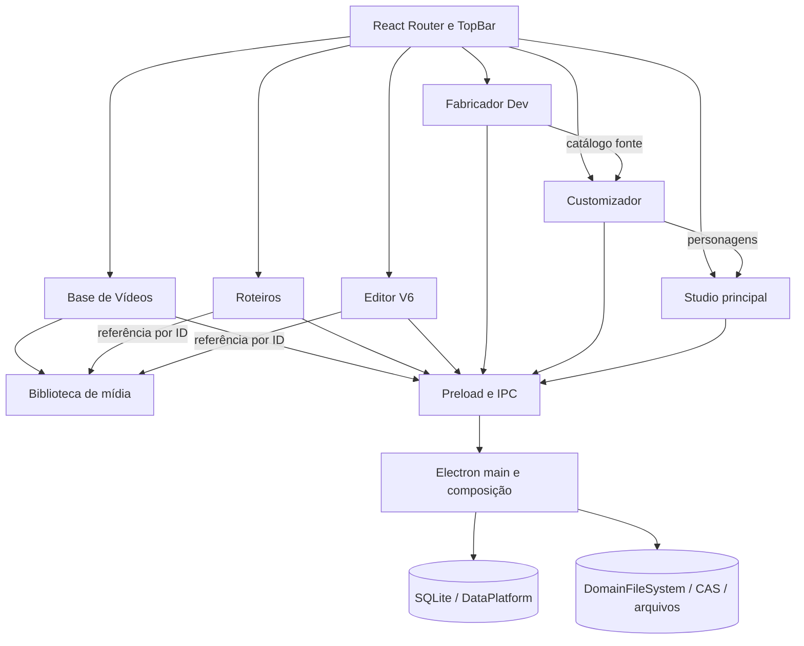

# Mapa do aplicativo e plano de refatoração progressiva

**Data:** 2026-10-27

**Base da reauditoria:** branch local `Dev-V2`, criada sobre `Main-desenvolvimento` no commit `6c2997223430ded043043222469b1fc20a63084f`.

**Escopo:** registrar a arquitetura atual de todas as áreas e conduzir a refatoração por domínio, sem quebrar dados ou fluxos existentes.

## Resumo

O aplicativo tem sete áreas em uma shell Electron/React. A separação de Base de Vídeos e Roteiros já avançou: têm rotas e telas distintas, contratos próprios, APIs com namespace e a Base está em sua própria pasta. A proteção de exclusão também consulta referências nos domínios donos, sem deixar o repositório da Base acessar tabelas de Roteiros.

A **Biblioteca de Mídia** é dona dos arquivos de vídeo e seus IDs. Base de Vídeos guarda estado editorial e numeração; Roteiros e Editor V6 guardam referências por ID. Uma coordenação curta agora serializa alterações nesses vínculos nas três áreas, evitando que um autosave atrasado recoloque a referência depois de excluir o vídeo.

O restante já tem módulos por domínio e armazenamento local com SQLite, arquivos e CAS. Os maiores pontos de concentração são `electron/main.ts`, que ainda registra 57 handlers IPC inline, e páginas React extensas que combinam estado e coordenação de operações. O plano prioriza limites de propriedade, segurança dos dados e redução de responsabilidades por fluxo.

**Próximos passos:** mapear e consolidar a composição de personagens entre Fabricador, Customizador, Studio, Roteiros e Editor V6, usando fixtures visuais antes de trocar os renderizadores.

## 1. Estado observado

- Aplicação desktop local em Electron 44, React 19 e TypeScript; não encontrei backend HTTP separado. O processo principal Electron faz o papel de backend local via IPC.
- O `App` usa React Router, carrega cada área sob demanda e separa Studio, Editor V6, Roteiros, Base de Vídeos, Customizador, Opções e Fabricador Dev.
- O código do processo principal está parcialmente separado por domínio. Há módulos próprios para Base de Vídeos, Customizador, catálogos do Fabricador, Studio principal e Editor V6.
- A persistência mistura SQLite para catálogos/documentos e armazenamento de arquivos por domínio/CAS. O esquema SQLite continua centralizado em `electron/dataPlatform.cjs`.
- Não encontrei solicitação para executar migração de dados; este diagnóstico não migra nem modifica dados pessoais.

### Inventário da reauditoria

- O shell tem sete rotas de produto: Customizador, Studio principal, Editor V6, Roteiros, Base de Vídeos, Opções e Fabricador DEV.
- `electron/domains/` contém módulos para Base de Vídeos, Customizador, Editor V6, Fabricador, Roteiros, armazenamento compartilhado e Studio. `src/shared/` guarda contratos e regras usadas por mais de um processo.
- `electron/main.ts` tem 2.221 linhas nesta revisão e ainda registra 57 handlers IPC diretamente; também compõe serviços que já foram separados em módulos.
- As páginas mais extensas são Customizador (2.776 linhas), Editor V6 (1.788), Studio (1.564) e Fabricador Dev (1.107). Roteiros tem 535, Base de Vídeos 362 e Opções 216 linhas. Esses números localizam concentração de responsabilidades, mas não são por si só motivo para dividir arquivos.
- A auditoria estática de dependências mantém em zero os imports de runtime entre os pares de features listados em `scripts/architecture/boundaries-baseline.json`.

### Mapa resumido



### Caminho de uma operação

```text
App.tsx / TopBar
  → página da feature em src/renderer/src/features/<domínio>
  → contrato window.desktop em src/shared + desktop.d.ts
  → método correspondente em electron/preload.ts
  → canal IPC registrado por electron/main.ts ou electron/domains/<domínio>
  → validação e caso de uso do domínio
  → DataPlatform/SQLite, DomainFileSystem/CAS ou arquivos do domínio
  → resposta pelo mesmo contrato até a página
```

O renderer não abre SQLite nem acessa o disco diretamente. `electron/main.ts` compõe os serviços e ainda conserva handlers inline; quando a área tem módulo extraído, o preload e o handler mantêm o nome de canal existente. `desktop.d.ts` descreve o objeto exposto em `contextBridge`.

## 2. Base de Vídeos e Roteiros

### O que já está separado

- `TopBar.tsx` tem entradas distintas para `/roteiros` e `/base-videos`.
- `App.tsx` tem rotas e carregamento lazy distintos.
- `electron/domains/baseVideos/` contém `service.ts`, `repository.ts`, `validation.ts` e `ipc.ts`.
- Os metadados de Base ficam em tabelas próprias (`base_video_details`, categorias, atribuições e sequência); os documentos ficam em `roteiros`, `roteiro_tiktoks`, `roteiro_sections` e logs.
- O vínculo de vídeo no roteiro é por ID; os bytes não são copiados para cada roteiro.
- `RoteiroVideoReference` também persiste nome, formato, tamanho e duração junto ao ID. Isso funciona como snapshot de exibição, mas pode ficar desatualizado depois de renomear o item na biblioteca; leitura e exportação devem resolver o arquivo pelo ID.

### Situação atual e acoplamentos restantes

| Área | Evidência no código | Efeito |
|---|---|---|
| Local da feature | `BaseVideosPage.tsx` está em `features/baseVideos/`; `App.tsx` mantém rota própria. | Separação visual e de diretório concluída. |
| Contratos | `BaseVideoDetails` e `BaseVideoCategory` estão em `src/shared/baseVideos.ts`; biblioteca e referências estão em `src/shared/mediaLibrary.ts`. | APIs têm donos claros; `RoteirosDesktopApi` continua cuidando apenas dos documentos e exportações de Roteiros. |
| API do preload | `desktop.baseVideos`, `desktop.mediaLibrary` e `desktop.videoBackgrounds` têm namespaces próprios. | Os canais IPC antigos foram preservados; o restante do preload ainda é uma união ampla de APIs. |
| Referências | Roteiros consulta sua tabela em `domains/roteiros/videoReferences.ts`; Editor V6 lê os vínculos nos próprios manifestos. `mediaLibrary/videoReferences.ts` compõe os leitores. | A Base e a Biblioteca chamam a mesma proteção sem conhecer schemas consumidores. |
| Fila | A Base e exclusão da mídia ainda usam `roteirosSaveQueue`; Editor V6 tem fila própria; gravações que alteram referências passam por um coordenador comum. | O coordenador serializa apenas salvamentos que adicionam vínculos e exclusões; as filas próprias preservam a ordem do restante das gravações. |
| Ownership de mídia | `VideoLibraryStore` mantém originais em `media-library`; Roteiros, Base e Editor V6 usam o mesmo ID/arquivo. O caminho legado é composto por `studioLibraryPath('video')`, sob `studios/Editor Gacha`. | O catálogo de arquivos é compartilhado e não pertence exclusivamente à tela de Base de Vídeos. O nome/caminho legado não deve ser renomeado durante uma extração de código. |
| Estado “Rascunho/Base” | A tela calcula isso pela presença de `video_number` em `base_video_details`; não há tabela de rascunhos separada. | “Rascunho” é um estado de publicação dentro do mesmo catálogo, não uma biblioteca física independente. |
| Consumidores | Roteiros e Editor V6 escolhem e consultam itens via `desktop.mediaLibrary`; metadados editoriais via `desktop.baseVideos`. | A relação por ID fica clara e não duplica o arquivo. |
| Exclusão | Os canais da Base e da Biblioteca compartilham a mesma proteção de referências. | A regra é comum; novos consumidores precisam registrar seu leitor no serviço da biblioteca. |
| Tipo legado | `VideoLibraryItem` ainda mantém o campo `studios` em `src/shared/mediaLibrary.ts`. | O contrato foi movido para o domínio de mídia, mas o campo antigo merece remoção apenas após verificar todos os consumidores e dados. |

### Propriedade recomendada

```text
Biblioteca de mídia (Media Library)
  ├─ é dona do arquivo binário, ID, nome, formato, tamanho, duração e disponibilidade
  ├─ fornece importação, leitura/stream e exclusão física protegida
  └─ mantém/verifica referências recebidas de outros domínios

Base de Vídeos
  ├─ é dona do estado de publicação, número sequencial, categoria e descrição editorial
  └─ associa seus metadados ao ID da biblioteca de mídia

Roteiros
  ├─ é dono dos documentos, seções, falas/pensamentos e logs de exportação
  └─ guarda referências por ID a vídeos; não é dono dos arquivos

Editor V6
  └─ pode referenciar um item da biblioteca, sem passar a depender dos metadados editoriais da Base
```

“Separação real” não significa criar cópia do mesmo MP4 nem proibir vínculo. Significa cada domínio possuir seus dados e casos de uso, consumir contratos explícitos e não fazer SQL direto nas tabelas internas de outro domínio.

### Sequência segura para essa separação

1. **Extrair contratos sem mudar o disco — concluído:** tipos de Base e mídia têm arquivos próprios; os dados de roteiro continuam no contrato de Roteiros.
2. **Separar APIs do preload por namespace — concluído:** consumidores usam `desktop.mediaLibrary` e `desktop.baseVideos`, mantendo os canais IPC atuais.
3. **Mover a UI — concluído:** BaseVideosPage tem pasta própria e preserva sua rota/layout.
4. **Desacoplar referências — concluído nesta etapa:** leitores ficam nos domínios donos e uma proteção comum verifica Roteiros e Editor V6 antes da exclusão.
5. **Concluído — separar concorrência por responsabilidade:** salvamentos de referências e exclusão passam por um coordenador curto, mantendo `roteirosSaveQueue` e a fila do Editor V6 para o restante das operações.
6. **Consolidar a biblioteca de mídia:** mover API e tipo hoje pendurados em `studio.ts` para `mediaLibrary`, removendo os campos `studios` apenas após verificar compatibilidade de todos os consumidores e documentos persistidos.
7. **Somente depois avaliar o schema:** manter `base_video_details`, tabelas de Roteiros e IDs atuais. Não é necessário separar SQLite por arquivo para obter isolamento de domínio. Qualquer normalização de `video_asset_json` para uma tabela relacional exige inventário de documentos legados, migração testável e rollback.

### Critérios de aceitação

- Salvar/excluir metadados da Base não reescreve documentos Roteiros.
- Roteiros pode selecionar vídeo por ID e continua exibindo o arquivo correto após reiniciar.
- Excluir um roteiro nunca apaga um vídeo publicado.
- Excluir mídia usada por Roteiros ou Editor V6 é bloqueado; remover uma referência libera a exclusão somente quando não houver outras referências.
- Publicar, desfazer publicação (se suportado), categorizar, renomear e mover o item entre as vistas mantém IDs e numeração existentes.
- Nenhum MP4 é duplicado por causa de vínculo a um roteiro.
- Corrida de autosave de Roteiros contra exclusão de vídeo não pode deixar referência quebrada.
- Contratos JSON/SQLite e rotas visuais existentes permanecem compatíveis.

## 3. Mapa do restante do aplicativo

| Área | Entrada visual e dono | Integrações e persistência | Observação estrutural |
|---|---|---|---|
| Fabricador Dev | `features/fabricator/FabricatorPage.tsx`; catálogo autoral de modelos, poses, roupas, cabelo, rosto, presets e animações. | `domains/fabricator/` concentra catálogos, IPC, persistência versionada, transações e recuperação; é fonte do Customizador e de outros renderizadores. | Vários domínios já foram extraídos; a página ainda coordena workspaces e comandos. |
| Customizador | `features/customizer/CustomizerPage.tsx`; instâncias de personagens e escolhas/overrides individuais. | `domains/customizer/` tem validação, serviço, repositório e IPC; lê catálogos do Fabricador e alimenta Studio, Roteiros e Editor V6. | Renderização e coordenação de estado ainda estão concentradas na página. |
| Studio principal | `features/studio/StudioPage.tsx`; documento de cena e composição. | `domains/studio/` tem IPC primário, índice e persistência; usa personagens do Customizador e armazenamento visual comum. | Separar estado, cena e painéis sem trocar a persistência de projetos. |
| Editor V6 | `features/editorV6/EditorV6Page.tsx`; projetos, timeline, preview e exportação. | `domains/editorV6/` cobre IPC, manifesto/índice, journal de assets, motions e workers/processo de exportação; usa biblioteca por ID. | Manter engine, preview, timeline e export em fronteiras estáveis. |
| Roteiros | `features/roteiros/RoteirosPage.tsx`; documentos, seções, elenco, falas/pensamentos e exportações. | `domains/roteiros/` tem serviços, repositórios SQLite, validação e IPC de documentos, logs, bibliotecas e exportações; usa Biblioteca/Base por ID, fundos compartilhados e personagens do Customizador/Fabricador. | A renderização dos personagens é feita no renderer; o processo principal valida e recebe os arquivos PNG antes de publicar o projeto exportado. |
| Base de Vídeos | `features/baseVideos/BaseVideosPage.tsx`; publicação, numeração, descrição, categorias e vistas de rascunho. | `domains/baseVideos/` tem serviço, repositório, validação e IPC; metadados relacionam ao ID da Biblioteca em SQLite. | Feature e namespace próprios; exclusão coordenada com consumidores dos vídeos. |
| Opções/Dados | `features/options/OptionsPage.tsx`; backups, inventário, migração e configurações. | `DataPlatform`, `DataMigrationService`, `DataBackupService` e `DomainFileSystem` coordenam SQLite, CAS e arquivos. | Infraestrutura crítica; migrações reais continuam explícitas e verificáveis. |

### Camadas transversais

- **Shell visual:** `src/renderer/src/ui/App.tsx` define sete rotas e lazy-load; `TopBar` escolhe a área; `AppErrorBoundary` e o fallback Suspense tratam falha/carregamento por rota.
- **Contrato desktop:** `electron/preload.ts` constrói o objeto protegido `window.desktop`; contratos de domínio ficam em `src/shared/` e a declaração global em `desktop.d.ts`. As APIs de Base, mídia, Studio e Editor V6 já têm nomes próprios; ainda há APIs de Fabricador, Roteiros, Customizador e Opções no objeto raiz.
- **Composição:** `electron/main.ts` inicializa Electron, filesystem, migrações e bibliotecas, registra IPC, conecta serviços e conserva 57 handlers inline. Os módulos em `electron/domains/` já removem vários desses fluxos da raiz.
- **Dados:** `electron/dataPlatform.cjs` possui schema e catálogo SQLite centralizados; `DomainFileSystem` permite caminhos lógicos sobre armazenamento físico/CAS; cada domínio mantém manifestos e arquivos próprios. Os nomes antigos dos diretórios são parte da compatibilidade.
- **Renderização compartilhada:** `src/shared/` contém contratos/regras puras de geometria, seleção, timelines e expressões; há consumers visuais separados nas features. Ainda falta comparar e consolidar os caminhos de composição do personagem usando os fixtures dourados antes de compartilhar implementação.

### Dívida estrutural geral

1. **Composition root inchado:** `electron/main.ts` tem 2.221 linhas e registra 57 `ipcMain.handle` diretamente. Ele faz mais do que inicializar o app: mantém persistência e fluxos de Roteiros, arquivos, vídeo e catálogos. A direção é extrair handlers e casos de uso restantes para domínios, mantendo `main.ts` como composição e ciclo de vida.
2. **Preload amplo:** `electron/preload.ts` reúne os métodos de Fabricador, Customizador, Studio, Editor V6, mídia e Roteiros; `desktop.d.ts` espelha essa união. Base de Vídeos e Biblioteca de Mídia já têm namespaces próprios; os demais contratos ainda podem ficar mais explícitos sem trocar imediatamente os canais IPC.
3. **Páginas longas:** Customizador (2.776 linhas), Editor V6 (1.788), Studio (1.564) e Fabricador Dev (1.107) ainda concentram estado e operações. A refatoração deve extrair casos de uso, seletores, hooks e componentes por responsabilidade, sem dividir apenas para reduzir contagem de linhas.
4. **Núcleo de renderização de personagem:** Fabricador, Customizador, Studio e Editor V6 consomem modelos e composições em contextos diferentes. Um núcleo compartilhado exige contratos claros e fixtures visuais douradas antes de trocar os caminhos atuais.
5. **Persistência heterogênea:** algumas áreas já usam serviços/repositórios/filas, outras gravam diretamente no `main.ts`. Cada domínio precisa declarar quem é dono do formato, fila, backup, recuperação e validade de referências.
6. **Storage distribuído:** bibliotecas e projetos usam caminhos legados em `app-data/runtime/profile/...` sobre a infraestrutura DataPlatform/CAS. Não renomear diretórios por estética; caminhos fazem parte da compatibilidade e dos dados do usuário.
7. **Documentação em camadas:** há ADRs úteis e relatórios de ciclos anteriores. Manter este arquivo como investigação atual e atualizar o índice da arquitetura quando a primeira fase for implementada; relatórios históricos não substituem o código presente.

## 4. Ordem de refatoração recomendada para o app

### Ciclo 1 — Base de Vídeos, Biblioteca de Mídia e Roteiros

- **Concluído:** isolar contratos e APIs por namespace, mover a UI e centralizar a verificação das referências.
- **Concluído:** coordenar gravações de Roteiros e Editor V6 com exclusão de mídia; preservar as filas e a ordem existentes por domínio.
- **Pendente:** retirar o campo `studios` do contrato de mídia após inventariar consumidores legados.
- Preservar caminho, IDs, JSON, schema SQLite e vínculos atuais.

### Ciclo 2 — Composição Electron e domínio de Roteiros

- **Concluído:** extrair `roteiros:list/save` em validação de lote, serviço, repositório e handlers IPC pequenos.
- **Concluído:** extrair logs de exportação com validação, serviço, repositório e handlers IPC pequenos.
- **Concluído nesta etapa:** extrair os canais de GIFs e fundos para serviços e IPC por domínio, preservando nomes, validação de origem e vínculos por ID.
- **Concluído nesta etapa:** extrair validação, armazenamento, handlers de exportação e propriedade dos jobs por janela para `domains/roteiros/`.
- Manter funções puras de validação fora do Electron.
- Adotar contratos explícitos de comandos/consultas e autorização IPC uniforme.
- Eliminar SQL de um domínio dentro do repositório de outro.

### Ciclo 3 — Renderização de personagens compartilhada

- Criar um núcleo independente de tela para resolver modelo, pose, expressão, roupas, cabelo, rosto e overrides do personagem.
- Usar o mesmo núcleo nos consumidores necessários sem importar páginas React entre features.
- Comparar resultados com fixtures douradas existentes de personagem/expressão/roupa antes de trocar os renderizadores.

### Ciclo 4 — Modularização das páginas grandes

- Customizador: separar carregamento, comandos de personagem, navegador de modelo, renderização e painéis.
- Fabricador: separar workspaces e comandos de catálogo; preservar transações, histórico e snapshots.
- Studio e Editor V6: separar estado/documento, timeline/cena, exportação e painel; não compartilhar engines por semelhança visual sem contrato explícito.

### Ciclo 5 — Persistência e confiabilidade transversal

- Mapear filas e operações atômicas por domínio.
- Formalizar como entidades registram referências de assets e projetos.
- Testar crash/reabertura/backup/restauração com perfis sintéticos isolados.
- Medir desempenho antes de otimizar store, renderização ou CAS.

## 5. Regras para preservar dados durante a refatoração

- Não trocar `id` de vídeo, roteiro, personagem, pose ou asset.
- Não mover fisicamente arquivos do perfil durante a separação de código.
- Não modificar esquema SQLite, formato JSON ou canais IPC na mesma etapa que mover UI.
- Não excluir nem reescrever `entity_references` como se já cobrisse vídeos: o código atual tem a tabela genérica, mas não encontrei indexação de referências de Roteiros/Editor V6 à biblioteca de vídeo através dela.
- Manter o perfil pessoal fora dos testes; usar fixtures sintéticas para falhas, ordenação e recuperação.
- Alterações localizadas devem ficar em commits pequenos e descritivos; manter `ABRIR_DESENVOLVIMENTO.bat` fora dos commits se continuar modificado.

## 6. Primeira etapa de implementação

Em 27/10/2026 foi aplicado um primeiro corte de separação no código:

- Contratos de Base de Vídeos movidos para `src/shared/baseVideos.ts`.
- Biblioteca reutilizável de vídeos e snapshots por ID movidos para `src/shared/mediaLibrary.ts`.
- API do renderer agora expõe `desktop.baseVideos` e `desktop.mediaLibrary`; os nomes IPC existentes continuam iguais.
- Tipos e métodos de Base de Vídeos foram removidos do contrato `RoteirosDesktopApi`.
- `BaseVideosPage` foi movida para `features/baseVideos/`.
- Roteiros e Editor V6 usam as APIs com namespace explícito; Editor V6 e Roteiros ainda podem selecionar a mesma mídia por ID.
- Contrato de biblioteca de fundos foi separado como `desktop.videoBackgrounds`.
- Schema SQLite, formatos de persistência, IDs, arquivos no perfil e regras de exclusão não foram alterados.

Este corte separa propriedade dos contratos e chamadas entre domínios, mas não migra a biblioteca física. A Base de Vídeos ainda classifica/publica itens da biblioteca de mídia; Roteiros guarda snapshots com IDs para preservar vínculos existentes.

### Etapa aplicada — proteção de referências por domínio

- `electron/domains/roteiros/videoReferences.ts` consulta referências de vídeos no formato que Roteiros já persiste.
- `electron/domains/editorV6/videoReferences.ts` localiza vínculos por ID nos projetos do Editor V6.
- `electron/domains/mediaLibrary/videoReferences.ts` reúne essas consultas em uma única proteção usada pela exclusão iniciada tanto na Base de Vídeos quanto na Biblioteca de Mídia.
- `BaseVideoRepository` deixou de consultar tabelas de Roteiros. Os canais IPC, IDs, formatos armazenados, banco e fila compartilhada de gravações foram preservados.
- O teste de domínio `npm run test:base-videos` passou com 7 verificações. Nenhum perfil ou mídia real foi usado.

### Etapa aplicada — coordenação de vínculos entre domínios

- `mediaLibrary/videoReferences.ts` agora fornece um coordenador assíncrono que serializa apenas operações capazes de criar ou remover referências a vídeos.
- Salvamentos de Roteiros, gravações do Editor V6 e exclusões iniciadas pela Biblioteca ou pela Base passam pelo mesmo coordenador; `roteirosSaveQueue` e a fila do Editor V6 continuam atendendo suas responsabilidades originais.
- Ao salvar, Roteiros compara os IDs recebidos aos já armazenados em `roteiro_sections`; Editor V6 recupera o journal de assets e compara o documento ao manifesto confirmado. Só vínculos novos são conferidos no catálogo e no arquivo físico da biblioteca.
- Vínculos existentes são preservados mesmo se o arquivo já estiver ausente. Isso mantém projetos legados editáveis; uma gravação atrasada que tente adicionar um ID removido é rejeitada.
- IDs, canais IPC, snapshots, caminhos, schema SQLite e formatos JSON permaneceram iguais. A alteração não acessou nem migrou o perfil pessoal.

### Etapa aplicada — documentos de Roteiros

- `roteiros:list` e `roteiros:save` agora passam por `domains/roteiros/documentIpc.ts`, `service.ts` e `repository.ts`; `validation.ts` valida o lote e os IDs duplicados antes de enfileirar.
- A montagem do documento e a transação SQL foram movidas sem alterar tabelas, ordenação, nomes de canal ou payload. O serviço continua usando a fila compartilhada e o coordenador de vínculos introduzido no ciclo anterior.
- `electron/main.ts` passou de 2.402 para 2.307 linhas e de 74 para 72 handlers inline; os canais extraídos ficam registrados no módulo dono de Roteiros.

### Etapa aplicada — logs de exportação de Roteiros

- Os canais `roteiros:export-logs:*` agora são registrados por `exportLogsIpc.ts`; validação e ordenação ficam em `exportLogsService.ts`, e as consultas/retention de 50 registros ficam em `exportLogsRepository.ts`.
- Os três canais, o limite dos 50 logs mais recentes, as mensagens de validação e a fila de gravações foram preservados. `main.ts` compartilha a mesma fila entre documentos, logs e a Base.
- `electron/main.ts` passou de 2.307 para 2.276 linhas e de 72 para 69 handlers inline.

### Etapa aplicada — bibliotecas de fundos e GIFs de Roteiros

- Os canais `background-library:*` e `roteiros:ui-gifs:*` agora ficam em `domains/mediaLibrary/` e `domains/roteiros/`, com seus casos de uso separados dos detalhes do Electron.
- A checagem de origem confiável continua em cada handler. O seletor de arquivos, caminhos do GIF padrão, mensagens e contratos de retorno continuam iguais.
- Excluir fundo ou GIF e salvar Roteiros agora compartilham a fila de escrita. O serviço impede excluir um item referenciado, e novos vínculos são conferidos na biblioteca antes de gravar; referências antigas continuam editáveis mesmo se o arquivo estiver ausente.
- IDs, canais IPC, schema SQLite, catálogo e caminhos físicos foram preservados. `electron/main.ts` tem 2.294 linhas e 63 handlers inline; a extração reduz responsabilidades da raiz, ainda que a coordenação necessária tenha aumentado algumas linhas de composição.

### Etapa aplicada — exportações de Roteiros

- Os armazenadores de exportação foram organizados em `domains/roteiros/characterExportStore.ts` e `projectExportStore.ts`; validação e coordenação ficam em `exportService.ts`, e os canais são registrados por `exportIpc.ts`.
- Os seis canais continuam iguais. A validação dos personagens para o TXT foi movida para o serviço; a propriedade de cada job continua limitada à janela que o iniciou, e jobs abandonados são cancelados quando essa janela fecha.
- Formatos do projeto, manifesto, limite de arquivos, localização temporária, proteção dos arquivos existentes e rollback continuam no mesmo código de armazenamento, sem alteração dos caminhos ou do projeto exportado.
- `electron/main.ts` tem 2.221 linhas e 57 handlers inline, contra 63 após a extração das bibliotecas. Ele ainda compõe os resolvers da Biblioteca de Mídia, GIFs e fundos para os exports.

### Reauditoria de referências do Video Studio removido

- O commit `a17094a` removeu a rota e a interface do Video Studio. O `App.tsx` atual mantém sete áreas de produto: Customizador, Studio, Editor V6, Roteiros, Base de Vídeos, Opções e Fabricador Dev.
- Sobraram testes estáticos, limites de arquitetura e auditorias que tentavam abrir `/video-studio` ou importar arquivos já apagados. Atualizei os checks mantidos para as telas atuais de Studio/Editor V6, retirei os limites e os registros órfãos e excluí os scripts de auditoria sem alvo ativo.
- As verificações matemáticas de roupa e pose foram preservadas. As funções de renderização continuam pertencendo a `characters/characterRenderer.ts`; removi os reexports de compatibilidade da página Customizador porque a busca não encontrou consumidor ativo fora da auditoria antiga.
- Os diretórios físicos legados `video-studio.media` e `video-studio.backgrounds` permanecem em `DomainFileSystem`, `DataPlatform` e `dataMigration`. São caminhos de dados existentes e não foram renomeados, apagados nem migrados.
- A antiga auditoria de isolamento de Studio/Video Studio foi retirada, sem substituição por um teste visual Studio/Editor V6 nesta etapa. O catálogo mantém as auditorias rápidas com código atual; uma nova auditoria visual das telas atuais pode ser criada quando a interface e seus seletores estiverem mapeados.
- O catálogo agora contém sete auditorias registradas, seis rápidas e uma manual. Os testes que conferem esses metadados foram ajustados, mas não foram executados nesta etapa.
- Studio e Editor V6 agora usam `src/shared/serializedDocumentSave.ts`; o algoritmo de fila era idêntico em dois módulos e continua instanciado separadamente por tela, preservando os canais e as políticas próprias de cada documento.

### Mapa do ciclo 3 — composição de personagens

- `characterRenderer.ts` serve Customizador, Studio, Roteiros e previews do Fabricador. `editorV6CharacterRenderer.ts` contém praticamente a mesma composição; a diferença de implementação está concentrada em tipos faciais, modo `talk-blink`, cache de imagem e descarte explícito de canvases.
- Extraí o LRU de decodificação para `characters/characterImageCache.ts`. Os dois renderizadores agora compartilham a regra e o limite de 512 itens, mantendo instâncias separadas para que a pressão de memória e a política de descarte do Editor V6 não mudem.
- O próximo passo do ciclo é extrair uma API de composição comum que aceite as políticas faciais de cada editor e respeite o `dispose()` do Editor V6. Não trocar o renderizador de nenhum consumidor até comparar os fixtures visuais existentes.

## 7. Próxima tarefa recomendada

Continuar pelo **Ciclo 3**: comparar os caminhos de composição de personagem e formalizar um núcleo compartilhado para modelos, poses, expressões, roupas e overrides. Usar os fixtures visuais dourados como critério de equivalência antes de migrar qualquer consumidor.

## 8. Verificações e validação

- Leitura do código atual de rotas, TopBar, preload, contratos compartilhados, Base de Vídeos, Roteiros, Editor V6, VideoLibrary, boot Electron, módulos de domínio, renderizadores, schema SQLite e ADRs.
- A etapa anterior moveu as consultas de referência para os domínios donos e `npm run test:base-videos` passou com 7 verificações sintéticas. Nenhum perfil ou mídia real foi usado.
- Nas etapas recentes, `git diff --check` e `node --experimental-strip-types --check` nos arquivos TypeScript alterados passaram. `npm run typecheck` e `npm run audit:architecture` não iniciaram porque as dependências locais (`tsc`/pacote `typescript`) não estão instaladas; os testes de regressão não foram executados.
- Typecheck, auditoria de arquitetura, build e regressões das etapas recentes ficam pendentes até as dependências do projeto estarem disponíveis.
