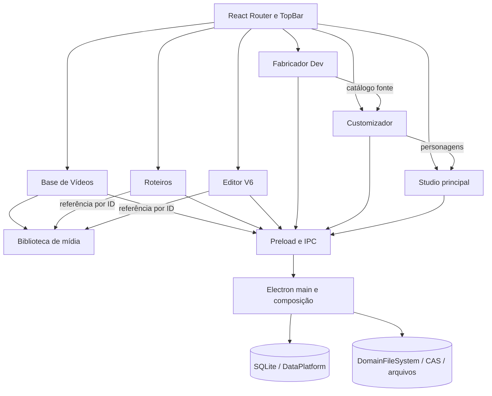

# Investigação de arquitetura e plano de refatoração

**Data:** 2026-10-27  
**Branch/HEAD analisados:** `Main-desenvolvimento` / `2acbc782d465406a36f815892cd2ea1077e8db7f`  
**Escopo pedido:** separar de verdade Base de Vídeos e Roteiros; depois melhorar a estrutura do restante do aplicativo.

## Resumo

O app já tem uma divisão visual entre **Base de Vídeos** e **Roteiros**: são entradas e rotas diferentes na barra superior. A divisão interna ainda é parcial. A Base de Vídeos aparece dentro da pasta de código de Roteiros, compartilha com Roteiros os tipos e a API do preload, e o serviço de Base consulta diretamente tabelas de Roteiros para impedir exclusões. Os dois também usam uma fila de gravação comum.

Há uma terceira responsabilidade que precisa ser nomeada antes da refatoração: **a biblioteca de mídia**, que guarda os arquivos de vídeo por ID. Base de Vídeos controla publicação, numeração, categorias e detalhes. Roteiros guarda referências aos vídeos que usa. Editor V6 também pode referenciar itens dessa biblioteca. Separar Base de Vídeos de Roteiros não deve duplicar arquivos nem quebrar essas referências.

O restante do app já tem módulos por domínio e uma infraestrutura local de SQLite, arquivos e CAS. A dívida maior está na composição: `electron/main.ts` ainda registra muitos handlers e concentra fluxos; o preload expõe uma API larga; algumas páginas React concentram milhares de linhas e estado, apresentação e coordenação de operações.

**Recomendação:** começar por uma separação de contratos e propriedade sem alterar dados em disco: `mediaLibrary`, `baseVideos` e `roteiros` como APIs/domínios explícitos; manter IDs e canais legados durante a migração; retirar buscas de Roteiros de dentro do repositório da Base; formalizar um serviço comum para verificar referências antes de apagar mídia. Depois migrar consumidores e mover a página de Base de Vídeos para sua própria feature.

## 1. Estado observado

- Aplicação desktop local em Electron 44, React 19 e TypeScript; não encontrei backend HTTP separado. O processo principal Electron faz o papel de backend local via IPC.
- O `App` usa React Router, carrega cada área sob demanda e separa Studio, Editor V6, Roteiros, Base de Vídeos, Customizador, Opções e Fabricador Dev.
- O código do processo principal está parcialmente separado por domínio. Há módulos próprios para Base de Vídeos, Customizador, catálogos do Fabricador, Studio principal e Editor V6.
- A persistência mistura SQLite para catálogos/documentos e armazenamento de arquivos por domínio/CAS. O esquema SQLite continua centralizado em `electron/dataPlatform.cjs`.
- Não encontrei solicitação para executar migração de dados; este diagnóstico não migra nem modifica dados pessoais.

### Mapa resumido



## 2. Base de Vídeos e Roteiros

### O que já está separado

- `TopBar.tsx` tem entradas distintas para `/roteiros` e `/base-videos`.
- `App.tsx` tem rotas e carregamento lazy distintos.
- `electron/domains/baseVideos/` contém `service.ts`, `repository.ts`, `validation.ts` e `ipc.ts`.
- Os metadados de Base ficam em tabelas próprias (`base_video_details`, categorias, atribuições e sequência); os documentos ficam em `roteiros`, `roteiro_tiktoks`, `roteiro_sections` e logs.
- O vínculo de vídeo no roteiro é por ID; os bytes não são copiados para cada roteiro.
- `RoteiroVideoReference` também persiste nome, formato, tamanho e duração junto ao ID. Isso funciona como snapshot de exibição, mas pode ficar desatualizado depois de renomear o item na biblioteca; leitura e exportação devem resolver o arquivo pelo ID.

### Acoplamentos encontrados

| Área | Evidência no código | Efeito |
|---|---|---|
| Local da feature | `BaseVideosPage.tsx` está em `features/roteiros/`; `App.tsx` importa dali. | A estrutura comunica que Base de Vídeos pertence a Roteiros, apesar de a navegação já separá-los. |
| Contratos | `BaseVideoDetails`, `BaseVideoCategory` e `RoteirosDesktopApi` estão juntos em `src/shared/roteiros.ts`. | Roteiros é a dependência de tipo/API da Base; o contrato não expressa as fronteiras reais. |
| API do preload | Métodos `listBaseVideoDetails`, `publishBaseVideo`, categorias e exclusão estão dentro de `RoteirosDesktopApi`; biblioteca de vídeo está em `VideoLibraryDesktopApi` definido em `studio.ts`. | Três domínios aparecem como uma API plana e nomes herdados do Studio continuam no contrato. |
| Repositório da Base | `BaseVideoRepository.assertNotReferencedByRoteiros()` consulta `roteiro_sections.video_asset_json` com `json_extract`. | Repositório da Base conhece o schema interno de Roteiros. |
| Fila | `BaseVideoService.enqueueWrite` recebe a mesma `roteirosSaveQueue`. | A serialização de todas as escritas da Base depende da fila de Roteiros. A fila evita uma corrida entre salvar referências e excluir mídia, mas acopla operações não relacionadas. |
| Ownership de mídia | `VideoLibraryStore` mantém originais em `media-library`; Roteiros, Base e Editor V6 usam o mesmo ID/arquivo. O caminho legado é composto por `studioLibraryPath('video')`, sob `studios/Editor Gacha`. | O catálogo de arquivos é compartilhado e não pertence exclusivamente à tela de Base de Vídeos. O nome/caminho legado não deve ser renomeado durante uma extração de código. |
| Estado “Rascunho/Base” | A tela calcula isso pela presença de `video_number` em `base_video_details`; não há tabela de rascunhos separada. | “Rascunho” é um estado de publicação dentro do mesmo catálogo, não uma biblioteca física independente. |
| Consumidores | `RoteiroSectionEditor` importa vídeo, seleciona publicado, salva detalhes e publica; Editor V6 lista biblioteca e detalhes para montar o modal de seleção. | Integração por ID é legítima, mas os consumidores usam contratos planos da Base/Roteiros. |
| Exclusão | A Base verifica seção de roteiro; a exclusão da biblioteca no `main.ts` também verifica Roteiros e Editor V6. | Regras de referência estão distribuídas por endpoints e tabelas; é fácil uma nova área esquecer a proteção. |
| Tipos legados | `VideoLibraryItem` e `VideoLibraryDesktopApi` estão em `src/shared/studio.ts`, e o item expõe `studios`. | Há nomenclatura que remete ao Video Studio removido e sugere associações que o catálogo atual preenche como lista vazia. |

### Propriedade recomendada

```text
Biblioteca de mídia (Media Library)
  ├─ é dona do arquivo binário, ID, nome, formato, tamanho, duração e disponibilidade
  ├─ fornece importação, leitura/stream e exclusão física protegida
  └─ mantém/verifica referências recebidas de outros domínios

Base de Vídeos
  ├─ é dona do estado de publicação, número sequencial, categoria e descrição editorial
  └─ associa seus metadados ao ID da biblioteca de mídia

Roteiros
  ├─ é dono dos documentos, seções, falas/pensamentos e logs de exportação
  └─ guarda referências por ID a vídeos; não é dono dos arquivos

Editor V6
  └─ pode referenciar um item da biblioteca, sem passar a depender dos metadados editoriais da Base
```

“Separação real” não significa criar cópia do mesmo MP4 nem proibir vínculo. Significa cada domínio possuir seus dados e casos de uso, consumir contratos explícitos e não fazer SQL direto nas tabelas internas de outro domínio.

### Sequência segura para essa separação

1. **Extrair os contratos sem mudar o disco:** criar tipos próprios de Base de Vídeos e Biblioteca de Mídia; `RoteiroDocument` e sua API ficam em contrato de Roteiros. Manter reexports temporários para compatibilidade interna enquanto cada consumidor migra.
2. **Separar APIs do preload por namespace:** `desktop.mediaLibrary`, `desktop.baseVideos` e `desktop.roteiros`. Manter os canais IPC atuais durante a primeira etapa; atualizar BaseVideosPage, RoteiroSectionEditor e EditorV6VideoPickerModal para usarem o namespace dono de cada operação.
3. **Mover a UI:** transferir BaseVideosPage e componentes próprios para `features/baseVideos/`; Roteiros continua importando apenas fluxos de mídia que façam parte do caso de uso de roteiro. Preservar rotas, navegação e layout.
4. **Desacoplar referências:** retirar a consulta SQL de `roteiro_sections` de `BaseVideoRepository`. Criar porta/serviço de verificação de referências injetado na composição do app. Ele consulta referências de Roteiros e Editor V6 e mantém o comportamento atual de bloquear exclusão.
5. **Separar concorrência por responsabilidade:** não remover `roteirosSaveQueue` antes de criar uma proteção explícita para corrida entre gravar referências e excluir mídia. Escritas de descrição/categoria e roteiros podem ter filas próprias; a mutação que apaga mídia deve compartilhar somente um lock/serviço de referência.
6. **Consolidar a biblioteca de mídia:** mover API e tipo hoje pendurados em `studio.ts` para `mediaLibrary`, removendo os campos `studios` apenas após verificar compatibilidade de todos os consumidores e documentos persistidos.
7. **Somente depois avaliar o schema:** manter `base_video_details`, tabelas de Roteiros e IDs atuais. Não é necessário separar SQLite por arquivo para obter isolamento de domínio. Qualquer normalização de `video_asset_json` para uma tabela relacional exige inventário de documentos legados, migração testável e rollback.

### Critérios de aceitação

- Salvar/excluir metadados da Base não reescreve documentos Roteiros.
- Roteiros pode selecionar vídeo por ID e continua exibindo o arquivo correto após reiniciar.
- Excluir um roteiro nunca apaga um vídeo publicado.
- Excluir mídia usada por Roteiros ou Editor V6 é bloqueado; remover uma referência libera a exclusão somente quando não houver outras referências.
- Publicar, desfazer publicação (se suportado), categorizar, renomear e mover o item entre as vistas mantém IDs e numeração existentes.
- Nenhum MP4 é duplicado por causa de vínculo a um roteiro.
- Corrida de autosave de Roteiros contra exclusão de vídeo não pode deixar referência quebrada.
- Contratos JSON/SQLite e rotas visuais existentes permanecem compatíveis.

## 3. Mapa do restante do aplicativo

| Área | Responsabilidade principal | Integrações importantes | Observação estrutural |
|---|---|---|---|
| Fabricador Dev | Catálogo autoral de modelos, poses, roupas, cabelo, rosto, presets e animações. | Fonte para Customizador; dados visuais usados por Editor V6 e exportações. | Vários domínios já foram extraídos; `FabricatorPage.tsx` ainda coordena muitas operações. |
| Customizador | Personagens e escolhas/overrides individuais. | Lê catálogos do Fabricador; alimenta Studio, Roteiros e Editor V6. | `CustomizerPage.tsx` tem cerca de 2.753 linhas; renderização e coordenação de estado são candidatos separados. |
| Studio principal | Documentos de cena e composição. | Usa personagens do Customizador e infraestrutura visual comum. | `StudioPage.tsx` tem cerca de 1.564 linhas; persistência primária já tem módulos próprios. |
| Editor V6 | Projetos de timeline, preview, importação por ID, exportação e FFmpeg. | Usa Biblioteca de Mídia; lê personagem/pose/presets sem ser o Studio. | `EditorV6Page.tsx` tem cerca de 1.877 linhas; manter engine/preview/export em fronteiras estáveis. |
| Roteiros | Documentos, seções, elenco, falas/pensamentos e exportações. | IDs da Biblioteca/Base; personagens e dados de Fabricador no export de personagens. | Persistência/listagem/export de roteiros ainda estão em `main.ts`. |
| Base de Vídeos | Publicação, numeração, descrição, categorias, buscas e vistas de rascunho. | Metadata para seleção dentro de Roteiros/Editor V6. | Rota separada, diretório e API ainda misturados com Roteiros/Studio. |
| Opções/Dados | Backups, inventário, migração guiada e armazenamento local. | SQLite, CAS, DomainFileSystem e domínios de arquivo. | Infraestrutura crítica; migrações reais devem continuar explícitas e verificáveis. |

### Dívida estrutural geral

1. **Composition root inchado:** `electron/main.ts` tem ~2.335 linhas e registra 74 `ipcMain.handle`. Ele faz mais do que inicializar o app: mantém lógica de persistência e fluxos de Roteiros, arquivos, vídeo e catálogos. A direção é extrair os handlers/casos de uso restantes para domínios mantendo `main.ts` como composição e ciclo de vida.
2. **Preload amplo:** `electron/preload.ts` monta uma API plana que combina Fabricador, Customizador, Studio, Editor V6, mídia e Roteiros; `desktop.d.ts` espelha essa união. Namespaces de domínio reduzem erros de ownership sem alterar imediatamente os canais IPC.
3. **Páginas longas:** além das páginas de Base/Roteiros, Customizador (2.753 linhas), Editor V6 (1.877), Studio (1.564) e Fabricador (1.107) concentram estado e operações. A refatoração deve extrair use cases/selectors/hooks por responsabilidade e componentes visuais, sem dividir apenas para reduzir contagem de linhas.
4. **Compartilhamento visual por páginas:** ADR-002 registra dependências do Studio para `CustomizerPage` e uma dependência Customizador → Fabricador em `DesignBanner`. Extrair um núcleo de renderização de personagem requer fixtures visuais/golden antes de retirar esses imports.
5. **Persistência heterogênea:** algumas áreas já usam serviços/repositórios/filas, outras gravam diretamente no `main.ts`. Cada domínio precisa declarar quem é dono do formato, fila, backup, recuperação e validade de referências.
6. **Storage distribuído:** bibliotecas e projetos usam caminhos legados em `app-data/runtime/profile/...` sobre a infraestrutura DataPlatform/CAS. Não renomear diretórios por estética; caminhos fazem parte da compatibilidade e dos dados do usuário.
7. **Documentação em camadas:** há ADRs úteis e relatórios de ciclos anteriores. Manter este arquivo como investigação atual e atualizar o índice da arquitetura quando a primeira fase for implementada; relatórios históricos não substituem o código presente.

## 4. Ordem de refatoração recomendada para o app

### Ciclo 1 — Base de Vídeos, Biblioteca de Mídia e Roteiros

- Isolar contratos e APIs por namespace.
- Mover UI da Base para feature independente.
- Extrair proteção de referências para uma porta/serviço comum.
- Separar filas sem abrir corrida entre gravação e exclusão.
- Preservar caminho, IDs, JSON, schema SQLite e vínculos atuais.

### Ciclo 2 — Composição Electron e domínio de Roteiros

- Extrair `roteiros:list/save`, export logs, GIFs/fundos e exportações de `main.ts` em serviços/repositórios/IPC pequenos.
- Manter funções puras de validação fora do Electron.
- Adotar contratos explícitos de comandos/consultas e autorização IPC uniforme.
- Eliminar SQL de um domínio dentro do repositório de outro.

### Ciclo 3 — Renderização de personagens compartilhada

- Criar um núcleo independente de tela para resolver modelo, pose, expressão, roupas, cabelo, rosto e overrides do personagem.
- Usar o mesmo núcleo nos consumidores necessários sem importar páginas React entre features.
- Comparar resultados com fixtures douradas existentes de personagem/expressão/roupa antes de trocar os renderizadores.

### Ciclo 4 — Modularização das páginas grandes

- Customizador: separar carregamento, comandos de personagem, navegador de modelo, renderização e painéis.
- Fabricador: separar workspaces e comandos de catálogo; preservar transações, histórico e snapshots.
- Studio e Editor V6: separar estado/documento, timeline/cena, exportação e painel; não compartilhar engines por semelhança visual sem contrato explícito.

### Ciclo 5 — Persistência e confiabilidade transversal

- Mapear filas e operações atômicas por domínio.
- Formalizar como entidades registram referências de assets e projetos.
- Testar crash/reabertura/backup/restauração com perfis sintéticos isolados.
- Medir desempenho antes de otimizar store, renderização ou CAS.

## 5. Regras para preservar dados durante a refatoração

- Não trocar `id` de vídeo, roteiro, personagem, pose ou asset.
- Não mover fisicamente arquivos do perfil durante a separação de código.
- Não modificar esquema SQLite, formato JSON ou canais IPC na mesma etapa que mover UI.
- Não excluir nem reescrever `entity_references` como se já cobrisse vídeos: o código atual tem a tabela genérica, mas não encontrei indexação de referências de Roteiros/Editor V6 à biblioteca de vídeo através dela.
- Manter o perfil pessoal fora dos testes; usar fixtures sintéticas para falhas, ordenação e recuperação.
- Alterações localizadas devem ficar em commits pequenos e descritivos; manter `ABRIR_DESENVOLVIMENTO.bat` fora dos commits se continuar modificado.

## 6. Próxima tarefa recomendada

Começar pelo **Ciclo 1, etapa 1: contratos e APIs separados**, antes de mexer em persistência ou mover dados. A primeira alteração deve criar contratos próprios de `mediaLibrary` e `baseVideos`, retirar esses tipos/métodos de `roteiros.ts` e `studio.ts` por migração compatível, e atualizar os consumidores para os namespaces certos. Em seguida, mover `BaseVideosPage` para `features/baseVideos/`.

Esse é o menor corte que torna a separação visível no código e estabelece uma base segura para remover o SQL cruzado e a fila compartilhada. A validação seguinte deve concentrar-se nos vínculos por ID, exclusão protegida e numeração atual, antes de qualquer migração de banco.

## 7. Verificações desta investigação

- Leitura do código atual de rotas, TopBar, preload, contratos compartilhados, BaseVideos, Roteiros, Editor V6 picker, VideoLibrary, serviços e repositórios.
- Leitura do schema SQLite e dos ADRs/documentos de arquitetura existentes.
- Não rodei testes/build e não alterei código ou dados do app nesta investigação.
