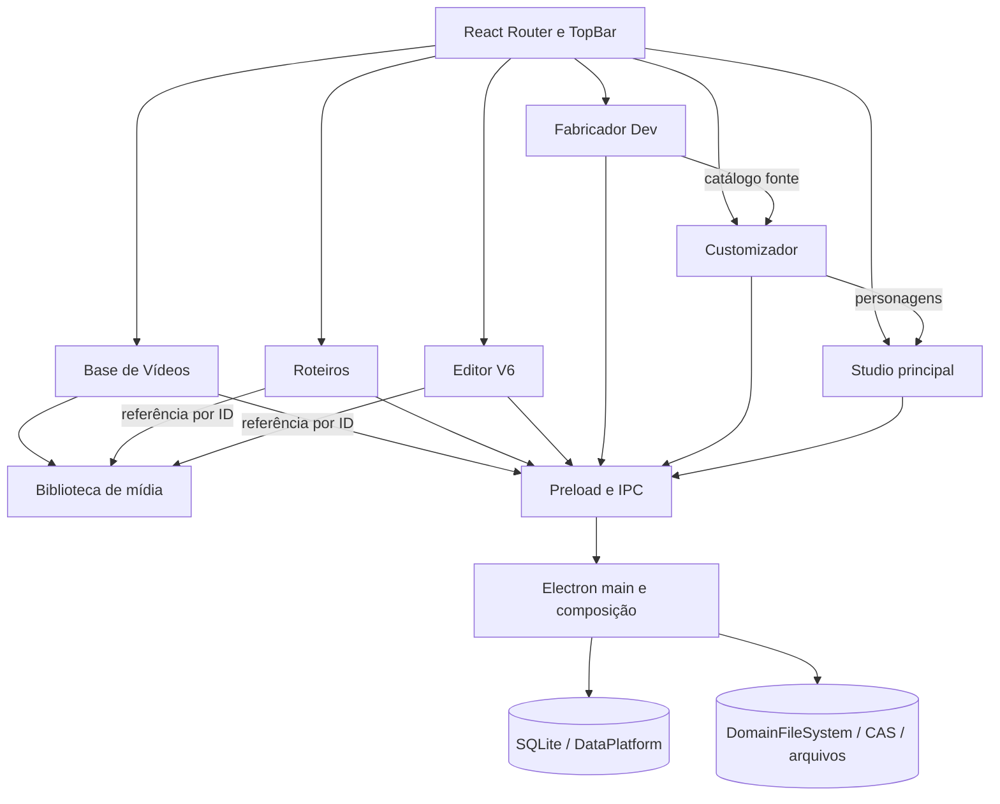

# Mapa do aplicativo e plano de refatoração progressiva

**Data:** 2026-10-27

**Última atualização:** 2026-10-28

**Base histórica da reauditoria:** branch local `Dev-V2`, criada sobre `Main-desenvolvimento` no commit `6c2997223430ded043043222469b1fc20a63084f`.

**Snapshot revalidado nesta etapa:** branch local `Dev-V2`, commit `c98f630` (`refactor(fabricator): use shared preview background hook`), antes da atualização incremental do contrato IPC descrita abaixo.

**Base histórica do primeiro ciclo:** commit `805798f` (`refactor(media): remove obsolete video studios field`), branch local `Dev-V2`.

**Objetivo:** manter um mapa atualizado dos fluxos, contratos e responsáveis por dados em todas as áreas do Native-gacha; refatorar em etapas pequenas sustentadas por evidência; simplificar módulos e remover código obsoleto somente após confirmar seus consumidores; e fortalecer as conexões entre áreas sem quebrar telas, IPC, formatos persistidos ou dados do usuário. Cada etapa deve registrar o caminho afetado, a mudança estrutural, as verificações executadas e um commit local revisável.

**Escopo:** diagnóstico arquitetural e melhorias incrementais de código e contratos. Mudanças de schema, migrações de dados, exclusões de assets ou alterações visuais compartilhadas exigem mapeamento e verificação próprios antes de serem incluídas.

## Resumo

O aplicativo tem sete áreas em uma shell Electron/React. A separação de Base de Vídeos e Roteiros já avançou: têm rotas e telas distintas, contratos próprios, APIs com namespace e a Base está em sua própria pasta. A proteção de exclusão também consulta referências nos domínios donos, sem deixar o repositório da Base acessar tabelas de Roteiros.

A **Biblioteca de Mídia** é dona dos arquivos de vídeo e seus IDs. Base de Vídeos guarda estado editorial e numeração; Roteiros e Editor V6 guardam referências por ID. Uma coordenação curta agora serializa alterações nesses vínculos nas três áreas, evitando que um autosave atrasado recoloque a referência depois de excluir o vídeo.

O restante já tem módulos por domínio e armazenamento local com SQLite, arquivos e CAS. O `electron/main.ts` agora registra somente o flush transversal de gravações; a maior concentração está nas páginas React extensas que combinam estado e coordenação de operações. O plano prioriza limites de propriedade, segurança dos dados e redução de responsabilidades por fluxo.

**Próximos passos:** continuar mapeando as filas de gravação e referências de catálogos entre renderer, preload, handlers IPC e repositórios. O flush transversal permanece no composition root. A composição compartilha algoritmos visuais de baixo nível; a orquestração e os modos de render continuam próprios de Studio e Editor V6 até existir comparação visual das saídas reais.

## 1. Estado observado

- Aplicação desktop local em Electron 44, React 19 e TypeScript; não encontrei backend HTTP separado. O processo principal Electron faz o papel de backend local via IPC.
- O `App` usa React Router, carrega cada área sob demanda e separa Studio, Editor V6, Roteiros, Base de Vídeos, Customizador, Opções e Fabricador Dev.
- O código do processo principal está parcialmente separado por domínio. Há módulos próprios para Base de Vídeos, Customizador, catálogos do Fabricador, Studio principal e Editor V6.
- A persistência mistura SQLite para catálogos/documentos e armazenamento de arquivos por domínio/CAS. O esquema SQLite continua centralizado em `electron/dataPlatform.cjs`.
- Não encontrei solicitação para executar migração de dados; este diagnóstico não migra nem modifica dados pessoais.

### Inventário da reauditoria

Contagens revalidadas na branch local `Dev-V2`, snapshot `c98f630`.

- O shell tem sete rotas de produto: Customizador, Studio principal, Editor V6, Roteiros, Base de Vídeos, Opções e Fabricador DEV.
- `electron/domains/` contém módulos para Base de Vídeos, Customizador, Editor V6, Fabricador, imagens compartilhadas, Roteiros, armazenamento compartilhado e Studio. `src/shared/` guarda contratos e regras usadas por mais de um processo.
- `electron/main.ts` tem 1.747 linhas após as extrações de migração, inventário, backup, cabelo, arquivos do Studio/Editor V6, configurações, projetos/histórico, roupas e exportação de imagens; registra somente o handler IPC transversal de flush e compõe os serviços. A normalização de imagens fica no domínio compartilhado `electron/domains/images`. Os handlers `protocol.handle` são protocolos de mídia, com responsabilidades próprias.
- As páginas de rota mais extensas são Editor V6 (1.623), Customizador (1.501), Studio (1.414) e Fabricador Dev (1.065); Roteiros tem 535, Base de Vídeos 362 e Opções 210 linhas. Dentro do Fabricador, os workspaces maiores são Expressões (1.280), peças faciais (1.205), Animador (1.115) e Roupas (906). Esses números localizam concentração de responsabilidades, mas não são por si só motivo para dividir arquivos.
- A auditoria estática de dependências mantém em zero os imports de runtime entre os pares de features listados em `scripts/architecture/boundaries-baseline.json`.

### Mapa resumido



### Caminho de uma operação

```text
App.tsx / TopBar
  → página da feature em src/renderer/src/features/<domínio>
  → contrato window.desktop em src/shared + desktop.d.ts
  → método correspondente em electron/preload.ts
  → canal IPC registrado por electron/main.ts ou electron/domains/<domínio>
  → validação e caso de uso do domínio
  → DataPlatform/SQLite, DomainFileSystem/CAS ou arquivos do domínio
  → resposta pelo mesmo contrato até a página
```

O renderer não abre SQLite nem acessa o disco diretamente. `electron/main.ts` compõe os serviços e ainda conserva handlers inline; quando a área tem módulo extraído, o preload e o handler mantêm o nome de canal existente. `desktop.d.ts` descreve o objeto exposto em `contextBridge`.

## 2. Base de Vídeos e Roteiros

### O que já está separado

- `TopBar.tsx` tem entradas distintas para `/roteiros` e `/base-videos`.
- `App.tsx` tem rotas e carregamento lazy distintos.
- `electron/domains/baseVideos/` contém `service.ts`, `repository.ts`, `validation.ts` e `ipc.ts`.
- Os metadados de Base ficam em tabelas próprias (`base_video_details`, categorias, atribuições e sequência); os documentos ficam em `roteiros`, `roteiro_tiktoks`, `roteiro_sections` e logs.
- O vínculo de vídeo no roteiro é por ID; os bytes não são copiados para cada roteiro.
- `RoteiroVideoReference` também persiste nome, formato, tamanho e duração junto ao ID. Isso funciona como snapshot de exibição, mas pode ficar desatualizado depois de renomear o item na biblioteca; leitura e exportação devem resolver o arquivo pelo ID.

### Situação atual e acoplamentos restantes

| Área | Evidência no código | Efeito |
|---|---|---|
| Local da feature | `BaseVideosPage.tsx` está em `features/baseVideos/`; `App.tsx` mantém rota própria. | Separação visual e de diretório concluída. |
| Contratos | `BaseVideoDetails` e `BaseVideoCategory` estão em `src/shared/baseVideos.ts`; biblioteca e referências estão em `src/shared/mediaLibrary.ts`. | APIs têm donos claros; `RoteirosDesktopApi` continua cuidando apenas dos documentos e exportações de Roteiros. |
| API do preload | `desktop.baseVideos`, `desktop.mediaLibrary` e `desktop.videoBackgrounds` têm namespaces próprios. | Os canais IPC antigos foram preservados; o restante do preload ainda é uma união ampla de APIs. |
| Referências | Roteiros consulta sua tabela em `domains/roteiros/videoReferences.ts`; Editor V6 lê os vínculos nos próprios manifestos. `mediaLibrary/videoReferences.ts` compõe os leitores. | A Base e a Biblioteca chamam a mesma proteção sem conhecer schemas consumidores. |
| Fila | A Base e exclusão da mídia ainda usam `roteirosSaveQueue`; Editor V6 tem fila própria; gravações que alteram referências passam por um coordenador comum. | O coordenador serializa apenas salvamentos que adicionam vínculos e exclusões; as filas próprias preservam a ordem do restante das gravações. |
| Ownership de mídia | `electron/domains/mediaLibrary/videoLibraryStore.ts` mantém originais em `media-library`; Roteiros, Base e Editor V6 usam o mesmo ID/arquivo. O caminho legado é composto por `studioLibraryPath('video')`, sob `studios/Editor Gacha`. | O catálogo de arquivos é compartilhado e não pertence exclusivamente à tela de Base de Vídeos. O nome/caminho legado não deve ser renomeado durante uma extração de código. |
| Estado “Rascunho/Base” | A tela calcula isso pela presença de `video_number` em `base_video_details`; não há tabela de rascunhos separada. | “Rascunho” é um estado de publicação dentro do mesmo catálogo, não uma biblioteca física independente. |
| Consumidores | Roteiros e Editor V6 escolhem e consultam itens via `desktop.mediaLibrary`; metadados editoriais via `desktop.baseVideos`. | A relação por ID fica clara e não duplica o arquivo. |
| Exclusão | Os canais da Base e da Biblioteca compartilham a mesma proteção de referências. | A regra é comum; novos consumidores precisam registrar seu leitor no serviço da biblioteca. |
| Campo removido | O antigo campo `studios` foi retirado de `VideoLibraryItem` e das respostas da biblioteca de vídeos. | A busca incluiu Base de Vídeos, Roteiros, Editor V6, preload, IPC e persistência; nenhuma área consumia o campo. O Studio mantém seu campo `studios` próprio para fundos de imagem, com vínculos reais. Propriedades desconhecidas em catálogos legados não são removidas do disco. |

### Propriedade recomendada

```text
Biblioteca de mídia (Media Library)
  ├─ é dona do arquivo binário, ID, nome, formato, tamanho, duração e disponibilidade
  ├─ fornece importação, leitura/stream e exclusão física protegida
  └─ mantém/verifica referências recebidas de outros domínios

Base de Vídeos
  ├─ é dona do estado de publicação, número sequencial, categoria e descrição editorial
  └─ associa seus metadados ao ID da biblioteca de mídia

Roteiros
  ├─ é dono dos documentos, seções, falas/pensamentos e logs de exportação
  └─ guarda referências por ID a vídeos; não é dono dos arquivos

Editor V6
  └─ pode referenciar um item da biblioteca, sem passar a depender dos metadados editoriais da Base
```

“Separação real” não significa criar cópia do mesmo MP4 nem proibir vínculo. Significa cada domínio possuir seus dados e casos de uso, consumir contratos explícitos e não fazer SQL direto nas tabelas internas de outro domínio.

### Sequência segura para essa separação

1. **Extrair contratos sem mudar o disco — concluído:** tipos de Base e mídia têm arquivos próprios; os dados de roteiro continuam no contrato de Roteiros.
2. **Separar APIs do preload por namespace — concluído:** consumidores usam `desktop.mediaLibrary` e `desktop.baseVideos`, mantendo os canais IPC atuais.
3. **Mover a UI — concluído:** BaseVideosPage tem pasta própria e preserva sua rota/layout.
4. **Desacoplar referências — concluído nesta etapa:** leitores ficam nos domínios donos e uma proteção comum verifica Roteiros e Editor V6 antes da exclusão.
5. **Concluído — separar concorrência por responsabilidade:** salvamentos de referências e exclusão passam por um coordenador curto, mantendo `roteirosSaveQueue` e a fila do Editor V6 para o restante das operações.
6. **Concluído nesta etapa — consolidar o contrato da biblioteca de vídeos:** `VideoLibraryItem` não carrega mais `studios`, antes sintetizado como lista vazia; o DTO filtra essa propriedade se ela estiver em um catálogo antigo, sem regravar ou descartar os dados persistidos. O campo homônimo da biblioteca de fundos do Studio é separado e permanece em uso.
7. **Somente depois avaliar o schema:** manter `base_video_details`, tabelas de Roteiros e IDs atuais. Não é necessário separar SQLite por arquivo para obter isolamento de domínio. Qualquer normalização de `video_asset_json` para uma tabela relacional exige inventário de documentos legados, migração testável e rollback.

### Critérios de aceitação

- Salvar/excluir metadados da Base não reescreve documentos Roteiros.
- Roteiros pode selecionar vídeo por ID e continua exibindo o arquivo correto após reiniciar.
- Excluir um roteiro nunca apaga um vídeo publicado.
- Excluir mídia usada por Roteiros ou Editor V6 é bloqueado; remover uma referência libera a exclusão somente quando não houver outras referências.
- Publicar, desfazer publicação (se suportado), categorizar, renomear e mover o item entre as vistas mantém IDs e numeração existentes.
- Nenhum MP4 é duplicado por causa de vínculo a um roteiro.
- Corrida de autosave de Roteiros contra exclusão de vídeo não pode deixar referência quebrada.
- Contratos JSON/SQLite e rotas visuais existentes permanecem compatíveis.

## 3. Mapa do restante do aplicativo

| Área | Entrada visual e dono | Integrações e persistência | Observação estrutural |
|---|---|---|---|
| Fabricador Dev | `features/fabricator/FabricatorPage.tsx`; catálogo autoral de modelos, poses, roupas, cabelo, rosto, presets e animações. | `domains/fabricator/` concentra catálogos, IPC, persistência versionada, transações e recuperação; configurações de banners têm serviço e IPC próprios. É fonte do Customizador e de outros renderizadores. | Vários domínios já foram extraídos; a página ainda coordena workspaces e comandos. |
| Customizador | `features/customizer/CustomizerPage.tsx`; instâncias de personagens e escolhas/overrides individuais. | `domains/customizer/` tem validação, serviço, repositório e IPC; lê catálogos do Fabricador e alimenta Studio, Roteiros e Editor V6. | Renderização e coordenação de estado ainda estão concentradas na página. |
| Studio principal | `features/studio/StudioPage.tsx`; documento de cena e composição. | `domains/studio/` tem IPC primário e de arquivos, índice e persistência; usa personagens do Customizador e armazenamento visual comum. | Autosave e importação de imagem compartilham a mesma fila do renderer antes do IPC; prints do CAS são materializados temporariamente para abrir no sistema. |
| Editor V6 | `features/editorV6/EditorV6Page.tsx`; projetos, timeline, preview e exportação. | `domains/editorV6/` cobre IPC primário e de arquivos, manifesto/índice, journal de assets, motions e workers/processo de exportação; usa biblioteca por ID. | Autosave e importação de imagem/áudio/vídeo compartilham a mesma fila do renderer antes do IPC. |
| Roteiros | `features/roteiros/RoteirosPage.tsx`; documentos, seções, elenco, falas/pensamentos e exportações. | `domains/roteiros/` tem serviços, repositórios SQLite, validação e IPC de documentos, logs, bibliotecas e exportações; usa Biblioteca/Base por ID, fundos compartilhados e personagens do Customizador/Fabricador. | A renderização dos personagens é feita no renderer; o processo principal valida e recebe os arquivos PNG antes de publicar o projeto exportado. |
| Base de Vídeos | `features/baseVideos/BaseVideosPage.tsx`; publicação, numeração, descrição, categorias e vistas de rascunho. | `domains/baseVideos/` tem serviço, repositório, validação e IPC; metadados relacionam ao ID da Biblioteca em SQLite. | Feature e namespace próprios; exclusão coordenada com consumidores dos vídeos. |
| Opções/Dados | `features/options/OptionsPage.tsx`; backups, inventário, migração e configurações. | `DataPlatform`, `DataMigrationService`, `domains/storage/dataMigrationIpc.ts`, `DataBackupService`, `domains/storage/dataBackupIpc.ts` e `DomainFileSystem` coordenam SQLite, CAS e arquivos. | Infraestrutura crítica; migrações reais continuam explícitas e verificáveis. |

### Trilha de modelo, pose e roupa

- **Modelo-fonte:** Fabricador guarda as peças desmontadas com IDs estáveis e `sourceTransform`, que registra a posição original de cada recorte. Poses partem do modelo montado, mas preservam esses IDs e a origem do modelo (`slot` e `updatedAt`) no snapshot.
- **Pose:** `PoseWorkspace` grava cada pose no catálogo do slot de modelo que a originou. Customizador, Studio, Editor V6 e o Animador consultam esse catálogo por `sourceModelSlot` e `slot`; Customizador, Studio e Editor V6 validam a identidade da pose antes de projetá-la.
- **Roupa:** um conjunto pertence a `modelSlot`; cada peça aponta para `attachedPartId` e guarda o encaixe no referencial local do osso original em `binding`. `mapWardrobeComponentToPose` converte esse encaixe para o osso homônimo da pose. Os PNGs e os metadados do conjunto continuam na biblioteca do Fabricador.
- **Instância do personagem:** Customizador guarda apenas referências (`modelSlot`, `setId`, `componentId`) e ajustes próprios do personagem em `wardrobeGroups`; não altera o modelo, a pose ou o conjunto de roupa-fonte.
- **Renderização:** `characterWardrobeRenderer` resolve modelo-fonte, pose, conjunto e grupo equipado por IDs e desenha as peças sobre os ossos correspondentes. As fachadas de Customizador/Studio e Editor V6, além da prévia do Animador, reutilizam esse mapeamento. `validateWardrobeFlow` aponta vínculo ausente, incompatibilidade de slot/revisão e transformações inválidas, sem regravar catálogos durante a leitura.
- **Compatibilidade:** `WardrobePosePart.wardrobeAttachment` ainda tem um leitor em Poses, mas não encontrei escritores no projeto; fica preservado por poder existir em documentos salvos antigos. A roupa atual é ligada pelo conjunto independente, não copiada para dentro da pose.

- No Customizador, os seletores “Outros” e “Perfil” estão na navegação, mas a página não tem ramificações de conteúdo para essas áreas. As subcategorias de “Outros” só mudam o estilo da aba ativa. Mantive esses destinos visíveis como lacuna funcional a esclarecer; não removi a navegação como se fosse código morto.

### Camadas transversais

- **Shell visual:** `src/renderer/src/ui/App.tsx` define sete rotas e lazy-load; `TopBar` escolhe a área; `AppErrorBoundary` e o fallback Suspense tratam falha/carregamento por rota.
- **Contrato desktop:** `electron/preload.ts` constrói o objeto protegido `window.desktop`; contratos de domínio ficam em `src/shared/` e a declaração global em `desktop.d.ts`. Base, Biblioteca de Mídia, fundos, gerenciamento de dados, importação de imagens, Fabricador, Customizador, Studio, Editor V6 e Roteiros expõem namespaces tipados. A auditoria de chamadas migrou os consumidores internos e removeu os aliases planos; `flushPendingWrites` permanece na raiz para a coordenação transversal de encerramento.
- **Composição:** `electron/main.ts` inicializa Electron, filesystem, migrações e bibliotecas, registra IPC, conecta serviços e mantém somente o handler transversal de flush; `dataMigrationIpc` registra as quatro operações de migração e expõe a tarefa ativa para o encerramento aguardar, `dataBackupIpc` registra o inventário e as cinco operações de backup, `fabricator/hairIpc` registra seis canais e mantém a fila de cabelo consultável pelo backup e pelo encerramento, `fabricator/projectIpc` registra operações de projetos e `fabricator/wardrobeIpc` coordena os três canais de roupa. `faceAnimationExportIpc` continua no domínio Fabricador; `images/imageNormalizationIpc` registra a normalização compartilhada sem renomear o canal existente. As persistências de projeto, histórico e roupa ficam em módulos do domínio. Os módulos de arquivo do Studio/Editor V6 coordenam seleção de imagens e abertura de prints; `designSettingsService` cuida da ativação segura do domínio legado, leitura, validação e gravação. `main.ts` injeta caminhos, acesso ao storage, normalização e callbacks de ciclo de vida; continua responsável por criar serviços, coordenar filas antes do backup e finalizar migrações após a abertura saudável.
- **Dados:** `electron/dataPlatform.cjs` possui schema e catálogo SQLite centralizados; `DomainFileSystem` permite caminhos lógicos sobre armazenamento físico/CAS; cada domínio mantém manifestos e arquivos próprios. Os nomes antigos dos diretórios são parte da compatibilidade.
- **Renderização compartilhada:** `characters/` já compartilha cache de imagem, materiais preparados, tintura, presets de expressão e composição de camadas, roupas e rosto de catálogo. Os renderizadores mantêm suas próprias fachadas, políticas e ciclo de vida. Ainda falta comparar saídas reais de Studio e Editor V6 antes de unificar a orquestração completa.

### Dívida estrutural geral

1. **Composition root inchado:** `electron/main.ts` tem 1.747 linhas e registra um `ipcMain.handle` diretamente. Esse canal reúne filas de vários domínios para backup e encerramento; essa coordenação permanece no composition root. A maior redução futura vem de separar a composição de serviços e inicialização sem deslocar propriedade entre domínios.
2. **Preload amplo:** `electron/preload.ts` preserva os métodos raiz para compatibilidade e agora também oferece agrupamentos por domínio. Os consumidores ainda precisam migrar gradualmente para os namespaces; os nomes e a validação dos canais IPC permanecem os mesmos.
3. **Páginas longas:** Customizador, Editor V6, Studio e Fabricador Dev ainda concentram estado e operações. A refatoração deve extrair casos de uso, seletores, hooks e componentes por responsabilidade, sem dividir apenas para reduzir contagem de linhas.
4. **Núcleo de renderização de personagem:** Fabricador, Customizador, Studio e Editor V6 consomem modelos e composições em contextos diferentes. Um núcleo compartilhado exige contratos claros e fixtures visuais douradas antes de trocar os caminhos atuais.
5. **Persistência heterogênea:** algumas áreas já usam serviços/repositórios/filas, outras gravam diretamente no `main.ts`. Cada domínio precisa declarar quem é dono do formato, fila, backup, recuperação e validade de referências.
6. **Storage distribuído:** bibliotecas e projetos usam caminhos legados em `app-data/runtime/profile/...` sobre a infraestrutura DataPlatform/CAS. Não renomear diretórios por estética; caminhos fazem parte da compatibilidade e dos dados do usuário.
7. **Documentação em camadas:** há ADRs úteis e relatórios de ciclos anteriores. Manter este arquivo como investigação atual e atualizar o índice da arquitetura quando a primeira fase for implementada; relatórios históricos não substituem o código presente.

## 4. Ordem de refatoração recomendada para o app

### Ciclo 1 — Base de Vídeos, Biblioteca de Mídia e Roteiros

- **Concluído:** isolar contratos e APIs por namespace, mover a UI e centralizar a verificação das referências.
- **Concluído:** coordenar gravações de Roteiros e Editor V6 com exclusão de mídia; preservar as filas e a ordem existentes por domínio.
- **Concluído nesta etapa:** retirar `studios` do contrato da biblioteca de vídeos após mapear seus consumidores e confirmar que a persistência não depende dele.
- Preservar caminho, IDs, JSON, schema SQLite e vínculos atuais.

### Ciclo 2 — Composição Electron e domínio de Roteiros

- **Concluído:** extrair `roteiros:list/save` em validação de lote, serviço, repositório e handlers IPC pequenos.
- **Concluído:** extrair logs de exportação com validação, serviço, repositório e handlers IPC pequenos.
- **Concluído nesta etapa:** extrair os canais de GIFs e fundos para serviços e IPC por domínio, preservando nomes, validação de origem e vínculos por ID.
- **Concluído nesta etapa:** extrair validação, armazenamento, handlers de exportação e propriedade dos jobs por janela para `domains/roteiros/`.
- Manter funções puras de validação fora do Electron.
- Adotar contratos explícitos de comandos/consultas e autorização IPC uniforme.
- Eliminar SQL de um domínio dentro do repositório de outro.
- Concluído nesta etapa: os quatro handlers de migração estão em `electron/domains/storage/dataMigrationIpc.ts`; o inventário e os cinco handlers de backup estão em `electron/domains/storage/dataBackupIpc.ts`. `main.ts` conserva a inicialização dos serviços, o dreno das filas antes do backup, o envio de progresso e a espera da migração durante o encerramento. O preload, a autorização de origem, os canais IPC e os formatos não mudaram.
- Concluído nesta etapa: `electron/domains/fabricator/hairIpc.ts` registra os seis canais de cabelo e passa a ser dona da fila de gravação por modelo. A mesma fila continua sendo drenada pelo backup e pelo encerramento através de `getPendingWrites()`.
- Concluído nesta etapa: `electron/domains/studio/fileIpc.ts` e `electron/domains/editorV6/fileIpc.ts` registram os oito canais de pasta, importação de imagem e prints. O Studio preserva a materialização temporária de diretórios ativos do CAS; canais, limites, caminhos e formatos continuam iguais.
- Concluído nesta etapa: `electron/domains/fabricator/designSettingsService.ts` assumiu a ativação controlada do domínio legado e a leitura/gravação das configurações. `designSettingsIpc.ts` registra os dois canais, preservando validação, caminho e formato JSON.
- Concluído nesta etapa: `fabricator/projectIpc.ts` registra importação, salvamento, publicação do Model Source, leitura/gravação do histórico e exclusão de slot. A fila por slot passou para o módulo e continua consultável por backup e encerramento. `historyPersistence.ts` assumiu o manifesto v1 e os assets por hash, inclusive a limpeza de arquivos sem referência; caminhos, canais, validações, limites e formatos foram mantidos. `main.ts` injeta os adaptadores e agora tem 1.777 linhas e seis handlers inline.
- Concluído nesta etapa: `fabricator/wardrobePersistence.ts` assumiu validação, leitura, gravação, cache e fila global dos conjuntos; `wardrobeIpc.ts` registra carga, salvamento e exclusão. O Customizador continua protegendo as alterações com sua fila de personagens antes de verificar referências, e backup/encerramento ainda aguardam a fila de roupas por `getPendingWrites()`. Catálogo, caminhos, nomes dos arquivos, compatibilidade de categorias e proteção de referências foram preservados. `main.ts` agora tem 1.703 linhas e três handlers inline.
- Concluído nesta etapa: `faceAnimationExportIpc.ts` registra exportação facial e `images/imageNormalizationIpc.ts` registra o canal compartilhado de normalização. Permanecem os limites de 250 MB e assinatura EBML do WebM, o seletor e sufixo `.webm`, o limite de 50 MB da imagem e todos os campos retornados ao renderer. `main.ts` agora mantém um handler direto: o flush transversal das filas.
- Concluído nesta etapa: `useFabricatorHistory.ts` passou a controlar snapshots, limites de 50 estados, gestos de edição, desfazer/refazer e persistência dos assets alterados. A página continua decidindo quando cada operação começa ou encerra um gesto e usa a API do hook para trocar/limpar o histórico ao carregar outro slot. A montagem, os canais e os arquivos salvos permanecem iguais; `FabricatorPage.tsx` caiu de 1.021 para 946 linhas.
- Concluído nesta etapa: `models/seamMixer.ts` agora concentra a geometria do pincel, leitura de pixels, teste de sobreposição com camadas inferiores e atenuação de alfa. `FabricatorPage.tsx` continua coordenando camadas visíveis, fila, sessão, histórico e salvamento dos assets; a ordem das peças, o raio e o efeito do pincel foram preservados. A página caiu de 946 para 840 linhas.
- Concluído nesta etapa: `models/projectHydration.ts` prepara o projeto ao abrir um slot: normaliza âncoras e camadas, limpa contornos legados e recupera bases do chroma usando o histórico compatível. O módulo devolve também os assets que precisam ser gravados e eventuais avisos; `FabricatorPage` mantém IPC, token de troca de slot e atualização de estado. IDs, schema e arquivos salvos não mudaram; a página caiu de 840 para 809 linhas.

### Ciclo 3 — Renderização de personagens compartilhada

- **Aplicado em parte:** cache de imagens, materiais preparados, tintura, presets de expressão e desenho de camadas, roupas e rosto de catálogo foram movidos para módulos reutilizáveis sob `characters/`.
- As fachadas continuam mantendo as políticas de Studio/Editor V6, inclusive piscar, boca falada e descarte de canvas.
- **Pendente antes de unificar a orquestração:** comparar as saídas reais dos dois renderizadores com fixtures visuais douradas; o teste sintético existente não executa essas fachadas.

### Ciclo 4 — Modularização das páginas grandes

- Customizador: roster, comandos, navegador de modelo e biblioteca de assets já têm hooks próprios. `CustomizerAssetPreviews.tsx` agora é dona da prévia recortada de cabelo e da prévia de candidatos de roupa; a cache local continua junto ao componente que a consome.
- `customizerFaceCatalogModel.ts` concentra seleção/pareamento de assets faciais, slots, partes e presets de pele/cor que antes estavam junto à página. A regra pura de identificação do lado direito agora pertence a `src/shared/faceLibrarySelection.ts`, preservando os reexports que os renderizadores já expunham.
- `createCustomizerFaceCatalogModel()` agora deriva em um único lugar as opções pareadas, escolhas por parte facial e seleção por ID/variante, compartilhadas pelo catálogo e pela biblioteca facial. A página continua dona das ações que alteram e salvam a personagem.
- `CustomizerAppearanceControls.tsx` agora contém os controles de transparência/blush/paleta usados por cabelo e rosto, além dos presets de cores. As callbacks e o estado do personagem continuam sob coordenação da página.
- `customizerFacePreview.ts` recebe os dados faciais por opções nomeadas e monta a saída PNG do catálogo; seleção de tamanho e estado da prévia permanecem na página.
- A fachada sem consumidores `features/customizer/skinTint.ts` foi removida após busca em todo o repositório. A implementação canônica permanece em `characters/skinTint.ts`.
- `customizerPreviewImages.ts` reúne a espera pela decodificação de imagens e a amostragem do tom original da pele, usadas em vários pontos de preview.
- `customizerNavigation.tsx` concentra módulos, abas e mapeamentos de ajuste de cabelo/rosto/roupa. O ícone de categoria e as regras foram copiados sem alteração; a página continua escolhendo a aba ativa.
- `customizerHairAppearanceModel.ts` concentra o vínculo entre partes editáveis do cabelo e estilos do catálogo, além da seleção de highlights de cabelo; isso deixa a compatibilidade da peça `rearHair` perto da regra que a interpreta.
- `useCustomizerBodyAppearance.ts` concentra o rascunho temporário, limites, comparação com valores salvos e gravação das proporções/dimensões corporais. A página mantém o uso desses valores na renderização e nos controles; a persistência continua passando pelo comando e pela fila existentes.
- `useCustomizerCharacterSourceSelection.ts` concentra as ações de selecionar modelo/pose, salvar seus slots na instância, validar o snapshot e renderizar o preview. Mantém o token de solicitação para ignorar previews antigos e continua lendo os projetos do Fabricador via IPC.
- `customizerArtworkSource.ts` concentra a carga e validação do par modelo/pose vindo do Fabricador. Preview inicial, seleção manual e recuperação das âncoras de roupa usam o mesmo caminho; loaders injetados preservam o cache de modelo na troca de pose, e cada fluxo mantém sua própria mensagem e guarda de respostas atrasadas.
- `useCustomizerCatalogThumbnails.ts` mantém a geração assíncrona e o cache das miniaturas de modelos e poses junto aos dados do navegador do catálogo. Cancelamento, mensagens, tamanhos renderizados e chaves de cache foram mantidos; a página caiu de 1.785 para 1.744 linhas.
- `customizerCharacterPreview.ts` é a regra comum do preview base: aplica cabeça/proporções/dimensões, calcula a resolução e decodifica a imagem antes da troca. Carga inicial e seleção manual usam o mesmo caminho.
- `useCustomizerFacePreview.ts` coordena o preview facial e mantém os dois formatos de origem: catálogo atual e conjunto legado; a página continua dona dos dados e da seleção.
- Seleções manuais de modelo e pose agora usam `selectCharacterArtwork`, a mesma regra da carga inicial, para validar que o snapshot da pose pertence aos IDs de modelo/pose antes de renderizá-lo. Uma pose ausente/incompatível deixa de cair silenciosamente na imagem do modelo.
- `CustomizerModelPicker.tsx` devolve a seleção de modelo à aba visível “Modelos”; proporções e dimensões ficam na aba “Corpo”. O catálogo e menu duplicados sob `hidden` foram removidos após confirmar que seus únicos consumidores estavam no próprio bloco oculto; erros do catálogo agora aparecem na lateral ativa. `customizerModuleByTab` mantém a associação entre abas e áreas em um único ponto, compartilhado pelos dois menus.
- `useCustomizerHairPreview.ts` monta e atualiza as camadas de cabelo traseira e frontal, incorporando também `partOverrides` nas dependências para evitar uma prévia desatualizada após ajustes de partes.
- `useCustomizerWardrobePreview.ts` aplica o rascunho de arraste somente à composição visual e produz as camadas abaixo e acima do cabelo; os grupos salvos continuam vindo da instância do personagem.
- O arraste do overlay de roupa estava inativo desde a importação do projeto (`wardrobePreviewDraggable = false`), então os handlers, estado de arraste e estilos exclusivos foram removidos; os controles do painel continuam aplicando e salvando transformações pela fila existente.
- `useCustomizerWardrobeAdjustment.ts` concentra o rascunho da peça selecionada e as alterações de transformação/visibilidade; usa a âncora da página e persiste pela fila de comandos existente.
- `useCustomizerWardrobePanelActions.ts` concentra a aplicação/remoção de peças e suas paletas, incluindo a compatibilidade entre óculos antigos e acessórios do catálogo; grava apenas a instância do personagem.
- `wardrobePanelCandidates()` monta as opções do painel a partir de resumo/detalhe do Fabricador e dos assets faciais; óculos de `head-extra` ganham um adaptador temporário para continuar usando a seleção e as cores da roupa.
- `customizerClothesAdjustmentModel.ts` centraliza o filtro, a deduplicação e a ordenação das peças aplicadas para o painel, incluindo agrupamento de pares esquerda/direita.
- `customizerHeadAdjustmentModel.ts` mantém os seletores que determinam se um ajuste de cabeça está aplicado e qual asset deve aparecer como miniatura, incluindo compatibilidade entre rosto, cabelo e acessórios.
- `useCustomizerHeadAdjustment.ts` concentra seleção e gravação dos ajustes de cabeça em `partOverrides` ou nos acessórios vestidos; o cálculo de âncora continua usando o mapeamento atual da página.
- Depois que cabeça e roupas receberam painéis próprios, a antiga grade genérica de ajustes e sua ação de restaurar todos os ajustes ficaram sem chamadas. A ramificação, a ação sem consumidor e os estilos exclusivos foram removidos; os controles ativos de exclusão/restauração por item continuam nos painéis atuais.
- `CustomizerHeadAdjustmentPanel.tsx` agora apresenta e deriva a lista de ajustes de cabeça, miniaturas, estado aplicado e controles de transformação; a página continua coordenando a seleção e `useCustomizerHeadAdjustment.ts` mantém a gravação. As consultas ao seletor de itens aplicados agora passam o personagem junto ao ID, fazendo a lista e os controles refletirem os dados da instância.
- `useCustomizerAdjustmentPreview.ts` coordena o alvo selecionado, limpa destaques ao trocar personagem/módulo/categoria e direciona o preview para rosto, cabelo ou roupas. Os hooks de ajuste continuam usando o mesmo setter para limpar o destaque durante a gravação.
- `useCustomizerHeadNavigation.ts` concentra a aba de cabeça, a categoria de ajuste e a regra de voltar de “Ajustar” à categoria anterior; seleções feitas pelo catálogo facial usam o mesmo caminho.
- `useCustomizerWardrobeNavigation.ts` concentra categoria, seção e página das roupas; mantém a alternância de “Ajustar” e limpa a biblioteca ao alternar entre as duas páginas de uma categoria.
- `useCustomizerPreviewViewport.ts` concentra medição, zoom e arraste da viewport compartilhada pelos dois canvases de prévia. A página mantém a decisão contextual sobre quando arrastar (há arte carregada) e reinicia o pan ao trocar de personagem; dimensões, densidade, limites de zoom e captura do ponteiro permanecem iguais.
- Próxima revisão do Customizador: decidir com o produto o destino de “Outros” e “Perfil”, que hoje não têm conteúdo associado.
- `features/fabricator/models/geometry.ts` concentra a rotação de ponto em torno de uma origem, usada por Modelos, Poses e Animador. As telas continuam controlando quais peças, âncoras e pivôs entram em cada operação.
- `features/fabricator/models/imageData.ts` centraliza decodificação de imagens e conversão de bytes PNG para data URL. Os chamadores preservam a mensagem de erro específica de cada fluxo.
- `features/fabricator/models/chromaCleanup.ts` concentra o processamento de bordas verdes usado ao atualizar modelos salvos da versão anterior do chroma; o carregamento continua responsável por escolher quando executar essa atualização e registrar a nova versão.
- `MAX_CHROMA_TOLERANCE`, declarado em `models/modelSource.ts`, agora fornece o limite da validação e das faixas de chroma tanto na página de Modelos quanto no editor da fonte.
- `features/fabricator/models/projectSerialization.ts` aplica o contrato `FabricatorProjectSave` nos três caminhos que persistem metadados de modelo: autosave, histórico e publicação da fonte editada.
- `features/fabricator/projectPersistence.ts` coordena os assets alterados e a recuperação sinalizada por `FABRICATOR_MISSING_ASSETS`; a gravação agora filtra os assets pelo snapshot do projeto para impedir que assets sujos de outro slot entrem na operação. `modelWriter.ts` valida também a imagem de base quando `chromaBaseSaved` está ativo; a recuperação restaura principal e base sob o mesmo ID.
- `features/fabricator/models/rigEditing.ts` agora reúne conectar peças, mover ramos fixados, alternar fixação e girar ramos. `FabricatorPage` mantém os gestos e a seleção; a transformação do rig recebe o projeto atual e devolve o próximo snapshot, com geração de ID injetada na conexão manual.
- `features/fabricator/wardrobe/wardrobeAutoDetection.ts` reúne também a inferência de categoria e nome da roupa pelo osso escolhido. A tela mantém o fluxo de edição e passa a consumir as mesmas regras do módulo que já detecta categorias pela posição dos recortes importados; nomes de peças com largura original legada ausente usam a largura montada do osso.
- A troca de slot em `FabricatorPage` carrega projeto, histórico e eventual limpeza de chroma em etapas assíncronas. Um contador de seleção invalida respostas antigas; durante a troca, a página mostra carregamento e bloqueia edição/importação. A troca e a exclusão também invalidam mensagens atrasadas de workers, e um projeto carregado atualiza o ref antes do estado React. Uma reimportação que termina depois de o usuário trocar de slot persiste o slot solicitado sem reativar a tela antiga. A persistência filtra os assets sujos pelos IDs de peça do snapshot.
- `WardrobeWorkspace` invalida respostas atrasadas ao carregar a lista/pose de teste, fechar o seletor, trocar o modelo/conjunto ou desmontar a tela. A pose carregada também precisa declarar o mesmo `sourceModelSlot` e `slot` solicitados antes de entrar na prévia.
- `wardrobeGridImage.ts` mantém as operações de imagem de baixo nível: remoção do fundo uniforme, escolha das divisões horizontais e limites dos recortes visíveis. `wardrobeGridImport.ts` converte a grade 3×3 ou 4×3 em componentes, centraliza cada peça no tronco de referência e aplica o vínculo inicial. `WardrobeWorkspace` mantém o seletor de arquivo e a atualização do conjunto; o formato salvo e o posicionamento permanecem iguais.
- `wardrobeProcessorProtocol.ts` define o contrato tipado entre o worker de separação e `WardrobeWorkspace`. `wardrobeSheetImport.ts` converte os recortes PNG, classifica as peças e sugere seus ossos usando o modelo de referência; a tela continua dona do ciclo de vida do worker, dos avisos e da gravação do rascunho.
- `wardrobeReferenceRecovery.ts` reconstrói em memória as referências da folha original para modelos legados, usando o primeiro snapshot do histórico e preservando os pivôs atuais. O carregamento da biblioteca consome o resultado sem publicar a recuperação no catálogo do modelo.
- Fabricador: separar workspaces e comandos de catálogo; preservar transações, histórico e snapshots.
- Studio e Editor V6: separar estado/documento, timeline/cena, exportação e painel; não compartilhar engines por semelhança visual sem contrato explícito.

### Ciclo 5 — Persistência e confiabilidade transversal

- Mapear filas e operações atômicas por domínio.
- Formalizar como entidades registram referências de assets e projetos.
- Testar crash/reabertura/backup/restauração com perfis sintéticos isolados.
- Medir desempenho antes de otimizar store, renderização ou CAS.

## 5. Regras para preservar dados durante a refatoração

- Não trocar `id` de vídeo, roteiro, personagem, pose ou asset.
- Não mover fisicamente arquivos do perfil durante a separação de código.
- Não modificar esquema SQLite, formato JSON ou canais IPC na mesma etapa que mover UI.
- Não excluir nem reescrever `entity_references` como se já cobrisse vídeos: o código atual tem a tabela genérica, mas não encontrei indexação de referências de Roteiros/Editor V6 à biblioteca de vídeo através dela.
- Manter o perfil pessoal fora dos testes; usar fixtures sintéticas para falhas, ordenação e recuperação.
- Alterações localizadas devem ficar em commits pequenos e descritivos; manter `ABRIR_DESENVOLVIMENTO.bat` fora dos commits se continuar modificado.

## 6. Primeira etapa de implementação

Em 27/10/2026 foi aplicado um primeiro corte de separação no código:

- Contratos de Base de Vídeos movidos para `src/shared/baseVideos.ts`.
- Biblioteca reutilizável de vídeos e snapshots por ID movidos para `src/shared/mediaLibrary.ts`.
- API do renderer agora expõe `desktop.baseVideos` e `desktop.mediaLibrary`; os nomes IPC existentes continuam iguais.
- Tipos e métodos de Base de Vídeos foram removidos do contrato `RoteirosDesktopApi`.
- `BaseVideosPage` foi movida para `features/baseVideos/`.
- Roteiros e Editor V6 usam as APIs com namespace explícito; Editor V6 e Roteiros ainda podem selecionar a mesma mídia por ID.
- Contrato de biblioteca de fundos foi separado como `desktop.videoBackgrounds`.
- Schema SQLite, formatos de persistência, IDs, arquivos no perfil e regras de exclusão não foram alterados.

Este corte separa propriedade dos contratos e chamadas entre domínios, mas não migra a biblioteca física. A Base de Vídeos ainda classifica/publica itens da biblioteca de mídia; Roteiros guarda snapshots com IDs para preservar vínculos existentes.

### Etapa aplicada — proteção de referências por domínio

- `electron/domains/roteiros/videoReferences.ts` consulta referências de vídeos no formato que Roteiros já persiste.
- `electron/domains/editorV6/videoReferences.ts` localiza vínculos por ID nos projetos do Editor V6.
- `electron/domains/mediaLibrary/videoReferences.ts` reúne essas consultas em uma única proteção usada pela exclusão iniciada tanto na Base de Vídeos quanto na Biblioteca de Mídia.
- `BaseVideoRepository` deixou de consultar tabelas de Roteiros. Os canais IPC, IDs, formatos armazenados, banco e fila compartilhada de gravações foram preservados.
- O teste de domínio `npm run test:base-videos` passou com 7 verificações. Nenhum perfil ou mídia real foi usado.

### Etapa aplicada — coordenação de vínculos entre domínios

- `mediaLibrary/videoReferences.ts` agora fornece um coordenador assíncrono que serializa apenas operações capazes de criar ou remover referências a vídeos.
- Salvamentos de Roteiros, gravações do Editor V6 e exclusões iniciadas pela Biblioteca ou pela Base passam pelo mesmo coordenador; `roteirosSaveQueue` e a fila do Editor V6 continuam atendendo suas responsabilidades originais.
- Ao salvar, Roteiros compara os IDs recebidos aos já armazenados em `roteiro_sections`; Editor V6 recupera o journal de assets e compara o documento ao manifesto confirmado. Só vínculos novos são conferidos no catálogo e no arquivo físico da biblioteca.
- Vínculos existentes são preservados mesmo se o arquivo já estiver ausente. Isso mantém projetos legados editáveis; uma gravação atrasada que tente adicionar um ID removido é rejeitada.
- IDs, canais IPC, snapshots, caminhos, schema SQLite e formatos JSON permaneceram iguais. A alteração não acessou nem migrou o perfil pessoal.

### Etapa aplicada — documentos de Roteiros

- `roteiros:list` e `roteiros:save` agora passam por `domains/roteiros/documentIpc.ts`, `service.ts` e `repository.ts`; `validation.ts` valida o lote e os IDs duplicados antes de enfileirar.
- A montagem do documento e a transação SQL foram movidas sem alterar tabelas, ordenação, nomes de canal ou payload. O serviço continua usando a fila compartilhada e o coordenador de vínculos introduzido no ciclo anterior.
- `electron/main.ts` passou de 2.402 para 2.307 linhas e de 74 para 72 handlers inline; os canais extraídos ficam registrados no módulo dono de Roteiros.

### Etapa aplicada — logs de exportação de Roteiros

- Os canais `roteiros:export-logs:*` agora são registrados por `exportLogsIpc.ts`; validação e ordenação ficam em `exportLogsService.ts`, e as consultas/retention de 50 registros ficam em `exportLogsRepository.ts`.
- Os três canais, o limite dos 50 logs mais recentes, as mensagens de validação e a fila de gravações foram preservados. `main.ts` compartilha a mesma fila entre documentos, logs e a Base.
- `electron/main.ts` passou de 2.307 para 2.276 linhas e de 72 para 69 handlers inline.

### Etapa aplicada — bibliotecas de fundos e GIFs de Roteiros

- Os canais `background-library:*` e `roteiros:ui-gifs:*` agora ficam em `domains/mediaLibrary/` e `domains/roteiros/`, com seus casos de uso separados dos detalhes do Electron.
- A checagem de origem confiável continua em cada handler. O seletor de arquivos, caminhos do GIF padrão, mensagens e contratos de retorno continuam iguais.
- Excluir fundo ou GIF e salvar Roteiros agora compartilham a fila de escrita. O serviço impede excluir um item referenciado, e novos vínculos são conferidos na biblioteca antes de gravar; referências antigas continuam editáveis mesmo se o arquivo estiver ausente.
- IDs, canais IPC, schema SQLite, catálogo e caminhos físicos foram preservados. `electron/main.ts` tem 2.294 linhas e 63 handlers inline; a extração reduz responsabilidades da raiz, ainda que a coordenação necessária tenha aumentado algumas linhas de composição.

### Etapa aplicada — exportações de Roteiros

- Os armazenadores de exportação foram organizados em `domains/roteiros/characterExportStore.ts` e `projectExportStore.ts`; validação e coordenação ficam em `exportService.ts`, e os canais são registrados por `exportIpc.ts`.
- Os seis canais continuam iguais. A validação dos personagens para o TXT foi movida para o serviço; a propriedade de cada job continua limitada à janela que o iniciou, e jobs abandonados são cancelados quando essa janela fecha.
- Formatos do projeto, manifesto, limite de arquivos, localização temporária, proteção dos arquivos existentes e rollback continuam no mesmo código de armazenamento, sem alteração dos caminhos ou do projeto exportado.
- `electron/main.ts` tem 2.221 linhas e 57 handlers inline, contra 63 após a extração das bibliotecas. Ele ainda compõe os resolvers da Biblioteca de Mídia, GIFs e fundos para os exports.

### Reauditoria de referências do Video Studio removido

- O commit `a17094a` removeu a rota e a interface do Video Studio. O `App.tsx` atual mantém sete áreas de produto: Customizador, Studio, Editor V6, Roteiros, Base de Vídeos, Opções e Fabricador Dev.
- Sobraram testes estáticos, limites de arquitetura e auditorias que tentavam abrir `/video-studio` ou importar arquivos já apagados. Atualizei os checks mantidos para as telas atuais de Studio/Editor V6, retirei os limites e os registros órfãos e excluí os scripts de auditoria sem alvo ativo.
- As verificações matemáticas de roupa e pose foram preservadas. As funções de renderização continuam pertencendo a `characters/characterRenderer.ts`; removi os reexports de compatibilidade da página Customizador porque a busca não encontrou consumidor ativo fora da auditoria antiga.
- Os diretórios físicos legados `video-studio.media` e `video-studio.backgrounds` permanecem em `DomainFileSystem`, `DataPlatform` e `dataMigration`. São caminhos de dados existentes e não foram renomeados, apagados nem migrados.
- A antiga auditoria de isolamento de Studio/Video Studio foi retirada, sem substituição por um teste visual Studio/Editor V6 nesta etapa. O catálogo mantém as auditorias rápidas com código atual; uma nova auditoria visual das telas atuais pode ser criada quando a interface e seus seletores estiverem mapeados.
- O catálogo agora contém seis auditorias registradas, cinco rápidas e uma manual. A antiga auditoria `video-library` chamava o método `attach()` que não existe mais no store e esperava a arquitetura de cópia por projeto; removi o item sem mexer nos testes ativos de armazenamento físico/CAS. Os testes que conferem o catálogo não foram executados nesta etapa.
- Studio e Editor V6 agora usam `src/shared/serializedDocumentSave.ts`; o algoritmo de fila era idêntico em dois módulos e continua instanciado separadamente por tela, preservando os canais e as políticas próprias de cada documento.

### Mapa do ciclo 3 — composição de personagens

- `characterRenderer.ts` serve Customizador, Studio, Roteiros e previews do Fabricador. `editorV6CharacterRenderer.ts` contém praticamente a mesma composição; suas diferenças funcionais restantes estão nas políticas faciais, no modo `talk-blink` e no descarte explícito de canvases.
- Extraí o LRU de decodificação para `characters/characterImageCache.ts`. Os dois renderizadores agora compartilham a regra e o limite de 512 itens, mantendo instâncias separadas para que a pressão de memória e a política de descarte do Editor V6 não mudem.
- Studio e Editor V6 também usam agora `src/shared/faceMouthSelection.ts` para resolver a mesma peça de boca; os nomes antigos `resolveStudioTalkMouthId` e `resolveEditorV6TalkMouthId` continuam exportados como aliases de compatibilidade.
- `characters/characterLayerRenderer.ts` centraliza a seleção de cabelo, desenho do corpo, sobreposições de cabelo e faces legadas. `characters/characterWardrobeRenderer.ts` é dona do catálogo de categorias, seleção de peças e composição das roupas. Ambos recebem os carregadores de imagem próprios de cada renderizador.
- `characters/characterCanvasDrawing.ts` reúne o realce de seleção usado por corpo, cabelo, rosto e roupas, evitando que esse detalhe genérico pertença só ao compositor de roupas.
- `characters/characterFaceCatalogSupport.ts` reúne a ordem facial, detecção de lado, transferência de ajustes entre olhos aberto/fechado e a escolha/cache do asset de olho fechado. O cache continua restrito a cada renderizador preparado.
- `characters/characterFaceCatalogRenderer.ts` centraliza o desenho do rosto de catálogo. Cada fachada injeta seu carregador de imagens e sua regra de piscar; Editor V6 continua tratando `talk-blink` como blink.
- `characters/standardExpressionEffects.ts` concentra a leitura e o fallback dos presets de expressão padrão; Customizer e Editor V6 continuam acessando o mesmo contrato pelas fachadas existentes.
- `characters/preparedCharacterMaterials.ts` centraliza a leitura de cabelo/roupas e a cache limitada a seis entradas. As fachadas continuam recebendo o mesmo cache do chamador e mantendo o contrato antigo.
- `characters/characterImageTint.ts` também centraliza a recoloração de cabelo/pele. Cada renderizador cria sua própria instância do algoritmo e mantém os caches de imagens tingidas isolados.
- Os corpos movidos para módulos compartilhados foram comparados estaticamente com os caminhos anteriores; as fachadas mantêm os contratos usados pelos consumidores. A preparação completa, a seleção de boca falada e o ciclo de vida de canvases continuam separados pelas políticas de Studio e Editor V6.
- `fabricator-complete-character-golden.test.mjs` confere pixels de uma composição sintética independente com Sharp; ele não executa os renderizadores de produção. Ainda falta um golden visual que compare as saídas reais de Studio e Editor V6, então a migração dessas políticas permanece condicionada a essa evidência.

### Etapa aplicada — domínio da Biblioteca de Mídia

- `VideoLibraryStore` e o helper de hash/CAS agora ficam em `electron/domains/mediaLibrary/`; `videoLibraryService.ts` coordena importação, metadados e exclusão, enquanto `videoLibraryIpc.ts` registra os cinco canais existentes.
- A exclusão continua na ordem fila Roteiros → coordenador de vínculos → busca de referências em Roteiros/Editor V6 → tombstone do store. Importar mantém o mesmo seletor e filtros; `video-library:*`, IDs, catálogo JSON, pasta `studios/Editor Gacha/media-library` e integração com Base/Roteiros/Editor V6 foram preservados.

### Etapa aplicada — IPC do catálogo facial do Fabricador

- `faceCatalogIpc.ts` agora registra os 12 canais de conjuntos faciais, peças de catálogo e assets individuais; `faceGuidesIpc.ts` registra leitura e gravação das guias. `main.ts` injeta os serviços atuais, validadores, caminhos e filas de escrita.
- Os canais, validações de origem, mensagens, limites de caminho, filas e formatos persistidos foram preservados. A mudança separa o registro IPC da composição Electron sem mover nem reescrever dados.
- Na etapa da extração de IPC facial, `electron/main.ts` passou de 2.097 para 2.038 linhas e de 52 para 38 handlers inline. Na reauditoria anterior às extrações recentes havia 2.153 linhas e 38 handlers diretos; após mover migrações ficou com 2.120 linhas e 34 handlers, inventário e backups com 2.080/28, cabelo com 2.051/22, arquivos do Studio/Editor V6 com 1.984/14, e configurações do Fabricador com 1.944 linhas e 12 handlers.

### Etapa aplicada — controle numérico compartilhado entre Studio e Editor V6

- As páginas repetiam o mesmo campo numérico com slider, incluindo rascunho de digitação, limite mínimo/máximo, confirmação por Enter ou blur e eventos de início/fim do histórico.
- `NumericRangeField.tsx` agora concentra esse comportamento visual na camada comum de UI. Cada página continua injetando seu próprio início de histórico e acabamento de edição; as regras dos documentos e da timeline continuam nos seus domínios.
- As páginas do Studio e Editor V6 diminuíram 68 linhas cada; ao fim dessa etapa estavam com 1.427 e 1.646 linhas. A mudança não altera persistência, IPC ou renderização.

### Etapa aplicada — leitura compartilhada de catálogos legados

- Studio e Editor V6 tinham a mesma leitura de metadados JSON do `localStorage` e o mesmo validador de IDs UUID v4 para as entradas antigas.
- `ui/legacySceneCatalog.ts` concentra a leitura, filtragem e validação. Cada editor passa sua própria chave e continua construindo e salvando o documento com seu contrato específico; a remoção da chave antiga permanece depois do carregamento bem-sucedido.
- Os arquivos de página diminuíram mais 8 linhas cada. Ao fim dessa etapa, Studio tinha 1.419 linhas e Editor V6, 1.638.

### Etapa aplicada — painel de propriedades compartilhado

- Studio e Editor V6 repetiam os controles X/Y, escala, largura, altura, rotação, espelhamento, ordem de camada e restauração de personagem. O Editor V6 também exibe a nota de que X/Y é compartilhado pelos blocos do personagem.
- `ui/components/SceneElementControls.tsx` agora concentra a apresentação desses controles. Cada página injeta suas mutações, histórico, ação de exclusão e a nota contextual; a timeline e o documento continuam sendo atualizados por seus donos.
- A extração reduziu Studio em 27 linhas e Editor V6 em 28. As páginas estão agora com 1.392 e 1.610 linhas.

### Etapa aplicada — padrões de autoria de cena

- Os editores repetiam a lista de ferramentas, a cor derivada dos cartões e a criação inicial de balões de texto, fala e pensamento.
- `ui/sceneEditorDefaults.ts` concentra esses padrões. A fábrica retorna apenas os campos iniciais comuns; cada página os incorpora ao seu próprio documento e o Editor V6 continua criando o bloco temporal no seu fluxo.
- Cada página diminuiu 11 linhas; Studio ficou com 1.381 e Editor V6 com 1.599 linhas.

### Etapa aplicada — seletor visual de elenco

- O modal de seleção repetido nas duas áreas agora pertence a `ui/components/SceneCastPickerModal.tsx`.
- A lista, a contagem, os botões e o fechamento durante salvamento são compartilhados. Cada página mantém a seleção de IDs e injeta a operação que adiciona os personagens à sua cena.
- Studio diminuiu 13 linhas e ficou com 1.368; Editor V6 diminuiu 13 e ficou com 1.586.

### Etapa aplicada — validação facial compartilhada

- Studio e Editor V6 mantinham duas implementações iguais para efeitos faciais e mapas de transformações, embora seus esquemas e canais permaneçam separados.
- `src/shared/sceneFaceValidation.ts` agora guarda a gramática e os limites em um único ponto. `isStudioExpressionEffects`, `isStudioFaceTransforms`, `isEditorV6ExpressionEffects` e `isEditorV6FaceTransforms` continuam exportados pelos módulos de origem para preservar os consumidores do processo principal, schema do Editor e auditoria estática.
- A aceitação de campos ausentes, chaves manuais/legadas/de expressão, limites numéricos e `sourceTransformOverride` foi mantida; nenhum formato JSON ou canal IPC mudou. O auditor manual passou a carregar as dependências do novo módulo no seu compilador em memória.

### Etapa aplicada — canvas de cena do Studio

- A busca da imagem de fundo, ordenação/desenho das camadas, estilos de posicionamento, rótulo de cena e botão de tela cheia foram movidos para `features/studio/StudioSceneCanvas.tsx`.
- O componente recebe o mesmo ref do canvas e callbacks de seleção/arraste; o inspector permanece composto pela página e renderizado como filho. A responsabilidade de render temporal do Editor V6 segue em `EditorV6PlaybackScene`.
- `StudioPage.tsx` diminuiu 16 linhas e ficou com 1.352. Os dados e a lógica de histórico não mudaram.

### Etapa aplicada — seletor de cena no Editor V6

- A escolha do bloco selecionado, elemento visível, personagem, vídeo e fundo estava espalhada em derivações dentro da página.
- `features/editorV6/editorV6Selection.ts` concentra a precedência por bloco/elemento/quadro e monta o alvo do inspector a partir do documento atual e da cena visível. O resultado é memoizado pelas referências de documento, cena, seleção e playhead; uma leitura do quadro e do vídeo usa a mesma lista de clips.
- O estado continua local ao Editor V6. Não houve mudança no formato dos blocos, no histórico nem na seleção feita pela timeline.

### Etapa aplicada — transformação de duplicação do Editor V6

- A página remapeava IDs de assets, elementos, trilhas e blocos e atualizava referências cruzadas e chaves de movimento ao duplicar um projeto. Essa transformação pura foi movida para `features/editorV6/editorV6ProjectDuplication.ts`, com a criação de IDs injetada para deixar a regra independente do navegador.
- Leitura do projeto, numeração e metadados do novo catálogo continuam no fluxo da página. A clonagem dos arquivos de áudio e mídia continua usando os mesmos canais IPC antes de salvar o documento duplicado.
- A operação mantém os mesmos campos, ordem de geração dos IDs, fallbacks de referências e política de regeneração de chaves de movimento. Nenhum contrato IPC, formato persistido ou schema mudou.

### Etapa aplicada — ordem comum para autosave e importações

- O autosave de Studio e Editor V6 já entrava em `SerializedDocumentSaveQueue` antes de gerar a miniatura. As gravações que persistem uma importação na cena contornavam a fila; uma miniatura lenta podia deixar um snapshot antigo chegar ao IPC depois da importação.
- As importações de imagem no Studio e de imagem/áudio/vídeo no Editor V6 agora usam a mesma fila local que o autosave. A fila do processo principal continua serializando os handlers e a persistência por projeto; a mudança garante que as chamadas partam do renderer na ordem em que foram solicitadas.
- A numeração, o histórico, os canais IPC, o formato do documento e as rotinas de armazenamento permanecem iguais. No Editor V6, a fila recebeu o nome `editorV6SaveQueue` para refletir seu dono.

### Etapa aplicada — hook comum de persistência de cena

- Studio e Editor V6 repetiam a coordenação do autosave: serializar escritas, gerar miniatura com fallback, atualizar `updatedAt`, ignorar resultados antigos e sinalizar sucesso/falha.
- `ui/hooks/useSerializedSceneDocumentSave.ts` agora concentra essa política e expõe a mesma fila para gravações de importação. Cada tela injeta seu renderizador de miniatura, canal de escrita e atualização de estado; os tipos de documento e as regras visuais continuam separados.
- As páginas diminuíram 11 linhas cada: Studio ficou com 1.405 e Editor V6 com 1.614. A mudança não altera IDs, payloads nem persistência.

### Etapa aplicada — invalidação imediata de resultados de autosave

- A geração do salvamento só avançava quando o próximo autosave começava, depois do debounce de 650 ms. Uma escrita já iniciada podia terminar nesse intervalo e marcar como salvo um documento que acabara de mudar.
- O hook agora expõe `invalidatePendingSaves`; as telas avançam a geração no mesmo momento em que marcam alterações e antes de gravar uma importação. A gravação antiga ainda termina na fila, mas seu callback de sucesso/falha deixa de atualizar o estado mais recente.
- A gravação seguinte continua usando o documento atual e a mesma fila. Nenhum campo persistido ou canal IPC mudou.

### Etapa aplicada — mesclar importações assíncronas com a versão atual

- A janela de seleção e a importação IPC suspendem o fluxo. O Studio e o Editor V6 capturavam o documento da renderização que iniciou a ação e, depois da espera, podiam salvar esse snapshot sobre edições mais recentes.
- `studioImageChanges.ts` e `editorV6MediaChanges.ts` concentram as transformações puras. Ao concluir a importação, cada tela usa o documento mais recente em memória (ou recarrega o projeto quando ele deixou de ser o ativo), aplica a imagem/mídia e grava pela fila serializada. O Studio reconcilia também o catálogo em memória quando a operação termina em segundo plano; o Editor V6 atualiza o resumo do projeto. A seleção e o indicador de salvo só mudam se a mesma versão ainda estiver ativa.
- A posição de quadro escolhida ao iniciar a importação, os IDs gerados, o histórico, as validações de faixa, os canais IPC e os contratos de persistência foram preservados. Os arquivos de página estão com 1.414 linhas no Studio e 1.622 no Editor V6.

### Etapa aplicada — alinhar verificações aos donos atuais dos fluxos

- A suíte de continuidade ainda procurava o índice antigo do Studio, a fila inline nas páginas e regras de roupa em `characterRenderer.ts`. As regras estão nos módulos atuais (`useSerializedSceneDocumentSave`, `characterWardrobeRenderer`, hooks de Customizador e persistência de Roupas), então os testes foram atualizados para conferir esses donos e seus contratos.
- A remoção do Video Studio deixou de ter leitores/escritores de timeline, cache de frames e `videoVisualOracle.ts`. Os testes de persistência agora cobrem somente o Studio Principal; o fixture visual compara buffers de pixels diretamente, sem importar o módulo removido.
- `modelWriter.ts` e `animatorPersistence.ts` tinham imports de runtime sem extensão para `modelSkinContours.ts`. O Node que executa os testes não os resolvia; imports explícitos `.ts` mantêm o mesmo módulo e passam no typecheck e na execução direta.
- A validação de IPC agora percorre os módulos TypeScript do domínio Fabricador, em vez de manter uma lista incompleta de handlers. O teste do catálogo inclui o escritor de roupas, que possui `wardrobe.json` fora de `main.ts`.
- A exclusão de um documento remove objetos CAS apenas depois da última referência. O fixture sintético confirma que um PNG compartilhado sobrevive à exclusão do primeiro documento e que o arquivo físico é removido ao excluir a última referência.

### Etapa aplicada — unificar seleção de fonte e renderização do preview

- A carga automática da pose salva e a seleção manual de modelo/pose repetiam a validação da origem, a escolha de pele/contorno e a renderização-base. `customizerArtworkPreview.ts` agora compõe esse fluxo uma vez e recebe os carregadores, a amostragem de cor e o renderizador por dependência.
- A seleção continua lendo o modelo/pose do Fabricador por ID e validando o vínculo em `customizerArtworkSource.ts`. A página continua sendo dona da seleção inicial e do cancelamento de resultados antigos; o hook de seleção manual continua salvando o vínculo no personagem. `onSourceResolved` publica a fonte carregada antes da renderização terminar, preservando a atualização do preview de roupas; a nova composição só produz o preview e não altera o catálogo-fonte.
- Os testes cobrem identidade modelo/pose, modelo em cache, cores escolhidas pelo personagem, fallback para a cor-base fixa e a recusa de renderizar uma pose inválida.

### Etapa aplicada — hidratação e reparo dos vínculos de roupas

- A restauração dos conjuntos persistidos no personagem, a migração de categoria/referencial e a criação de miniaturas foram extraídas de `CustomizerPage.tsx` para `useCustomizerWardrobeHydration.ts`. A página continua compondo a tela e fornece os estados e comandos já donos da biblioteca e dos personagens.
- Fontes ausentes continuam preservando seus vínculos até o usuário confirmar a remoção. A migração ainda compara as roupas atuais com o snapshot carregado antes de salvar, evitando sobrescrever uma edição concorrente; a gravação continua passando pelo comando serializado `saveCharacter`.
- A mudança não altera canais IPC, contratos JSON ou a propriedade dos assets. O Customizador diminuiu 87 linhas; a suíte de continuidade agora também fixa a delegação e a proteção contra sobrescrita concorrente.

### Etapa aplicada — restauração do preview inicial de modelo e pose

- A resolução do modelo e da pose salvos, os estados vazios, a renderização do PNG e os erros de carregamento foram extraídos para `useCustomizerInitialArtworkPreview.ts`. O hook usa o compositor `prepareCustomizerArtworkPreview`, compartilhado com a seleção manual.
- O hook mantém a prioridade do slot salvo, o fallback para o primeiro modelo disponível e a validação da pose pelo slot de origem. Ele publica modelo e arte ao resolver a fonte para atualizar cabelo, rosto e roupas antes de finalizar o preview; a guarda da requisição impede uma resposta antiga de substituir a seleção manual mais recente.
- Nenhum vínculo do personagem ou modelo-fonte é gravado por essa hidratação. O Customizador diminuiu 73 linhas e os testes de continuidade agora confirmam a delegação e o compartilhamento do identificador de requisição com a seleção manual.

### Etapa aplicada — carregamento do catálogo facial

- As leituras do catálogo de rosto, dos detalhes, dos efeitos de expressão, dos assets faciais e do conjunto facial legado foram movidas para `useCustomizerFaceCatalog.ts`. A página continua dona da seleção e edição do personagem; o hook somente hidrata dados do catálogo fonte e da biblioteca em memória.
- Foram mantidos os gatilhos por slot/área, o reaproveitamento dos detalhes legados em cache, o cancelamento após troca de modelo e a exibição de erro facial apenas quando a área correspondente está aberta. Nenhum contrato IPC ou dado persistido mudou.
- As leituras continuam atravessando `window.desktop`/preload. Rosto e catálogo facial legado seguem nos canais de `faceCatalogIpc.ts`; assets faciais usam `fabricatorIpcChannels`; efeitos de expressão seguem pelo `CharacterRenderAssetProvider`. No processo principal, os leitores e escritores continuam injetados pelo composition root em `electron/main.ts`.
- O Customizador diminuiu mais 49 linhas; o teste de continuidade verifica o dono do carregamento, o cache legado, o cancelamento e a condição de erro contextual.

### Etapa aplicada — aparência do modelo compartilhada entre workspaces

- `useFabricatorModelAppearance.ts` agora possui o slot-alvo informado pelos workspaces, a leitura do modelo selecionado fora de Modelos e o salvamento externo da cor de pele e do contorno. O contexto continua fornecendo a cor e os PNGs de prévia aos editores que consomem o modelo base; oito workspaces escolhem seu alvo via `useModelAppearanceTarget`.
- Quando a edição é do projeto aberto, `FabricatorPage` segue usando `updateProject`, histórico e autosave existentes. Quando a área edita outro slot, o hook altera o snapshot em memória, aplica debounce de 500 ms, serializa as gravações, salva metadados com a lista de assets vazia e emite `fabricator:assets-updated`. Trocas de alvo e de slot continuam aguardando a fila pendente.
- O fluxo mantém `loadFabricatorSlot`/`saveFabricatorProject`, IDs de slot e contratos atuais; não duplica PNGs nem muda o formato persistido. A página do Fabricador diminuiu 87 linhas, e o teste de continuidade verifica os oito consumidores, a divisão entre autosave local e escrita externa e a gravação sem reenvio de assets.

### Etapa aplicada — contrato e composição do resultado da importação do modelo

- O caminho mapeado começa em `window.desktop.fabricator.importFabricatorModel`, que entrega à tela a imagem original e seus metadados. `FabricatorPage.runProcessor` envia imagem e tolerância ao worker; `imageProcessor.worker.ts` remove o chroma, identifica componentes e devolve PNGs e PNGs-base como `ArrayBuffer`. A tela correlaciona a resposta pelo ID da requisição e o autosave persiste projeto e assets pelo fluxo existente de `projectPersistence.ts`.
- Os tipos de entrada e saída agora pertencem aos protocolos `imageProcessorProtocol.ts` e `chromaAdjustProtocol.ts`, importados pela página e pelos respectivos workers. `processedModelProject.ts` converte o resultado completo em projeto: data URLs, bases recuperáveis, rig/juntas, âncoras de origem, ordem de camadas e mapas de assets pendentes.
- A tela continua dona de cancelamento e correlação de workers, estado React, gravação de histórico e autosave. O algoritmo de pixels, IDs de recorte, schema persistido, canais IPC e escrita dos PNGs não mudaram. A montagem inline de projeto e rig foi substituída por uma chamada ao módulo de domínio, mantendo explícito na página o repasse dos assets pendentes.
- `fabricator-image-processing-contract.test.mjs` cobre o projeto montado a partir de uma resposta sintética do worker e confirma que página e workers usam os mesmos protocolos. Nenhuma imagem do usuário foi aberta para esta verificação.

### Etapa aplicada — execução compartilhada do worker de chroma

- O mapeamento mostrou dois consumidores do mesmo `chromaAdjust.worker.ts`: `FabricatorPage` aplica a tolerância ao modelo ativo; `composeModelSource` usa a mesma operação ao compor a prévia e publicar alterações da folha original. Antes, ambos criavam o worker, filtravam o ID da resposta, convertiam buffers PNG e terminavam a instância em código separado; `modelSource.ts` ainda mantinha uma resposta duplicada.
- `runChromaAdjustWorker.ts` agora coordena criação, envio tipado, validação do ID, conversão das imagens, conclusão e encerramento. O retorno permite cancelamento e diferencia falha devolvida pelo processamento, erro de execução e cancelamento.
- Os dois consumidores mantêm seus donos: Model Source continua compondo o preview como uma operação assíncrona; Modelos DEV continua controlando estado, erro contextual, assets sujos, invalidando resultados de outra requisição e limpando o worker em troca/exclusão de slot e desmontagem. O algoritmo de pixels e a persistência não foram alterados.
- Testes com worker sintético verificam resposta antiga, conversão do PNG, encerramento único, erro do worker, cancelamento e uso compartilhado nos dois caminhos.

### Etapa aplicada — execução do worker de separação da folha

- O mapa confirma que `imageProcessor.worker.ts` é iniciado somente pelo fluxo de importação/reset em `FabricatorPage`. O worker informa progresso e responde com o resultado completo; a página já delega a criação do projeto para `processedModelProject.ts`, mas ainda mantinha a instalação dos handlers, correlação da resposta e encerramento.
- `runImageProcessorWorker.ts` agora possui o contrato de uma tarefa de separação: envia a requisição tipada, ignora IDs antigos, encaminha progresso, resolve apenas respostas completas e encerra em sucesso, falha ou cancelamento. A página mantém o ID de geração que coordena também o worker de chroma e invalida a tarefa em troca/exclusão de slot e desmontagem.
- A montagem do projeto, o registro no histórico, a inclusão dos assets pendentes e as mensagens de domínio continuam na tela. O processamento de pixels e o fluxo de persistência não mudaram.
- Testes com worker sintético verificam progresso, resposta antiga, resultado completo, erro, cancelamento e o uso do runner pela página.

### Etapa aplicada — namespaces no contrato IPC das áreas consumidoras

- O mapa confirmou que `preload.ts` já mantinha objetos tipados por domínio, mas os espalhava no objeto raiz `window.desktop`; Studio misturava chamadas próprias, leituras do Customizador e leituras do Fabricador no mesmo nível.
- O preload agora também expõe `fabricator`, `customizer`, `studio`, `editorV6` e `roteiros` como grupos tipados, mantendo as chamadas planas antigas para compatibilidade gradual. Os objetos apontam para as mesmas funções, sem novos handlers ou canais IPC.
- `StudioPage` usa os grupos do Studio para documentos/arquivos, do Customizador para personagens e do Fabricador para poses/catálogos faciais. O Customizador usa seus próprios métodos de personagens e o namespace do Fabricador para ler modelos, poses, cabelo, roupas e rosto.
- O Editor V6 usa `editorV6` para projetos, exportação, mídia e prints; `customizer` para o elenco; e `fabricator` para poses e catálogos faciais. Os namespaces preexistentes `mediaLibrary` e `baseVideos` continuam sendo usados para suas respectivas bibliotecas.
- Roteiros usa `roteiros` para documentos, logs, exportações e GIFs; `customizer` para personagens; e `fabricator` para poses e catálogos. Continua usando `mediaLibrary`, `baseVideos` e `videoBackgrounds` para dados que pertencem a essas áreas.
- O Fabricador usa `fabricator` para seus métodos de modelo, poses, cabelo, roupas, rosto, animações e configurações do Design Dev; as consultas a personagens no Animador usam `customizer`, e as importações de imagem usam `images.normalizeForImport`. `FabricatorDesignSettings` agora pertence ao contrato em `src/shared/fabricator.ts`; a carga continua desconhecida até a normalização dos dados locais no renderer, enquanto a gravação já tem formato tipado.
- Opções usa `dataManagement` para armazenamento, migração e backups; a importação de imagem compartilhada usa `images.normalizeForImport`. O capturador visual e o roteiro de autoria DEV também usam os namespaces dos domínios que consultam.
- Os formatos persistidos, canais IPC e propriedade dos dados não mudaram. Os aliases raiz das APIs de domínio foram removidos depois de migrar e auditar seus consumidores internos; somente `flushPendingWrites` permanece na raiz por ser transversal.
- `typecheck`, `audit:architecture` e `build` passaram; nenhuma chamada raiz das APIs de domínio permaneceu nas telas do Studio, Customizador, Editor V6, Roteiros e Fabricador.

### Etapa aplicada — inventário único das gravações pendentes

- O composition root mantinha listas separadas para o flush IPC, backups e encerramento. A lista de encerramento não incluía as filas de Animador, Roupas, rosto e Customizador, e não esperava uma migração legada de poses já iniciada.
- `collectPendingPersistenceWrites()` agora é a única fonte para as filas dos domínios. O flush IPC e o backup drenam esse inventário; o encerramento acrescenta migração de dados, exportações e workers ao mesmo inventário. Falhas continuam impedindo o fechamento seguro.
- As filas continuam pertencendo aos mesmos serviços e módulos. Não houve mudança nos canais IPC, nos formatos persistidos ou na ordem das gravações.
- `tests/pending-persistence-inventory.test.mjs` protege a cobertura e o uso comum do inventário para que os três fluxos não voltem a divergir.

### Mapa parcial — referências de catálogos e assets entre áreas

| Fonte dona do asset | Quem mantém o vínculo | Forma do vínculo e proteção atual |
| --- | --- | --- |
| Fabricador: conjuntos de roupas | Customizador; Studio e Editor V6 consomem o personagem | O personagem guarda `modelSlot`, `setId` e, quando disponível, `componentId`; o serviço verifica referências novas, e a edição/exclusão do conjunto mantém os personagens bloqueados enquanto consulta e grava (`withCharactersLocked`). |
| Biblioteca de vídeos | Roteiros, Editor V6 e Base de Vídeos | Roteiros guarda o ID no SQLite e Editor V6 guarda `libraryVideoId` no manifesto. Um coordenador serializa criação/remoção de vínculos e a exclusão consulta os dois consumidores antes de remover o vídeo. |
| Biblioteca de fundos e GIFs | Roteiros | Os documentos guardam IDs no SQLite; o salvamento valida assets novos e a exclusão consulta referências salvas, usando a fila de escrita de Roteiros. |
| Fabricador: cabelos | Personagem do Customizador; Studio e Editor V6 renderizam o personagem | `hairAppearance` guarda `modelSlot` e IDs legados ou por peça. O renderer resolve esses IDs no Fabricador; hoje o salvamento do personagem não verifica esses vínculos e a exclusão do cabelo não consulta personagens. |
| Fabricador: rosto, catálogo facial e componentes | Personagem do Customizador e presets/rascunho de Expressões DEV; Studio, Editor V6 e Animador DEV renderizam esses dados | O personagem guarda IDs de conjunto, catálogo, componentes, detalhes e acessórios. Presets e rascunho de expressão também guardam IDs de componentes e itens de catálogo. Hoje as exclusões desses recursos não consultam esses consumidores nem compartilham uma barreira de gravação com eles. |
| Personagem do Customizador | Studio e Editor V6 | As cenas guardam `characterId` e uma imagem PNG derivada (`assetId`); Studio também salva a base de expressão. A combinação permite exibir o snapshot e atualizar a arte a partir do personagem fonte. |

- Evidências principais: `electron/domains/fabricator/wardrobeReferences.ts`, `wardrobeIpc.ts`, `electron/domains/customizer/service.ts`, `electron/domains/fabricator/hairIpc.ts`, `faceCatalogIpc.ts`, `roteiros/assetReferences.ts`, `mediaLibrary/videoReferences.ts`, `roteiros/videoReferences.ts`, `editorV6/videoReferences.ts`, `StudioPage.tsx` e `EditorV6Page.tsx`.
- A lacuna em cabelos e rosto é uma hipótese de integridade confirmada pelos contratos e caminhos de exclusão: IDs persistidos continuam sendo lidos pelos renderizadores, mas esses handlers podem remover a fonte sem consultar os leitores. A correção exige inventariar e serializar os escritores de Customizador e Expressões, além de validar novos vínculos, antes de ativar bloqueios de exclusão.

## 7. Próxima tarefa recomendada

Implementar proteção consistente para exclusão e criação de vínculos de cabelo e assets faciais. Antes da mudança, inventariar os escritores de personagens, presets e rascunhos por slot; depois, serializar a alteração do vínculo com a exclusão, validar IDs novos e testar links legados, seleção por peça e renderização em Studio/Editor V6. Preservar os formatos persistidos e os vínculos existentes.

## 8. Verificações e validação

- Leitura do código atual de rotas, TopBar, preload, contratos compartilhados, Base de Vídeos, Roteiros, Editor V6, VideoLibrary, boot Electron, módulos de domínio, renderizadores, schema SQLite e ADRs.
- A etapa anterior moveu as consultas de referência para os domínios donos e `npm run test:base-videos` passou com 7 verificações sintéticas. Nenhum perfil ou mídia real foi usado.
- Em uma etapa anterior, `npm run typecheck` e `npm run audit:architecture` não iniciaram porque `tsc`/TypeScript não estavam disponíveis naquela instalação. As dependências já estão disponíveis nesta etapa; a limitação anterior foi superada.
- No ciclo 4, previews, controles de aparência, navegação, vínculo das peças de cabelo e estado/comandos das proporções corporais foram extraídos da página; seleção facial e presets foram movidos sem mudar as regras. Comparações estáticas anteriores confirmaram equivalência do bloco de navegação e do mapeamento de cabelo.
- Na atualização anterior, `npm run typecheck`, `npm run audit:architecture` (317 arquivos TS/TSX, sem erros de sintaxe, importações locais ausentes ou violações de fronteira) e `git diff --check` passaram. Testes e build não foram executados naquela etapa.
- Na etapa anterior, a importação de grades 3×3/4×3 foi extraída de `WardrobeWorkspace`; `npm run typecheck`, `npm run audit:architecture` (318 arquivos TS/TSX, sem erros de sintaxe, importações locais ausentes ou violações de fronteira) e `git diff --check` passaram. Testes e build não foram executados naquela etapa.
- Na etapa anterior, o protocolo do worker de separação e a conversão dos recortes foram centralizados; `npm run typecheck`, `npm run audit:architecture` (320 arquivos TS/TSX, sem erros de sintaxe, importações locais ausentes ou violações de fronteira) e `git diff --check` passaram. Testes e build não foram executados naquela etapa.
- Nesta atualização, a recuperação de referência de modelos legados foi isolada sem alterar persistência; `npm run typecheck`, `npm run audit:architecture` (321 arquivos TS/TSX, sem erros de sintaxe, importações locais ausentes ou violações de fronteira) e `git diff --check` passaram. Testes e build não foram executados nesta etapa.
- Nesta atualização, o catálogo facial e a biblioteca passaram a compartilhar o mesmo modelo derivado de escolhas; `npm run typecheck`, `npm run audit:architecture` (321 arquivos TS/TSX, sem erros de sintaxe, importações locais ausentes ou violações de fronteira) e `git diff --check` passaram. Testes e build não foram executados nesta etapa.
- Nesta etapa, `useCustomizerPreviewViewport.ts` assumiu medição, zoom e pan compartilhados dos dois previews. `npm run test:customizer` (11 testes), `npm run typecheck`, `npm run audit:architecture` (334 arquivos TS/TSX), `npm run build` e `git diff --check` passaram.
- Nesta etapa, `npm run test:refactor` passou com 278 testes e `npm test` passou com 27 testes. `npm run typecheck`, `npm run audit:architecture` (335 arquivos TS/TSX, sem imports locais ausentes ou violações de fronteira) e `git diff --check` também passaram. Os fixtures usaram diretórios temporários e conteúdo sintético; nenhum perfil ou mídia pessoal foi acessado.
- Nesta etapa, `npm run test:refactor` passou com 282 testes e `npm test` com 27. `npm run typecheck`, `npm run audit:architecture` (339 arquivos TS/TSX, sem erros de sintaxe, imports ausentes ou violações de fronteira), `npm run build` e `git diff --check` também passaram. A hidratação das roupas, do preview inicial, do catálogo facial e do estado de aparência compartilhada migrou para hooks; nenhum perfil ou mídia pessoal foi acessado.
- Nesta etapa, o inventário único de gravações pendentes foi ligado ao flush, ao backup e ao encerramento; o teste sintético confirma as filas incluídas e a reutilização do mesmo coletor.
- Nesta etapa, `node --test tests/pending-persistence-inventory.test.mjs`, `npm run typecheck`, `npm run audit:architecture` (342 arquivos TS/TSX) e `npm run build` passaram. O mapeamento de referências de catálogo foi somente leitura; nenhum dado de perfil ou mídia foi acessado.
