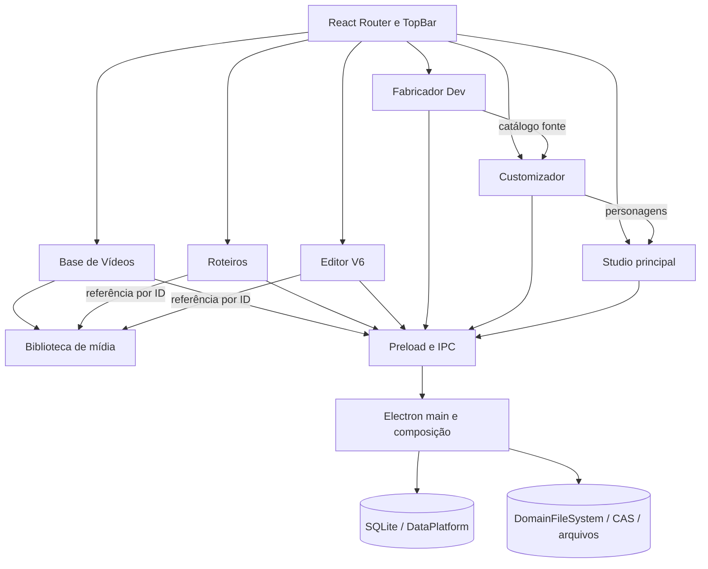

# Mapa do aplicativo e plano de refatoração progressiva

**Data:** 2026-10-27

**Base da reauditoria:** branch local `Dev-V2`, criada sobre `Main-desenvolvimento` no commit `6c2997223430ded043043222469b1fc20a63084f`.

**Escopo:** registrar a arquitetura atual de todas as áreas e conduzir a refatoração por domínio, sem quebrar dados ou fluxos existentes.

## Resumo

O aplicativo tem sete áreas em uma shell Electron/React. A separação de Base de Vídeos e Roteiros já avançou: têm rotas e telas distintas, contratos próprios, APIs com namespace e a Base está em sua própria pasta. A proteção de exclusão também consulta referências nos domínios donos, sem deixar o repositório da Base acessar tabelas de Roteiros.

A **Biblioteca de Mídia** é dona dos arquivos de vídeo e seus IDs. Base de Vídeos guarda estado editorial e numeração; Roteiros e Editor V6 guardam referências por ID. Essa conexão evita cópias, mas ainda precisa de coordenação entre gravações do Editor V6 e exclusões da mídia.

O restante já tem módulos por domínio e armazenamento local com SQLite, arquivos e CAS. Os maiores pontos de concentração são `electron/main.ts`, que registra 74 handlers IPC inline, e páginas React extensas que combinam estado e coordenação de operações. O plano prioriza limites de propriedade, segurança dos dados e redução de responsabilidades por fluxo.

**Próximos passos:** coordenar operações de referência entre Editor V6 e Biblioteca de Mídia; extrair os fluxos de Roteiros de `electron/main.ts`; depois modularizar composição de personagens e páginas grandes com fixtures visuais existentes.

## 1. Estado observado

- Aplicação desktop local em Electron 44, React 19 e TypeScript; não encontrei backend HTTP separado. O processo principal Electron faz o papel de backend local via IPC.
- O `App` usa React Router, carrega cada área sob demanda e separa Studio, Editor V6, Roteiros, Base de Vídeos, Customizador, Opções e Fabricador Dev.
- O código do processo principal está parcialmente separado por domínio. Há módulos próprios para Base de Vídeos, Customizador, catálogos do Fabricador, Studio principal e Editor V6.
- A persistência mistura SQLite para catálogos/documentos e armazenamento de arquivos por domínio/CAS. O esquema SQLite continua centralizado em `electron/dataPlatform.cjs`.
- Não encontrei solicitação para executar migração de dados; este diagnóstico não migra nem modifica dados pessoais.

### Inventário da reauditoria

- O shell tem sete rotas de produto: Customizador, Studio principal, Editor V6, Roteiros, Base de Vídeos, Opções e Fabricador DEV.
- `electron/domains/` contém módulos para Base de Vídeos, Customizador, Editor V6, Fabricador, Roteiros, armazenamento compartilhado e Studio. `src/shared/` guarda contratos e regras usadas por mais de um processo.
- `electron/main.ts` tem 2.256 linhas nesta revisão e ainda registra 74 handlers IPC diretamente; também compõe serviços que já foram separados em módulos.
- As páginas React mais extensas são Customizador (2.657 linhas), Editor V6 (1.706), Studio (1.487) e Fabricador (1.045). Esses números localizam concentração de responsabilidades, mas não são por si só motivo para dividir arquivos.
- A auditoria estática de dependências mantém em zero os imports de runtime entre os pares de features listados em `scripts/architecture/boundaries-baseline.json`.

### Mapa resumido



## 2. Base de Vídeos e Roteiros

### O que já está separado

- `TopBar.tsx` tem entradas distintas para `/roteiros` e `/base-videos`.
- `App.tsx` tem rotas e carregamento lazy distintos.
- `electron/domains/baseVideos/` contém `service.ts`, `repository.ts`, `validation.ts` e `ipc.ts`.
- Os metadados de Base ficam em tabelas próprias (`base_video_details`, categorias, atribuições e sequência); os documentos ficam em `roteiros`, `roteiro_tiktoks`, `roteiro_sections` e logs.
- O vínculo de vídeo no roteiro é por ID; os bytes não são copiados para cada roteiro.
- `RoteiroVideoReference` também persiste nome, formato, tamanho e duração junto ao ID. Isso funciona como snapshot de exibição, mas pode ficar desatualizado depois de renomear o item na biblioteca; leitura e exportação devem resolver o arquivo pelo ID.

### Situação atual e acoplamentos restantes

| Área | Evidência no código | Efeito |
|---|---|---|
| Local da feature | `BaseVideosPage.tsx` está em `features/baseVideos/`; `App.tsx` mantém rota própria. | Separação visual e de diretório concluída. |
| Contratos | `BaseVideoDetails` e `BaseVideoCategory` estão em `src/shared/baseVideos.ts`; biblioteca e referências estão em `src/shared/mediaLibrary.ts`. | APIs têm donos claros; `RoteirosDesktopApi` continua cuidando apenas dos documentos e exportações de Roteiros. |
| API do preload | `desktop.baseVideos`, `desktop.mediaLibrary` e `desktop.videoBackgrounds` têm namespaces próprios. | Os canais IPC antigos foram preservados; o restante do preload ainda é uma união ampla de APIs. |
| Referências | Roteiros consulta sua tabela em `domains/roteiros/videoReferences.ts`; Editor V6 lê os vínculos nos próprios manifestos. `mediaLibrary/videoReferences.ts` compõe os leitores. | A Base e a Biblioteca chamam a mesma proteção sem conhecer schemas consumidores. |
| Fila | A Base e exclusão da mídia ainda usam `roteirosSaveQueue`; Editor V6 tem fila própria por projeto. | Roteiros não disputa salvamento contra exclusão; a coordenação com gravações do V6 permanece pendente. |
| Ownership de mídia | `VideoLibraryStore` mantém originais em `media-library`; Roteiros, Base e Editor V6 usam o mesmo ID/arquivo. O caminho legado é composto por `studioLibraryPath('video')`, sob `studios/Editor Gacha`. | O catálogo de arquivos é compartilhado e não pertence exclusivamente à tela de Base de Vídeos. O nome/caminho legado não deve ser renomeado durante uma extração de código. |
| Estado “Rascunho/Base” | A tela calcula isso pela presença de `video_number` em `base_video_details`; não há tabela de rascunhos separada. | “Rascunho” é um estado de publicação dentro do mesmo catálogo, não uma biblioteca física independente. |
| Consumidores | Roteiros e Editor V6 escolhem e consultam itens via `desktop.mediaLibrary`; metadados editoriais via `desktop.baseVideos`. | A relação por ID fica clara e não duplica o arquivo. |
| Exclusão | Os canais da Base e da Biblioteca compartilham a mesma proteção de referências. | A regra é comum; novos consumidores precisam registrar seu leitor no serviço da biblioteca. |
| Tipo legado | `VideoLibraryItem` ainda mantém o campo `studios` em `src/shared/mediaLibrary.ts`. | O contrato foi movido para o domínio de mídia, mas o campo antigo merece remoção apenas após verificar todos os consumidores e dados. |

### Propriedade recomendada

```text
Biblioteca de mídia (Media Library)
  ├─ é dona do arquivo binário, ID, nome, formato, tamanho, duração e disponibilidade
  ├─ fornece importação, leitura/stream e exclusão física protegida
  └─ mantém/verifica referências recebidas de outros domínios

Base de Vídeos
  ├─ é dona do estado de publicação, número sequencial, categoria e descrição editorial
  └─ associa seus metadados ao ID da biblioteca de mídia

Roteiros
  ├─ é dono dos documentos, seções, falas/pensamentos e logs de exportação
  └─ guarda referências por ID a vídeos; não é dono dos arquivos

Editor V6
  └─ pode referenciar um item da biblioteca, sem passar a depender dos metadados editoriais da Base
```

“Separação real” não significa criar cópia do mesmo MP4 nem proibir vínculo. Significa cada domínio possuir seus dados e casos de uso, consumir contratos explícitos e não fazer SQL direto nas tabelas internas de outro domínio.

### Sequência segura para essa separação

1. **Extrair contratos sem mudar o disco — concluído:** tipos de Base e mídia têm arquivos próprios; os dados de roteiro continuam no contrato de Roteiros.
2. **Separar APIs do preload por namespace — concluído:** consumidores usam `desktop.mediaLibrary` e `desktop.baseVideos`, mantendo os canais IPC atuais.
3. **Mover a UI — concluído:** BaseVideosPage tem pasta própria e preserva sua rota/layout.
4. **Desacoplar referências — concluído nesta etapa:** leitores ficam nos domínios donos e uma proteção comum verifica Roteiros e Editor V6 antes da exclusão.
5. **Separar concorrência por responsabilidade:** não remover `roteirosSaveQueue` antes de criar uma proteção explícita para corrida entre gravar referências e excluir mídia. Escritas de descrição/categoria e roteiros podem ter filas próprias; a mutação que apaga mídia deve compartilhar somente um lock/serviço de referência.
6. **Consolidar a biblioteca de mídia:** mover API e tipo hoje pendurados em `studio.ts` para `mediaLibrary`, removendo os campos `studios` apenas após verificar compatibilidade de todos os consumidores e documentos persistidos.
7. **Somente depois avaliar o schema:** manter `base_video_details`, tabelas de Roteiros e IDs atuais. Não é necessário separar SQLite por arquivo para obter isolamento de domínio. Qualquer normalização de `video_asset_json` para uma tabela relacional exige inventário de documentos legados, migração testável e rollback.

### Critérios de aceitação

- Salvar/excluir metadados da Base não reescreve documentos Roteiros.
- Roteiros pode selecionar vídeo por ID e continua exibindo o arquivo correto após reiniciar.
- Excluir um roteiro nunca apaga um vídeo publicado.
- Excluir mídia usada por Roteiros ou Editor V6 é bloqueado; remover uma referência libera a exclusão somente quando não houver outras referências.
- Publicar, desfazer publicação (se suportado), categorizar, renomear e mover o item entre as vistas mantém IDs e numeração existentes.
- Nenhum MP4 é duplicado por causa de vínculo a um roteiro.
- Corrida de autosave de Roteiros contra exclusão de vídeo não pode deixar referência quebrada.
- Contratos JSON/SQLite e rotas visuais existentes permanecem compatíveis.

## 3. Mapa do restante do aplicativo

| Área | Responsabilidade principal | Integrações importantes | Observação estrutural |
|---|---|---|---|
| Fabricador Dev | Catálogo autoral de modelos, poses, roupas, cabelo, rosto, presets e animações. | Fonte para Customizador; dados visuais usados por Editor V6 e exportações. | Vários domínios já foram extraídos; `FabricatorPage.tsx` ainda coordena muitas operações. |
| Customizador | Personagens e escolhas/overrides individuais. | Lê catálogos do Fabricador; alimenta Studio, Roteiros e Editor V6. | `CustomizerPage.tsx` tem 2.657 linhas; renderização e coordenação de estado são candidatos separados. |
| Studio principal | Documentos de cena e composição. | Usa personagens do Customizador e infraestrutura visual comum. | `StudioPage.tsx` tem 1.487 linhas; persistência primária já tem módulos próprios. |
| Editor V6 | Projetos de timeline, preview, importação por ID, exportação e FFmpeg. | Usa Biblioteca de Mídia; lê personagem/pose/presets sem ser o Studio. | `EditorV6Page.tsx` tem 1.706 linhas; manter engine/preview/export em fronteiras estáveis. |
| Roteiros | Documentos, seções, elenco, falas/pensamentos e exportações. | IDs da Biblioteca/Base; personagens e dados de Fabricador no export de personagens. | Persistência, listagem e exportação de roteiros ainda estão em `main.ts`. |
| Base de Vídeos | Publicação, numeração, descrição, categorias, buscas e vistas de rascunho. | Metadata para seleção dentro de Roteiros/Editor V6, vinculados por ID à Biblioteca de Mídia. | Já tem feature própria e namespace `desktop.baseVideos`; a proteção de referência está sendo centralizada. |
| Opções/Dados | Backups, inventário, migração guiada e armazenamento local. | SQLite, CAS, DomainFileSystem e domínios de arquivo. | Infraestrutura crítica; migrações reais devem continuar explícitas e verificáveis. |

### Dívida estrutural geral

1. **Composition root inchado:** `electron/main.ts` tem 2.256 linhas e registra 74 `ipcMain.handle` diretamente. Ele faz mais do que inicializar o app: mantém persistência e fluxos de Roteiros, arquivos, vídeo e catálogos. A direção é extrair handlers e casos de uso restantes para domínios, mantendo `main.ts` como composição e ciclo de vida.
2. **Preload amplo:** `electron/preload.ts` reúne os métodos de Fabricador, Customizador, Studio, Editor V6, mídia e Roteiros; `desktop.d.ts` espelha essa união. Base de Vídeos e Biblioteca de Mídia já têm namespaces próprios; os demais contratos ainda podem ficar mais explícitos sem trocar imediatamente os canais IPC.
3. **Páginas longas:** Customizador (2.657 linhas), Editor V6 (1.706), Studio (1.487) e Fabricador (1.045) ainda concentram estado e operações. A refatoração deve extrair casos de uso, seletores, hooks e componentes por responsabilidade, sem dividir apenas para reduzir contagem de linhas.
4. **Núcleo de renderização de personagem:** Fabricador, Customizador, Studio e Editor V6 consomem modelos e composições em contextos diferentes. Um núcleo compartilhado exige contratos claros e fixtures visuais douradas antes de trocar os caminhos atuais.
5. **Persistência heterogênea:** algumas áreas já usam serviços/repositórios/filas, outras gravam diretamente no `main.ts`. Cada domínio precisa declarar quem é dono do formato, fila, backup, recuperação e validade de referências.
6. **Storage distribuído:** bibliotecas e projetos usam caminhos legados em `app-data/runtime/profile/...` sobre a infraestrutura DataPlatform/CAS. Não renomear diretórios por estética; caminhos fazem parte da compatibilidade e dos dados do usuário.
7. **Documentação em camadas:** há ADRs úteis e relatórios de ciclos anteriores. Manter este arquivo como investigação atual e atualizar o índice da arquitetura quando a primeira fase for implementada; relatórios históricos não substituem o código presente.

## 4. Ordem de refatoração recomendada para o app

### Ciclo 1 — Base de Vídeos, Biblioteca de Mídia e Roteiros

- **Concluído:** isolar contratos e APIs por namespace, mover a UI e centralizar a verificação das referências.
- **Pendente:** coordenar gravações do Editor V6 com exclusão de mídia; preservar a ordem atual dos salvamentos de Roteiros.
- **Pendente:** retirar o campo `studios` do contrato de mídia após inventariar consumidores legados.
- Preservar caminho, IDs, JSON, schema SQLite e vínculos atuais.

### Ciclo 2 — Composição Electron e domínio de Roteiros

- Extrair `roteiros:list/save`, export logs, GIFs/fundos e exportações de `main.ts` em serviços/repositórios/IPC pequenos.
- Manter funções puras de validação fora do Electron.
- Adotar contratos explícitos de comandos/consultas e autorização IPC uniforme.
- Eliminar SQL de um domínio dentro do repositório de outro.

### Ciclo 3 — Renderização de personagens compartilhada

- Criar um núcleo independente de tela para resolver modelo, pose, expressão, roupas, cabelo, rosto e overrides do personagem.
- Usar o mesmo núcleo nos consumidores necessários sem importar páginas React entre features.
- Comparar resultados com fixtures douradas existentes de personagem/expressão/roupa antes de trocar os renderizadores.

### Ciclo 4 — Modularização das páginas grandes

- Customizador: separar carregamento, comandos de personagem, navegador de modelo, renderização e painéis.
- Fabricador: separar workspaces e comandos de catálogo; preservar transações, histórico e snapshots.
- Studio e Editor V6: separar estado/documento, timeline/cena, exportação e painel; não compartilhar engines por semelhança visual sem contrato explícito.

### Ciclo 5 — Persistência e confiabilidade transversal

- Mapear filas e operações atômicas por domínio.
- Formalizar como entidades registram referências de assets e projetos.
- Testar crash/reabertura/backup/restauração com perfis sintéticos isolados.
- Medir desempenho antes de otimizar store, renderização ou CAS.

## 5. Regras para preservar dados durante a refatoração

- Não trocar `id` de vídeo, roteiro, personagem, pose ou asset.
- Não mover fisicamente arquivos do perfil durante a separação de código.
- Não modificar esquema SQLite, formato JSON ou canais IPC na mesma etapa que mover UI.
- Não excluir nem reescrever `entity_references` como se já cobrisse vídeos: o código atual tem a tabela genérica, mas não encontrei indexação de referências de Roteiros/Editor V6 à biblioteca de vídeo através dela.
- Manter o perfil pessoal fora dos testes; usar fixtures sintéticas para falhas, ordenação e recuperação.
- Alterações localizadas devem ficar em commits pequenos e descritivos; manter `ABRIR_DESENVOLVIMENTO.bat` fora dos commits se continuar modificado.

## 6. Primeira etapa de implementação

Em 27/10/2026 foi aplicado um primeiro corte de separação no código:

- Contratos de Base de Vídeos movidos para `src/shared/baseVideos.ts`.
- Biblioteca reutilizável de vídeos e snapshots por ID movidos para `src/shared/mediaLibrary.ts`.
- API do renderer agora expõe `desktop.baseVideos` e `desktop.mediaLibrary`; os nomes IPC existentes continuam iguais.
- Tipos e métodos de Base de Vídeos foram removidos do contrato `RoteirosDesktopApi`.
- `BaseVideosPage` foi movida para `features/baseVideos/`.
- Roteiros e Editor V6 usam as APIs com namespace explícito; Editor V6 e Roteiros ainda podem selecionar a mesma mídia por ID.
- Contrato de biblioteca de fundos foi separado como `desktop.videoBackgrounds`.
- Schema SQLite, formatos de persistência, IDs, arquivos no perfil e regras de exclusão não foram alterados.

Este corte separa propriedade dos contratos e chamadas entre domínios, mas não migra a biblioteca física. A Base de Vídeos ainda classifica/publica itens da biblioteca de mídia; Roteiros guarda snapshots com IDs para preservar vínculos existentes.

### Etapa seguinte aplicada — proteção de referências por domínio

- `electron/domains/roteiros/videoReferences.ts` consulta referências de vídeos no formato que Roteiros já persiste.
- `electron/domains/editorV6/videoReferences.ts` localiza vínculos por ID nos projetos do Editor V6.
- `electron/domains/mediaLibrary/videoReferences.ts` reúne essas consultas em uma única proteção usada pela exclusão iniciada tanto na Base de Vídeos quanto na Biblioteca de Mídia.
- `BaseVideoRepository` deixou de consultar tabelas de Roteiros. Os canais IPC, IDs, formatos armazenados, banco e fila compartilhada de gravações foram preservados.
- O teste de domínio `npm run test:base-videos` passou com 7 verificações. Nenhum perfil ou mídia real foi usado.

**Limite que permanece:** a fila compartilhada evita corrida entre salvar Roteiros e excluir vídeo. O Editor V6 mantém sua própria fila por projeto; exclusão de vídeo e gravação de projeto ainda não compartilham um coordenador. Essa concorrência precisa ser tratada com uma política para projetos já abertos e referências ausentes, antes de mexer nas filas.

## 7. Próxima tarefa recomendada

Continuar o **Ciclo 1, etapa 3: coordenar gravações do Editor V6 e exclusão da mídia**. Definir como lidar com projetos abertos que guardam uma referência antiga e com arquivos ausentes; serializar apenas as operações relacionadas, sem transformar a biblioteca inteira numa fila global.

Depois, seguir para o **Ciclo 2: extrair Roteiros de `electron/main.ts`**, separando listagem, salvamento, logs e exportação. Em ambas as etapas, preservar vínculos por ID, filas, formatos e backup; a biblioteca física não deve ser duplicada para obter separação de domínios.

## 8. Verificações e validação

- Leitura do código atual de rotas, TopBar, preload, contratos compartilhados, Base de Vídeos, Roteiros, Editor V6, VideoLibrary, boot Electron, módulos de domínio, renderizadores, schema SQLite e ADRs.
- A alteração de código moveu as consultas de referência para os domínios donos e unificou a proteção de exclusão; não alterou o perfil local, schema, canais ou formatos persistidos.
- `npm run test:base-videos`: 7/7 verificações passaram com dados sintéticos.
- Typecheck e build não foram executados nesta etapa.
