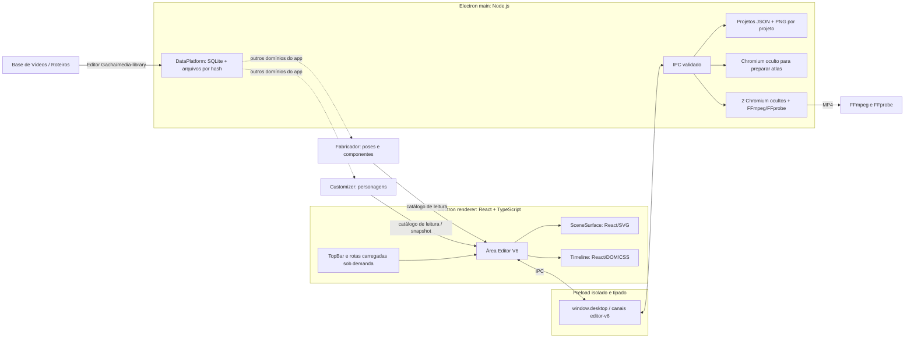

# Editor V6: arquitetura e integração

**Auditoria estática do código em 26/10/2026.** Este documento descreve o Editor V6 que existe hoje, separa seu domínio do restante do app e propõe uma evolução para um editor de vídeo local. As oportunidades de desempenho são hipóteses até medirmos projetos reais.

## Mapa do aplicativo

## O que está implementado

- O V6 é uma rota própria, carregada sob demanda, em `src/renderer/src/features/editorV6`. Tem modelo, validação, IPC, persistência, histórico, renderizador e serviços de animação próprios. Não importa a página nem os documentos do Studio Principal.
- A janela principal usa `contextIsolation: true`, `nodeIntegration: false` e `sandbox: true`. O preload expõe métodos tipados e específicos, em vez de entregar o `ipcRenderer` inteiro. O processo principal valida o remetente antes de operar nos canais do V6.
- O V6 pode consultar personagens do Customizer e fontes do Fabricador. Ao colocar um personagem na cena, guarda um snapshot visual e metadados de origem. Alterar a biblioteca depois não atualiza cenas existentes por conta própria, e editar uma cena não grava na origem.
- Projetos persistem em `userData/studios/Editor V6/editorV6-<id>/`: manifesto `editorV6.json`, PNGs em subpastas próprias, impressões e áudio importado. Há journal transacional para publicar PNGs e manifesto sem deixar uma gravação interrompida em estado ambíguo.
- `SceneSurface` desenha os mesmos fundos, personagens e textos na prévia e na captura. Na exportação com vídeo, o renderer oculto captura fundo e foreground separadamente; FFmpeg coloca os clips de vídeo entre as camadas. Os workers usam BrowserWindows ocultos, preloads próprios e sandbox, e enviam BGRA ao FFmpeg.
- O app geral usa `DataPlatform`, SQLite, `DomainFileSystem`, `better-sqlite3` e objetos de mídia identificados por hash para alguns domínios. Base de Vídeos e Roteiros usam o domínio de bibliotecas que ainda fica fisicamente em `studios/Editor Gacha`.

## Onde o V6 se separa do Studio e das outras áreas

O V6 tem outra pasta, outro schema, canais `editor-v6:*`, outra fila de salvamento, armazenamento de assets próprio e estado/histórico próprios. Isso atende à separação funcional pedida. Compartilhar Electron, React, APIs de leitura de personagens/poses, o shell e serviços genéricos de arquivos não torna os projetos do V6 documentos do Studio.

O `DomainFileSystem` e a lista `BUILTIN_DOMAINS` ainda **não registram** `studios/Editor V6`. Portanto os projetos V6 usam arquivos locais sob o perfil portátil do Electron, fora do catálogo SQLite/CAS. Os backups do app incluem `runtime/profile`, então isso não significa que o V6 esteja fora dos backups; significa que busca, deduplicação e migração por domínio não administram seus arquivos como fazem para domínios já migrados.

Direção: preservar o V6 como domínio de documentos independente e, quando a integração for feita, conectar o armazenamento por um adaptador `editor-v6.*` próprio. O domínio pode usar as ferramentas comuns de arquivo, hash, backup e streaming do app, mas não deve compartilhar documentos, histórico, identificadores de projeto nem regras de edição do Studio. Assets importados continuam pertencendo logicamente ao projeto V6; deduplicação física só é segura se o catálogo preservar essa propriedade e mantiver referências/backup consistentes.

## Vídeo e áudio no V6

- `Importar vídeo` e `Importar áudio` copiam a mídia para a pasta `media/` do próprio projeto. FFprobe confirma o tipo, a duração, as dimensões e os streams antes da cópia. O manifesto guarda IDs, nome original, tipo MIME, quadros de origem e existência de áudio.
- A faixa visual aceita imagens/fundos e clips de vídeo; a faixa `Áudio` aceita vários clips. Cada clip guarda mídia, quadro de entrada, posição/duração, ganho e ativação do áudio. O vídeo inclui áudio por padrão e pode ser silenciado no Inspector.
- Na prévia, o vídeo HTML fica entre o fundo e personagens/textos. A reprodução sincroniza os elementos HTML de vídeo/áudio com o relógio da timeline e corrige desvios por seek. O vídeo fica silenciado enquanto a edição está pausada.
- Na exportação, o Chromium captura a cena de fundo e os elementos transparentes em camadas. O FFmpeg decodifica, dimensiona e recorta os clips de vídeo entre essas camadas, mantendo personagens e textos à frente. As duas partes Turbo recebem apenas o intervalo necessário. O áudio dos clips é mixado uma vez na montagem final.
- O protocolo `gacha-editor-media://` lê somente arquivos UUID declarados no manifesto do projeto e serve intervalos de bytes. Duplicar projeto também copia as mídias; reabrir não depende do caminho original.
- Base de Vídeos/Roteiros continua sendo uma biblioteca separada. Trazer uma mídia para o V6 é uma cópia explícita, então o projeto não depende da biblioteca nem do caminho original.

Proxies, thumbnails, waveform, cache de seek e integração com o catálogo SQLite ainda não estão implementados. A reprodução de preview depende dos codecs aceitos pelo Chromium local; o exportador usa FFmpeg. `proxies: 0` é um indicador correto do recurso pendente, não de ausência de clips importados.

## Tecnologias do app: função real e impacto

| Tecnologia | Papel atual | Relação com fluidez |
| --- | --- | --- |
| Electron + Chromium | Janela, isolamento de processos, APIs desktop e compositor do palco. | O framework oferece GPU, workers e offscreen; uma thread ocupada ou muitas cópias ainda travam a interface. |
| Node.js no processo main | IPC, arquivos, serviços, SQLite, coordenação de export e subprocessos. Não há um servidor HTTP dedicado para o V6. | Trabalho síncrono pesado no main pode travar o app inteiro; operações longas precisam ser assíncronas ou sair dessa thread. |
| React 19 + React Router | Painéis, controles, inspector, palco SVG e timeline DOM. Rotas são carregadas sob demanda. | O quadro de reprodução usa uma store externa; só prévia, timeline e áudio assinam atualizações contínuas. A página recebe estado em seeks/pausas. Linhas memoizadas e clips fora do viewport filtrados. Ainda é preciso investigar picos e medir pintura apresentada. |
| TypeScript 5.9 | Tipagem e compilação dos contratos UI/IPC/documento. | Ajuda a prevenir erros de estrutura; tipos são removidos na execução e não aceleram renderização. |
| Zustand 5 + Immer 11 | Estado e histórico próprios do V6. A biblioteca guarda resumos; a área de edição mantém o documento ativo e o histórico de desfazer/refazer daquele projeto. | O desenho evita carregar todos os projetos e PNGs para a biblioteca. O projeto ativo e seus snapshots de histórico ainda usam Data URLs e continuam sendo a próxima fronteira de armazenamento. |
| Zod 4 | Validação de documentos e jobs ao atravessar fronteiras de persistência/IPC. Há limites de 500 assets, 1.000 elementos e 200 faixas. | Validação protege os dados; validar/transportar um documento grande a cada salvamento pode custar. Não há medição de que Zod, sozinho, seja o gargalo. |
| electron-vite + Vite | Compila bundles separados para main, preload e renderer e serve HMR no desenvolvimento. Workers do renderer usam formato ES. | Ferramentas de build não fazem a cena ficar mais fluida durante a edição. Dividir em bundles e carregar a rota sob demanda ajuda inicialização. |
| FFmpeg + FFprobe | Subprocessos locais para codificar H.264, juntar trechos, mixar áudio e validar o MP4. | O exportador consulta NVENC, QSV, AMF e depois libopenh264. O encoder detectado depende da máquina/build; “Turbo 2×” ainda divide CPU, GPU, memória e disco. |
| Sharp/libvips | Normalização e análise de imagens no processo principal, fora do ciclo de cada frame. | Ajuda importações e processamento de imagens; arquivos grandes ainda podem gerar pico de memória durante operações. |
| SQLite + better-sqlite3 | Catálogo e metadados dos domínios migrados do app, com chamadas síncronas no main. O V6 não persiste seus projetos nesse banco hoje. | Consultas pequenas e indexadas são adequadas; uma consulta grande síncrona pode bloquear o event loop. Usar worker só se uma consulta real justificar. |
| Vitest | Testes automatizados de lógica e serviços. | Só roda em desenvolvimento/CI; não compõe nem exporta vídeo no uso normal. |
| Electron Builder | Empacota o app portátil Windows x64 e inclui FFmpeg/FFprobe e avisos de licença. | Não altera fps durante edição; nativos como SQLite/Sharp adicionam trabalho de build/rebuild e precisam ser validados no pacote. |

Os números acima são as versões declaradas no projeto (`package.json`), com faixas semver; o lockfile define as versões instaladas em cada build. Versões atuais não devem ser inferidas somente pelo `^` do manifesto.

No lockfile atual, as versões principais resolvem para Electron 44.9.3 / Chromium 152.0.7977.167, React e React DOM 19.3.0, React Router 8.4.0, Zustand 5.0.16, Immer 11.2.9, Zod 4.6.7, Vite 7.3.7, electron-vite 5.0.0, TypeScript 5.9.3, Vitest 5.0.5, Electron Builder 26.18.0, better-sqlite3 13.0.3 e Sharp 0.35.5. O pacote FFmpeg incluído foi identificado como n8.1.3-18-g46d899d7a0, build Windows x64 da BtbN, LGPL-2.1-or-later; a própria ficha pede completar a checagem de conformidade/fontes antes de uma release final.

## Decisões acertadas que o V6 já usa

- O playhead usa uma store externa ao Zustand e ao estado de `EditorV6Page`. Prévia, timeline e áudio assinam o relógio; a página atualiza apenas em seek/pausa/edição. A timeline memoiza as linhas e filtra blocos fora do viewport.
- A timeline filtra blocos e transições pelo intervalo visível. A tela é DOM/CSS, mas não renderiza todos os clips fora da região que o usuário vê.
- O preparo de animações acontece numa BrowserWindow separada, em fila serial. O cache de trabalho limita número/tamanho, e o Play apenas escolhe um sprite já preparado.
- O exportador limita quantos assets prepara em cache, aguarda o pipe do FFmpeg e reutiliza bitmaps de fundo/foreground para cenas visualmente idênticas. Os quadros do vídeo continuam variando pelo filtro nativo do FFmpeg. Falhas do caminho Turbo acionam fallback CPU.
- A rota V6 é carregada sob demanda; o build mantém main/preloads/renderer em bundles próprios. A janela e os workers mantêm sandbox e preload de escopo estreito.

Essas escolhas seguem padrões vistos nos editores pesquisados. Elas não removem o custo de abrir, validar e salvar os documentos inteiros com assets em Base64.

## Custos concretos a reduzir primeiro

1. **Lista e abertura de projeto:** corrigido nesta rodada. `listEditorV6Projects` lê apenas os manifestos leves e devolve resumo; `loadEditorV6Project(id)` lê os PNGs somente para o projeto aberto. A tela mantém os resumos na biblioteca e um documento completo no estado de edição.
2. **Cada salvamento recodifica o conjunto inteiro de assets.** O auto-save ocorre depois de 650 ms sem mudança. `writeEditorV6` decodifica cada Data URL, normaliza formatos não-PNG e entrega todas as imagens à transação, mesmo quando só mudou um texto ou um bloco. A transação ainda lê/backupeia os caminhos existentes antes de publicar o manifesto.
3. **Data URL atravessa limites de estado e IPC.** O mesmo PNG pode existir como texto Base64 no estado do renderer, no payload de IPC e em buffers no processo principal. Base64 aumenta o tamanho do dado e cópias transitórias podem elevar a memória de pico.
4. **A captura do export é intensiva e concorrente.** Turbo cria dois renderizadores ocultos, captura cada imagem em BGRA e alimenta dois processos FFmpeg. O caminho já tem fallback e validação, mas exige uma comparação de tempo/memória no projeto real antes de assumir que duas partes sempre serão melhores.
5. **A fluidez de animação tem uma limitação visível no código.** O relógio atual publica quadros inteiros a 30 FPS. O relatório [DESEMPENHO_E_FLUIDEZ.md](DESEMPENHO_E_FLUIDEZ.md) descreve como comparar isso com preview de 60 Hz sem mudar a timeline/export de 30 FPS.
6. **O diagnóstico de reprodução agora separa relógio, DOM e custo React.** Com `sessionStorage.gv5:perf=1`, `performanceDiagnostics.ts` captura commits/long tasks, amostras do Profiler de surface/timeline/scene, publicação de frames e duração da composição. O stress runner também mede heap JS, eventos GC se disponíveis, callbacks RAF, mutações DOM, codecs e desvio da mídia. RAF e DOM não medem apresentação física do compositor; essa taxa ainda não está disponível. Os resultados de 30 s por cenário estão em [TESTES_DE_ESTRESSE_OFFSCREEN.md](TESTES_DE_ESTRESSE_OFFSCREEN.md).

Esses pontos são oportunidades arquiteturais observadas no código, não uma alegação de que todos já causam lentidão perceptível. Priorizar por medição do volume de dados e por um perfil representativo.

## Direção recomendada

### Fase 1 — tirar mídia desnecessária do caminho crítico

- **Concluído:** separar a API de resumo da API de abrir projeto completo. A biblioteca carrega título, datas e miniatura; só o projeto selecionado carrega timeline e assets.
- Persistir assets como arquivos binários com IDs/hash no manifesto. O renderer recebe referências tipadas e miniaturas; não precisa manter todos os PNGs como Data URL.
- Na gravação, publicar somente assets novos ou cujo hash mudou; mudanças de timeline/texto publicam manifesto sem regravar PNGs. Agrupar auto-save durante arraste e garantir fila ordenada com a versão mais recente.
- Manter a propriedade portátil do projeto e o journal de recuperação. Criar migração por versão para documentos existentes antes de trocar o formato.

### Trabalho iniciado nesta rodada

- A biblioteca agora lista `EditorV6ProjectSummary` sem abrir arquivos PNG. A API `loadEditorV6Project(id)` carrega e valida um único documento ao entrar no editor; a duplicação também abre o documento de origem sob demanda.
- A store mantém resumos da biblioteca e o documento ativo; ao trocar de projeto, limpa o histórico anterior. Snapshots de desfazer/refazer do projeto ativo ainda permanecem enquanto ele estiver aberto.
- O gerador `npm run editor-v6:stress-projects` mantém fixtures sintéticas reabríveis. Separadamente, `npm run test:editor-v6:stress-offscreen` exercita quatro personagens locais `STRESS_*` nos cenários leve, médio, pesado, multimídia e interação por 30 s. Usa perfil temporário isolado e mídia sintética local de quatro containers/áudio. O JSON publicado no repositório é agregado e não contém IDs pessoais; dados brutos ficam em `out/` ignorado. Veja [TESTES_DE_ESTRESSE_OFFSCREEN.md](TESTES_DE_ESTRESSE_OFFSCREEN.md) e [o resultado agregado](benchmarks/ESTRESSE_2026-10-26.json). Tamanhos de disco não são estimativa de RAM nem benchmark de FPS.
- O gerador confirma que os resumos não transportam assets e reabre cada projeto pelo leitor de persistência real, validando os PNGs e atlas de animação.

Ainda falta medir a biblioteca/projeto e alterar a gravação incremental de assets. A separação atual evita carregar projetos não selecionados, mas o projeto ativo ainda pode manter seus PNGs em Base64 durante a sessão.

### Fase 2 — formalizar integração com os dados do app

- Registrar um domínio V6 próprio na camada de dados, começando por inventário, backup, hashes, migração guiada e protocolo local de leitura de asset.
- Usar protocolo de mídia com allowlist e leitura por ID, não caminhos de arquivo arbitrários na UI. A janela já usa segurança Electron correta; preservar `contextIsolation`, sandbox e APIs específicas no preload.
- Reusar contratos de catálogo para importar uma cópia visual de personagem/pose; não importar ou alterar os documentos do Studio. Ao atualizar uma personagem existente, pedir uma ação explícita e mostrar o que será recalculado.
- Deixar vídeos e sons como assets de propriedade do projeto. A biblioteca Base de Vídeos pode oferecer uma ação explícita de copiar/importar se isso ajudar o usuário, mas não deve virar dependência necessária para reabrir um projeto.

### Fase 3 — mídia em timeline

- **Implementado:** IDs, arquivo por projeto, quadro de entrada, início/duração, áudio, ganho, mute e referências por manifesto; clips nas faixas visual e de áudio; preview sincronizada; export FFmpeg com sobreposição nativa do vídeo sob personagens/texto.
- **Pendente:** proxies compatíveis com Chromium, miniaturas, waveform, índice de seek e teste de codec para mostrar um aviso ou gerar proxy quando a prévia não suportar a fonte.
- **Pendente:** permitir mais de uma faixa de áudio independente, além da faixa atual, se a edição demonstrar que isso é necessário.
- Manter fundos/personagens/textos como a composição principal comum entre prévia e captura. O FFmpeg aplica a camada de vídeo no export para evitar dependência do decoder HTML no renderizador offscreen.

### Fase 4 — otimizar desenho somente após medir

- Manter painéis e inspector em React. A timeline em React/DOM está virtualizada por tempo para clips e transições; só migrar sua superfície para Canvas se um projeto de muitos milhares de blocos mostrar custo de DOM/layout.
- Continuar com palco SVG para imagens e alguns personagens. Comparar Canvas2D/OffscreenCanvas quando perfis mostrarem re-render, layout ou paint como gargalo; comparar WebGL/WebGPU se composição e upload de textura dominarem.
- Considerar addon C++/Rust apenas para decode, composição ou leitura de pixels que apareça como CPU-bound. Um addon não remove cópias de memória ou trabalho feito no processo React por si só.
- Usar metas e relatórios separados para: inicialização, abrir/listar projeto, salvar, seek/play, bake de animações e export. Otimização de uma métrica não deve regressar as demais.

## Fronteiras arquiteturais recomendadas

- **Editor V6:** schema, timeline, histórico, transições, importação, cache de preview e export do V6.
- **Plataforma compartilhada:** IPC seguro, diálogo de arquivo, armazenamento por domínio, backup, logs, hash/protocolo de mídia e diagnósticos.
- **Fabricador/Customizer:** são autores das bibliotecas e personagens. O V6 consulta e captura snapshots por APIs formais, sem importar módulos internos dessas features.
- **Studio Principal:** permanece projeto independente. O V6 não importa o modelo nem os componentes dele. A checagem `scripts/architecture/check-boundaries.cjs` deve continuar bloqueando novas importações runtime entre features.
- **Base de Vídeos/Roteiros:** biblioteca atual separada do V6; no futuro pode oferecer uma operação explícita de importação, que faz a cópia definida pelo contrato do V6.

## Fontes técnicas e pesquisa comparativa

As fontes e os limites de comparação estão no relatório [DESEMPENHO_E_FLUIDEZ.md](DESEMPENHO_E_FLUIDEZ.md). As conclusões centrais são: Electron recomenda profiling e trabalho pesado fora do processo visual; WeftCut mostra store de playhead/filas limitadas e engine de mídia nativo; Descript relata ganhos ao reduzir cópias entre decode e GPU; Clipchamp documenta trabalho local usando tecnologias de browser com armazenamento cloud opcional; Premiere UXP mostra como uma UI HTML/JavaScript pode coexistir com motor desktop nativo. Esses exemplos não dão FPS transferível ao V6.

Fontes oficiais consultadas:

- [Electron: modelo de processos](https://www.electronjs.org/docs/latest/tutorial/process-model), [IPC](https://www.electronjs.org/docs/latest/tutorial/ipc), [isolamento de contexto](https://www.electronjs.org/docs/latest/tutorial/context-isolation) e [sandbox](https://www.electronjs.org/docs/latest/tutorial/sandbox).
- [Desempenho no Electron](https://www.electronjs.org/docs/latest/tutorial/performance) e [renderização offscreen](https://www.electronjs.org/docs/latest/tutorial/offscreen-rendering).
- [electron-vite: ambiente](https://electron-vite.org/guide/) e [compilação](https://electron-vite.org/guide/build).
- [React: `memo`](https://react.dev/reference/react/memo) e [Zustand: evitar renderizações desnecessárias](https://zustand.docs.pmnd.rs/learn/guides/prevent-rerenders-with-use-shallow).
- [Immer: desempenho](https://immerjs.github.io/immer/performance/) e [Zod: validar dados](https://zod.dev/basics).
- [FFmpeg](https://ffmpeg.org/ffmpeg.html), [codificadores](https://ffmpeg.org/ffmpeg-codecs.html), [Node.js worker threads](https://nodejs.org/api/worker_threads.html), [Sharp](https://sharp.pixelplumbing.com/performance/) e [Vitest](https://vitest.dev/guide/).

## Próxima decisão técnica

Antes de trocar a tecnologia gráfica, completar a linha de base de memória, abrir/salvar e playback com diferentes quantidades de personagens. A primeira medição de playback com quatro personagens reais está registrada em [TESTES_DE_ESTRESSE_OFFSCREEN.md](TESTES_DE_ESTRESSE_OFFSCREEN.md); ela revelou picos de tarefa longa na página e uma amostra interna de transição não observada por RAF, que são os próximos alvos de profiling. O carregamento sob demanda e a importação/exportação de vídeo já estão implementados. A gravação incremental dos assets, proxies/cache de preview e testes com codecs variados continuam pendentes.
