# Missão 01 — gargalo de exportação do Editor V6

**Data da auditoria:** 14/11/2026
**Branch:** `codex/editor-v6-plano-b`
**HEAD auditado:** `156c4591d6773ac682602952ef3bea4bc04e74ac` (merge que contém `040984b4d99b405b175880685da1113642102fce`)
**Escopo:** evidência disponível localmente, harness sintético de Electron e relatórios do laboratório. Nenhum projeto ou perfil real foi aberto ou alterado.

## Resumo executivo

O SHA do prompt estava desatualizado, mas a implementação citada já fazia parte da linha atual: a branch estava em `156c4591`, com os commits `040984b4`, `e87916e5` e `8b245b07` integrados. A implementação `stacked` e seus diagnósticos foram, portanto, auditados como código atual.

**Não há prova de que a exportação bem-sucedida do projeto real de seis minutos esteja limitada a tempo real.** Não encontrei um relatório concluído de 10.800 quadros. Os relatórios locais de maior utilidade são diagnósticos que falharam; eles ajudam a localizar custos anteriores à renderização, mas não podem servir como benchmark de velocidade final.

O melhor dado estrutural disponível aponta para preparação de transições como gargalo em timelines com muitas trocas: um relatório histórico falho de 519 quadros passou 50,358 s em `motionPreparation` dentro de 53,149 s observados (94,75%); a renderização começou e acumulou 2,413 s antes da falha. O relatório contabilizou 42 transições únicas e 298 rigs preparados. Isso é uma evidência concreta daquele caso, **não uma conclusão sobre o projeto de seis minutos**.

O teste A/B recém-adicionado comparou `serial` e `stacked` em três pares alternados, com vídeo sobreposto, cabelo em movimento e estados faciais. No fixture de 320×180 e 40 quadros, a mediana do tempo caiu de 1.244,14 ms para 1.218,23 ms (2,08%); a taxa medida subiu de 32,15 para 32,83 quadros/s. Em 240 comparações de camada, 225 foram idênticas e 15 diferiram em no máximo 1 nível RGB de 8 bits; não houve diferença de alpha nem amostra fora da tolerância. É uma melhora pequena nesse fixture, não a explicação nem uma solução comprovada para a exportação longa.

O modo `paint-event` foi comparado a `capturePage` em 60 quadros únicos 1920×1080: levou 2,927 s versus 2,780 s e não melhorou o throughput. Embora o worker separado tenha tido paridade exata de pixels, sua cauda de espera foi maior. Não deve substituir `capturePage` com esses dados.

**Conclusão objetiva:** manter `stacked` como caminho para cenas com vídeo em camadas, sem prometer ganho material; manter `capturePage` e a tubulação FFmpeg atuais por enquanto; priorizar uma próxima investigação instrumentada do bake de transições. A correção de decodificação SVG do cabelo e o ajuste de tipagem/fixture tornaram o caminho de teste de cabelo utilizável e validado. Não foi demonstrado um ganho de velocidade no projeto real.

## Arquitetura e fluxo verificados

```mermaid
flowchart LR
  A[Projeto e opções de exportação] --> B[exportRunner]
  B --> C[Carregar snapshots de personagens]
  C --> D[Planejar e preparar transições]
  D --> E[Selecionar e sondar encoder]
  E --> F[Planejar partes / workers Electron offscreen]
  F --> G[Resolver frame e estado de timeline]
  G --> H[React + SVG / rasterização Chromium]
  H --> I[capturePage + validação do token]
  I --> J[NativeImage / bitmap -> BGRA]
  J --> K[pipe rawvideo para FFmpeg]
  K --> L[Concatenação / áudio / ffprobe / validação]
  L --> M[Publicação atômica do candidato]
```

O fluxo está principalmente em `electron/domains/editorV6/exportRunner.ts:runEditorV6Export`, `exportReadiness.ts:prepareEditorV6ExportReadiness`, `exportMotionPreparation.ts:prepareEditorV6ExportMotions`, `prepareMotions.ts:prepareExportMotions`, `motionIpc.ts:createEditorV6MotionService` e `exportPartRenderer.ts`. A preparação inteira precede a seleção efetiva do encoder e a renderização das partes. Portanto, seu tempo está corretamente separado no relatório e não pode se sobrepor ao render/codificador na arquitetura atual.

Para cada transição, `bakeMotion.ts:bakeEditorV6Motion` carrega fonte e poses, prepara face, cria resolvedor/rig, produz amostras em canvas, monta atlas e finaliza assets. `motionAtlasFrameBaking.ts:bakeEditorV6MotionAtlasFrames` processa amostras numa sequência `for...of` com `await render(...)`, desenha cada amostra no atlas e prepara patches/camadas faciais. A concorrência é entre lanes de bake (normalmente 2), não entre quadros de um mesmo atlas. `motionIpc.ts` mantém BrowserWindows offscreen por lane, cache de trabalho em memória com limites e cache de exportação com escopo aleatório.

O renderizador solicita os quadros segundo a timeline, faz `flushSync` no React, confirma token visual e chama `capturePage`. O modo `stacked` compõe as duas camadas de vídeo num único bitmap com fundo opaco e primeiro plano transparente; `serial` preserva duas capturas. A captura é convertida/copiada para BGRA e enviada ao FFmpeg por pipe `rawvideo`. O comando configura `-framerate 30` para atribuir timestamps ao fluxo raw; não usa `-re`/`-readrate`. Essa opção não é evidência de uma espera pelo relógio de reprodução.

### Evidência de caminho com suporte no código

| Pergunta | Resultado verificado | Confiança |
|---|---|---|
| Existe throttle explícito de entrada em tempo real no FFmpeg? | Não no construtor de comando consultado; rawvideo usa `-framerate`, necessário para timestamps. | Alta |
| A preparação pode segurar a exportação antes dos quadros? | Sim: readiness aguarda preparação completa antes de iniciar tentativa de render. | Alta |
| Chromium/captura pode custar muito em 1080p? | Sim: no A/B de captura, `capturePage` consumiu 1,501 s dos 2,780 s em 60 quadros. | Alta para esse fixture |
| `paint-event` melhora o fluxo atual? | Não no teste medido; foi cerca de 5,3% mais lento e teve p95 de espera maior. | Média, máquina e fixture únicos |
| `stacked` é visualmente equivalente? | 240 fatias de camadas: 225 exatas; 15 dentro de tolerância RGB de 1 LSB; alpha idêntico. | Alta para esse fixture/tolerância |
| `stacked` resolve o projeto de 6 min? | Não demonstrado; o A/B foi pequeno e sintético. | Alta quanto à ausência de prova |

## Gargalos e limitações por gravidade

### Alta prioridade — preparação sequencial em relação ao render

- **Evidência:** `exportReadiness.ts:prepareEditorV6ExportReadiness` aguarda `prepareEditorV6ExportMotions` integralmente. Relatório histórico falho de 519 quadros: 50,358 s de 53,149 s em preparação (94,75%), 42 transições únicas, 42 bakes e 298 rigs. As fases renderizaram 2,413 s antes da falha; não foi uma exportação concluída.
- **Causa provável:** transições são renderizadas em BrowserWindows offscreen em lanes, com sequências de amostras e composição de atlas antes de liberar o trabalho de quadros. O relatório agregado não informa quanto cada subetapa (`loadFabricatorSlot`, resolver pose, rig, render das amostras, patches de face, atlas, IPC/serialização) contribui.
- **Consequência prática:** um projeto com dezenas de transições pode passar tempo significativo sem produzir quadros, mesmo se a captura ou o encoder forem rápidos. O tempo total cresce com transições únicas e custo do personagem, não apenas com duração em segundos.
- **Solução proposta:** instrumentar por subetapa em cada bake; produzir fixture de transição longo e repetível; medir concorrência 1/2/3, custo de setup, uso de CPU/RAM/GPU e reaproveitamento de endpoints dentro do escopo da exportação. Só então considerar compartilhar preparação de endpoints entre transições adjacentes ou preparar por intervalo em pipeline. Preservar o isolamento entre exportações.
- **Alternativas consideradas:** aumentar lanes imediatamente (pode elevar pressão de GPU/memória e piorar latência); bake sob demanda concorrente com render (requer bloquear corretamente frames dependentes, tornar transições disponíveis antes do prazo e redesenhar cancelamento/relatórios); migrar bake para native renderer (complexidade muito maior sem perfil por etapa).
- **Impacto/complexidade/risco:** impacto potencial alto em projeto com muitas trocas; complexidade média para instrumentar, alta para pipeline incremental; risco visual alto se uma amostra ausente for substituída silenciosamente. Não foi implementada mudança de concorrência no escuro.
- **Confiança:** alta para a ordenação e para o custo do relatório de 519 quadros; média para dizer que será o maior custo no projeto real; baixa para o ganho futuro antes de profiling e benchmark.

### Média prioridade — captura BGRA sincroniza Chromium e CPU

- **Evidência:** `capturePage` foi 1,501 s em 60 quadros únicos 1080p (p50 24,7 ms, p95 35,1 ms); cópia/conversão do bitmap 220,86 ms e gravação no pipe 308,46 ms no mesmo perfil.
- **Causa provável:** captura de página retorna imagem CPU-visível e pode sincronizar com composição/rasterização do Chromium. O benchmark não separa totalmente GPU readback da rasterização e do custo de `capturePage`.
- **Consequência:** para quadros realmente novos em 1080p, a captura pode limitar a velocidade mesmo sem FPS cap. Quadros reutilizados não têm o mesmo custo.
- **Solução proposta:** primeiro perfilar em máquina alvo; se leitura GPU/CPU dominar, prototipar captura por textura compartilhada offscreen e encoder nativo que consuma textura D3D11 sem serializar BGRA. Manter caminho `capturePage` como fallback até paridade de alpha, cor, ordem e cancelamento ser demonstrada.
- **Alternativas consideradas:** `beginFrameSubscription` / `paint-event` (medido mais lento no harness); WebCodecs (não elimina a necessidade de renderizar Chromium nem integra AMF/D3D automaticamente); pipeline nativo direto (maior potencial, maior risco de integração e manutenção).
- **Impacto/complexidade/risco:** potencial alto em cenas com muitos quadros dinâmicos; complexidade muito alta para D3D11/AMF nativo; risco de compatibilidade por GPU/driver e sincronização de textura.
- **Confiança:** alta que `capturePage` é custo material neste fixture; baixa para extrapolar proporção em projeto/PC diferente.

### Média prioridade — `stacked` tem benefício pequeno e variação do encoder

- **Evidência:** 3 pares alternados: mediana 1.244,14 ms serial e 1.218,23 ms stacked, redução de 2,08% no fixture. A mediana de `capturePage` agregado baixou aproximadamente 5%; as gravações FFmpeg agregadas, no entanto, foram mais longas no modo stacked (aprox. 19,1 ms contra 37,0 ms), ainda muito pequenas frente ao wall time total.
- **Causa provável:** uma captura elimina round trip/cópia separada, mas o bitmap empilhado dobra a altura e não reduz rasterização/cópia total de pixels. Variação do sistema e do encoder é relevante nesse tempo curto.
- **Consequência:** manter como implementação de menor overhead provável em cenas com vídeo, sem afirmar aceleração geral. Em cenas sem vídeo sobreposto, o caminho não é aplicável.
- **Solução proposta:** preservar os dois modos e continuar registrando a escolha. Medir em 1080p e em projeto longo na GPU alvo antes de declarar ganho.
- **Confiança:** alta para os números sintéticos do A/B; baixa para ganho real em produção.

### Corrigido nesta missão — SVG de cabelo falha ao entrar em WebGL

- **Evidência:** o fixture sintético de cabelo usa atlas SVG. O caminho antigo usava `createImageBitmap(Blob SVG)` e falhava na build Electron usada pelo harness. `exportWorkerHairResources.ts:loadHairImage` agora decodifica SVG por URL Blob, desenha uma vez num canvas limpo e cria `ImageBitmap`; PNG continua no caminho direto. Testes unitários exercitam os dois formatos e a liberação de URL/canvas.
- **Consequência anterior:** a falha acontecia antes de poder avaliar codecs/throughput em fixtures que geravam SVG.
- **Impacto/complexidade/risco:** remove a incompatibilidade no caminho testado; Canvas 2D faz uma rasterização adicional apenas na carga de SVG. Erros continuam explícitos; formatos não suportados são rejeitados.
- **Confiança:** alta para o harness e os testes; média para todos os arquivos de cabelo reais, pois projeto real não foi utilizado.

### Corrigido nesta missão — integração stacked e fixture dos testes

- `exportWorker.tsx` separa `renderLayer` antes de repassar props ao componente correto, removendo incompatibilidade de tipo entre `SceneSurface` e o surface de captura empilhada.
- Um teste na suíte assumia `naturalWidth/naturalHeight` (HTMLImageElement), mas a implementação já recebe `ImageBitmap.width/height`; o fixture foi corrigido para representar o contrato real.
- O gate de RAF não registra necessariamente uma amostra se a promessa resolvida durar abaixo da resolução do acumulador. O teste agora verifica o flag e métricas de captura em vez de exigir uma amostra artificial de RAF.

## Alternativas arquiteturais avaliadas

| Caminho | O que muda | Benefício realista | Custos/riscos | Julgamento |
|---|---|---|---|---|
| A — otimizar atual | Instrumentar bakes, corrigir cache/serialização comprovadamente redundantes, balancear lanes; manter Chromium, capturePage e FFmpeg pipe | Menor risco; melhora incremental e compatibilidade com a composição atual | Não remove sincronização CPU/GPU da captura | Recomendado agora para atacar a preparação, com medições |
| B — reformular subsistemas | Preparação incremental e endpoint sharing por execução; eventualmente offscreen shared texture + encoder nativo para casos suportados | Pode sobrepor bakes a quadros independentes e evitar readback BGRA | Ordem/cancelamento/paridade complexos; D3D11/AMF acopla a Windows/AMD; fallback obrigatório | Melhor destino estrutural se profiling confirmar os custos |
| C — redesenho completo | Scene graph próprio e renderer de vídeo nativo em GPU, timeline independente do DOM | Controle integral e potencial maior teto de throughput | Reescrita de efeitos, SVG/texto, assets, sincronismo, UI/preview/export; regressões e custo de manutenção altos | Não justificado agora; projeto real e instrumentação faltam |

Não há evidência para migrar para outra biblioteca apenas por novidade. O Electron documenta `beginFrameSubscription` e o modo offscreen com texturas compartilhadas; o segundo pode reduzir transferências se o consumidor for nativo e liberar as texturas corretamente, mas não é substituto drop-in para o atual pipe BGRA. O FFmpeg documenta rawvideo com `-framerate`/`-pixel_format`/`-video_size`; a taxa de input não implica throttle `-re`.

Fontes oficiais: [Electron webContents](https://www.electronjs.org/docs/latest/api/web-contents), [Electron offscreen rendering](https://www.electronjs.org/docs/latest/tutorial/offscreen-rendering/), [FFmpeg formats](https://ffmpeg.org/ffmpeg-formats.html), [FFmpeg AMF](https://ffmpeg.org/general.html#AMD-AMF_002fVCE).

## Mudanças e testes desta missão

### Mudanças no código

- Corrigida a passagem de props entre o worker e a superfície de captura single/stacked.
- Adicionado decode seguro de SVG de cabelo via Blob URL → `Image` → canvas 2D → `ImageBitmap`, liberando URL e canvas no `finally`.
- Adicionados testes unitários PNG/SVG/formato inválido.
- Corrigido o teste para não exigir métrica RAF de uma operação resolvida abaixo da granularidade do acumulador.
- Adicionado A/B de três repetições alternadas `serial`/`stacked`, com comparação BGRA por camada, alpha e tolerância explícita de 1 LSB.
- A comparação paint-event no mesmo worker ficou selecionável via variável de teste porque expirou intermitentemente no limite de 60 s. Na rodada final foi pulada explicitamente; comparação entre workers, validação de paridade e demais perfis continuaram ativos. Isso não é aprovação desse caso omitido.

### Resultados de validação

| Verificação | Resultado |
|---|---|
| `npm run typecheck` | Aprovado |
| `npm run audit:architecture` | Aprovado: 884 arquivos TS/TSX, sem import local ausente ou violação de fronteira |
| `npm run test:editor-v6:quick` | Aprovado: 62 testes Vitest + 6 testes de gate |
| `npm run test:editor-v6` | Aprovado: 856 testes, 1 skip registrado pela configuração existente |
| `npm run test:editor-v6:export` com fixture sintética Electron | Aprovado: build e exportações sintéticas; 81 quadros; áudio contínuo na emenda; testes de cabelo/face/captura; A/B serial × stacked passou |
| Comparação paint-event no mesmo worker | Omitida explicitamente na última rodada por timeout intermitente anterior; precisa repetir sem skip |
| Exportação de projeto real 6 min, CPU e AMF | Não executada; nenhum projeto real foi aberto |
| WPR/WPA | Relatórios anteriores registram que WPR não iniciou por política/permissão; sem ETL para atribuição de CPU/GPU |

O fixture integrado serial × stacked foi 320×180 / 40 quadros, não representa o uso final. O perfil de captura 1080p usou 60 quadros visualmente únicos, não 10.800. Os números não devem ser extrapolados como ganho de uma exportação de seis minutos.

## Próxima missão técnica recomendada

Atacar **preparação de movimentos**, antes de uma reescrita do compositor:

1. Instrumentar `bakeEditorV6Motion` em etapas: carregamento de fonte/poses/assets, resolução de face, construção/reuso de rig, renderização de cada amostra, recorte facial, escrita de atlas e serialização/IPC.
2. Criar fixture sintética determinística com aproximadamente 42 transições e pelo menos 298 rigs/samples-equivalentes, sem copiar dados de perfil ou projeto pessoal.
3. Comparar lanes 1, 2 e 3, em ordem alternada, com mediana/p95, CPU, GPU, RSS, memória GPU e contadores de cache. Preservar escopo novo para cada exportação e permitir somente reuse dentro da execução.
4. Medir especificamente se rigs de endpoint entre transições consecutivas podem ser compartilhados sem alterar bytes de entrada nem pixels resultantes. Não aumentar limite de cache sem estimar memória por personagem.
5. Se a preparação seguir dominante, avaliar preparo por partição com dependências explícitas e execução em pipeline, incluindo cancelamento e publicação atômica. Se captura dominar após isso, abrir protótipo isolado de shared texture D3D11/encoder nativo com fallback Chromium.
6. Pedir uma exportação de 10.800 quadros no PC alvo, primeiro em CPU e depois AMF, com mesma revisão/configuração e relatório preservado; validar contagem, timestamps A/V, pixels de entrada/saída, RSS e tempo por fase. Só então responder se rompeu o tempo real.

## Conclusão

O gargalo não foi comprovado como codificador nem como uma limitação de vsync. O pipeline não usa `-re`; em casos com muitas transições, há um custo anterior ao encoder potencialmente dominante. A captura é cara em quadros únicos 1080p, enquanto `paint-event` não mostrou vantagem. `stacked` conserva paridade dentro da tolerância do fixture e melhora pouco o tempo total medido.

Portanto, não recomendo reescrever tudo nem declarar vitória de desempenho. Recomendo manter o pipeline existente, manter `stacked` como implementação validada para camadas, conservar `capturePage` como recuperação confiável e investir a próxima mudança estrutural na instrumentação e redução do custo de bake de transições. A aceleração de ponta a ponta do projeto de seis minutos permanece **não medida**.
