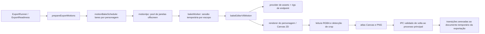
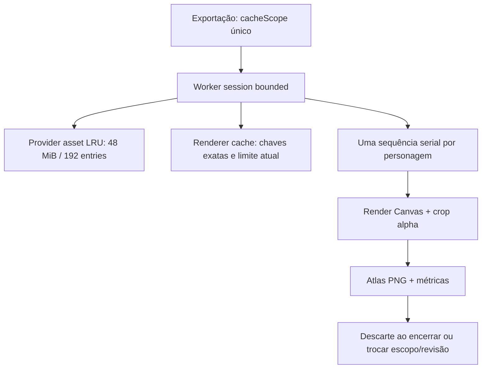

# Missão 02 — Reestruturação da preparação de animações

**Repositório:** `nestarasup-sys/Native-gacha`
**Branch:** `codex/editor-v6-plano-b`
**Commit de referência:** `ec351af7870ec16b19d1c35839fbd766021acb6d`
**Escopo desta execução:** motor de preparação de transições do Editor V6. Nenhum projeto pessoal, perfil real ou mídia do usuário foi aberto.

## 1. Resumo executivo

O custo encontrado não era simplesmente “construir rigs demais”. No fixture determinístico, 42 transições únicas exigiram 332 construções e 46 reutilizações de rigs; só 8 rigs precisaram ser reconstruídos depois de terem sido descartados. A maior diferença entre a variante antiga e a nova veio da preparação dos rigs: o cache antigo de leituras de assets tinha capacidade de 32 entradas e política FIFO, expulsando ativos ainda quentes durante os bakes. Nas três rodadas A/B finais, isso produziu 55.914 misses no baseline contra 336 no caminho novo.

A mudança implementada é um cache LRU limitado por **192 entradas e 48 MiB por worker**, isolado por sessão de exportação, e um cache facial preparado limitado a **64 itens e 24 MiB**. A preparação do bake caiu **37,20%** no cenário de um personagem (2.133,58 ms → 1.339,88 ms) e **19,19%** no cenário de três personagens com concorrência 3 (1.134,49 ms → 916,78 ms). Os hashes do atlas, quadros e dados geométricos foram idênticos em todos os pares A/B. A meta experimental de 15% foi atingida nos dois cenários A/B medidos.

Esses números medem **preparação de transições sintéticas**, não exportação completa de vídeo. Não havia projeto real autorizado de seis minutos no ambiente; portanto, não há resultado para os 10.800 quadros finais. A física/reação do cabelo também não está representada no fixture, embora ele contenha uma camada de cabelo e mudanças de pose.

## 2. Mapeamento da arquitetura atual

- `prepareExportMotions` resolve transições ausentes, agrupa planos com a mesma chave, atribui sequências de cada personagem a uma lane e só então agenda os bakes. Uma sequência do mesmo personagem é deliberadamente serial, para preservar a reutilização local dos rigs.
- `motionIpc` mantém até a capacidade configurada de workers Electron invisíveis/offscreen. O worker prepara o rig, pinta amostras em Canvas 2D, encontra crops de alpha, monta atlas PNG e devolve metadados e imagem pelo canal validado.
- `bakeWorker` mantém caches temporários no renderer. Agora cria uma sessão nova ao mudar o escopo da exportação e descarta a sessão anterior. A capacidade de rigs continua limitada a 12 renderers e a estimativa existente de 96 MiB; assets têm seu próprio limite de 48 MiB.
- O resultado da preparação é anexado ao documento temporário utilizado pela exportação. A telemetria é incluída no relatório normal; seus tempos por etapa representam durações medidas dentro de cada transição. Em concorrência, os totais de etapas podem se sobrepor e **não** são parcelas exclusivas do tempo de parede.

## 3. Análise detalhada da preparação/exportação

### O que foi contado

O harness integrado em `tests/editor-v6/motion-service.electron.ts` cria um projeto descartável, usa 42 transições únicas, 12 geometrias de pose, 42 IDs de preset facial, uma camada de cabelo sintética e blocos de fala. Cada rodada usa um `cacheScope` novo. Há três pares A/B alternados para um personagem/concorrência 1 e três pares para três personagens/concorrência 3. A matriz otimizada mede também 1, 2 e 3 workers para ambos os cenários.

| Cenário A/B | Baseline mediano | Novo mediano | Diferença | Rigs construídos | Rigs reutilizados | RSS de pico mediano |
|---|---:|---:|---:|---:|---:|---:|
| 1 personagem, concorrência efetiva 1 | 2.133,58 ms | 1.339,88 ms | −37,20% | 332 → 332 | 46 → 46 | 176,5 → 172,3 MiB |
| 3 personagens, concorrência efetiva 3 | 1.134,49 ms | 916,78 ms | −19,19% | 333 → 333 | 45 → 45 | 205,8 → 192,0 MiB |

O fixture tem 546 chamadas de renderização de amostras por rodada. Isso corresponde a 13 chamadas por transição em média, incluindo resolução de endpoints e sete amostras. O número varia com modos faciais ausentes que o renderer rejeita e o resolvedor trata conforme o contrato atual.

No par de um personagem/concorrência 1, o P50 por transição de construção de rig caiu de aproximadamente **17,2 ms para 1,7 ms**, e o P95 de aproximadamente **21,0 ms para 2,2 ms**. A quantidade de rigs não caiu: a economia está em reutilizar leituras imutáveis de assets durante as 332 construções necessárias. O agregado de leituras confirma o motivo: **372 hits / 55.914 misses** no baseline contra **11.400 hits / 336 misses** no novo cache, somando as três rodadas em cada modo.

Depois da mudança, o recorte de alpha continuou caro: o P50 por transição ficou em torno de 19,4–20,3 ms no cenário de um personagem. A resolução da geometria de endpoints também faz múltiplas renderizações faciais. São os próximos alvos de profiling, mas não foram alterados nesta missão: reduzir essas leituras sem prova de equivalência poderia mudar crops, escala, posicionamento ou pixels nas emendas.

### Sincronização, boca e cabelo

Não foi alterado o contrato de interpolação: a pose continua sendo interpolada pelos mesmos samples/progress da timeline. A preparação facial continua a resolver endpoints antes da renderização; os caches novos cobrem apenas leituras e estruturas imutáveis, não os pixels pintados de expressões nem as amostras de movimento. O harness compara os bytes PNG e metadados de todos os frames entre baseline e novo. Ele não valida visualmente uma cena real com boca em fala, roupa complexa ou física de cabelo; essa validação permanece necessária no projeto longo.

## 4. Problemas e limitações identificados

| Gravidade | Evidência e causa | Consequência | Correção/impacto | Confiança |
|---|---|---|---|---|
| Alta | `motionAssetProviderCache.ts`, `cacheEditorV6MotionAssetProvider`: 32 entradas FIFO; no fixture, 55.914 misses agregados no A/B baseline e 332 rigs construídos | Assets e fontes lidos novamente no mesmo bake/export, elevando rig preparation e tempo total | LRU export-local com teto de 192 entradas/48 MiB; 37,20% e 19,19% de redução nos dois A/B medidos; hash visual idêntico | Alta para fixture; média para projeto real |
| Média | `prepareMotions.ts` calculava lanes scheduláveis em função do número de planos; `main.ts` também mantinha capacidade de 2 quando o benchmark pedia 1 | “Concorrência 3” podia não significar três workers, e um personagem jamais usa três bakes simultâneos por desenho do scheduler | Configuração solicitada, lanes, janelas abertas e pico ativo agora são registrados/verificados separadamente. Capacidades 1/2/3 abriram e atingiram 1/2/3 operações em teste de serviço | Alta |
| Média | `motionBakeEndpointGeometry.ts` mede endpoints e vários modos faciais; `motionFrameRenderer.ts` faz readback/crop a cada chamada | Capturas de endpoint e varredura RGBA persistem como etapa relevante após eliminar cache thrash | Instrumentadas; não houve mudança de algoritmo de crop por risco de deslocamento/recorte | Alta |
| Baixa | Métricas do bake eram descartadas em `motionBakeResult.ts` nas saídas normais | Relatório IPC não recebia o perfil por transição | O perfil agora é anexado às duas saídas de atlas; teste integrado valida sua disponibilidade e os valores agregados | Alta |
| Limitação do ambiente | Não havia projeto de seis minutos nem fixtures autorizadas de cabelo com reação física | Não é possível converter o ganho de bake em tempo total de MP4 ou assegurar comportamento visual real de cabelo nesta máquina | Rodar a exportação longa no projeto do usuário e comparar os relatórios com os comandos abaixo | Alta |

### Respostas às perguntas sobre rigs

1. **Rigs necessários:** 332 no cenário de um personagem e 333 no de três, contra cerca de 298 equivalentes reportados no fixture de falha anterior. O número depende de poses/geometrias e de descarte de cache.
2. **Repetição:** há 46/45 renderers reutilizados dentro da sessão e 8/6 reconstruções após descarte no fixture. O restante é trabalho de rig com chaves de arte distintas; não se deve deduplicar por semelhança visual.
3. **Renderizações:** 546 chamadas de renderer/amostragem por execução de 42 transições no harness. O profiler separa render, crop, atlas, face e codificação; operações por transição podem ser sobrepostas entre personagens.
4. **Renderer intermediário:** cada geometria nova ainda precisa de estrutura de renderer; endpoints idênticos podem ser reutilizados com chave exata de personagem, revisão de fonte e arte. A infraestrutura do rig não foi mantida mutável entre geometrias, pois isso exige comparar o pipeline inteiro e preservação pixel a pixel.
5. **Leituras repetidas:** comprovadas pelas contagens de cache do A/B; 55.914 misses versus 336 no cenário de um personagem, somando as três rodadas.
6. **Descarte de rigs:** há reconstruções após descarte, mas apenas 8/6 no fixture. A causa maior medida foi descarte/releitura de assets, não reconstrução de canvas de rig.
7. **Custo dominante:** no baseline, busca de assets na preparação do rig (17,2 ms P50 por transição); no novo, crop/readback (20,5 ms P50), seguido da geometria de endpoint (~10–11 ms). Atlas PNG/IPC não domina esse fixture. A captura de GPU/uso real da GPU não foi instrumentada; somente working set do processo GPU é observado e não equivale a VRAM nem utilização.

## 5. Alternativas tecnológicas avaliadas

| Alternativa | Potencial | Trade-off / decisão |
|---|---|---|
| Ampliar o cache sem teto | Evitaria misses | Rejeitada: assets podem conter imagens grandes, memória cresceria sem limite e sobreviveria sem orçamento explícito |
| Cache LRU por entradas + bytes, isolado por export | Remove thrash, mantém invalidação e limite de memória | Implementada: cache de 192 itens/48 MiB, com sessão nova por escopo, revisão e limpeza ao fim; ganho A/B acima da meta |
| Aumentar workers padrão para 3 | Pode reduzir parede com personagens independentes | Não aplicado ao padrão. Em um personagem, a sequência continua numa lane; 2/3 é capacidade ociosa e custa processo/memória. Com três personagens, 1→2→3 reduziu fixture 1.280→1.036→909 ms, mas isso não prova benefício universal em hardware real |
| Remover crops ou substituir varredura por bounds geométricos | Pode retirar readback de pixels | Não aplicada: bounds aproximados podem cortar cabelo, face, sombras ou peças fora do corpo e alterar escala/posição no atlas |
| GPU/WebGL para reduzir alpha | Poderia reduzir trabalho de CPU/readback em imagem grande | Não recomendada ainda: upload/render/readback pode apenas deslocar o gargalo e complicaria compatibilidade/transparência; precisa de spike instrumentado e teste de pixels contra Canvas 2D |
| Manter um renderer mutável por personagem e atualizar articulações | Poderia reduzir alocações de canvas/rig | Não aplicada: a renderer atual compõe geometria, roupas, cabelo e rosto em camadas; mudar só articulações exige provar igualdade em transformações, pivôs, presets e pose, com risco alto antes de o profiling mostrar rig creation como custo restante dominante |

## 6. Comparação de opções de evolução

| Critério | Cache/medição atual | Refatorar endpoints e crop | Renderer novo (GPU/scene graph) |
|---|---|---|---|
| Ganho observado | 19–39% no bake sintético, A/B medido | Potencialmente alto; ainda hipótese | Incerto até protótipo |
| Fidelidade de pixels | Mesmo PNG e frame metadata no fixture | Risco moderado nos limites e offsets | Risco alto de divergência de compositing |
| CPU/memória | Melhor cache com orçamento; RSS sem aumento mediano nos pares | Pode reduzir readback, talvez exigir mais buffers | Mais transferência/VRAM e sincronização podem aumentar custo |
| Complexidade/manutenção | Baixa a moderada | Moderada/alta | Alta, nova implementação do renderer e compatibilidade |
| Recomendação | Manter | Próxima etapa experimental com paridade visual | Só decidir após profile de projeto real e spike comparável |

## 7. Arquitetura recomendada para a próxima etapa

Manter a preparação em workers isolados, mas tratar cada exportação como uma sessão com identidade própria:

Manter: Canvas 2D e composição existente até haver equivalência do pipeline alternativo; chaves exatas de rigs; atlas temporário por export; limite de rigs/canvases; serialização por personagem; validação IPC e cancelamento. Não elevar capacidade padrão sem matriz de hardware e memória real.

Próximo experimento recomendado: instrumentar o custo de `getImageData` separadamente do loop de alpha, testar recortes derivados de composição em Canvas software/offscreen com readback uma vez, e comparar quadros compostos finais com tolerância estrita/visual. A etapa de geometria endpoint deve contar renderizações por modo e cache hit. Só depois vale decidir por renderer mutável ou backend GPU.

## 8. Oportunidades priorizadas

1. **Concluída:** ampliar cache de assets com LRU e orçamento por bytes por worker.
2. **Concluída:** sessão nova por escopo de export, impedindo reaproveitar rigs/provider entre exportações; atlas cache segue chaveado pelo `cacheScope` já existente.
3. **Concluída:** registrar fases, contagens de rigs/cache, P50/P95, payload/IPC, capacidade e pico real de concorrência; inserir resumo e memória no relatório de exportação.
4. **Próxima:** otimizar/limitar leituras de pixels e capturas de endpoints, medindo `getImageData` e varredura separadamente.
5. **Próxima:** comparar matriz 1/2/3 num projeto autorizado de três ou mais personagens, registrando memória e tempo de export completo antes de escolher padrão.
6. **Depois:** protótipo de renderer mutável ou GPU apenas se o custo de crop continuar dominante em cenas grandes e as leituras indicarem ganho líquido.

## 9. Plano de evolução/migração

1. Integrar o commit desta missão na mesma branch e preservar caches limitados ao `cacheScope`.
2. Rodar testes e o benchmark sintético com `npm run test:editor-v6:motion-service`; salvar o resultado descartável em `out/editor-v6-motion-service/result.json`.
3. Inspecionar com `npm run diagnose:editor-v6:motion-preparation`.
4. Na máquina do usuário, exportar um projeto de seis minutos uma vez antes e uma depois, com mesmo encoder, configuração e hardware. O relatório deve indicar 10.800 quadros, P50/P95 por transição, memória, duração de preparação, duração completa e validação FFprobe.
5. Revisar sincronismo, pose, expressão, boca durante fala, cabelo após transição, alpha e bordas dos atlases em quadros antes/durante/depois de emendas.
6. Só então avançar com a próxima mudança no crop/readback; rollback fica limitado ao commit desta missão na branch Plano B.

## 10. Benchmarks e validação

### Resultados realizados

| Medição | Baseline | Novo | Interpretação |
|---|---:|---:|---|
| Um personagem, 42 transições, concorrência efetiva 1 | 2.133,58 ms | 1.339,88 ms | Mediana de três rodadas alternadas; −37,20% |
| Três personagens, 42 transições, concorrência efetiva 3 | 1.134,49 ms | 916,78 ms | Mediana de três rodadas alternadas; −19,19% |
| Rigs construídos (um personagem) | 332 | 332 | Trabalho geométrico necessário não diminuiu |
| Rigs reutilizados (um personagem) | 46 | 46 | Chaves exatas; caches e recursos dentro do escopo |
| Provider cache hits/misses (um personagem, três rodadas) | 372 / 55.914 | 11.400 / 336 | Menos leituras repetidas; contagem, não estimativa |
| P50/P95 `rigBuildMs` por transição | 17,2 / 21,0 ms | 1,7 / 2,2 ms | Efeito direto de reduzir misses ao construir rigs |
| P50 `cropDetectionMs` por transição | 21,1 ms | 20,5 ms | Continua limitando depois da correção |
| RSS máximo mediano | 176,5 MiB | 172,3 MiB | O benchmark não mostrou aumento; o working set total inclui subprocessos Chromium e varia entre rodadas |
| Concorrência de serviço verificada | 1/2/3 | 1/2/3 | Três janelas abertas e pico ativo medido no teste de capacidade |
| Três personagens, tempo otimizado por capacidade 1/2/3 | — | 1.298,95 / 1.029,85 / 916,78 ms | Concorrência efetiva medida 1/2/3; fixture apenas |
| Um personagem, tempo otimizado por capacidade 1/2/3 | — | 1.339,88 / 1.287,14 / 1.338,51 ms | Concorrência efetiva sempre 1; sem evidência de benefício por aumentar capacidade |

O comparador usa SHA-256 dos bytes de atlas de cada transição e dos metadados de todos os frames. Os seis pares A/B comparados passaram; o arquivo de resultado tem `visualParity: true`. O processo mede RSS, working set Electron e working set do processo GPU a cada 100 ms; não mede utilização de GPU ou VRAM.

### Não realizado / pendente

- Não foi executada exportação MP4 longa real de seis minutos: projeto real não foi fornecido/aberto nesta área autorizada.
- O fixture é 100×100 e sintético, então serve para testar cache, scheduler e equivalência determinística, não para extrapolar exportação 1080p.
- Não mede física/reação do cabelo, áudio codificado, FFmpeg ou tempo de exportação total.
- A antiga medição de 50.358 ms para 42 transições/298 rigs foi uma execução que falhou relatada no contexto da missão; não é baseline de sucesso desta comparação nem foi reproduzida.

Para confirmar no projeto longo, gerar o relatório de exportação normal no mesmo PC antes/depois e comparar: duração total, preparação, número de transições/rigs, etapas P50/P95, tamanho dos atlases, FPS real de saída, quadros e áudio FFprobe. Não misturar tempo de bake com tempo total do MP4.

### Testes

- `npm run typecheck` — passou.
- `npm run build` — passou.
- `npx vitest run --config vitest.editor-v6.config.ts tests/editor-v6/motionAssetProviderCache.test.ts tests/editor-v6/bakeSession.test.ts tests/editor-v6/motionPreparation.test.ts tests/editor-v6/motionRigPreparation.test.ts tests/editor-v6/motionFrameRenderer.test.ts tests/editor-v6/motionAtlasFrameBaking.test.ts tests/editor-v6/motionBakeResult.test.ts` — 7 arquivos, 48 testes passaram.
- `npm run test:editor-v6:motion-service` — passou; inclui teste Electron integrado, cache novo escopo versus cache no mesmo escopo, cancelamento/recuperação, capacidade real 1/2/3, A/B de 42 transições e hash visual.
- `npm run test:editor-v6:hair-motion-export` — passou depois de corrigir a fixture sintética para fornecer os personagens e atlas de transição necessários ao fluxo atual de re-preparação.
- `npm run test:editor-v6:export` — passou; exportou fixture de 81 quadros, validou Turbo, costura entre partes, áudio contínuo, fallback, full HD e cancelamento.
- `npm run diagnose:editor-v6:motion-preparation` — passou e leu o relatório produzido pelo teste.
- `npm run test:editor-v6` — passou: 185 arquivos e 859 testes passaram. 1 arquivo e 1 teste de projetos de estresse foram pulados pela condição `skipIf(!enabled)` em `tests/editor-v6/editorV6StressProjects.test.ts`; a fixture de projeto real não foi habilitada.
- Exportação FFmpeg real de seis minutos — pendente porque não havia projeto real autorizado no ambiente.

## 11. Conclusão

O motor estava fazendo muitas construções de rig porque cada transição contém geometrias intermediárias realmente distintas: 332 de 42 transições no fixture. Essa contagem, isoladamente, não justificava eliminar ou aproximar poses. O desperdício confirmado era expulsar assets ainda usados de um cache de 32 entradas; ao ampliar o cache com limite de memória e política LRU, rig construction ficou muito mais barata, sem mudar o número de rigs ou os bytes resultantes.

A mudança atingiu a meta de 15% no fixture sintético com três rodadas A/B, mas não prova a mesma redução na exportação real. O que deve permanecer é o isolamento por export, cache limitado, validação e composição atual. O próximo esforço deve medir e atacar o readback/crop e as capturas de endpoint, que agora dominam boa parte do bake, e depois testar o projeto de seis minutos antes de redesenhar o renderer ou alterar o pipeline global.
