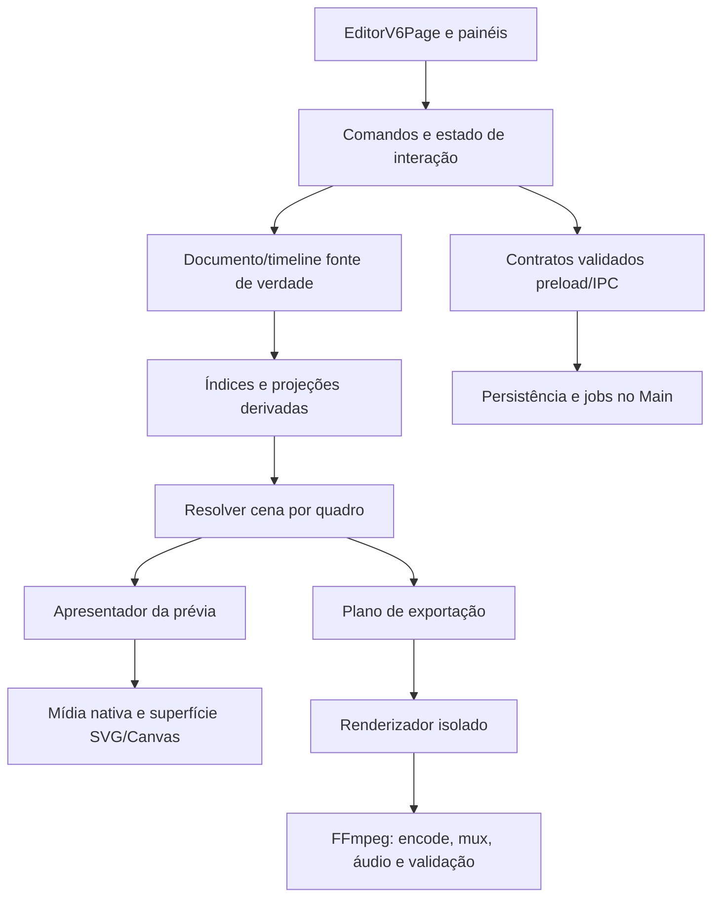

# Pesquisa Chromium para a refatoração do Editor V6

**Data:** 06/11/2026  
**Escopo:** pesquisa técnica integrada de Chromium e da arquitetura do Native Gacha inteiro, com foco em refatoração do Editor V6 e suas dependências. Este documento orienta investigações e experimentos; não autoriza uma reescrita de uma vez, mudança de formato persistido ou troca do renderizador de produção.


> **Pesquisa ampliada em 06/11/2026:** este arquivo agora contém **duas partes no mesmo Markdown**: Parte I, a análise do Chromium/RenderingNG e da refatoração do Editor V6; e Parte II, uma **segunda auditoria independente de todo o Native Gacha**, cobrindo Fabricador, Customizador, Studio, Roteiros, Base de Vídeos, bibliotecas, SQLite/CAS, mídia, Electron/Chromium, WebGL/Canvas, FFmpeg, cabelo e alternativas com critérios de aceite. A Parte II analisou a árvore completa (1.311 arquivos) e leu os componentes principais, **não cada implementação linha a linha**. Não houve execução do app nem novo benchmark; medições citadas têm sua proveniência indicada. [Ir para a Parte II](#parte-ii--segunda-auditoria-sistêmica-native-gacha-inteiro-editor-v6-chromium-ffmpeg-e-alternativas-de-arquitetura).

## Síntese

O material do Chromium aponta para uma refatoração guiada por quatro ideias: etapas pequenas com contratos explícitos, atualização somente do que ficou inválido, isolamento do trabalho de alta frequência e medição de quadros reais. O Editor V6 já adota partes dessa direção: mantém a timeline virtualizada, publica o relógio de playback fora do estado amplo da página, compõe a prévia em `SceneSurface`, processa exportação em renderizadores separados e finaliza o MP4 pelo FFmpeg.

A principal oportunidade arquitetural é tornar essas fronteiras explícitas e testáveis. A página principal ainda coordena muitos casos de uso; prévia, timeline e exportação resolvem partes do documento por caminhos diferentes; e o ciclo de playback, as fontes de mídia e a apresentação de quadros precisam de contratos comuns de tempo e invalidação. A refatoração deve primeiro estabilizar um modelo de cena derivado e suas regras de invalidação. Só depois vale experimentar uma superfície de desenho diferente.

**Não se deve copiar a implementação interna do Chromium.** RenderingNG, Blink, Viz e VideoNG são arquitetura do navegador, não APIs que o Editor possa chamar. As referências servem para extrair princípios e usar ferramentas públicas, como Workers, OffscreenCanvas, WebCodecs e DevTools.

## Material pesquisado

Foram percorridas as áreas Chromium e DevTools do site Chrome for Developers: RenderingNG, arquitetura de renderização, estruturas de dados, VideoNG, WebCodecs, desempenho e diagnóstico visual. As páginas conceituais de RenderingNG e VideoNG descrevem arquitetura desenvolvida ao longo de vários anos; os princípios são úteis, mas não substituem a verificação das APIs presentes na versão do Electron embutida no aplicativo.

- [Chromium](https://developer.chrome.com/docs/chromium?hl=pt-br) — índice e subáreas do projeto.
- [RenderingNG](https://developer.chrome.com/docs/chromium/renderingng) — confiabilidade antes de desempenho escalável e extensibilidade; caching, isolamento e uso de hardware.
- [RenderingNG architecture](https://developer.chrome.com/docs/chromium/renderingng-architecture) — fluxo entre animação, estilo, layout, pintura, composição e apresentação; responsabilidades por thread.
- [Key data structures in RenderingNG](https://developer.chrome.com/docs/chromium/renderingng-data-structures) — árvores de propriedades, listas de pintura, fragmentos e quadros do compositor.
- [VideoNG](https://developer.chrome.com/docs/chromium/videong) — sincronização, seleção e entrega de quadros de vídeo e separação do pipeline geral de renderização.
- [Video processing with WebCodecs](https://developer.chrome.com/docs/web-platform/best-practices/webcodecs) — encoder/decoder assíncronos, Workers, transferência de frames, controle de fila e liberação de recursos.
- [Performance](https://developer.chrome.com/docs/modern-web-guidance/guides/performance/performance) — contenção e trabalho fora da área visível.
- [Performance features reference](https://developer.chrome.com/docs/devtools/performance/reference) e [Rendering tab](https://developer.chrome.com/docs/devtools/rendering) — frames perdidos, trilhas Main/GPU, pintura, camadas e estatísticas em tempo real.
- [Long Animation Frames API](https://developer.chrome.com/docs/web-platform/long-animation-frames) — diagnóstico de frames cuja execução prolongada afeta a responsividade.

## Estado observado no Editor V6

Este mapa é do código do checkout em que a pesquisa foi feita. Ele serve para localizar a refatoração; não é uma medição de desempenho.

| Área | Implementação atual | Implicação para a refatoração |
| --- | --- | --- |
| Composição da página | `EditorV6Page.tsx` contém aproximadamente 986 linhas e coordena seleção, comandos, hooks, painéis, playback, persistência, mídias e exportação. | Extrair fronteiras por responsabilidade e contrato. A contagem de linhas, sozinha, não define o que deve ser dividido. |
| Documento e timeline | Documento persistido e tipos compartilhados ficam em `src/shared/editorV6.ts`; timeline tem modelo e operações próprias. | Manter documento como fonte de verdade; cena renderizada deve ser uma projeção derivada, sem nova cópia persistida concorrente. |
| Relógio | `useEditorV6Playback` calcula o quadro lógico em `requestAnimationFrame`; durante a execução, atualiza o relógio externo e evita publicar estado React amplo a cada quadro. | Preservar o isolamento atual. Evitar reintroduzir re-renderização da página inteira a cada tick. |
| Prévia | `EditorV6PlaybackScene` resolve a cena por quadro e usa `SceneSurface`, uma superfície SVG com elementos visuais e camada de vídeo HTML. Composição facial assíncrona é aplicada quando necessária. | Separar resolução de cena, composição de assets e desenho. Preservar resposta imediata ao seek, seleção e arraste. |
| Timeline | `EditorV6Timeline.tsx` mantém apenas blocos e transições próximos à janela horizontal visível; as linhas de blocos são memoizadas. | Refatorar o índice e a geometria de viewport sem perder a virtualização já existente. |
| Vídeo e áudio | Prévia usa elementos HTML de vídeo/áudio, alinhados ao tempo do Editor com tolerâncias de seek/reprodução. | Formalizar a autoridade do relógio, as regras de seek, pausa e retomada e o que fazer quando a mídia ainda não está pronta. |
| Exportação | `exportWorker.tsx` (aproximadamente 684 linhas) roda numa janela/renderizador isolado, monta a cena por quadro e valida uma marca do quadro capturado. Main coordena os trabalhos, e `exportRunner.ts` envia quadros ao FFmpeg, junta, mixa e valida o arquivo. | Formalizar o protocolo produtor/consumidor, os limites de memória, cancelamento, progresso, erros e paridade entre prévia e exportação. |
| Diagnóstico | Há React Profiler, amostras de resolução da cena, long tasks, lacunas de playback e métricas detalhadas do exportador, com ativação opt-in. | Evoluir a instrumentação para responder a perguntas concretas de interação, sem registrar conteúdo privado de projetos. |

Locais principais: `src/renderer/src/features/editorV6/EditorV6Page.tsx`, `editorV6PlaybackClock.ts`, `useEditorV6Playback.ts`, `EditorV6PlaybackScene.tsx`, `SceneSurface.tsx`, `EditorV6Timeline.tsx`, `exportWorker.tsx`, `electron/domains/editorV6/exportWorkers.ts`, `exportRunner.ts` e `src/shared/editorV6.ts`.

## Princípios do Chromium aplicados ao Editor

### 1. Modelar etapas e invalidação, não um renderizador monolítico

RenderingNG descreve estágios distintos — animação, estilo/layout, pintura, rasterização, composição e desenho — e pula estágios quando a mudança não exige reexecutá-los. As estruturas intermediárias tornam explícito o que cada etapa consome e produz. Para o Editor, a tradução útil é um fluxo de dados do documento até a apresentação:

1. Documento/timeline imutáveis e comandos de edição.
2. Índices e snapshots derivados para a faixa e o intervalo de quadros consultado.
3. Resolução determinística do estado da cena no quadro solicitado.
4. Preparação de imagem, face, cabelo e vídeo, cada qual com identidade e ciclo de vida claros.
5. Apresentação na prévia ou produção de bitmap no exportador.

Uma alteração em cor, seleção ou playhead não deve reconstruir índices de timeline; uma alteração de asset não deve invalidar geometria de todos os elementos; um seek não deve provocar gravação do documento. Isso pede dependências explícitas e chaves de revisão por domínio, não flags globais de “cena suja”.

**Adaptação recomendada:** desenhar os contratos de entradas/saídas das etapas antes de mover código. Manter funções puras para resolução e planos de desenho sempre que possível. Separar mudanças de documento, estado transitório de interação e estado derivado de apresentação.

### 2. Isolar o trabalho de alta frequência e manter a entrada responsiva

Chromium separa tarefas da thread principal, compositor e mídia; a documentação destaca Workers e `OffscreenCanvas` para trabalho de renderização que possa sair da thread de interface. O Editor já possui Workers para etapas de movimento e renderizadores Electron isolados para exportar. A prioridade não é criar workers indiscriminadamente, mas impedir que tarefas de alta frequência bloqueiem comandos, arraste, seleção ou navegação.

**Adaptação recomendada:** manter relógio de playback e drag draft fora do documento salvo; publicar para React apenas os dados que realmente mudaram; deixar operações caras canceláveis e com limite de concorrência. Considerar mover composição de pixels para Worker/OffscreenCanvas somente quando ela puder ser expressa sem depender de DOM/React e a transferência não custar mais que o trabalho removido.

### 3. Desenhar somente o que está visível e invalidar localmente

RenderingNG usa invalidation, listas de pintura e rasterização por tiles; a orientação Web moderna recomenda `content-visibility` para subárvores fora da tela. No V6, a virtualização horizontal da timeline é um bom exemplo de trabalhar só na janela visível. A cena de prévia, por outro lado, precisa permanecer completa dentro de seu viewport fixo; aplicar `content-visibility` à superfície de cena poderia ocultar conteúdo que faz parte do quadro final.

**Adaptação recomendada:** estender índices de visibilidade para camadas de timeline e listas longas de assets/presets. Na cena, fazer culling por bounds somente para elementos comprovadamente fora do quadro e sem efeitos que cruzem esses limites. Recalcular bounds após transformações, rotação, crop, sombras/contornos e cabelo. Instrumentar falsos negativos visualmente; a regra de visibilidade deve ser testável com cenas sintéticas.

Não aplicar `will-change` ou promover cada elemento a camada. A composição por camadas tem custo de memória e pode piorar o desempenho quando usada em excesso; confirmar o ganho por trace e estatísticas de GPU antes de alterar CSS.

### 4. Tratar vídeo como fluxo de quadros com relógio, não como imagem da cena

VideoNG separa a apresentação de vídeo da pintura comum, escolhe quadros usando tempo de apresentação e relógio e procura reduzir cópias de pixel. O Editor já usa `<video>` na prévia e evita rasterizar vídeo dentro de cada atualização React. A sincronização atual corrige `currentTime` por limiares; ela é uma heurística de produto, não prova de sincronismo audiovisual perfeito.

**Adaptação recomendada:** definir um contrato de transporte de mídia com tempo de origem, intervalo, taxa de quadros, seek pendente, estado de decodificação e apresentação. Manter o elemento de vídeo nativo como candidato padrão. Avaliar callbacks de quadros apresentados, como `requestVideoFrameCallback`, apenas se suportados pela versão do Electron e se resolverem um defeito medido. Em seek, exigir seleção determinística do quadro de vídeo correspondente ao quadro do Editor.

O compositor não deve copiar vídeo para Canvas a cada frame sem uma necessidade demonstrada: isso pode adicionar readback/conversão e consumo de banda justamente no caminho que VideoNG mantém separado.

### 5. Usar WebCodecs como experimento de pipeline, não substituição direta do MP4

WebCodecs oferece codificação/decodificação assíncrona, frames transferíveis e `OffscreenCanvas`. A documentação pede verificar suporte com `isConfigSupported`, monitorar `encodeQueueSize`, aplicar backpressure e fechar `VideoFrame` quando não for mais necessário. Essas regras são relevantes se o V6 testar codificação dentro de Worker.

WebCodecs não constitui, por si só, o pipeline atual de MP4: o Editor precisa de H.264, composição de áudio, muxagem, validação de número/duração de quadros, cancelamento, recuperação, relatórios e compatibilidade com o FFmpeg empacotado. Uma troca exigiria ainda componente de muxagem e paridade com FFprobe. Portanto, manter FFmpeg como caminho de produção; testar WebCodecs num spike separado, com detecção de capacidade e fallback, sem mudar formato ou resultados publicados.

### 6. Medir quadros e causas antes de otimizar

O painel Performance do Chromium permite relacionar um quadro à atividade Main, GPU e raster, distinguir quadro parcial de quadro perdido, rever screenshots e localizar eventos de pintura. A aba Rendering ajuda a observar FPS, paint flashing, bordas de camadas e tiles. As próprias ferramentas podem afetar o tempo quando instrumentação avançada é ligada; traces diagnósticos não devem ser tratados como benchmark final.

O V6 já registra custo de commit React, resolução da cena, lacunas do relógio, long tasks e subfases de exportação. A pesquisa sugere uma matriz que conecte sintomas a dados:

| Pergunta | Evidência necessária |
| --- | --- |
| O arraste perdeu quadros por JavaScript ou pintura? | Trace Main, frames e pintura durante drag/resize. |
| O gargalo da prévia é resolução da cena ou desenho SVG? | Tempo puro de resolução versus trace/render stats do quadro apresentado. |
| O áudio/vídeo deriva durante playback? | Erro em milissegundos por tempo de apresentação, seek, pausa e retomada em mídias de teste. |
| Exportar é limitado por composição, readback ou FFmpeg? | Tempos por fase e por quadro, CPU/GPU, fila de quadros e pico de memória. |
| Uma mudança piora dispositivos modestos? | Medições em perfis de hardware distintos, não apenas o PC de desenvolvimento. |

Perfis avançados como screenshots por quadro e paint instrumentation devem ser usados para explicar uma diferença; as comparações oficiais devem usar a mesma fixture, resolução, FPS, estado de cache permitido e configuração de máquina.

## Arquitetura alvo para investigar

O diagrama propõe limites de dependência. Não prescreve uma hierarquia de diretórios nem uma reescrita completa.



Responsabilidades propostas:

- **Comandos/documento:** transações de edição, undo/redo, validação, autosave e flush. Documento permanece dono dos dados persistidos e das referências por ID.
- **Índices/projeções:** lookup de blocos por faixa/intervalo, bounds visíveis, assets necessários, planos de motion e assinaturas. São descartáveis e reconstruíveis a partir do documento.
- **Relógio/presentação:** um relógio do Editor para playhead; adaptadores de mídia para sincronizar os próprios clocks; regra explícita de seek, pausa, final e frame atrasado.
- **Prévia:** presenter que combina cena derivada, seleções/overlays transitórios e layers nativas de vídeo; sem regra de persistência ou exportação.
- **Exportação:** job imutável com snapshot, recursos resolvidos, progresso, cancelamento e erro tipado; renderer de quadro isolado e backend FFmpeg.
- **Telemetria:** diagnósticos opt-in com contagens e tempos agregados; caminhos, nomes, IDs e conteúdo de projeto não entram em traces compartilháveis.

## Sequência de refatoração e gates

### Fase 0 — Consolidar a baseline

Usar a [baseline publicada](baselines/native_gacha_nova_baseline_2026-11-05.md) e a [priorização pós-baseline](ZONA_GUERRA_PRIORIDADES_POS_BASELINE_2026-11-05.md) como ponto de partida. Inventariar contratos de persistência, eventos de edição e capturas já existentes; reproduzir cenários de prévia e timeline com fixtures sintéticas. Separar custos de interação, cena e exportação. Não abrir projetos pessoais como fixtures destrutivas.

**Gate:** cenário de referência reproduzível; visual de quadros conhecido; métricas por fase e consumo de memória disponíveis; testes existentes e contratos de dados documentados.

### Fase 1 — Extrair o núcleo de cena

Identificar o estado fonte de cada operação, extrair resolução de cena e seletores por faixa/quadro e remover regras duplicadas somente onde os contratos forem realmente os mesmos. Manter a superfície SVG e o exportador atuais.

**Gate:** mesma cena resolvida em todos os quadros de casos determinísticos, inclusive background, sobreposição, visibilidade, transições, personagens, expressões e mídia; nenhuma mudança de schema; exportação continua compatível.

### Fase 2 — Unificar tempo e invalidação da prévia

Isolar updates de playback, drag draft, seleção e documento. Medir commits, tempo de resolução, tempo até frame visível e sync de mídia. Introduzir invalidação fina com limites e chaves explícitos; preservar o relógio externo de alta frequência.

**Gate:** seek/drag/resize/undo/redo respondem corretamente; nenhum autosave provocado por tick; playback não aumenta re-renderizações gerais da página; sincronismo de mídia medido numa suíte fixa.

### Fase 3 — Clarificar a timeline

Separar geometria e consulta visível de eventos de pointer e apresentação dos blocos. Preservar range de viewport, snap, drag, resize, menus, acessibilidade e atalhos. Usar trace para confirmar a origem de layout/paint antes de adicionar CSS containment ou novos layers.

**Gate:** mesmos frames e regras de snap para fixtures; interação com muitas faixas/blocos; navegação de teclado; comparação de quadros, DOM e tempo de resposta.

### Fase 4 — Experimentos de renderização isolados

Prototipar composição Canvas/OffscreenCanvas e transferência de `ImageBitmap`/`VideoFrame` apenas para componentes que não dependem de DOM, com orçamento de memória e backpressure. Comparar o custo de desenho e cópia com a implementação atual. Prototipar WebCodecs separadamente do FFmpeg.

**Gate:** paridade de pixels (RGBA/BGRA e alpha), texto e fontes, crop/rotação, rosto/roupas/cabelo, layering, vídeo, áudio e emendas; estabilidade de memória e cancelamento; ganho A/B em mais de um perfil de hardware. Se não cumprir, o protótipo não entra na rota de produção.

### Fase 5 — Remover duplicação comprovada

Só depois de as rotas novas passarem todos os gates, remover a rota antiga. Manter persistência, IPC, IDs de projetos/assets e contratos entre Fabricador, Customizador, Studio e Editor V6 estáveis, salvo proposta separada com migração e rollback.

## Riscos e decisões que ficam em aberto

- **Versão do Chromium:** APIs disponíveis e comportamento de GPU variam com a versão do Electron e drivers. Detectar capacidade em runtime; não depender de flags privadas.
- **Paridade de texto e SVG:** desenho em Canvas/Skia pode divergir de SVG/DOM em fontes, antialiasing, filtros, clipping e alpha. A aparência do Editor é contrato funcional.
- **Memória:** frames 1080p e bitmaps transferidos são grandes; qualquer fila deve ser limitada, com descarte/fechamento explícito e contabilidade de bytes.
- **Cache:** chaves precisam conter todas as revisões visuais necessárias; memória deve ter limite e eviction. Esta pesquisa não propõe cache entre exportações.
- **Hardware:** GPU pode acelerar raster, mas upload/readback, composição e drivers podem anular o ganho ou reduzir estabilidade. Medir em CPU/GPU antes de ativar.
- **Produto e regressão:** a animação experimental dinâmica de cabelo continua exclusiva da exportação MP4; a prévia normal não ganha esse comportamento por causa da refatoração.
- **Escopo:** a pesquisa anterior de [alternativas de exportação](PESQUISA_SISTEMICA_MOTORES_E_EXPORT_2026-11-04.md) já trata motores e protótipos. Este documento complementa aquela pesquisa com arquitetura de renderização/tempo do Chromium; não deve criar uma segunda prioridade de benchmark incompatível.

## Referências locais relacionadas

- [Roadmap V4 do Editor V6](ROADMAP_V4_EXCELENCIA.md)
- [Prioridades após a baseline de 05/11](ZONA_GUERRA_PRIORIDADES_POS_BASELINE_2026-11-05.md)
- [Baseline Native Gacha Nova](baselines/native_gacha_nova_baseline_2026-11-05.md)
- [Pesquisa sistêmica de motores e exportação](PESQUISA_SISTEMICA_MOTORES_E_EXPORT_2026-11-04.md)
- [Testes de estresse offscreen](TESTES_DE_ESTRESSE_OFFSCREEN.md)

## Conclusão

A refatoração de maior valor não começa trocando SVG, React ou FFmpeg. Começa por separar fonte de verdade, projeções da cena, clock, apresentação e jobs de exportação; definir invalidação e identidade entre eles; então medir quais fases continuam caras. Isso segue a sequência de confiabilidade, desempenho escalável e extensibilidade vista no RenderingNG e usa as áreas do Chromium como referências de projeto — não como promessa de que uma API específica acelere o aplicativo.

---

## Parte II — Segunda auditoria sistêmica: Native Gacha inteiro, Editor V6, Chromium, FFmpeg e alternativas de arquitetura

**Data:** 06/11/2026  
**Escopo:** aplicativo desktop Native Gacha, suas fontes de conteúdo e persistência, Editor V6 completo (edição, prévia, movimento, exportação), Electron/Chromium, pipeline de áudio/vídeo/FFmpeg, bibliotecas nativas, segurança, desempenho, integração e possíveis motores alternativos.  
**Base verificável:** repositório `nestarasup-sys/Native-gacha`, branch `Dev-V2`, **commit `1a6c9b1c22515bdd78af493e48c586c3e062c464`**; árvore GitHub recursiva não truncada com **1.311 arquivos**.  
**Parte I consultada:** a pesquisa Chromium original nas seções acima (190 linhas na revisão de origem).
**Natureza desta seção integrada:** segunda opinião, pesquisa técnica e roteiro de auditoria/experimentos — **não é refatoração realizada nem benchmark executado**.

#### Legenda obrigatória de evidências

- **[CÓDIGO]**: comportamento ou dependência visível na revisão Git acima, com referência a arquivo/função. A evidência é **estática**; não implica que a função rodou ou que o fluxo foi medido na máquina do usuário.
- **[DOCUMENTAÇÃO EXTERNA]**: declaração de documentação oficial de Electron, Chromium, FFmpeg, Web APIs ou SQLite; versão exata do binário embutido deve ser testada.
- **[USUÁRIO]**: informação relatada na conversa, sem relatório bruto desta execução.
- **[DOCUMENTO ANTERIOR]**: fato declarado por estudos anteriores do repositório; confirmar a proveniência dos benchmarks antes de usá-los como nova baseline.
- **[HIPÓTESE]**: proposta a implementar/testar, **não performance obtida**.
- **[A CONFIRMAR]**: exige inspeção dinâmica, hardware real, projeto original, profiling ou análise de outros arquivos.

**Regra:** não transformar `código presente` em `caminho ativo`; não transformar `CI sintética verde` em `melhora de desempenho`; não confundir `cache aquecido` com primeira exportação fria; não contar trabalho de workers simultâneos como tempo de parede acumulado.

---

### Rodada 1 — Inventário real do aplicativo e stack

#### 1.1 Quantidade e organização observadas

A API GitHub de árvore recursiva retornou 1.311 entradas de arquivo (`truncated=false`). Contagem por raiz: `src/` **575**, `electron/` **175**, `tests/` **341**, `docs/` **117**, `scripts/` **81**; demais arquivos são configuração, recursos, workflows e distribuição. Pastas de frontend: `src/renderer/src/features/fabricator/` **213 arquivos**, `customizer/` **62**, `editorV6/` **80**, `studio/` **21**, `baseVideos/` **15**, `roteiros/` **10**, `editorV7/` **1**. São contagens estruturais de arquivos, **não indicadores de qualidade, risco ou volume de código**.

A inspeção foi uma **varredura completa da árvore + leitura dirigida dos componentes principais**, não leitura semântica manual das 1.311 implementações. Esta distinção importa para avaliar a cobertura da auditoria.

| Camada | Tecnologia/verificação | Papel efetivo e fronteira |
|---|---|---|
| Desktop | **Electron** (`^45.1.0` no `package.json`) | Main process, janelas, Chromium, sandbox/preload, IPC e ciclo de vida. Não inferir Chromium/Node exatos pelo range: confirmar `process.versions` do build executado. |
| UI | **React 19, React DOM 19, React Router 8** | Páginas, painéis, editor, timeline, `SceneSurface` em SVG, composição visual e perfis de interação. |
| Estado | **Zustand 5**, **Immer 11** | Estado e atualização de documentos/edições; o uso exato varia por domínio. |
| Contratos | **TypeScript 6 alias npm**, **Zod 4** | Tipagem, validação IPC/documentos, invariantes de exportação. |
| Build | **electron-vite 6, Vite 8, plugin React 6, esbuild 0.28.2** | Bundles separados de Main/preload/UI/worker, asset loading, CSP, SHA embutido. |
| Persistência | **better-sqlite3 13**, filesystem Node, JSON, CAS SHA-256 | Catálogos, bibliotecas, Roteiros/Base de Vídeos, projetos, assets, recuperação e migrações. Não é tudo SQLite. |
| Imagens | **sharp 0.35 (libvips), Canvas 2D, SVG, WebGL**, PNG/JPEG/WebP | Normalização de imagens, fontes do Fabricador, personagens, máscaras, tint, face, atlas de poses e cabelo. |
| Vídeo | **FFmpeg + ffprobe externos preparados pelo projeto** | Raw BGRA → codificação H.264 → concatenação → áudio → validação MP4. Não confundir FFmpeg externo com decodificador HTML `<video>` do Chromium. |
| Processamento | `BrowserWindow` isoladas, WebGL/Canvas, processos FFmpeg | Bake de movimento, duas lanes Turbo, captura de quadros e codificação. |
| UI/diagnóstico | React Profiler, relógio por RAF, traces, testes Vitest/Node | Prévia, manutenção da fluidez, auditoria de fases, relatórios sem dados privados. |
| Empacotamento | **electron-builder 26**, pacote Windows portátil | Distribuição e disponibilidade real de DLLs, GPU, executáveis FFmpeg. |

Referências diretas: [`package.json`](../../package.json), [`package-lock.json`](../../package-lock.json), [`electron.vite.config.ts`](../../electron.vite.config.ts), [`electron/main.ts`](../../electron/main.ts), [`src/renderer/src/ui/mountApp.tsx`](../../src/renderer/src/ui/mountApp.tsx).

##### Dependências diretas identificadas — inventário fechado do `package.json`

**Em produção (`dependencies`):** `better-sqlite3`, `immer`, `react`, `react-dom`, `react-router`, `sharp`, `zod`, `zustand`.

**De desenvolvimento/build (`devDependencies`):** `@electron/rebuild`, `@types/better-sqlite3`, `@types/react`, `@types/react-dom`, `@typescript/native`, `@vitejs/plugin-react`, `electron`, `electron-builder`, `electron-vite`, `esbuild`, `typescript`, `vite`, `vitest`.

**Não aparecem como dependências diretas instaladas:** `@napi-rs/canvas`, `resvg-js`, `PixiJS`, `Three.js`, `Remotion`, `WebGPU` como biblioteca externa, `fluent-ffmpeg`. Essas são **alternativas a avaliar**, não componentes já usados. É possível haver dependências transitivas; a presença/versão final deve ser auditada com `npm ls` e o lockfile local.

##### Caminhos e artefatos importantes

- `electron.vite.config.ts` cria `out/main`, `out/preload` e `out/renderer` e entradas **separadas** para UI e `editor-v6-export.html`.
- `electron/editorV6ExportPreload.ts` e `electron/editorV6MotionPreload.ts` são bridges isoladas, distintas do preload normal.
- `src/renderer/src/main.tsx` desvia algumas URLs de stress/bake para entrypoints especiais; a UI normal é montada em `src/renderer/src/ui/mountApp.tsx` com React StrictMode e HashRouter.
- `src/shared/applicationRoutes.ts` confirma rotas: Customizador, Studio, Editor V6, biblioteca do V6, **Editor V7**, Roteiros, Base de Vídeos, Fabricador DEV, Opções e Logs DEV.
- `electron/main.ts` continua um **ponto de composição grande** (1.399 linhas na revisão); dezenas de serviços foram extraídos, mas inicialização e orquestração cruzada continuam importantes para falhas de dependência e shutdown.

#### 1.2 Arquitetura de processos e confiança

```text
                          Aplicativo Windows
                                │
               ┌────────────────┴────────────────┐
               │ Electron Main / Node.js          │
               │ arquivos, DB, protocolo, IPC     │
               │ jobs, FFmpeg, janelas             │
               └──────────────┬──────────────────┘
                              │ Preload/contextBridge com contratos
           ┌──────────────────┼───────────────────────────┐
           │                  │                           │
    React/UI Chromium    Worker Electron              Worker Electron
    Fabricador etc.      bake de movimento             export 1080p
    Preview V6           Canvas personagens             SVG/Canvas/WebGL
    Timeline             atlas de transições           captura tokenizada
           │                  │                           │
           │                  └───────────────┬───────────┘
           │                                  │ BGRA dos frames
           └─ mídia/projetos por IPC          ▼
                            FFmpeg externos + ffprobe
                            H.264, áudio, concat, validação
```

**[CÓDIGO]** A janela principal e as de exportação usam `contextIsolation:true`, `nodeIntegration:false`, `sandbox:true`; serviços registram origin/sender e validam contratos. O worker de movimento tem bridge própria. **[DOCUMENTAÇÃO EXTERNA]** Isso segue boas práticas de isolamento do Electron, mas a segurança final depende de todos os canais, origem, permissões, CSP e protocolo — não apenas de três flags. Referências: [`electron/application/mainWindow.ts`](../../electron/application/mainWindow.ts), [`electron/preload.ts`](../../electron/preload.ts), [`electron/domains/editorV6/exportWorkers.ts`](../../electron/domains/editorV6/exportWorkers.ts), [Electron Security](https://www.electronjs.org/docs/latest/tutorial/security), [Electron Context Isolation](https://www.electronjs.org/docs/latest/tutorial/context-isolation).

**Ponto estrutural:** um resultado do Fabricador/Customizador pode chegar ao renderizador por **assets/catálogos/manifestos IPC**, depois gerar texturas e personagens no Chromium, e ainda ser transformado em atlases pela exportação. Portanto, ganhar velocidade no V6 às vezes requer mudar **o contrato de preparação no produtor**, não só o componente V6.

---

### Rodada 2 — Donos dos dados: cada área e o que ela fornece ao Editor V6

#### 2.1 Mapa de relações funcionais

| Domínio | O que possui/produz | Consumidores e impacto no Editor V6 | Código de referência |
|---|---|---|---|
| **Fabricador DEV** | Modelos, partes, fontes, poses, articulações, roupas, cabelos, faces, expressões, efeitos, guias, catálogos, assets versionados | Fornece *geometria e arte originais*; uma alteração pode invalidar poses, cabelo, recortes, materiais e snapshots de personagens | [`electron/domains/fabricator/`](../../electron/domains/fabricator/), [`src/shared/fabricator.ts`](../../src/shared/fabricator.ts), [`src/renderer/src/features/fabricator/`](../../src/renderer/src/features/fabricator/) |
| **Customizador** | Instâncias/identidades dos personagens; roupa, cor de pele, cabelo, face, pose, overrides | V6 precisa resolver personagem + revisão da fonte; cache não pode usar apenas ID ou pose, sob risco de personagem errado | [`electron/domains/customizer/repository.ts`](../../electron/domains/customizer/repository.ts), [`src/shared/customizer.ts`](../../src/shared/customizer.ts), [`src/renderer/src/features/customizer/`](../../src/renderer/src/features/customizer/) |
| **Personagem compartilhado** | Preparação, tint, materiais/roupa, Canvas, face, cachês, recortes, composições reutilizáveis | O **hot path da exportação** chama `prepareSavedCharacterRenderer`, `renderToCanvas` e variantes; alterações aqui afetam também Studio e Customizador | [`src/renderer/src/characters/`](../../src/renderer/src/characters/), [`editorV6CharacterRenderer.ts`](../../src/renderer/src/characters/editorV6CharacterRenderer.ts) |
| **Studio** | Documento/cena, seleção/cast, assets, snapshots de personagem e imagens | Compartilha geometria, personagem, referências e políticas de persistência; refatorar renderer compartilhado sem validar Studio é regressão provável | [`electron/domains/studio/`](../../electron/domains/studio/), [`src/shared/studio.ts`](../../src/shared/studio.ts), [`src/renderer/src/features/studio/`](../../src/renderer/src/features/studio/) |
| **Editor V6** | Projeto próprio, timeline de 30fps, snapshots, movimentos, prévia, áudio/vídeo vinculados, MP4 e relatórios | Consome catálogos e produz mídia final; dados são uma **projeção** de outras áreas e snapshots, não um Editor independente | [`src/shared/editorV6.ts`](../../src/shared/editorV6.ts), [`electron/domains/editorV6/`](../../electron/domains/editorV6/), [`src/renderer/src/features/editorV6/`](../../src/renderer/src/features/editorV6/) |
| **Bibliotecas de mídia** | Vídeos, áudios, fundos, objetos, metadados/duração, links referenciados | Prévia usa protocolos/Range e HTMLMediaElement; MP4 final usa paths/FFmpeg; links podem ser compartilhados sem copiar toda mídia | [`electron/domains/mediaLibrary/`](../../electron/domains/mediaLibrary/), [`electron/domains/editorV6/mediaProtocol.ts`](../../electron/domains/editorV6/mediaProtocol.ts) |
| **Roteiros** | Textos, seções, vídeo de referência, personagens, fichas e exportações | Pode criar/vincular conteúdo do Customizador/Editor; alterações no ciclo de vida de referências podem quebrar Roteiros e V6 | [`electron/domains/roteiros/`](../../electron/domains/roteiros/), [`src/shared/roteiros.ts`](../../src/shared/roteiros.ts) |
| **Base de Vídeos** | Metadados, categorias, sequência e publicação de vídeos | Usa a **biblioteca de vídeo compartilhada** e a fila de gravação relacionada a Roteiros; remoção deve respeitar vínculos | [`electron/domains/baseVideos/service.ts`](../../electron/domains/baseVideos/service.ts), [`repository.ts`](../../electron/domains/baseVideos/repository.ts) |
| **Editor V7 (existente no código)** | Domínio e exportador próprios; escopo ainda pequeno | Não presumir compatibilidade de formatos nem copiar código entre V6/V7 sem contrato; observar coexistência de IPC e build | [`src/shared/editorV7.ts`](../../src/shared/editorV7.ts), [`electron/domains/editorV7/`](../../electron/domains/editorV7/) |
| **Opções/Logs DEV/infra** | Backup, migração, diagnóstico, métricas de IPC, logs e persistência pendente | Define **segurança dos dados e mensurabilidade**. Otimização que torna o app instável ou perde saves não é ganho | [`src/renderer/src/features/options/`](../../src/renderer/src/features/options/), [`electron/domains/storage/`](../../electron/domains/storage/), [`electron/ipcPerformance.ts`](../../electron/ipcPerformance.ts) |

**[CÓDIGO]** A fronteira formal já consta de [`AGENTS.md`](../../AGENTS.md): Fabricador é dono da fonte, Customizador da instância, Studio do documento/cena e Editor V6 do projeto/timeline. Preserve contratos de IDs, live references, snapshots e revisões. **Atenção especial a roupas e cabelos:** nem toda mudança visual deve ser tratada como uma troca independente de PNG.

#### 2.2 Fluxo real de personagem e por que custa tempo

```text
Fabricador: modelo, peças, articulações, poses, roupas, face, estilos de cabelo
      │ revisões/fontes / IDs / assets
      ▼
Customizador: personagem salvo, estilo/cores, overrides, roupa, pose, expressão
      │ contrato de origem; sem assumir que uma preview == snapshot de export
      ▼
src/renderer/src/characters/
  characterSourceResolver + preparedCharacterMaterials
  editorV6CharacterRenderer / characterRenderer
  Canvas, tint, face, roupas, camadas, caches de imagem
      │
      ├── Studio / preview / Customizador
      ├── Editor V6: snapshots e catálogo para timeline
      ├── bakeMotion.ts: atlas de transições por amostra
      └── editorV6HairMotionPreparation.ts: split normal/sem cabelo
                     │
                     ▼
                exportWorker.tsx
                SVG/Canvas/WebGL / FFmpeg
```

**[CÓDIGO]** [`electron/editorV6MotionPreload.ts`](../../electron/editorV6MotionPreload.ts) expõe ao worker, entre outros, `loadFabricatorSlot`, poses, cabelo, roupas, faces e catálogos de face por IPC. Essa sequência confirma que o bake não é um cálculo independente de posições: pode exigir buscar e renderizar materiais vindos de vários domínios.

##### Risco central de refatoração

Um cache compartilhado entre Fabricador → Customizador → V6 precisa identificar **conteúdo visual completo e versão de cada dependência**: modelo, pose, roupa, tint, cabelo, olhos, boca, máscara, transformações, revisões e crop. Sem isso, a otimização pode produzir conteúdo desatualizado. **Não criar um cache global genérico como primeira resposta ao problema.** Primeiro medir duplicidade real e construir invalidação correta.

#### 2.3 Bibliotecas e formato de mídia

**[CÓDIGO]** `electron/domains/mediaLibrary/videoLibraryStore.ts` mantém um catálogo de vídeos e operações coordenadas; `videoCasShadow.ts` trata hashing/CAS. `mediaFileResponse.ts` retorna **HTTP Range (`206`), `Content-Range`, streams Node e tratamento de `HEAD`**, necessários para seek de vídeo/áudio no Chromium sem carregar toda a mídia. `electron/domains/editorV6/mediaProtocol.ts` autoriza referências a mídia de projeto, biblioteca e imagens por ID, com checks de MIME/caminhos.

**Implicação:** comparar preview Chromium com export FFmpeg exige verificar **mesma origem, codec, início em frames, timestamps, intervalo e ausência de substituição por proxy**. Não remover o protocolo ou reescrever URLs para `file://` no intuito de acelerar. As duas rotas de decodificação são tecnicamente diferentes e podem produzir variância de cor, tempo, seek ou alpha.

#### 2.4 Banco, CAS, JSON e recuperação — não mexer sem transação

**[CÓDIGO]** `electron/dataPlatform.cjs` usa `better-sqlite3`; `electron/domains/storage/catalogSchema.cjs` declara **`CATALOG_SCHEMA_VERSION = 18`** na revisão e define SQLite `journal_mode=WAL`, `synchronous=FULL`, catálogos de Roteiros e Base de Vídeos, metadata, referências, objetos e migrações. `contentAddressedStore.cjs` armazena objetos em `media/objects/sha256`. `domainFileSystem.cjs` suporta dados de domínios com imagens externalizadas e referências protegidas. Outras áreas persistem em JSON/arquivos: Customizador e projetos do V6, por exemplo.

- `electron/domains/editorV6/documentPersistence.ts` lê/escreve `editorV6.json`, normaliza timeline, recupera transações de assets e protege referências.
- `electron/domains/editorV6/assetTransaction.ts` + `electron/domains/storage/atomicManifest.ts` publicam assets e manifestos com transações/temporários.
- `electron/domains/customizer/repository.ts` mantém protocolo de `*.tmp` e backup legado.
- `electron/domains/roteiros/repository.ts` usa transações SQLite; `electron/domains/baseVideos/repository.ts` usa consultas e transações SQL.
- `electron/domains/storage/keyedOperationQueue.ts` ordena ações por entidade; `pendingPersistenceIpc.ts` coordena flush do renderer **antes** do Main.

**[DOCUMENTAÇÃO EXTERNA]** WAL permite leituras simultâneas com um escritor, mas checkpoints e migrações seguem regras e riscos próprios ([SQLite WAL](https://www.sqlite.org/wal.html)). Não otimizar a exportação movendo assets para SQLite ou regravando JSON sem medir causalidade: é mudança de contrato e recuperação, possivelmente pior para pixels/grandes binários.

---

### Rodada 3 — Editor V6 completo, da interação à cena

#### 3.1 Núcleo do documento/timeline

| Subárea | O que o código faz | Evidência |
|---|---|---|
| Documento | Define `EditorV6Document`, assets, mídia e elementos/atributos de personagem | `src/shared/editorV6.ts` |
| Validação | Zod para documento, IPC e formato dos assets, limites e invariantes | `src/shared/editorV6Schema.ts` |
| Timeline | Tracks de personagem, fala, pensamento, objeto, vídeo e áudio; blocos, snapshot e durações | `src/shared/editorV6.ts`, `editorV6TimelineCore.ts`, `editorV6TimelineEdits.ts` |
| Resolução determinística | `resolveEditorV6SceneAtFrame(document, frame)` + background, expressão, movimento, elementos vinculados e mídia | `src/shared/editorV6TimelineScene.ts` |
| Movimento | `editorV6MotionPlans` e interpolações/atlases de pose | `src/shared/editorV6Motion.ts`, `editorV6MotionInterpolation.ts` |
| Rosto | Blink, mouth/talk, catalogação, patches e mascaramento | `editorV6FaceSchedule.ts`, `sceneFaceComposition.ts`, `faceModeAssets.ts` |
| Cabelo | Geometria da cabeça, presets, física por amostra e reação de pose | `editorV6HairMotion.ts`, `hairMotionEngine.ts` |
| Mídia | Projetos/links, vídeos sobrepostos e áudio de exportação | `editorV6VideoComposition.ts`, `editorV6Export.ts` |
| Estado UI | `EditorV6Page.tsx`, store Zustand, hooks e comandos | `src/renderer/src/features/editorV6/` |
| Prévia | Clock de `requestAnimationFrame`, `EditorV6PlaybackScene`, `SceneSurface` SVG | `useEditorV6Playback.ts`, `editorV6PlaybackClock.ts`, `SceneSurface.tsx` |
| Export | `EditorV6ExportPanel.tsx`, comando, hair prepare, export IPC/Main/workers, FFmpeg | seção Rodada 5 |

**[CÓDIGO]** `EditorV6Page.tsx` tem **986 linhas** e compõe muitos comandos, seletores e painéis. `EditorV6Timeline.tsx` usa virtualização horizontal e memoização; `useEditorV6Playback.ts` mantém playback por `requestAnimationFrame` e relógio externo. **Não é válido concluir que toda a UI re-renderiza a cada frame apenas pelo tamanho da página**: já há isolamento útil. A pesquisa original aborda esse ponto corretamente.

##### Contrato desejado para qualquer refatoração

```text
Documento/autoria   → TimelineIndex → ResolvedScene(frame) → DrawPlan + ResourceRevisions
                                 ├── PreviewPresenter (interativo/DOM)
                                 └── ExportPresenter (determinístico/offscreen)
```

O **modelo de cena e identidade dos recursos devem ser comuns**, mas os apresentadores podem ser diferentes: a prévia quer resposta a input e seek; o export quer pixels em frame exato, throughput e estabilidade. Não criar uma segunda interpretação de boca/cabelo/pose em um motor nativo sem rodar comparação contra a referência existente.

#### 3.2 Pontos de custo e reinvalidação no V6

**[CÓDIGO]** A prévia em `EditorV6PlaybackScene.tsx` chama `resolveEditorV6SceneAtFrame`, compõe face assincronamente quando há patches e usa `SceneSurface`. A exportação, por sua vez, tem `exportWorker.tsx` próprio e executa composição de face/atlas/cabelo antes de chamar a mesma superfície SVG. Há, portanto, **camadas compartilhadas de modelo, mas caminhos parcialmente distintos de preparação e agendamento**.

**[HIPÓTESE]** Um `ResourceGraph` com chaves imutáveis permitiria separar quatro tipos de invalidação: (a) documento/timeline; (b) geometria e pose; (c) expressão/boca; (d) textura/mesh do cabelo. Cada alteração deveria invalidar somente o grafo descendente relevante. Medir aumento/redução de RAM e tempo antes de mover trabalho para cache permanente.

##### O que NÃO copiar literalmente do Chromium

`Blink`, `LayoutNG`, `RenderingNG`, `Viz`, `Skia` e o processo GPU não são interfaces públicas de desenho de uma página Electron. Não é possível chamar diretamente um estágio de pintura do Chrome como função de um aplicativo React. O que podemos usar são **princípios e APIs expostas** — Workers, WebGL, OffscreenCanvas, WebCodecs, APIs de vídeo, `contentTracing`, DevTools e algumas opções de Electron. Por isso, reescrever o Editor V6 para “usar o compositor do Chromium” sem contrato explícito é promessa vazia.

---

### Rodada 4 — Segunda checagem sistemática de Chromium, Blink, Viz, Web APIs e Electron

Esta é uma **matriz de relevância e de testes**; não significa que todas as áreas internas do Chromium foram analisadas arquivo por arquivo. A pesquisa original listou páginas conceituais, mas a integração com a **versão exata do Electron e com o backend real do app** é que decide viabilidade.

| Tecnologia/área | Situação no Native Gacha | Oportunidade específica | Limite/gate |
|---|---|---|---|
| **RenderingNG/Blink: style/layout/paint/prepaint** | `SceneSurface` é SVG/DOM; React atualiza props por quadro | Resolução de cena/draw plan com chaves de invalidação; reduzir DOM/React quando só cabelo muda | Não assumir que `React.memo` evita raster/layout por completo; usar tracing |
| **Viz/compositor/GPU process** | A captura percorre apresentação de quadros Chromium em `BrowserWindow` | Medir paint/capture/compositor; alternativa via textura compartilhada | Viz não é API pública; handles nativos exigem ownership e sincronização |
| **HTML/SVG e `foreignObject`** | Canvas animado é embutido em SVG com `foreignObject` para personagem | Trocar composição de corpo inteiro por overlays/canvas quando pixels idênticos | Anti-alias, ordem, máscaras, layout, alpha e clipping podem divergir |
| **Canvas 2D** | Muito usado em assets, face, cabelo e atlas | Compor recursos estáticos uma vez; redraw por retângulos/regiões alteradas | `getImageData` e `toDataURL` podem ser caros; medir |
| **WebGL 1** | `exportHairMeshRenderer.ts` cria contexto WebGL e malha | Manter texturas na GPU; aplicar deformação no render target final | Context loss, texturas por worker, sincronização e readback |
| **WebGL 2** | **Não confirmada integração atual no pipeline** | PBO/fences para readback assíncrono, se for o real gargalo | Feature detect no Electron 45/driver Windows; no `getImageData` implícito no meio |
| **WebGPU/Dawn** | Não há evidência de backend de produção no repo | Benchmark exploratório de renderer inteiramente GPU | Compatibilidade/driver, distribuição, paridade, custo de reescrita; não promover cedo |
| **OffscreenCanvas + Worker** | Não identificado como substituto de `SceneSurface` na produção | Renderizar sprites/mesh em worker sem bloquear DOM | `foreignObject`, React, DOM e imagens de CSS não migram automaticamente |
| **WebCodecs (`VideoFrame`, `VideoEncoder`)** | Não é o exportador MP4 atual | Reduzir cópias e pipeline async de frames/encode, testar hardware | WebCodecs **não gera MP4/muxa áudio sozinho**; codec/profile/disponibilidade a verificar |
| **HTMLMediaElement/VideoNG** | Prévia de vídeo/áudio em elementos HTML, fontes por protocolo com Range | Clock e PTS unificados em preview, seek confiável | Previews Chromium ≠ filtros FFmpeg automaticamente |
| **MSE/WebAudio** | Não detectado como pipeline universal do V6 | Investigar somente em problemas reais de sincronização/seek | Pode adicionar buffers/latência/complexidade sem benefício |
| **`requestAnimationFrame`** | Relógio de prévia e sincronização da pintura no worker | Separar `frameIndex` lógico de apresentação/UI | Não substituir frame determinístico por tempo de relógio de tela |
| **`content-visibility`, culling, layers CSS** | Timeline já virtualizada | Culling em grandes listas, não na cena exportada sem prova de bounds | Pode esconder conteúdo legítimo; `will-change` excessivo custa GPU |
| **DevTools Performance, Memory, GPU, tracing** | Perf hooks e testes já presentes | Medir GPU, Main, Renderer, Raster, long tasks e heap; frame-by-frame | Trace pesado deve ser opt-in, não alterar baseline sem controle |
| **Electron `offscreen: true` / `paint`** | Workers de export usam offscreen mas leem `capturePage` | Spike de `paint` direto + fence de frameId | Evento `paint` e dirty rect não garantem captura completa e correta sem protocolo |
| **Electron `offscreen.useSharedTexture`** | **Não encontrado habilitado** em produção | Ponte nativa D3D/GPU↔encoder, potencial de zero-copy | Experimental, addon nativo obrigatório, `texture.release()`, lifetime/driver; alto risco |
| **Electron IPC/preload/contextIsolation/sandbox** | Amplamente usado em Main + workers | Menos dados/copias de assets no IPC, revisão de payloads/segurança | Não abrir Node dentro do renderer; validar sender e inputs |
| **Chromium image decode / Skia raster** | PNG e assets no DOM/Canvas, texturas de cabelo em WebGL | `ImageBitmap`, menos serialização PNG/base64 e recarga de textura | Mudanças no color profile, alpha premultiplicado e filtragem exigem pixel gate |

##### Observações verificadas em documentação primária

1. **[DOCUMENTAÇÃO EXTERNA]** RenderingNG separa animation/style/layout/paint/raster/activate/aggregate/draw; **fases podem ser puladas quando nada as invalida**. A oportunidade do V6 é reter dados e desenhar só a camada alterada — não tentar chamar internals de Blink. [Chromium RenderingNG architecture](https://developer.chrome.com/docs/chromium/renderingng-architecture).
2. **[DOCUMENTAÇÃO EXTERNA]** O Electron tem offscreen com bitmap por memória CPU e modo **GPU shared texture**, este requer módulo nativo e release explícito, com possibilidade de menor cópia. Não é um switch mágico: exige API, lifecycle e comparação de pixels. [Electron Offscreen Rendering](https://www.electronjs.org/docs/latest/tutorial/offscreen-rendering), [Electron webContents](https://www.electronjs.org/docs/latest/api/web-contents).
3. **[DOCUMENTAÇÃO EXTERNA]** `capturePage` é captura da página; o fato de `BrowserWindow` ter `offscreen:true` **não significa** que ele já esteja consumindo as texturas compartilhadas. [Electron `capturePage`](https://www.electronjs.org/docs/latest/api/web-contents).
4. **[DOCUMENTAÇÃO EXTERNA]** OffscreenCanvas pode rodar em Worker; porém não assume as funções de React, HTML, SVG e máscaras sem nova implementação. [MDN OffscreenCanvas](https://developer.mozilla.org/en-US/docs/Web/API/OffscreenCanvas), [transferControlToOffscreen](https://developer.mozilla.org/en-US/docs/Web/API/HTMLCanvasElement/transferControlToOffscreen).
5. **[DOCUMENTAÇÃO EXTERNA]** `WebCodecs.VideoEncoder` expõe pipeline assíncrono, `encodeQueueSize` e `VideoFrame.close()`; ele não deve ser tratado como muxer MP4 com áudio por padrão. [Chrome WebCodecs](https://developer.chrome.com/docs/web-platform/best-practices/webcodecs).
6. **[DOCUMENTAÇÃO EXTERNA]** WebGL2 `fenceSync` é primitiva de sincronização de GPU; sozinha não elimina custo de `readPixels`, e WebGL1 não possui essa mesma interface. [MDN fenceSync](https://developer.mozilla.org/en-US/docs/Web/API/WebGL2RenderingContext/fenceSync).
7. **[DOCUMENTAÇÃO EXTERNA]** O Electron recomenda medir CPU/heap/main renderer antes de adotar otimizações; DevTools separa GPU/raster/frames e explica quadros perdidos. [Electron Performance](https://www.electronjs.org/docs/latest/tutorial/performance), [Chrome DevTools Performance](https://developer.chrome.com/docs/devtools/performance/reference).
8. **[DOCUMENTAÇÃO EXTERNA]** Segurança: pré-load filtrado, sender validation, sandbox, CSP, URL/protocolo e permissões são parte da arquitetura. [Electron Security](https://www.electronjs.org/docs/latest/tutorial/security).

##### Testes que precisam ser realizados em vez de presumidos

```text
[ ] Registrar process.versions.electron/chrome/node do EXE Windows executado.
[ ] Verificar gl.getParameter(MAX_TEXTURE_SIZE), WebGL2, OffscreenCanvas, WebCodecs, VideoEncoder.isConfigSupported.
[ ] Capturar DevTools CPU + GPU + frames + memória sem desligar proteções ou mudar configurações.
[ ] Provar se React/DOM, desenho WebGL, PNG/base64, readback ou encoder dominam por fase.
[ ] Prototipar 150 frames usando paint, depois shared texture e/ou buffer próprio, um de cada vez.
[ ] Verificar frameId/token e paridade RGBA + MP4, inclusive pause/seek/seam/cancel.
[ ] Provar reuso de recursos entre workers sem acesso a texturas de sessões distintas.
```

---

### Rodada 5 — Vídeo, FFmpeg e o exportador real, passo a passo

#### 5.1 Fluxo de exportação verificado

```text
EditorV6ExportPanel.start(animateHair)
  → editorV6ExportCommands.runEditorV6ExportCommand
       ├─ snapshot isolado do documento e validação
       ├─ se animado: prepareEditorV6HairMotionBundle ANTES do job
       └─ desktop.editorV6.startEditorV6Export(...)
            ↓ preload/main IPC; validação e status
      electron/domains/editorV6/exportIpc.ts
            ↓ runEditorV6Export
      exportRunner.ts
       ├─ getCharacters / prepareExportMotions (bake com workers)
       ├─ encoder probe / validação do codec disponível
       ├─ até 2 partes Turbo, cada uma com mouthLoops e worker
       │    ↓
       │  exportWorkers.ts: BrowserWindow oculta/offscreen, renderFrame IPC,
       │    captura tokenizada via capturePage → bitmap BGRA
       │    ↓
       │  FFmpeg stdin: rawvideo bgra 1920x1080 30fps → H.264
       │    ↓
       │  mp4 parcial + ffprobe
       ├─ concat stream copy + filtros de áudio (se necessário)
       ├─ validação de contagem/seams e publicação atômica
       └─ MP4 + report.json + status
```

**[CÓDIGO]** `exportRunner.ts` organiza partes e a renderização, `exportWorkers.ts` renderiza frames com token de pintura e `capturePage`, `exportWorker.tsx` usa React/`SceneSurface` e o compositor de cabelo. O encoder padrão do botão é **CPU H.264** (`encoder:'cpu'`, 1080p/30, Turbo), enquanto `encoder:'auto'` testa uma lista de encoders (`h264_nvenc`, `h264_qsv`, `h264_amf`, `h264_mf`, `libopenh264`, na revisão atual) e escolhe um que passar no probe. **Não escrever que o botão padrão usa AMF só porque AMD existe.** `exportIpc.ts` configura FFmpeg/ffprobe do diretório de ferramentas do aplicativo.

**[CÓDIGO]** `exportRunner.ts` prepara `mouthLoops` por parte/trecho quando há fala vinculada. A composição com vídeo externo pode duplicar a altura do raw frame para carregar **fundo e foreground** e só então misturar com filtros FFmpeg. `planEditorV6VideoOverlays` determina se essa rota é necessária. Não confundir export sem sobreposição com export real contendo áudio ou vídeo.

##### Quantidade física de pixels transferidos

Um quadro **1920×1080×4 bytes BGRA** tem **8.294.400 bytes (~7,91 MiB)**. Para 300 quadros únicos isso representa **2.488.320.000 bytes (~2,32 GiB)** enviados ao encoder, **antes** de possíveis cópias intermediárias; 150 quadros representam aproximadamente **1,16 GiB**. Com duas camadas BGRA por quadro (rota de vídeo sobreposto), o fluxo bruto pode dobrar. **Isso não é consumo de RAM simultâneo**, mas volume de tráfego do caminho crítico. Reutilização de quadros, filas e buffers alteram o número de capturas e cópias, não o fato de o encoder receber quadros.

**[HIPÓTESE]** Depois de resolver o custo de preparação, investigar readback, payload por quadro e passagem a FFmpeg pode ser uma oportunidade grande; antes disso, um encoder mais rápido isolado tende a deixar a maior parte do trabalho intacta.

#### 5.2 O que o FFmpeg realmente faz

| Recurso | Já usado? | Onde entra | O que não deve ser confundido |
|---|---|---|---|
| `rawvideo` com `-pixel_format bgra` | **Sim** | Bitmap da janela → `stdin` do FFmpeg | Não é codificação do cabelo a 120 fps |
| H.264 `libopenh264` | **Sim / padrão CPU** | MP4 por parte | Encoder ≠ renderizador: não remove atlas/cabelo |
| `h264_nvenc`, `h264_qsv`, `h264_amf`, `h264_mf` | **Candidatos do modo auto** | Probe de hardware/Media Foundation | Ter driver/Windows AMD não garante encoder selecionado |
| `-filter_complex overlay` | **Quando há vídeo sobreposto** | Compor vídeo externo sobre base e foreground | A ordem de alpha/partes precisa ser preservada |
| `atrim`, `asetpts`, `aresample`, `aformat`, `volume`, `adelay`, `amix`, `apad` | **Se houver áudio** | Mixagem final | Não usar vídeo sem áudio para certificar caso com áudio |
| Concat demuxer e `-c:v copy` | **Sim** | Une partes Turbo sem recodificar vídeo | Exige propriedades de stream compatíveis |
| `ffprobe` e validação de seams | **Sim** | Contagem/codec/frames/timestamps e emendas | Contar pacotes como frames exige condições verificadas |
| `-movflags +faststart` | **Sim** | Publicar MP4 compatível | Pode adicionar trabalho de finalização; não é prova de ganho |
| Controle de abort/pipe | **Sim** | Cancelar sem publicar arquivo parcial | Pipeline novo precisa preservar esse comportamento |

Fontes oficiais: [FFmpeg Formats — rawvideo/concat/MP4](https://ffmpeg.org/ffmpeg-formats.html), [FFmpeg Filters — overlay/alpha](https://ffmpeg.org/ffmpeg-filters.html), [FFmpeg Codecs — libopenh264 e hardwares](https://ffmpeg.org/ffmpeg-codecs.html).

##### Cuidados de paridade temporal

- 30 FPS é a **taxa de saída**, não a simulação física interna do cabelo. `hairMotionEngine.ts` define `HAIR_MOTION_SIMULATION_HZ=120` e `HAIR_MOTION_OUTPUT_FPS=30` para determinados modos.
- Não reproduzir cada frame em 120 fps e reduzir a 30; o sistema calcula posição interna e rende apenas os quadros de 30fps.
- O padrão `poseReactionOnly` segue **amostragem analítica da reação**: o movimento posterior é disparado **após troca de pose**, volta ao repouso, sem loop. `hairMotionPoseReactionIsActive` abrange, para cada evento, frames `end+1` até `end+29` inclusive (29 frames ativos); `HAIR_MOTION_POSE_REACTION_FRAMES=30`.
- Consequência: **não há justificativa para redesenhar toda a silhueta do personagem em todos os 300 quadros por causa de uma reação que dura cerca de 29 frames por troca**. Essa é a hipótese dominante a testar com contadores reais.

#### 5.3 Onde estão as APIs externas e o custo de vídeo

- **Chromium `<video>` e `<audio>`**: prévia no renderer/DOM e seek com protocolo de biblioteca/Range.
- **FFmpeg externo**: produção final, decode do vídeo sobreposto, encoder por parte, audio mix, junção, prova de integridade.
- **GPU WebGL**: cabelo no worker de export, com texturas e malha.
- **CPU Canvas/PNG**: origem de personagens, face, manipulação de imagens, atlases de movimento, PNG data URLs.
- **Electron browser capture**: imagem final extraída por `capturePage`, com token contra stale frame.
- **Node Buffer e pipe**: cópia/transporte BGRA até FFmpeg.

**[HIPÓTESE]** Qualquer redesenho precisa medir cada fronteira com `performance.now()` e profiler, não chamar tudo de “Chromium lento”. O Chromium pode estar renderizando rápido enquanto o trabalho de preparar assets externos é lento; ou o contrário.

---

### Rodada 6 — Descoberta causal prioritária: cabelo e o experimento 50 s → 9 s

#### 6.1 Evidência disponível (e o que NÃO sabemos)

**[USUÁRIO]** No **mesmo projeto e mesmo vídeo de 10 segundos**, a exportação passou de aproximadamente **50 s** com cabelo animado para **9 s** com cabelo estático, após introduzir opção para desativar animação. Diferença de cerca de **41 s / 82%**, velocidade total aproximadamente **5,6×**. É uma comparação valiosa, mas **não foram examinados aqui os dois relatórios brutos desse experimento** nem confirmado se todas as opções, builds e condições de cache eram idênticas.

**[DOCUMENTO ANTERIOR]** Outros testes do projeto (e outras revisões) registram medições diferentes, incluindo 300 e 309 quadros, CPU ou AMF, cache quente/frio. **Não misturar as baselines de documentos distintos** e não extrapolar 9 s/10 s para 5 s/5 s sem medir.

#### 6.2 Custos visíveis no código atual

1. **Dois renderizadores de personagem no preparo de cabelo.** [`editorV6HairMotionPreparation.ts`](../../src/renderer/src/features/editorV6/editorV6HairMotionPreparation.ts) prepara versão normal e sem cabelo e chama render de face, split layers, crop alpha e serialização de superfícies/PNG; isso acontece **antes do job principal**. Existe reuso dentro da sessão, mas não elimina o contrato duplicado.
2. **O caminho de cabelo pode introduzir várias representações do mesmo personagem.** [`exportWorker.tsx`](../../src/renderer/src/features/editorV6/exportWorker.tsx) gerencia `hairSurfaces`, `hairTextures`, `hairFrameCanvases`, `motionHairFrameSurfaces`, meshes e face replacement. `composeHairFrame` desenha corpo, rosto e peças em um canvas do tamanho do personagem.
3. **O cabelo usa WebGL e depois Canvas/DOM.** [`exportHairMeshRenderer.ts`](../../src/renderer/src/features/editorV6/exportHairMeshRenderer.ts) cria malha WebGL; `warpHairTexture` copia seu resultado para Canvas2D; `SceneSurface.tsx` embute canvas em `foreignObject`; no final o quadro ainda passa por `capturePage`.
4. **O modo padrão já tem uma importante otimização de transições.** [`motion/hairBakeBatch.ts`](../../src/renderer/src/features/editorV6/motion/hairBakeBatch.ts) retorna **lista vazia de bakes sem cabelo** quando `hairPoseReactionOnly=true`. Logo, a explicação simplista “o cabelo obriga a gerar um segundo atlas completo de todas as transições” **não é válida para esse modo padrão neste commit**. Precisamos medir outros custos: rig inicial, face, raster por quadro, capturas, workeres/PNG. Para modos não-padrão, o comportamento é diferente.
5. **Mesmo quando a reação termina, o compositor de cabelo ainda pode ser acionado.** O caminho de `exportWorker.tsx` usa assinatura visual para deduplicar quadros e identificar reação; porém uma fala, rosto, posição ou outra mudança do elemento pode invalidar a cena. A montagem completa do personagem pode ocorrer enquanto o cabelo está parado. **Isso é um suspeito concreto, não uma fase medida.**
6. **O custo físico de 120 Hz não é o primeiro alvo no perfil padrão.** `sampleHairMotionPoseReaction` aplica fórmula determinística por quadro para reação posterior. Reduzir 120→60 Hz **não deve ser adotado** como diagnóstico principal desse caso sem demonstrar que o modo executou os substeps.

#### 6.3 A proposta do usuário: “vídeo transparente só do cabelo posterior”

**[HIPÓTESE]** É viável e merece benchmark, desde que formulada corretamente:

```text
                 CAMINHO RÁPIDO DE 9 S (REFERÊNCIA)
         cena / corpo / roupas / rosto / boca / poses
                          │
            camada traseira do cabelo ESTÁTICO
            removida / substituída onde necessário
                          │
       ┌──────────────────┴─────────────────────┐
       │ Reação evento de troca de pose          │
       │ segmento de 29 frames RGBA              │
       │ SEM loop, com âncora da nova pose       │
       │ sem redesenhar corpo/rosto inteiro      │
       └──────────────────┬─────────────────────┘
                          │
                 composição correta por layer
                          │
                   MP4 H.264 final
```

##### Quatro implementações diferentes para a MESMA ideia

| Variante | Como funciona | Benefício possível | Risco/gate |
|---|---|---|---|
| **A. Overlay de textura WebGL por quadro** | Mover **somente o mesh/ROI** do cabelo posterior sobre a cena pronta; manter o resto estático | Melhor primeira tentativa; não precisa guardar vídeo intermediário | Oclusão atrás da cabeça e remoção exata do cabelo original |
| **B. Sprite atlas RGBA de 29 quadros** | Preparar uma única sequência de reações, por textura/preset/pose compatíveis, e desenhar célula ativa | Custo de física/mesh evitado durante quadro final; reutilização potencial | Cache frio paga o bake; atlas pode consumir muita VRAM/RAM; crop/flip/transform e múltiplos personagens |
| **C. Clip transparente em arquivo** | Codificar PNG sequence/RGBA em codec **com alpha real**, sobrepor na saída | Reutilizar clipes previamente gerados e desacoplar compositor | MP4 H.264 típico **não preserva canal alpha**; mux, codec, sincronismo e decode adicionam custo |
| **D. Buffer temporário de ROI** | Desenhar o ROI transparente sob demanda em buffer e compor diretamente sobre o quadro antes do encoder | Menos memória que atlas, sem codec alpha intermediário | Precisa de compositor pixel-correto e pipeline bounded; converter alpha premultiplicado corretamente |

**Escolha inicial recomendada:** **A → D**, não “gravar MP4 transparente”. O objetivo correto é **separar o cabelo como uma *camada visual***. O mecanismo de armazenamento é secundário. Um clip com alpha pode ser válido (formato/codec a testar), mas **não elimina** o custo de gerar aqueles pixels na primeira exportação e pode piorar tempo de decode/composição.

##### Problemas visuais obrigatórios

- **Camada traseira** fica atrás de partes da cabeça/corpo, nunca simplesmente colada por cima do personagem.
- Antes da sobreposição, evitar “duplo cabelo”: o cabelo estático na imagem base deve estar ausente ou ser substituído corretamente, sem apagar roupa/rosto.
- Pivô, rotação, escala de cabeça, `flipX`, crop, antialias e contornos precisam coincidir com o modelo salvo.
- Quando a pose muda, usar geometria da **nova pose** e iniciar a reação somente **após** a transição, pelo evento correto.
- Se houver múltiplas trocas próximas, tempo absoluto, cancelamento e fronteira entre workers precisam preservar o movimento.
- Qualquer alpha deve ser comparado em RGBA **antes** do H.264, com fundo colorido/checkerboard para revelar halos.

#### 6.4 Experimentos decisivos e falsificáveis

**Teste T0 — auditoria de diferença de configuração:** fazer 3x sem cabelo animado e 3x com animação no mesmo snapshot, 300 frames, mesmo encoder (não misturar CPU e AMF), presets, cache equivalente; registrar se `animateHair=false` muda somente a presença de `hairMotion`, mantendo demais recursos/efeitos. [Evidência de código: `EditorV6ExportPanel.tsx`, `editorV6ExportCommands.ts`.]

**Teste T1 — decompor os 41 s:** coletar `hairPreparation.totalMilliseconds`, `prepareCharacterRenderers`, `renderHairlessFaceTarget`, `measureFaceModeCrop`, `serializeFaceSurface`, `hairCompositionMs`, `hairRasterFrames`, `hairRasterPixels`, `reactCommitMs`, `capturePageMs`, `captureBitmapMs`, `ffmpegWriteMs`, tempo de encode, `motionPreparation`, RAM/GPU. Não somar tempos paralelos como wall clock.

**Teste T2 — “em repouso não desenha corpo”:** projeto com 1 pose e uma fala contínua, cabelo animado habilitado mas sem troca de pose. Esperado: sem reação → **zero warps dinâmicos** e nenhum full-canvas redraw causado apenas pela habilitação do cabelo; saída visual deve coincidir com a versão de referência no repouso.

**Teste T3 — uma única reação:** cena com **uma** troca de pose; comparar frames imediatamente antes da troca, durante a transição, após o fim e nos 29 quadros da reação, até o retorno ao repouso. Medir custo de gerar overlay/ROI versus full canvas.

**Teste T4 — ROI diferente de cena:** simular cabelo posterior em posições/rotações diferentes e sobre fundos branco, preto, rosa e checkerboard. ROI deve incluir toda a amplitude da malha, contorno e filtragem sem clipping, mas não repintar pixels exteriores.

**Teste T5 — multiator/turbo:** dois personagens, duas partes de 150 frames, fronteira em evento de cabelo; nenhum frame stale, tela errada ou discrepância de tempo absoluto da física.

**Critério para adotar:** a implementação preserva pixels/visual e reduz **o total de exportação incluindo preparo**, não só uma subfase. Se o custo antes da exportação aumentar tanto quanto o custo por frame cair, hipótese rejeitada.

---

### Rodada 7 — Alternativas tecnológicas realistas: o que testar, o que adiar

| Alternativa | Resolve potencialmente | Prototipagem mínima | Por que NÃO adotar cegamente |
|---|---|---|---|
| **Cache de recurso imutável compilado no Fabricador/Customizador** | Duplicação de tint, roupa, face/poses, prep do primeiro export | Mesmo personagem, revisão idêntica, export 300 frames frio, comparar builds e pixels | Cache quente não melhora necessariamente primeira exportação; invalidação é difícil |
| **Compositor incremental de cabelo no V6** | Full-canvas redraw e ponte WebGL→Canvas→SVG | 1 pose sem reação + 1 reação de 29 frames com ROI/overlay | Ordem/oclusão/mascaramento exigem paridade |
| **DrawPlan por peças (expansão do protótipo)** | Atlases pesados de movimento e duplicação no export | 7 transições reais, roupa/face/cabelo, resultado RGBA | `src/shared/editorV6ExportDrawPlan.ts` declara explicitamente `unsupported` e **nenhum consumidor de produção**; parcial |
| **Skia/Canvas nativo (`@napi-rs/canvas`)** | DOM/React/capture por quadro | 30 frames sintéticos equivalentes com texto/face/sombra | Nova dependência nativa, ABI/distribuição Windows, raster/fontes diferentes |
| **libvips/`sharp` já instalado** | Composição de imagens/atlas estáticos ou operações batch CPU | Compor snapshots sem pele/roupa errada, medir contra Canvas | Não dá física WebGL, SVG `foreignObject` e vídeo sozinho; pode aumentar cópias |
| **`resvg-js` para SVG puro** | Raster SVG simples fora de Chromium | 30 frames SVG sem foreignObject, fonte e máscaras | Falha no principal caso animado com Canvas/WebGL embutido; diferença de pixels |
| **Renderer WebGL2 dedicado** | Texturas persistentes, deformação + composição sem readback intermediário | Framebuffer com textura de corpo, cabelo, face e alpha; GPU capability | Acessórios/roupa/texto/vídeo e portabilidade precisam ser refeitos |
| **Electron `paint` offscreen** | Reduzir `capturePage`/bitmap extra | Spike com frameId em 150 quadros + costura | Paint dirty rect pode ser parcial/stale; sem fence não é confiável |
| **Electron GPU shared texture → D3D/AMF** | Evitar readback/cópia CPU no frame/encode | Spike nativo isolado em Windows AMD com 150 frames e release explícito | Módulo nativo, driver/compatibilidade, sincronização e crashes; custo alto |
| **WebCodecs VideoEncoder** | Encoder assíncrono em worker | `VideoFrame` 1080p 150 frames, `isConfigSupported`, mux MP4 real | Codec/H.264/qualidade/hardware não garantidos; não resolve preparo |
| **FFmpeg hwaccel/AMF** | Reduzir CPU encode de vídeo | Padrão CPU vs `encoder:auto`, mesma qualidade/timeline e HW | Se prep/capture dominam, pouca influência no total; licenças/build |
| **Pré-bake de 29 quadros de cabelo RGBA** | Reação repetida determinística | 1 pessoa, 1 preset, 1 pose, frio/quente separados | Custo de produzir primeiro atlas e memória, cache sem revisão é perigoso |
| **Vídeo RGBA alpha como sidecar** | Overlay offline reutilizável | Provar codec com alpha, tempos de mux/decode, overlay no evento | H.264 yuv420p da saída padrão não armazena alpha; decode pode custar mais |
| **Editor completamente nativo/C++** | Potencial de controle total GPU/encoder | Só depois de 2–3 spikes que demonstrem benefício maior que risco | Reescrever regras visuais e persistência do app inteiro é projeto muito grande; paridade caríssima |

##### Critério de seleção (o contrário de “tentar tudo”)

Priorizar **tempo de parede evitável** × **quantidade de operações elimináveis** × **paridade provável** ÷ **risco de manutenção, integridade e distribuição**. O custo e a qualidade têm de ser medidos no **mesmo projeto e mesma condição de cache**. Um spike que corta 90% de uma subfase de 1 s pode ser pior investimento que eliminar uma preparação de 20 s.

---

### Rodada 8 — Lacunas encontradas na pesquisa anterior e no ferramental

#### 8.1 Auditoria do Markdown original (segunda opinião)

**[CÓDIGO + DOCUMENTO ANTERIOR]** A pesquisa `PESQUISA_CHROMIUM_REFACTOR_EDITOR_V6_2026-11-06.md` consultada cobre bem RenderingNG, arquitetura de estágios, VideoNG, WebCodecs, previsualização, estado/timeline e diagnósticos. Porém, para o objetivo “**todo o aplicativo e o motor de exportação**”, faltava explicitar:

1. Fabricador/Customizador/Studio e renderer de personagens como **pipeline de origem dos pixels**, incluindo contratos/revisões e custo de preparar roupa/face/cabelo.
2. SQLite + CAS/JSON/DomainFileSystem + links/Range da biblioteca como dependências funcionais do V6.
3. FFmpeg real: entrada BGRA, h264 CPUs/hardware, concat, áudio, ffprobe e diferenças de duração/codec.
4. WebGL do mesh capilar, cópias GPU→Canvas→SVG→`capturePage`, RGBA e recorte/oclusão.
5. Distinção crucial entre os **120 Hz da simulação** e **30 FPS de exportação** e a reação analítica posterior de 29 frames.
6. Ponto causal dos 50→9 s, sem atribuir os 41 segundos apenas aos substeps da física.
7. Capacidade/risco de `offscreen.useSharedTexture`, extensões WebGL2, textura release, drivers AMD e módulo nativo.
8. Contratos de segurança, migração, recuperação e flush, que não podem ser quebrados para deixar o render mais rápido.
9. Dados concretos para escolher solução: contadores de redraw por região/frames realmente animados, montagens repetidas, per-worker readbacks, bytes IPC, heap/VRAM e mediana de tempo completo.
10. Ferramenta de benchmark não genérica e os limites do conjunto de testes existente.

Não significa que o Codex “não pesquisou nada”: o documento consultado cobre sua proposta original de pesquisa Chromium. Significa que **não é uma auditoria completa do Native Gacha**, e não prova por si só que todas as áreas internas do Chromium foram verificadas.

#### 8.2 Lacuna importante do benchmark real

**[CÓDIGO]** O script [`scripts/editor-v6/benchmark-project-export.cjs`](../../scripts/editor-v6/benchmark-project-export.cjs) exige pastas de backup e validações estritas; seu fluxo de benchmarks com cabelo usa **um título fixo de projeto de teste autorizado diferente do `editor v6 06`** (a string está no script). [`backup-authorized-project.cjs`](../../scripts/editor-v6/backup-authorized-project.cjs) também é específico desse projeto. **Logo, NÃO podem ser tratados como um benchmark pronto do `editor v6 06`**. Não remover essas proteções para forçar a ferramenta a acessar userData sem isolamento.

**[HIPÓTESE/ENTREGA FUTURA]** Criar um harness multi-projeto, recebendo uma **cópia verificada** e um manifesto de autorização/hash, perfil e caminhos isolados, sem IDs hardcoded no código genérico. Suportar A/B de cabelo, CPU/AMF, cache frio/quente, endFrame 150/300, mas garantir que a comparação preserve os parâmetros relevantes. Nada de limpar caches do usuário.

#### 8.3 Onde o projeto já fez trabalho útil e NÃO devemos recomeçar

- Scheduler/cache de movimento e validações de atlas: `prepareMotions.ts`, `motionIpc.ts`, `motionCache.ts`.
- Reuso por sessão para wardrobe/materials e split de camadas: `editorV6CharacterRenderer.ts`, `motion/hairPreparationReuse.ts`.
- Otimização de reação `poseReactionOnly` sem bake adicional da transição: `motion/hairBakeBatch.ts`.
- Virtualização da timeline e relógio isolado: `EditorV6Timeline.tsx`, `useEditorV6Playback.ts`.
- Frame token para impedir screenshot stale: `exportWorkers.ts`, `exportCaptureBitmap.ts`.
- Contadores por fase e validação de H.264/seams: `exportRunner.ts`.
- Protótipos de compositor: `src/shared/editorV6PartMotionPrototype.ts`, `editorV6PartRasterRenderer.ts`, `editorV6ExportDrawPlan.ts`.
- Testes reais de MP4 no Windows CI, de geometria/face/cabelo e de recuperação de dados: `.github/workflows/editor-v6-parity.yml`, `tests/editor-v6/`, `tests/fabricator-*`, `tests/*customizer*`, `tests/*studio*`.

**[CÓDIGO]** Parte desses protótipos declara ser **experimental** e não ser consumida em produção; preservar essa honestidade nas próximas rodadas.

---

### Rodada 9 — Protocolo completo de pesquisa dinâmica e testes de integração

#### 9.1 Matriz de qualidade entre todos os domínios

| Mudança em | Precisa testar imediatamente | Gate de integração |
|---|---|---|
| Modelo/roupa do Fabricador | Catálogo, pose, tint, roupa, fontes e previews no Customizador/Studio/V6 | Mesma geometria/alpha, atualizações de referência e snapshots |
| Face/olhos/boca | Fabricador, Customizador, Studio, V6 prévia, export e mouth loop | Blink/talk/talk-blink, recortes, patches e cache |
| Cabelo | Fabricador hair styles, Customizador, Editor V6, física, saída MP4 | Nova pose, flip, camada posterior, 29 frames, repouso, oclusão |
| Persistência de personagem | JSON, backups, recovery, atualização de revisão | Não perder personagem nem fazer cache antigo parecer novo |
| Biblioteca de vídeo/áudio | Base de Vídeos, Roteiros, Studio, Editor V6 | Links por ID, referências de exclusão, Range, duração e decode |
| SQLite/`DomainFileSystem` | Roteiros/Base de Vídeos/catálogos e Main lifecycle | Migração, rollback, backups, WAL, pending writes, corrupção/crash |
| Timeline e clock V6 | Seek/scrub, drag, áudio, vídeo, voz, preview e export | Frame igual no mesmo tempo, sem drift e paridade de operação |
| Renderer V6 | Preview, screenshot, MP4 com/sem hair, overlays e face | Pixels corretos em RGBA e 150/300 frames H.264 |
| FFmpeg/tools | Encoder probe, CLI, stream copy, áudio, overlays | H.264, dimensões, PTS, duração, seams, sem publicação parcial |
| IPC/segurança | Main, preloads, workers, fontes, CSP, protocolo | Sender validado; nenhuma API de Node aberta no renderer |
| Distribuição Windows | `.exe` portátil, DLLs nativas, binários FFmpeg, drivers | Empacotar e iniciar offline no PC real, sem depender de dev URL |

#### 9.2 Protocolo de perf/benchmark com variáveis controladas

**Amostras obrigatórias:** 3 execuções por caso para investigar; para declarar meta agressiva, três corridas frias equivalentes, e pelo menos um controle alternado. O custo do pré-preparo **antes** do MP4 entra no total de parede. Se o projeto não estiver disponível para execução do agente, anotar `não medido no projeto real` e usar fixtures apenas como prova parcial de correção.

| Caso | Input e cenário | Pergunta respondida |
|---|---|---|
| **E0** | `editor v6 06`, 300 frames, cabelo OFF, 1080p/30 | Confirmar os ~9 s e obter fases do caminho rápido |
| **E1** | Mesmo snapshot/encoder/cache, cabelo ON, 300 frames | Qual fase responde pela diferença 50–9 s? |
| **E2** | 300 frames, cabelo ON, **nenhuma troca de pose** | Quanto custa ter cabelo habilitado mas imóvel? |
| **E3** | 300 frames, uma troca de pose + reação | Qual custo do primeiro evento de 29 frames? |
| **E4** | 300 frames, múltiplas trocas e fala/blink | O custo escala por transição, personagem ou quadro? |
| **E5** | 150 frames, cabelo ON/OFF, mesmas condições | Meta de export 5 s de vídeo; não extrapolar de 300 |
| **E6** | 300 frames com vídeo/áudio externos e overlay | Não ganhar velocidade removendo mídia real do caso de uso |
| **E7** | Mesmo frame de pose, PNG/Canvas vs shader/ROI sidecar | É RGBA-equivalente e reduz bytes/capturas? |
| **E8** | FFmpeg CPU vs auto AMF, parte de render fixada | Encode é gargalo depois de reduzir preparo? |
| **E9** | Build portátil real no Windows AMD | Confirmação de driver, GPU, memória e qualidade fora do CI |

Cada execução deve salvar localmente: sha/build dirty, fingerprint do snapshot, opções, hardware/driver, condição de cache, `totalWallMs`, etapas do cabelo, preparo de movimento, tempos de face/roupa/material, per-worker render/capture/encode, contadores `hairRasterFrames`/`hairRasterPixels`, RSS e GPU, 150 ou 300 frames, 1920×1080, 30 FPS, áudio, duração, fallback e checks de pixels. **Não publicar caminhos pessoais, retratos, IDs ou relatórios brutos em CI**.

##### Estratégia de profiling por processo

1. **Renderer UI**: Performance panel, FPS e long tasks no playback, Drag, Timeline e navegação, memórias de assets; sem ativar modos debug em produção.
2. **Worker de bake**: tempos por request, materiais, rig, alpha bounds, face, `toDataURL`, quantidade de pixels/PNG e IPC.
3. **Worker export**: `sceneResolution`, `faceComposition`, `hairComposition`, `hairLayerDraw`, `hairMotionState`, `React commit`, raster, RAF, `capturePage`, bitmap e espera por frame.
4. **Electron Main**: filas de jobs, filesystem, IPC, payload/serialização, RSS, tempo de spawn, timers e flush.
5. **GPU**: WebGL texture uploads, `drawElements`, context loss, viewport, readback/fence, driver; identificar se dois workers competem na mesma GPU.
6. **FFmpeg/FFprobe**: encoder probe, feed stdin, encode frames, filtros de mídia/áudio, finalização, concat e validação.
7. **Persistência**: SQLite/FileSystem em testes isolados, apenas se houver evidência de bloqueio na UI ou exportação; não migrar banco por especulação.

#### 9.3 Gates/commands existentes na revisão

```powershell
# Leia AGENTS.md e examine alterações locais antes de trabalhar.
git status --short
git branch --show-current
git log -1 --format="%H %s"

npm run typecheck
npm run audit:architecture
npm run build
npm run test:editor-v6
npm run test:editor-v6:motion
npm run test:editor-v6:motion-service
npm run test:editor-v6:hair-motion-export
npm run test:editor-v6:export-overlay
npm run test:editor-v6:export
npm run test:character-flow
npm run test:geometry
npm run test:data-runtime
npm run test:roteiros
npm run test:base-videos
```

**Aviso:** Alguns comandos fazem build, dependem de Windows/Electron/FFmpeg, e outros podem demorar. Conferir `package.json` da revisão exata e **não executar bench real no userData sem backup**. Também usar `.github/workflows/editor-v6-parity.yml`, workflows Fabricador Windows e o build portátil para regressão; CI Server não substitui PC Windows 11 AMD real.

---

### Rodada 10 — Plano de ação recomendado (sistêmico, não minúcias)

| Ordem | Entrega concreta | Justificativa | Teste de aceite |
|---|---|---|---|
| **P0** | **Instrumentação ponta a ponta dos 50→9 s**, isolando cabelo ON/OFF por processo e fase | Sem isso, qualquer aposta pode voltar a otimizar a etapa errada | 3+3 corridas comparáveis, efeito associado a operações concretas |
| **P1** | **Compositor incremental/ROI do cabelo posterior** sobre a renderização existente | Aproveitar caminho já ~9 s; 29 frames de reação por evento | Mesma camada/alpha em T2–T5, menor total em 300 frames |
| **P2** | **Compilar personagem/layers imutáveis uma vez** entre Fabricador/Customizador/V6, com identidade de conteúdo | Evitar preparo duplicado do normal/sem cabelo e rosto | Paridade dos quatro modos, 3 corridas frias e snapshots corretos |
| **P3** | **Retirar cópias WebGL→Canvas→SVG** durante frames animados | Eliminar parte do pipeline, não ajustar retry | GPU trace, RGBA equivalentes, ganho ponta a ponta |
| **P4** | **Frame buffer/capture determinística sem screenshot** (`paint`/renderer próprio/shared texture conforme testes) | Remover ciclo de readback/IPC | FrameId 100%, 300 frames e seams, memória/driver |
| **P5** | **Ampliar DrawPlan nativo somente para cenas de paridade garantida**, incluindo autorias reais | Alternativa de longo prazo a React/Chromium por quadro | Composição de roupas, face, cabelo, fontes, vídeo, alpha |
| **P6** | **Codec/encode hardware A/B** após restar custo relevante de codificação | Não gastar meses trocando encoder quando 41 s vêm do cabelo | Mesma qualidade, menor total, boa compatibilidade portátil |
| **P7** | **Melhorar playback/edição (clock, índices, culling, asset pipeline)** em trilha separada | Desempenho do editor interativo também importa | Drag/scrub/scroll responsivos sem alterar dados ou export |

##### Decisões que eu NÃO tomaria agora

1. Reescrever o Native Gacha inteiro em C++/Rust só porque Chromium aparece no perfil.
2. Concluir que 120 Hz é a causa dos 41 segundos, dado que o modo padrão usa reação analítica posterior.
3. Criar um MP4 H.264 “com transparência” e tentar usá-lo como alpha, sem codec/formato capaz de preservá-la.
4. Habilitar `offscreen.useSharedTexture` de produção sem addon nativo, release, sincronização e validação.
5. Duplicar caches persistentes sem compreender invalidação por alteração de roupa/face/pose/modelo.
6. Abandonar `SceneSurface`/SVG em toda UI antes de medir se o gargalo é mesmo layout/raster.
7. Reduzir resolução, FPS, cores, número de personagens, movimento capilar ou casos de áudio para declarar benchmark.
8. Reusar resultados de um projeto de benchmark hardcoded como se fossem do `editor v6 06`.

---

### Apêndice A — Índice operacional de arquivos para a próxima rodada Codex

O caminho de referência é relativo à raiz do projeto; todos foram identificados na árvore consultada, exceto onde indicado como opção experimental.

##### Build, entrada, segurança e persistência

- `AGENTS.md`, `package.json`, `package-lock.json`, `electron.vite.config.ts`.
- `electron/main.ts`, `electron/preload.ts`, `electron/application/mainWindow.ts`, `electron/application/rendererContentSecurityPolicy.ts`, `electron/windowNavigation.ts`, `electron/windowPermissions.ts`, `electron/windowResourcePolicy.ts`.
- `electron/editorV6ExportPreload.ts`, `electron/editorV6MotionPreload.ts`.
- `electron/dataPlatform.cjs`, `electron/domainFileSystem.cjs`, `electron/domains/storage/catalogSchema.cjs`, `contentAddressedStore.cjs`, `atomicManifest.ts`, `keyedOperationQueue.ts`, `pendingPersistenceIpc.ts`, `assetManifestTransaction.ts`, `studioAssetTransaction.ts`.

##### Fabricação/personagem/Studio

- `electron/domains/fabricator/modelSource.ts`, `modelSourceJournal.ts`, `modelSourceRecovery.ts`, `posePersistence.ts`, `wardrobeCatalog.ts`, `wardrobePersistence.ts`, `hairStorage.ts`, `faceStorage.ts`, `faceReferences.ts`, `versionedAssetResolver.ts`, `expressionStorage.ts`.
- `electron/domains/customizer/repository.ts`, `validation.ts`, `compatibility.ts`, `paths.ts`.
- `src/renderer/src/characters/characterRenderer.ts`, `editorV6CharacterRenderer.ts`, `preparedCharacterMaterials.ts`, `characterLayerRenderer.ts`, `characterWardrobeRenderer.ts`, `characterFaceCatalogRenderer.ts`, `characterImageTint.ts`, `characterSourceResolver.ts`, `hairMotionMeshGeometry.ts`, `sceneCharacterProjection.ts`.
- `electron/domains/studio/primaryIpc.ts`, `documentPersistence.ts`, `libraryIndex.ts`, `paths.ts`; `src/renderer/src/features/studio/`.

##### V6: documento, mídia, preview, export e imagens

- `src/shared/editorV6.ts`, `editorV6Schema.ts`, `editorV6TimelineCore.ts`, `editorV6TimelineScene.ts`, `editorV6TimelineEdits.ts`, `editorV6Motion.ts`, `editorV6MotionInterpolation.ts`, `editorV6FaceSchedule.ts`, `editorV6Export.ts`, `editorV6VideoComposition.ts`, `editorV6ExportDrawPlan.ts`.
- `src/renderer/src/features/editorV6/EditorV6Page.tsx`, `EditorV6Timeline.tsx`, `EditorV6PlaybackScene.tsx`, `SceneSurface.tsx`, `useEditorV6Playback.ts`, `editorV6PlaybackClock.ts`, `editorV6Store.ts`, `sceneFaceComposition.ts`, `faceModeAssets.ts`, `EditorV6ExportPanel.tsx`, `editorV6ExportCommands.ts`, `exportWorker.tsx`, `exportHairMeshRenderer.ts`, `editorV6HairMotionPreparation.ts`.
- `src/renderer/src/features/editorV6/motion/bakeMotion.ts`, `bakeWorker.ts`, `hairBakeBatch.ts`, `hairPreparationReuse.ts`, `hairSourceBatch.ts`, `motionPoseResolver.ts`.
- `electron/domains/editorV6/primaryIpc.ts`, `fileIpc.ts`, `documentPersistence.ts`, `assetTransaction.ts`, `mediaLibrary.ts`, `mediaLibraryIpc.ts`, `mediaProtocol.ts`, `motionIpc.ts`, `motionCache.ts`, `prepareMotions.ts`, `prepareMouthLoops.ts`, `exportIpc.ts`, `exportRunner.ts`, `exportWorkers.ts`, `exportCaptureBitmap.ts`, `exportProcess.ts`.

##### Vídeo e Roteiros/Base de Vídeos

- `electron/domains/mediaLibrary/mediaFileResponse.ts`, `videoLibraryStore.ts`, `videoLibraryService.ts`, `videoLibraryIpc.ts`, `videoReferences.ts`, `videoCasShadow.ts`.
- `electron/domains/roteiros/service.ts`, `repository.ts`, `writeQueue.ts`, `videoReferences.ts`, `assetReferences.ts`, `characterSheetsService.ts`, `projectExportTransaction.ts`.
- `electron/domains/baseVideos/service.ts`, `repository.ts`, `ipc.ts`; `src/shared/baseVideos.ts`.

##### Bench, testes e protótipos

- `.github/workflows/editor-v6-parity.yml`.
- `scripts/editor-v6/benchmark-project-export.cjs`, `backup-authorized-project.cjs`, `compare-real-export.cjs`, `check-motion.cjs`, `check-motion-service.cjs`, `check-face-export.cjs`, `check-overlay-parity.cjs`, `check-hair-motion-export.cjs`, `spike-native-compositor.cjs`.
- `scripts/video-studio/prepare-ffmpeg-lgpl.ps1`.
- `src/shared/editorV6PartMotionPrototype.ts`, `editorV6PartRasterRenderer.ts`, `editorV6ExportDrawPlan.ts` (experimentais; não equivalem a backend em produção).
- `tests/editor-v6/`, `tests/application/`, testes de Fabricador, Customizador, Studio, Roteiros e Base de Vídeos.

---

### Apêndice B — Fontes externas primárias verificadas nesta rodada

| Tópico | Fonte e URL | O que ela sustenta |
|---|---|---|
| RenderingNG e processos | [Chromium RenderingNG architecture](https://developer.chrome.com/docs/chromium/renderingng-architecture) | Etapas, render/compositor/Viz, worker/media e invalidação |
| Visão geral da renderização | [Chromium RenderingNG](https://developer.chrome.com/docs/chromium/renderingng) | GPU acceleration, OffscreenCanvas e desenho por etapas |
| Offscreen Electron | [Electron Offscreen Rendering](https://www.electronjs.org/docs/latest/tutorial/offscreen-rendering) | bitmap vs textura compartilhada, frame rate, `paint` |
| Captura da página | [Electron webContents](https://www.electronjs.org/docs/latest/api/web-contents) | `capturePage`, `paint`, textura e release |
| Opções de janela | [Electron BrowserWindow options](https://www.electronjs.org/docs/latest/api/structures/browser-window-options) | offscreen, backgroundThrottling e shared texture experimental |
| Segurança e preload | [Electron Security](https://www.electronjs.org/docs/latest/tutorial/security), [Context Isolation](https://www.electronjs.org/docs/latest/tutorial/context-isolation) | trust boundaries e não expor IPC genérico |
| Performance Electron | [Electron Performance](https://www.electronjs.org/docs/latest/tutorial/performance) | Medir CPU, renderer, memórias e main process |
| Profiler Chromium | [Chrome DevTools Performance Reference](https://developer.chrome.com/docs/devtools/performance/reference) | GPU, raster, frames, long tasks |
| Offscreen Canvas | [MDN OffscreenCanvas](https://developer.mozilla.org/en-US/docs/Web/API/OffscreenCanvas), [transferControlToOffscreen](https://developer.mozilla.org/en-US/docs/Web/API/HTMLCanvasElement/transferControlToOffscreen) | Worker/canvas fora do DOM |
| Frame encoder | [Chrome WebCodecs](https://developer.chrome.com/docs/web-platform/best-practices/webcodecs) | VideoFrame/VideoEncoder, fila e liberação |
| Sincronização GL | [MDN WebGL2 fenceSync](https://developer.mozilla.org/en-US/docs/Web/API/WebGL2RenderingContext/fenceSync) | Fence no command stream de GPU |
| FFmpeg formatos | [FFmpeg Formats](https://ffmpeg.org/ffmpeg-formats.html) | Rawvideo, concat e MP4 faststart |
| FFmpeg filtros | [FFmpeg Filters](https://ffmpeg.org/ffmpeg-filters.html) | Overlay, conversões e alpha |
| FFmpeg codecs | [FFmpeg Codecs](https://ffmpeg.org/ffmpeg-codecs.html) | `libopenh264`, suportes de hardware |
| SQLite | [SQLite WAL](https://www.sqlite.org/wal.html) | Leitura/escrita/checkpoint sob WAL |

**Limite da verificação externa:** estas são fontes oficiais consultadas em 06/11/2026; **documentação “latest” não prova que a API funciona no build do Electron/driver instalado**. Teste de capabilities e bundle é obrigatório. Também não foi feita varredura no código-fonte completo do Chromium ou FFmpeg upstream: esta pesquisa cobre **arquitetura, interfaces públicas e relevância para o app**, não uma auditoria de seus milhões de linhas.

---

### Apêndice C — Prompt para a PRÓXIMA rodada de Codex (com as restrições corretas)

> Leia `AGENTS.md`, `docs/editor-v6/PESQUISA_CHROMIUM_REFACTOR_EDITOR_V6_2026-11-06.md` (Parte I e Parte II). Compare com o **HEAD e alterações locais atuais**, nunca presuma que o SHA deste relatório continua sendo o HEAD. Faça uma auditoria de caminhos completos: Fabricador → Customizador → personagem compartilhado → Studio/V6 → Chromium/Canvas/WebGL → Electron IPC/Main → FFmpeg. Classifique cada conclusão `[CÓDIGO]`, `[MEDIDO]`, `[HIPÓTESE]`, `[A CONFIRMAR]`. Não confunda docs do Chromium com API disponível em Electron. Primeiro reproduza o teste cabelo ON/OFF no **mesmo `editor v6 06` em cópia autorizada** e demonstre onde entram os 41 segundos com métricas de parede/por worker. Inspecione se existem redesenhos completos de corpo/face quando o cabelo posterior está em repouso, e só então faça spikes de ROI/overlay, texturas compartilhadas e redução de readback. Não mude GUI, persistência, dados privados, codec, resolução nem qualidade para passar benchmark. Não execute scripts hardcoded de outro projeto como benchmark de `editor v6 06`. Cada hipótese só vira decisão de produção após paridade e ganho end-to-end em Windows AMD real. Respeite a proibição de `git reset --hard`, force-push e mudanças no userData sem backup. Reporte fontes consultadas, comandos executados, testes não rodados, diferenciais visuais, todos os tempos e a melhor próxima hipótese.

#### Veredito técnico desta segunda auditoria

**Não parece sensato concluir hoje que “Chromium é o problema” nem que “120 Hz do cabelo são o problema”.** O aplicativo usa Chromium para produzir pixels, mas o caminho mais suspeito ligado à enorme diferença de desempenho é **o acoplamento entre preparar/desenhar o personagem completo e habilitar a animação posterior**, além de conversões entre WebGL, Canvas, SVG e captura. A arquitetura prioritária a investigar é **camada posterior independente com atualização por evento/ROI + preservação das texturas/recursos da personagem**, mantendo a produção atual como referência visual. A troca de renderer/captura e a codificação hardware vêm **depois do perfil causal**. Esse veredito é **hipótese fundamentada por código + relato do usuário, não uma conclusão de benchmark**.
