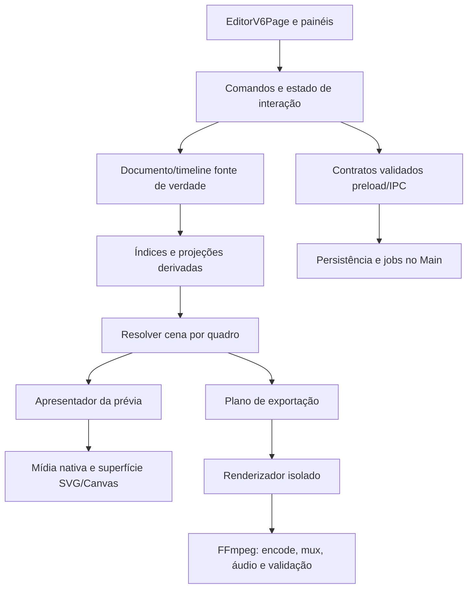

# Pesquisa Chromium para a refatoração do Editor V6

**Data:** 06/11/2026  
**Escopo:** pesquisa técnica para planejar uma refatoração ampla do Editor V6. Este documento orienta investigações e experimentos; não autoriza uma reescrita de uma vez, mudança de formato persistido ou troca do renderizador de produção.

## Síntese

O material do Chromium aponta para uma refatoração guiada por quatro ideias: etapas pequenas com contratos explícitos, atualização somente do que ficou inválido, isolamento do trabalho de alta frequência e medição de quadros reais. O Editor V6 já adota partes dessa direção: mantém a timeline virtualizada, publica o relógio de playback fora do estado amplo da página, compõe a prévia em `SceneSurface`, processa exportação em renderizadores separados e finaliza o MP4 pelo FFmpeg.

A principal oportunidade arquitetural é tornar essas fronteiras explícitas e testáveis. A página principal ainda coordena muitos casos de uso; prévia, timeline e exportação resolvem partes do documento por caminhos diferentes; e o ciclo de playback, as fontes de mídia e a apresentação de quadros precisam de contratos comuns de tempo e invalidação. A refatoração deve primeiro estabilizar um modelo de cena derivado e suas regras de invalidação. Só depois vale experimentar uma superfície de desenho diferente.

**Não se deve copiar a implementação interna do Chromium.** RenderingNG, Blink, Viz e VideoNG são arquitetura do navegador, não APIs que o Editor possa chamar. As referências servem para extrair princípios e usar ferramentas públicas, como Workers, OffscreenCanvas, WebCodecs e DevTools.

## Material pesquisado

Foram percorridas as áreas Chromium e DevTools do site Chrome for Developers: RenderingNG, arquitetura de renderização, estruturas de dados, VideoNG, WebCodecs, desempenho e diagnóstico visual. As páginas conceituais de RenderingNG e VideoNG descrevem arquitetura desenvolvida ao longo de vários anos; os princípios são úteis, mas não substituem a verificação das APIs presentes na versão do Electron embutida no aplicativo.

- [Chromium](https://developer.chrome.com/docs/chromium?hl=pt-br) — índice e subáreas do projeto.
- [RenderingNG](https://developer.chrome.com/docs/chromium/renderingng) — confiabilidade antes de desempenho escalável e extensibilidade; caching, isolamento e uso de hardware.
- [RenderingNG architecture](https://developer.chrome.com/docs/chromium/renderingng-architecture) — fluxo entre animação, estilo, layout, pintura, composição e apresentação; responsabilidades por thread.
- [Key data structures in RenderingNG](https://developer.chrome.com/docs/chromium/renderingng-data-structures) — árvores de propriedades, listas de pintura, fragmentos e quadros do compositor.
- [VideoNG](https://developer.chrome.com/docs/chromium/videong) — sincronização, seleção e entrega de quadros de vídeo e separação do pipeline geral de renderização.
- [Video processing with WebCodecs](https://developer.chrome.com/docs/web-platform/best-practices/webcodecs) — encoder/decoder assíncronos, Workers, transferência de frames, controle de fila e liberação de recursos.
- [Performance](https://developer.chrome.com/docs/modern-web-guidance/guides/performance/performance) — contenção e trabalho fora da área visível.
- [Performance features reference](https://developer.chrome.com/docs/devtools/performance/reference) e [Rendering tab](https://developer.chrome.com/docs/devtools/rendering) — frames perdidos, trilhas Main/GPU, pintura, camadas e estatísticas em tempo real.
- [Long Animation Frames API](https://developer.chrome.com/docs/web-platform/long-animation-frames) — diagnóstico de frames cuja execução prolongada afeta a responsividade.

## Estado observado no Editor V6

Este mapa é do código do checkout em que a pesquisa foi feita. Ele serve para localizar a refatoração; não é uma medição de desempenho.

| Área | Implementação atual | Implicação para a refatoração |
| --- | --- | --- |
| Composição da página | `EditorV6Page.tsx` contém aproximadamente 986 linhas e coordena seleção, comandos, hooks, painéis, playback, persistência, mídias e exportação. | Extrair fronteiras por responsabilidade e contrato. A contagem de linhas, sozinha, não define o que deve ser dividido. |
| Documento e timeline | Documento persistido e tipos compartilhados ficam em `src/shared/editorV6.ts`; timeline tem modelo e operações próprias. | Manter documento como fonte de verdade; cena renderizada deve ser uma projeção derivada, sem nova cópia persistida concorrente. |
| Relógio | `useEditorV6Playback` calcula o quadro lógico em `requestAnimationFrame`; durante a execução, atualiza o relógio externo e evita publicar estado React amplo a cada quadro. | Preservar o isolamento atual. Evitar reintroduzir re-renderização da página inteira a cada tick. |
| Prévia | `EditorV6PlaybackScene` resolve a cena por quadro e usa `SceneSurface`, uma superfície SVG com elementos visuais e camada de vídeo HTML. Composição facial assíncrona é aplicada quando necessária. | Separar resolução de cena, composição de assets e desenho. Preservar resposta imediata ao seek, seleção e arraste. |
| Timeline | `EditorV6Timeline.tsx` mantém apenas blocos e transições próximos à janela horizontal visível; as linhas de blocos são memoizadas. | Refatorar o índice e a geometria de viewport sem perder a virtualização já existente. |
| Vídeo e áudio | Prévia usa elementos HTML de vídeo/áudio, alinhados ao tempo do Editor com tolerâncias de seek/reprodução. | Formalizar a autoridade do relógio, as regras de seek, pausa e retomada e o que fazer quando a mídia ainda não está pronta. |
| Exportação | `exportWorker.tsx` (aproximadamente 684 linhas) roda numa janela/renderizador isolado, monta a cena por quadro e valida uma marca do quadro capturado. Main coordena os trabalhos, e `exportRunner.ts` envia quadros ao FFmpeg, junta, mixa e valida o arquivo. | Formalizar o protocolo produtor/consumidor, os limites de memória, cancelamento, progresso, erros e paridade entre prévia e exportação. |
| Diagnóstico | Há React Profiler, amostras de resolução da cena, long tasks, lacunas de playback e métricas detalhadas do exportador, com ativação opt-in. | Evoluir a instrumentação para responder a perguntas concretas de interação, sem registrar conteúdo privado de projetos. |

Locais principais: `src/renderer/src/features/editorV6/EditorV6Page.tsx`, `editorV6PlaybackClock.ts`, `useEditorV6Playback.ts`, `EditorV6PlaybackScene.tsx`, `SceneSurface.tsx`, `EditorV6Timeline.tsx`, `exportWorker.tsx`, `electron/domains/editorV6/exportWorkers.ts`, `exportRunner.ts` e `src/shared/editorV6.ts`.

## Princípios do Chromium aplicados ao Editor

### 1. Modelar etapas e invalidação, não um renderizador monolítico

RenderingNG descreve estágios distintos — animação, estilo/layout, pintura, rasterização, composição e desenho — e pula estágios quando a mudança não exige reexecutá-los. As estruturas intermediárias tornam explícito o que cada etapa consome e produz. Para o Editor, a tradução útil é um fluxo de dados do documento até a apresentação:

1. Documento/timeline imutáveis e comandos de edição.
2. Índices e snapshots derivados para a faixa e o intervalo de quadros consultado.
3. Resolução determinística do estado da cena no quadro solicitado.
4. Preparação de imagem, face, cabelo e vídeo, cada qual com identidade e ciclo de vida claros.
5. Apresentação na prévia ou produção de bitmap no exportador.

Uma alteração em cor, seleção ou playhead não deve reconstruir índices de timeline; uma alteração de asset não deve invalidar geometria de todos os elementos; um seek não deve provocar gravação do documento. Isso pede dependências explícitas e chaves de revisão por domínio, não flags globais de “cena suja”.

**Adaptação recomendada:** desenhar os contratos de entradas/saídas das etapas antes de mover código. Manter funções puras para resolução e planos de desenho sempre que possível. Separar mudanças de documento, estado transitório de interação e estado derivado de apresentação.

### 2. Isolar o trabalho de alta frequência e manter a entrada responsiva

Chromium separa tarefas da thread principal, compositor e mídia; a documentação destaca Workers e `OffscreenCanvas` para trabalho de renderização que possa sair da thread de interface. O Editor já possui Workers para etapas de movimento e renderizadores Electron isolados para exportar. A prioridade não é criar workers indiscriminadamente, mas impedir que tarefas de alta frequência bloqueiem comandos, arraste, seleção ou navegação.

**Adaptação recomendada:** manter relógio de playback e drag draft fora do documento salvo; publicar para React apenas os dados que realmente mudaram; deixar operações caras canceláveis e com limite de concorrência. Considerar mover composição de pixels para Worker/OffscreenCanvas somente quando ela puder ser expressa sem depender de DOM/React e a transferência não custar mais que o trabalho removido.

### 3. Desenhar somente o que está visível e invalidar localmente

RenderingNG usa invalidation, listas de pintura e rasterização por tiles; a orientação Web moderna recomenda `content-visibility` para subárvores fora da tela. No V6, a virtualização horizontal da timeline é um bom exemplo de trabalhar só na janela visível. A cena de prévia, por outro lado, precisa permanecer completa dentro de seu viewport fixo; aplicar `content-visibility` à superfície de cena poderia ocultar conteúdo que faz parte do quadro final.

**Adaptação recomendada:** estender índices de visibilidade para camadas de timeline e listas longas de assets/presets. Na cena, fazer culling por bounds somente para elementos comprovadamente fora do quadro e sem efeitos que cruzem esses limites. Recalcular bounds após transformações, rotação, crop, sombras/contornos e cabelo. Instrumentar falsos negativos visualmente; a regra de visibilidade deve ser testável com cenas sintéticas.

Não aplicar `will-change` ou promover cada elemento a camada. A composição por camadas tem custo de memória e pode piorar o desempenho quando usada em excesso; confirmar o ganho por trace e estatísticas de GPU antes de alterar CSS.

### 4. Tratar vídeo como fluxo de quadros com relógio, não como imagem da cena

VideoNG separa a apresentação de vídeo da pintura comum, escolhe quadros usando tempo de apresentação e relógio e procura reduzir cópias de pixel. O Editor já usa `<video>` na prévia e evita rasterizar vídeo dentro de cada atualização React. A sincronização atual corrige `currentTime` por limiares; ela é uma heurística de produto, não prova de sincronismo audiovisual perfeito.

**Adaptação recomendada:** definir um contrato de transporte de mídia com tempo de origem, intervalo, taxa de quadros, seek pendente, estado de decodificação e apresentação. Manter o elemento de vídeo nativo como candidato padrão. Avaliar callbacks de quadros apresentados, como `requestVideoFrameCallback`, apenas se suportados pela versão do Electron e se resolverem um defeito medido. Em seek, exigir seleção determinística do quadro de vídeo correspondente ao quadro do Editor.

O compositor não deve copiar vídeo para Canvas a cada frame sem uma necessidade demonstrada: isso pode adicionar readback/conversão e consumo de banda justamente no caminho que VideoNG mantém separado.

### 5. Usar WebCodecs como experimento de pipeline, não substituição direta do MP4

WebCodecs oferece codificação/decodificação assíncrona, frames transferíveis e `OffscreenCanvas`. A documentação pede verificar suporte com `isConfigSupported`, monitorar `encodeQueueSize`, aplicar backpressure e fechar `VideoFrame` quando não for mais necessário. Essas regras são relevantes se o V6 testar codificação dentro de Worker.

WebCodecs não constitui, por si só, o pipeline atual de MP4: o Editor precisa de H.264, composição de áudio, muxagem, validação de número/duração de quadros, cancelamento, recuperação, relatórios e compatibilidade com o FFmpeg empacotado. Uma troca exigiria ainda componente de muxagem e paridade com FFprobe. Portanto, manter FFmpeg como caminho de produção; testar WebCodecs num spike separado, com detecção de capacidade e fallback, sem mudar formato ou resultados publicados.

### 6. Medir quadros e causas antes de otimizar

O painel Performance do Chromium permite relacionar um quadro à atividade Main, GPU e raster, distinguir quadro parcial de quadro perdido, rever screenshots e localizar eventos de pintura. A aba Rendering ajuda a observar FPS, paint flashing, bordas de camadas e tiles. As próprias ferramentas podem afetar o tempo quando instrumentação avançada é ligada; traces diagnósticos não devem ser tratados como benchmark final.

O V6 já registra custo de commit React, resolução da cena, lacunas do relógio, long tasks e subfases de exportação. A pesquisa sugere uma matriz que conecte sintomas a dados:

| Pergunta | Evidência necessária |
| --- | --- |
| O arraste perdeu quadros por JavaScript ou pintura? | Trace Main, frames e pintura durante drag/resize. |
| O gargalo da prévia é resolução da cena ou desenho SVG? | Tempo puro de resolução versus trace/render stats do quadro apresentado. |
| O áudio/vídeo deriva durante playback? | Erro em milissegundos por tempo de apresentação, seek, pausa e retomada em mídias de teste. |
| Exportar é limitado por composição, readback ou FFmpeg? | Tempos por fase e por quadro, CPU/GPU, fila de quadros e pico de memória. |
| Uma mudança piora dispositivos modestos? | Medições em perfis de hardware distintos, não apenas o PC de desenvolvimento. |

Perfis avançados como screenshots por quadro e paint instrumentation devem ser usados para explicar uma diferença; as comparações oficiais devem usar a mesma fixture, resolução, FPS, estado de cache permitido e configuração de máquina.

## Arquitetura alvo para investigar

O diagrama propõe limites de dependência. Não prescreve uma hierarquia de diretórios nem uma reescrita completa.

Responsabilidades propostas:

- **Comandos/documento:** transações de edição, undo/redo, validação, autosave e flush. Documento permanece dono dos dados persistidos e das referências por ID.
- **Índices/projeções:** lookup de blocos por faixa/intervalo, bounds visíveis, assets necessários, planos de motion e assinaturas. São descartáveis e reconstruíveis a partir do documento.
- **Relógio/presentação:** um relógio do Editor para playhead; adaptadores de mídia para sincronizar os próprios clocks; regra explícita de seek, pausa, final e frame atrasado.
- **Prévia:** presenter que combina cena derivada, seleções/overlays transitórios e layers nativas de vídeo; sem regra de persistência ou exportação.
- **Exportação:** job imutável com snapshot, recursos resolvidos, progresso, cancelamento e erro tipado; renderer de quadro isolado e backend FFmpeg.
- **Telemetria:** diagnósticos opt-in com contagens e tempos agregados; caminhos, nomes, IDs e conteúdo de projeto não entram em traces compartilháveis.

## Sequência de refatoração e gates

### Fase 0 — Consolidar a baseline

Usar a [baseline publicada](baselines/native_gacha_nova_baseline_2026-11-05.md) e a [priorização pós-baseline](ZONA_GUERRA_PRIORIDADES_POS_BASELINE_2026-11-05.md) como ponto de partida. Inventariar contratos de persistência, eventos de edição e capturas já existentes; reproduzir cenários de prévia e timeline com fixtures sintéticas. Separar custos de interação, cena e exportação. Não abrir projetos pessoais como fixtures destrutivas.

**Gate:** cenário de referência reproduzível; visual de quadros conhecido; métricas por fase e consumo de memória disponíveis; testes existentes e contratos de dados documentados.

### Fase 1 — Extrair o núcleo de cena

Identificar o estado fonte de cada operação, extrair resolução de cena e seletores por faixa/quadro e remover regras duplicadas somente onde os contratos forem realmente os mesmos. Manter a superfície SVG e o exportador atuais.

**Gate:** mesma cena resolvida em todos os quadros de casos determinísticos, inclusive background, sobreposição, visibilidade, transições, personagens, expressões e mídia; nenhuma mudança de schema; exportação continua compatível.

### Fase 2 — Unificar tempo e invalidação da prévia

Isolar updates de playback, drag draft, seleção e documento. Medir commits, tempo de resolução, tempo até frame visível e sync de mídia. Introduzir invalidação fina com limites e chaves explícitos; preservar o relógio externo de alta frequência.

**Gate:** seek/drag/resize/undo/redo respondem corretamente; nenhum autosave provocado por tick; playback não aumenta re-renderizações gerais da página; sincronismo de mídia medido numa suíte fixa.

### Fase 3 — Clarificar a timeline

Separar geometria e consulta visível de eventos de pointer e apresentação dos blocos. Preservar range de viewport, snap, drag, resize, menus, acessibilidade e atalhos. Usar trace para confirmar a origem de layout/paint antes de adicionar CSS containment ou novos layers.

**Gate:** mesmos frames e regras de snap para fixtures; interação com muitas faixas/blocos; navegação de teclado; comparação de quadros, DOM e tempo de resposta.

### Fase 4 — Experimentos de renderização isolados

Prototipar composição Canvas/OffscreenCanvas e transferência de `ImageBitmap`/`VideoFrame` apenas para componentes que não dependem de DOM, com orçamento de memória e backpressure. Comparar o custo de desenho e cópia com a implementação atual. Prototipar WebCodecs separadamente do FFmpeg.

**Gate:** paridade de pixels (RGBA/BGRA e alpha), texto e fontes, crop/rotação, rosto/roupas/cabelo, layering, vídeo, áudio e emendas; estabilidade de memória e cancelamento; ganho A/B em mais de um perfil de hardware. Se não cumprir, o protótipo não entra na rota de produção.

### Fase 5 — Remover duplicação comprovada

Só depois de as rotas novas passarem todos os gates, remover a rota antiga. Manter persistência, IPC, IDs de projetos/assets e contratos entre Fabricador, Customizador, Studio e Editor V6 estáveis, salvo proposta separada com migração e rollback.

## Riscos e decisões que ficam em aberto

- **Versão do Chromium:** APIs disponíveis e comportamento de GPU variam com a versão do Electron e drivers. Detectar capacidade em runtime; não depender de flags privadas.
- **Paridade de texto e SVG:** desenho em Canvas/Skia pode divergir de SVG/DOM em fontes, antialiasing, filtros, clipping e alpha. A aparência do Editor é contrato funcional.
- **Memória:** frames 1080p e bitmaps transferidos são grandes; qualquer fila deve ser limitada, com descarte/fechamento explícito e contabilidade de bytes.
- **Cache:** chaves precisam conter todas as revisões visuais necessárias; memória deve ter limite e eviction. Esta pesquisa não propõe cache entre exportações.
- **Hardware:** GPU pode acelerar raster, mas upload/readback, composição e drivers podem anular o ganho ou reduzir estabilidade. Medir em CPU/GPU antes de ativar.
- **Produto e regressão:** a animação experimental dinâmica de cabelo continua exclusiva da exportação MP4; a prévia normal não ganha esse comportamento por causa da refatoração.
- **Escopo:** a pesquisa anterior de [alternativas de exportação](PESQUISA_SISTEMICA_MOTORES_E_EXPORT_2026-11-04.md) já trata motores e protótipos. Este documento complementa aquela pesquisa com arquitetura de renderização/tempo do Chromium; não deve criar uma segunda prioridade de benchmark incompatível.

## Referências locais relacionadas

- [Roadmap V4 do Editor V6](ROADMAP_V4_EXCELENCIA.md)
- [Prioridades após a baseline de 05/11](ZONA_GUERRA_PRIORIDADES_POS_BASELINE_2026-11-05.md)
- [Baseline Native Gacha Nova](baselines/native_gacha_nova_baseline_2026-11-05.md)
- [Pesquisa sistêmica de motores e exportação](PESQUISA_SISTEMICA_MOTORES_E_EXPORT_2026-11-04.md)
- [Testes de estresse offscreen](TESTES_DE_ESTRESSE_OFFSCREEN.md)

## Conclusão

A refatoração de maior valor não começa trocando SVG, React ou FFmpeg. Começa por separar fonte de verdade, projeções da cena, clock, apresentação e jobs de exportação; definir invalidação e identidade entre eles; então medir quais fases continuam caras. Isso segue a sequência de confiabilidade, desempenho escalável e extensibilidade vista no RenderingNG e usa as áreas do Chromium como referências de projeto — não como promessa de que uma API específica acelere o aplicativo.
