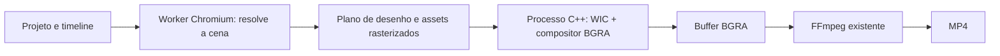

# Renderizador nativo em C++ do Editor V6

## Estado

Implementação experimental e opt-in. O editor, a resolução da timeline, a composição de rosto/cabelo e o FFmpeg permanecem os componentes de produção existentes. A nova opção substitui a captura/composição visual de cada quadro por um processo nativo isolado que recebe um plano de desenho e devolve pixels BGRA.

## Componentes

- `native/editor-v6-renderer/main.cpp`: processo Windows C++ que decodifica imagens via Windows Imaging Component (WIC), compõe camadas em BGRA premultiplicado e aceita imagens, recortes de atlas, flip horizontal, rotação, opacidade, contain, recorte de boca e retângulos sólidos.
- `electron/domains/editorV6/nativeRendererProcess.ts`: protocolo binário local via stdin/stdout, limites de tamanho, envio de assets uma vez por worker, cancelamento pelo fechamento do worker e validação do tamanho do quadro.
- `src/renderer/src/features/editorV6/editorV6NativeFramePlan.tsx`: converte a cena resolvida em comandos para o processo; assets de vídeo continuam tratados pelo pipeline de vídeo existente. Elementos de texto são rasterizados no Chromium e enviados como imagens.
- `exportWorkerFrameRenderer.ts`: escolhe o resultado BGRA nativo mantendo as mesmas interfaces de quadros e camadas consumidas pelo exportador/FFmpeg.
- `scripts/editor-v6/build-native-renderer.cjs` e `native/editor-v6-renderer/CMakeLists.txt`: compilação x64 Release com MSVC, Windows SDK e CMake.
- O empacotamento inclui o executável em `resources/native/editor-v6-native-renderer.exe`.

## Decisões e limites da experiência

O C++ é um processo separado, não uma biblioteca carregada dentro do Electron. Isso limita o impacto de falhas nativas sobre o processo principal e deixa o contrato de pixel explícito. O processo mantém assets decodificados apenas durante a vida de um worker, com limite de 512 MiB para esse cache; os buffers de quadro são temporários.

A primeira implementação não usa Skia nem aceleração GPU. Escolhemos WIC e rasterização CPU própria para evitar uma dependência grande e testar o contrato de cena/pixels com a toolchain já instalada. Isso não demonstra que seja a implementação mais rápida. Também não reproduz toda a semântica do Chromium/SVG/CSS: filtros, máscaras gerais, modos de mesclagem e outras construções não representadas no plano ainda não são cobertos. O texto passa pela rasterização Chromium. Projetos com esses recursos precisam de comparação visual antes de uso final.

### Próximos candidatos de renderização

- **Skia** é uma biblioteca 2D multiplataforma usada por vários produtos e tem APIs para transformações e rasterização de imagens. Pode ajudar se o projeto precisar manter uma camada gráfica portátil; exige, porém, integrar e distribuir uma dependência C++ grande e testar compatibilidade de pixels com o Chromium. [Documentação oficial do Skia](https://skia.org/docs/).
- **Direct2D** é a alternativa mais direta para esta build Windows: a Microsoft documenta desenho 2D imediato com aceleração de hardware e rasterizador de software de fallback, além de composição alpha. Isso pode remover o custo medido do laço de pixels CPU, mas ainda precisa provar transferência/readback eficiente para BGRA, estabilidade em máquinas sem GPU compatível e paridade visual. [Visão geral oficial do Direct2D](https://learn.microsoft.com/en-us/windows/win32/direct2d/direct2d-overview).
- **FFmpeg** continua recebendo quadros raw; o pipeline de raw video permite informar tamanho e pixel format na entrada, portanto o protocolo BGRA pode continuar sem trocar encoder. [Documentação oficial de formatos do FFmpeg](https://ffmpeg.org/ffmpeg-formats.html).

Com a medição atual, a próxima iteração deve comparar Direct2D e Skia sobre o mesmo fixture e contrato de pixel. A escolha deve depender da paridade, round-trip de um quadro Full HD, memória/readback e custo de empacotamento — não apenas da velocidade do desenho isolado.

A opção fica no painel como **Renderizador nativo em C++** e desmarcada por padrão. A descrição do controle informa que o modo é experimental. Não muda encoder, qualidade, resolução, FPS nem sincronização do áudio.

## Verificação reproduzível

- `npm run build:editor-v6:native`: compila o executável.
- `npm run test:editor-v6:native-renderer`: exercita formato BGRA, tamanho do quadro, recorte de atlas, alpha sobre e composição empilhada.
- `npm run test:editor-v6:export`: build completo e teste Electron; inclui renderização do mesmo quadro sintético em Chromium e C++, comparando erro médio absoluto de canal e diferenças de alpha.
- `npm run typecheck`: verifica os contratos TypeScript.

O teste de paridade é sintético e não substitui a revisão de cenas com assets reais, cabelo, boca, poses, expressões, balões e vídeos. No fixture sintético simples (uma imagem sobre fundo sólido), três comparações Full HD deram MAE máximo 0; a mediana do round-trip foi **178,5 ms no caminho C++** contra **82,4 ms no Chromium**, enquanto a rasterização nativa mediu 175,1 ms contra 36,2 ms de `capturePage`. Esse resultado local mostra que esta primeira rasterização CPU é mais lenta nesse caso. Não é uma medição de exportação de seis minutos nem permite generalizar para outras cenas/hardwares. A opção serve para experimentação e recuperação, não como recomendação de desempenho. O passo seguinte é otimizar com profiling (por exemplo, avaliar Skia ou Direct2D com o mesmo teste de fidelidade) e rodar o export A/B de projeto representativo, verificando quadros, áudio, tempo por etapa e RSS antes de ampliar suporte ou recomendar o modo.
